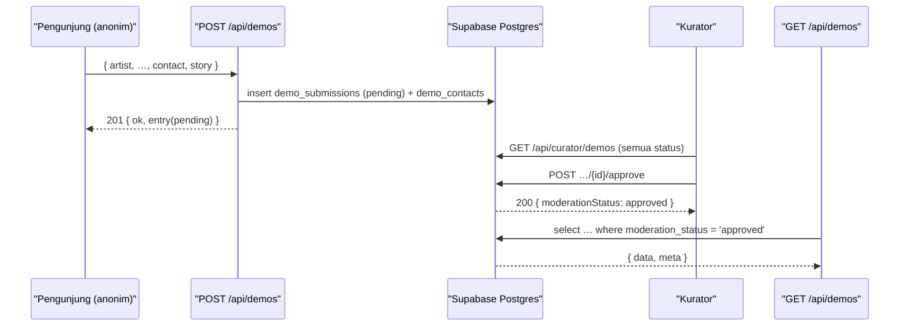

# API-CONTRACTS — Melodi Alam Web Platform

Dokumen ini adalah **kontrak antarmuka** platform web **Melodi Alam**: endpoint
yang benar-benar ada hari ini, celah yang terbukti dari kode, dan kontrak target
yang dibutuhkan stack terpilih (Payload CMS 3 di dalam app ini + Supabase).

Isi dipisahkan eksplisit menjadi dua keadaan, mengikuti `docs/ARCHITECTURE.md`
dan `docs/DATA-MODEL.md`:

- **Current State — `TERVERIFIKASI`.** Endpoint yang ada di repo `melodi-alam/`.
  Setiap method, field, cap, status code, dan pesan validasi dibaca langsung dari
  `app/api/demos/route.ts` dan `components/DemoPortal.tsx`.
- **Target State — `RENCANA`.** Kontrak yang dibutuhkan fase berikutnya
  (Payload CMS 3 + Supabase + moderated queue). Belum diimplementasikan; fase ini
  **DOCS ONLY** — tidak ada endpoint baru yang dibuat.

Label status: `TERVERIFIKASI` (dibaca di kode), `RENCANA` (direncanakan),
`ASUMSI` (diasumsikan), `[PERLU VERIFIKASI]` (tidak dapat dikonfirmasi dari sumber).

Acuan keputusan: **ADR-0002** (Payload 3 in-app + Supabase), **ADR-0003**
(Supabase = Postgres + Storage), **ADR-0005** (moderated demo queue). Acuan
requirement: `BR-001` (batas berkas audio + tipe berkas), `RISK-001` (kontrol
penyalahgunaan / abuse). Acuan skema data: `docs/DATA-MODEL.md`.

> Catatan cakupan. Hanya **satu** route handler yang ada di repo:
> `app/api/demos/route.ts` (method `GET` dan `POST`). Semua endpoint lain di
> dokumen ini diberi label `RENCANA` dan **tidak diklaim ada**.

---

## 1. API Context

### 1.1 Konsumen

| Kode | Konsumen | Kebutuhan | Status |
|---|---|---|---|
| `C1` | `components/DemoPortal.tsx` (client component, layar `/submit`) | Mengirim satu submission via `POST /api/demos`, membaca `errors` per-field dan `error` banner | `TERVERIFIKASI` |
| `C2` | Antrean publik *Incoming Demo Queue* di layar `/submit` | Hari ini **di-seed dari `SEED_DEMOS` lokal**, tidak memanggil `GET /api/demos` | `TERVERIFIKASI` |
| `C3` | Kurator/editor (non-teknis) | Meninjau submission, menyetujui/menolak, membaca kontak artis | `RENCANA` (ADR-0005) |
| `C4` | Halaman editorial (Journal, Videos) | Membaca artikel dan sesi video dari CMS | `RENCANA` (ADR-0002) |

Temuan penting `TERVERIFIKASI`: meski `GET /api/demos` ada, **tidak ada konsumen
yang memanggilnya**. `DemoPortal` menginisialisasi state dengan `SEED_DEMOS`
langsung dan hanya menambahkan entri dari respons `POST`. Konsekuensinya,
mengubah bentuk `GET` tidak memecahkan klien yang sudah dikirim — lihat §9.

### 1.2 Gaya antarmuka

| Aspek | Nilai | Status |
|---|---|---|
| Gaya hari ini | REST, JSON, route handler Next.js App Router | `TERVERIFIKASI` |
| Gaya target | REST untuk aksi domain (submit, moderasi) + **Payload REST/GraphQL** untuk koleksi editorial | `RENCANA` (ADR-0002) |
| Format body | JSON (`application/json`) | `TERVERIFIKASI` |
| Basis URL dev | `http://localhost:3100` (port sengaja bukan 3000) | `TERVERIFIKASI` (`package.json`) |
| Versi kontrak | Belum berversi; tidak ada prefix `/v1` | `TERVERIFIKASI` |

### 1.3 Model autentikasi

| Fase | Model | Status |
|---|---|---|
| Hari ini | **Tidak ada autentikasi apa pun.** `GET` dan `POST /api/demos` terbuka | `TERVERIFIKASI` |
| Target | Submission publik tetap anonim; aksi kurator butuh sesi kurator (role `curator`) | `RENCANA` (ADR-0002, ADR-0005) |

Bentuk persis kredensial kurator (cookie sesi Payload vs Bearer JWT) dan sumber
klaim `role` adalah `[PERLU VERIFIKASI]` — mengikuti `docs/DATA-MODEL.md` §10.
Kontrak ini mendokumentasikan **persyaratan** (operation harus menolak non-kurator),
bukan mekanisme token spesifik.

### 1.4 Asumsi

- `ASUMSI` — Dev server dijalankan tanpa environment variable (brief §3). Kontrak
  target yang butuh koneksi Supabase/Payload akan memperkenalkannya sendiri.
- `ASUMSI` — Payload 3 mengekspos koleksi di bawah `/api`; detail rute persis
  `[PERLU VERIFIKASI]` (§7.4). Potensi bentrok catch-all Payload dengan
  `/api/demos` dicatat di Open Questions.
- `ASUMSI` — Volume submit rendah (kurator 1–3 orang, `docs/DATA-MODEL.md`),
  sehingga batas rate dipilih longgar (§8).

---

## 2. Konvensi

Konvensi di §2.1–§2.3 berlaku hari ini (`TERVERIFIKASI`). §2.4–§2.8 adalah target.

### 2.1 Format data (`TERVERIFIKASI`)

| Data | Konvensi | Sumber |
|---|---|---|
| ID submission | `demo-<Date.now base36>-<6 char base36 acak>`; seed memakai `seed-<slug>` | `route.ts` `id()` |
| Tanggal submit | **Date-only** `YYYY-MM-DD` (UTC), dari `new Date().toISOString().slice(0,10)` | `route.ts` |
| Field teks | Di-`trim()` lalu `slice()` ke cap; non-string dipetakan ke `""` | `route.ts` `str()` |
| Enum `genre`/`program` | Closed set `as const` dari `lib/content.ts` | `route.ts` |
| Casing JSON key | `camelCase` | `route.ts` |
| `null` vs absen | Tidak ada field opsional bersifat `null` di kode hari ini; field yang tak dikirim menjadi `""` setelah `str()` | `route.ts` |

### 2.2 Batas payload dan cap field (`TERVERIFIKASI`)

`str(value, max = 500)` — default cap 500, tiap field punya cap eksplisit:

| Field | Cap karakter | Wajib? |
|---|---|---|
| `artist` | 120 | Ya |
| `city` | 80 | Ya |
| `title` | 160 | Ya |
| `genre` | 60 | Tidak (validasi kondisional) |
| `program` | 80 | Tidak (validasi kondisional) |
| `link` | 500 | Ya |
| `contact` | 160 | Ya |
| `story` | 2000 | Ya |

Pemotongan **diam-diam** (tanpa error): nilai lebih panjang dipotong, bukan
ditolak. Cap ini dijalankan **sebelum** validasi wajib, sehingga field 700
karakter yang valid tetap lolos.

### 2.3 Status code hari ini (`TERVERIFIKASI`)

| Status | Kapan | Body |
|---|---|---|
| `200` | `GET /api/demos` selalu | `{ queue, count }` |
| `201` | `POST` sukses | `{ ok, entry, queueLength, note }` |
| `400` | Body `POST` bukan JSON valid | `{ error }` |
| `422` | Validasi field gagal | `{ error, errors }` |

Untuk `PUT`/`DELETE`/`PATCH` pada `/api/demos` (tidak diekspor): `ASUMSI` —
Next.js mengembalikan `405` secara otomatis, tetapi **body dan `Allow`-header
tidak dikendalikan oleh kode ini**; tidak diklaim di sini (`[PERLU VERIFIKASI]`).
Tidak ada penanganan error tak terduga (`500`) eksplisit di route.

### 2.4 Format data target (`RENCANA`)

- Timestamp: ISO 8601 **dengan timezone** (`2026-10-14T09:30:00Z`) untuk
  `reviewedAt`/`createdAt`; `submittedAt` tetap date-only untuk kompatibilitas UI.
- ID target: `uuid` internal (tidak diekspos), plus `publicRef` (string lama)
  yang tetap dipakai publik — lihat `docs/DATA-MODEL.md` §4.3.
- Enum: `moderationStatus ∈ {pending, approved, rejected}` (ADR-0005).

### 2.5 Paginasi target (`RENCANA`)

Offset-based, dengan amplop seragam. **Setiap daftar tak terbatas wajib
berpaginasi** — ini salah satu celah yang diperbaiki (§3).

| Param | Default | Batas | Keterangan |
|---|---|---|---|
| `page` | `1` | ≥ 1 | Halaman 1-based |
| `limit` | `20` | 1–100 | Di atas 100 dijepit ke 100 |

Amplop respons daftar:

```json
{
  "data": [],
  "meta": { "page": 1, "limit": 20, "total": 42, "totalPages": 3 }
}
```

`ASUMSI` — offset dipilih (bukan cursor) karena volume rendah dan UI butuh nomor
halaman; cursor tidak diperlukan bukti apa pun saat ini.

### 2.6 Filter, sortir, pencarian target (`RENCANA`)

`GET /api/demos` menerima `city`, `genre`, `program`, `q` (pencarian substring
`artist`/`title`), dan `sort` (`submittedAt:desc` default). Semua opsional.

### 2.7 Error envelope target (`RENCANA`)

Satu amplop untuk semua endpoint baru, backward-compatible terhadap `{ error,
errors }` (detail di §6).

### 2.8 Idempotensi, rate limit, dan batas payload target (`RENCANA`)

Header `Idempotency-Key` untuk `POST` (aman retry), rate limit per-IP, dan batas
unggahan audio 25 MB. Detail di §8.

---

## 3. Inventaris Operasi

Kolom **Fase**: `TERVERIFIKASI` = ada di kode hari ini; `RENCANA` = target.

| ID | Method & Path | Tujuan | Auth | Requirement/Layar | Fase |
|---|---|---|---|---|---|
| `API-01` | `GET /api/demos` | Baca seluruh antrean demo (array in-memory) | Tidak ada | Layar `/submit` (klien tidak memanggilnya) | `TERVERIFIKASI` |
| `API-02` | `POST /api/demos` | Kirim satu submission demo | Tidak ada | Form `/submit` (`DemoPortal`) | `TERVERIFIKASI` |
| `API-03` | `POST /api/demos` | Tulis submission sebagai `pending` (privat) | Tidak ada (publik) | `/submit`; ADR-0005 | `RENCANA` |
| `API-04` | `GET /api/demos` | Baca antrean **approved-only**, terpaginasi | Tidak ada (publik) | Incoming Demo Queue; ADR-0005 | `RENCANA` |
| `API-05` | `GET /api/curator/demos` | Kurator membaca seluruh antrean + PII terpisah | Kurator | Moderasi; ADR-0005 | `RENCANA` |
| `API-06` | `GET /api/curator/demos/{id}/contact` | Kurator membaca kontak artis (PII) | Kurator | Menghubungi artis; ADR-0005 | `RENCANA` |
| `API-07` | `POST /api/curator/demos/{id}/approve` | Setujui submission → tampil publik | Kurator | ADR-0005 | `RENCANA` |
| `API-08` | `POST /api/curator/demos/{id}/reject` | Tolak submission + catatan | Kurator | ADR-0005 | `RENCANA` |
| `API-09` | `GET/POST/PATCH/DELETE /api/articles…` | CRUD artikel via Payload REST | Kurator (tulis) / publik (baca) | Journal; ADR-0002 | `RENCANA` |
| `API-10` | `GET/POST/PATCH/DELETE /api/videos…` | CRUD sesi video via Payload REST | Kurator (tulis) / publik (baca) | Watch; ADR-0002 | `RENCANA` |
| `API-11` | `POST /api/graphql` | GraphQL Payload (query + mutation) | Publik (baca) / kurator (tulis) | Editorial; ADR-0002 | `RENCANA` |

---

## 4. Spesifikasi Operasi — Current State (`TERVERIFIKASI`)

### 4.1 `API-01` — `GET /api/demos`

| Properti | Nilai |
|---|---|
| Tujuan | Membaca seluruh isi antrean demo |
| Method & path | `GET /api/demos` |
| Auth | Tidak ada; terbuka publik |
| Parameter | **Tidak ada.** Tidak ada query, header, atau paginasi |
| Efek samping | Tidak ada |
| Cache | Tidak ada header cache eksplisit (`ASUMSI` default Next) |

**Kode referensi** (`app/api/demos/route.ts`):

```ts
export async function GET() {
  return NextResponse.json({ queue, count: queue.length });
}
```

**Respons sukses — `200`** (`application/json`):

```json
{
  "queue": [ /* DemoSubmission[] */ ],
  "count": 3
}
```

- `queue`: seluruh array modul, **termasuk 3 seed** dari `SEED_DEMOS`, urut
  terbaru-dulu (entri baru di-`unshift`).
- `count`: `queue.length` — jumlah elemen, bukan jumlah approved.
- **Tidak ada status error.** Route ini tidak dapat mengembalikan `4xx`/`5xx`
  dari logikanya sendiri.

**Celah `TERVERIFIKASI` (dibuktikan dari kode):**

1. **Store proses-lokal.** `const queue: DemoSubmission[] = [...SEED_DEMOS];`
   adalah array di level modul. Isinya hidup selama satu proses Node dan
   **reset saat restart**. Ini bukan database.
2. **Tidak konsisten antar-instance.** Di Vercel (multi-instance/serverless),
   `GET` bergantung pada instance yang melayani request (`ASUMSI` — dicatat juga
   di `docs/ARCHITECTURE.md` §8.3).
3. **Tanpa paginasi.** Mengembalikan **seluruh** antrean tanpa batas.
4. **Tanpa filter/sortir/pencarian.** Tidak ada parameter `city`, `genre`, `q`.
5. **Tanpa autentikasi dan tanpa rate limit.**
6. **Antrean tidak dimoderasi.** Semua entri yang pernah di-`POST` langsung
   tampil; belum ada konsep approved-only (akan diperbaiki `API-04`, ADR-0005).

**Contoh respons** (bentuk entry dari `SEED_DEMOS[0]`):

```json
{
  "queue": [
    {
      "id": "seed-shroomeater",
      "artist": "Shroomeater",
      "city": "Bogor",
      "title": "Echoes in the Pine Forest",
      "genre": "Alternative Rock / Shoegaze",
      "program": "Live at Melodi Samsara",
      "link": "https://www.instagram.com/melodi.alam/",
      "story": "Direkam secara live di studio kecil kawasan Baranangsiang, terinspirasi kabut sore Kota Bogor.",
      "status": "SELECTED FOR SAMSARA LIVE",
      "submittedAt": "2026-10-12"
    }
  ],
  "count": 3
}
```

### 4.2 `API-02` — `POST /api/demos`

| Properti | Nilai |
|---|---|
| Tujuan | Menerima satu submission demo dari form `/submit` |
| Method & path | `POST /api/demos` |
| Auth | Tidak ada; terbuka publik |
| Content-Type | `application/json` (yang dikirim klien) |
| Efek samping | `queue.unshift(entry)` — memutasi array proses-lokal |
| Idempotensi | **Tidak ada.** Retry menghasilkan entri ganda (`RISK-001`, §8) |

**Request body** — 8 field, semuanya opsional di tipe (`Payload`), tetapi 6
wajib setelah validasi:

```json
{
  "artist": "Skyline",
  "city": "Bandung",
  "title": "Senja di Jalan Braga",
  "genre": "Indie Pop / Folk",
  "program": "Review Artikel dan Rekomendasi IG",
  "link": "https://open.spotify.com/example",
  "contact": "manager@example.test",
  "story": "Single kedua dari EP mendatang."
}
```

**Pipeline server** (`route.ts`, urut persis):

1. `await request.json()`. Jika gagal parse → `400` (langkah 2 dilewati).
2. `str()` per field: `trim()` + `slice(0, cap)`. Non-string → `""`.
3. Bangun `errors` objek per-field (urutan kode: `artist`, `city`, `title`,
   `story`, `contact`, `link`, lalu `genre`, `program`).
4. Jika `errors` tidak kosong → `422`.
5. Susun `entry`, `unshift` ke `queue`, kembalikan `201`.

**Validasi `TERVERIFIKASI` (pesan persis, huruf demi huruf):**

| Field | Kondisi gagal | Pesan `errors[field]` |
|---|---|---|
| `artist` | kosong setelah trim | `Nama band atau solois wajib diisi.` |
| `city` | kosong setelah trim | `Kota asal wajib diisi.` |
| `title` | kosong setelah trim | `Judul lagu atau EP wajib diisi.` |
| `story` | kosong setelah trim | `Cerita singkat wajib diisi.` |
| `contact` | kosong setelah trim | `Kontak manajer wajib diisi.` |
| `link` | kosong setelah trim | `Link streaming atau EPK wajib diisi.` |
| `link` | tidak cocok `/^https?:\/\/.+/i` (dan tak kosong) | `Link harus diawali http:// atau https://.` |
| `genre` | non-kosong **dan** di luar `DEMO_GENRES` | `Genre tidak dikenal.` |
| `program` | non-kosong **dan** di luar `DEMO_PROGRAMS` | `Program tujuan tidak dikenal.` |

Catatan validasi yang harus dibaca konsumen:

- **`genre`/`program` kondisional.** Nilai kosong **lolos** server (cek hanya
  `if (genre && …)`). Hanya `<select>` di UI yang selalu mengirim nilai default
  (`DEMO_GENRES[0]` / `DEMO_PROGRAMS[0]`). Jadi `{}` (semua kosong) menghasilkan
  error untuk 6 field wajib, **bukan** untuk `genre`/`program`.
- **Regex `link` ketat.** `/^https?:\/\/.+/i` mensyaratkan minimal satu karakter
  setelah `//`; `"https://"` saja **gagal**. Skema selain `http`/`https` gagal.
- **Cap dijalankan lebih dulu.** Field 700 karakter tidak memicu error panjang,
  hanya terpotong.
- **Tidak ada validasi tipe.** Angka/`null`/objek untuk field string menjadi
  `""` lewat `str()`, lalu jatuh ke error "wajib diisi" bila field itu wajib.

**Error `400`** — body bukan JSON valid:

```json
{ "error": "Body harus berupa JSON." }
```

**Error `422`** — `errors` hanya memuat field yang gagal:

```json
{
  "error": "Periksa kembali isian formulir.",
  "errors": {
    "artist": "Nama band atau solois wajib diisi.",
    "link": "Link harus diawali http:// atau https://."
  }
}
```

**Sukses `201`:**

```json
{
  "ok": true,
  "entry": {
    "id": "demo-m2x1ab-k9f3zq",
    "artist": "Skyline",
    "city": "Bandung",
    "title": "Senja di Jalan Braga",
    "genre": "Indie Pop / Folk",
    "program": "Review Artikel dan Rekomendasi IG",
    "link": "https://open.spotify.com/example",
    "story": "Single kedua dari EP mendatang.",
    "status": "NEW SUBMISSION • JUST NOW",
    "submittedAt": "2026-10-14"
  },
  "queueLength": 4,
  "note": "Kontak manajer (manager@example.test) dicatat terpisah dan tidak tampil di daftar publik."
}
```

Field respons sukses:

| Field | Tipe | Catatan |
|---|---|---|
| `ok` | `boolean` | Selalu `true` |
| `entry` | `DemoSubmission` | Objek yang di-`unshift` |
| `queueLength` | `number` | `queue.length` **setelah** unshift |
| `note` | `string` | Mengandung **nilai `contact` mentah** |

`entry.status` selalu `"NEW SUBMISSION • JUST NOW"` (string bebas, bukan enum).
`entry.submittedAt` date-only UTC.

**Celah `TERVERIFIKASI` (dibuktikan dari kode):**

1. **`contact` tidak dipersistensi.** Nilai ini hanya muncul kembali di string
   `note` pada respons `201`. Tidak ada kolom untuk menyimpannya di `entry`.
   Artinya: tidak ada PII at rest hari ini, tetapi **juga tidak ada cara kurator
   menghubungi artis**. `note` sebenarnya adalah satu-satunya jalur nilai kontak
   keluar dari server — dan itu memantulkannya kepada pengirim sendiri.
2. **Tidak ada autentikasi** pada operasi tulis publik.
3. **Tidak ada rate limiting** — `RISK-001` (`ASUMSI`: spam flood membanjiri array).
4. **Tidak ada idempotensi** — retry jaringan menghasilkan duplikat.
5. **File audio tidak pernah dikirim ke server.** `DemoPortal.onPickAudio` hanya
   `URL.createObjectURL(file)`; `POST` mengirim JSON teks, bukan `multipart`.
   Tidak ada unggahan, tidak ada validasi ukuran/tipe di server (target:
   `API-03` + §8, `BR-001`).
6. **Klien memakai ulang entri pending secara optimistis.** `DemoPortal`
   menambahkan `data.entry` ke state queue lokalnya, jadi entri akan tampil
   meski (di target) belum approved — lihat §7.2 catatan kompatibilitas.

---

## 5. Spesifikasi Operasi — Target State (`RENCANA`)

Semua di §5 adalah `RENCANA`. Tidak ada yang diimplementasikan pada fase ini.
Rute eksak Payload (`API-09`…`API-11`) adalah `[PERLU VERIFIKASI]`.

### 5.1 `API-03` — `POST /api/demos` (tulis, privat)

| Properti | Nilai |
|---|---|
| Tujuan | Menyimpan submission sebagai `pending` → tidak tampil publik sampai disetujui (ADR-0005) |
| Method & path | `POST /api/demos` (path **tidak berubah**) |
| Auth | Tidak ada (pengunjung anonim). Ditulis lewat server, bukan browser→Supabase |
| Idempotensi | Header `Idempotency-Key` (§8.1) |
| Rate limit | Per-IP (§8.2) |
| Efek samping | `insert` transaksional ke `demo_submissions` + `demo_contacts` (`docs/DATA-MODEL.md` §8.3); opsional unggah audio ke Storage |

**Request body** — bentuk lama dipertahankan persis (8 field JSON) agar
`DemoPortal` tidak berubah:

```json
{
  "artist": "Skyline", "city": "Bandung", "title": "Senja di Jalan Braga",
  "genre": "Indie Pop / Folk", "program": "Review Artikel dan Rekomendasi IG",
  "link": "https://open.spotify.com/example",
  "contact": "manager@example.test",
  "story": "Single kedua dari EP mendatang."
}
```

**Prasyarat unggahan audio (`RENCANA`, `BR-001`).** Karena file tidak dapat
dikirim sebagai JSON, ditetapkan salah satu (keputusan terbuka, Open Questions):

- `POST /api/demos/uploads` → keluarkan signed upload URL Supabase, diikuti
  `PUT` objek oleh klien; `objectPath` lalu dirujuk di `POST /api/demos`; **atau**
- `POST /api/demos` menerima `multipart/form-data` (field JSON + file).

Validasi audio target: tipe di allowlist (`audio/mpeg`, `audio/wav`,
`audio/x-wav`, `audio/mp4`, `audio/aac`, `audio/ogg`, `audio/flac`) → jika di luar
itu `415`; ukuran ≤ **26214400 byte (25 MB)** → jika lebih `413`.

**Validasi field:** identik dengan §4.2 **plus** pengetatan `genre`/`program`
menjadi wajib (`docs/DATA-MODEL.md` §4.3). Pengetatan ini adalah perubahan
perilaku — Open Questions.

**Sukses `201`** (bentuk lama, `contact` **tidak** lagi di-echo di `note`):

```json
{
  "ok": true,
  "entry": {
    "publicRef": "demo-m2x1ab-k9f3zq",
    "artist": "Skyline", "city": "Bandung", "title": "Senja di Jalan Braga",
    "genre": "Indie Pop / Folk", "program": "Review Artikel dan Rekomendasi IG",
    "link": "https://open.spotify.com/example",
    "story": "Single kedua dari EP mendatang.",
    "moderationStatus": "pending",
    "submittedAt": "2026-10-14"
  },
  "queueLength": 42,
  "note": "Demo Anda masuk antrean kurasi. Kontak tersimpan privat untuk redaksi."
}
```

**Error:** `400` (JSON cacat), `415` (tipe audio), `413` (audio > 25 MB),
`422` (`{ error, errors }`), `429` (rate limit), `409` (idempotency konflik) —
amplop di §6.

> Catatan kompatibilitas `RENCANA`. Klien saat ini menambahkan `entry` dari
> respons `POST` ke antrean lokal yang tampil publik. Karena entri itu kini
> `pending`, klien **harus** berhenti memperlakukannya sebagai baris publik — atau
> baris pending ditandai dan tidak dihitung sebagai bagian `Incoming Demo Queue`.
> Perubahan ini menyentuh `DemoPortal.tsx` dan harus direncanakan di
> `FRONTEND-PLAN.md`.

### 5.2 `API-04` — `GET /api/demos` (publik, approved-only, terpaginasi)

| Properti | Nilai |
|---|---|
| Tujuan | Antrean publik *Incoming Demo Queue*: hanya baris `approved` (ADR-0005) |
| Method & path | `GET /api/demos` (path tidak berubah; **bentuk respons berubah**) |
| Auth | Tidak ada (publik) |
| Query | `page`, `limit`, `city`, `genre`, `program`, `q`, `sort` (§2.5, §2.6) |
| PII | **Tidak pernah** memuat `contact` — query publik secara struktural hanya membaca tabel tanpa kolom PII (`docs/DATA-MODEL.md` §8.4) |

**Query contoh:**

```
GET /api/demos?page=1&limit=20&city=Bogor&sort=submittedAt:desc
```

**Respons `200`:**

```json
{
  "data": [
    {
      "publicRef": "seed-shroomeater",
      "artist": "Shroomeater", "city": "Bogor",
      "title": "Echoes in the Pine Forest",
      "genre": "Alternative Rock / Shoegaze",
      "program": "Live at Melodi Samsara",
      "link": "https://www.instagram.com/melodi.alam/",
      "story": "Direkam secara live di studio kecil kawasan Baranangsiang…",
      "moderationStatus": "approved",
      "submittedAt": "2026-10-12"
    }
  ],
  "meta": { "page": 1, "limit": 20, "total": 1, "totalPages": 1 }
}
```

**Error:** `400` (param paginasi tidak valid), `422` (`city`/`genre`/`program`
di luar nilai yang dikenal). Tidak ada `404` pada path koleksi.

`ASUMSI` — perubahan dari `{ queue, count }` menjadi `{ data, meta }` **bukan**
breaking change bagi klien yang dikirim, karena tidak ada konsumen yang memanggil
`GET` (§1.1). Konsumen eksternal hipotetis butuh versi baru — lihat §9.

### 5.3 `API-05` — `GET /api/curator/demos`

| Properti | Nilai |
|---|---|
| Tujuan | Kurator membaca **seluruh** antrean (semua `moderationStatus`) |
| Method & path | `GET /api/curator/demos` |
| Auth | **Wajib.** Role `curator` |
| Query | `page`, `limit`, `moderationStatus`, `city`, `genre`, `q`, `sort` |
| PII | Tidak memuat `contact`; PII diambil terpisah (`API-06`) |

**Respons `200`:**

```json
{
  "data": [
    {
      "id": "3f9c…", "publicRef": "demo-m2x1ab-k9f3zq",
      "artist": "Skyline", "city": "Bandung", "title": "Senja di Jalan Braga",
      "genre": "Indie Pop / Folk", "program": "Review Artikel dan Rekomendasi IG",
      "link": "https://open.spotify.com/example",
      "story": "Single kedua dari EP mendatang.",
      "moderationStatus": "pending",
      "submittedAt": "2026-10-14",
      "reviewedBy": null, "reviewedAt": null, "reviewNote": null,
      "hasContact": true, "hasAudio": true
    }
  ],
  "meta": { "page": 1, "limit": 20, "total": 1, "totalPages": 1 }
}
```

**Error:** `401` (tanpa sesi), `403` (bukan kurator).

`hasContact`/`hasAudio` sengaja boolean, bukan nilai PII — supaya daftar kurator
dapat menandai baris tanpa pernah mengangkut kontak.

### 5.4 `API-06` — `GET /api/curator/demos/{id}/contact`

| Properti | Nilai |
|---|---|
| Tujuan | Kurator mengambil kontak artis untuk menghubungi (mengisi celah §4.2) |
| Method & path | `GET /api/curator/demos/{id}/contact` |
| Auth | **Wajib.** Role `curator` |
| Path param | `id` — id internal submission (uuid) |
| Audit | `ASUMSI` — setiap pembacaan sebaiknya tercatat (PII) |

**Respons `200`:**

```json
{ "submissionId": "3f9c…", "contact": "manager@example.test",
  "createdAt": "2026-10-14T09:30:00Z" }
```

**Error:** `401`, `403`, `404` (submission tidak ada / tidak punya kontak).
Tidak ada `contact` yang boleh muncul di `API-04` atau `API-05`.

### 5.5 `API-07` — `POST /api/curator/demos/{id}/approve`

| Properti | Nilai |
|---|---|
| Tujuan | Setujui submission → tampil di read path publik (ADR-0005) |
| Method & path | `POST /api/curator/demos/{id}/approve` (aksi non-CRUD eksplisit) |
| Auth | **Wajib.** Role `curator` |
| Transisi | `pending` → `approved`; isi `reviewedBy`, `reviewedAt` |
| Idempotensi | Idempoten secara alami: approve ulang baris yang sudah `approved` → `200` (bukan `409`) |

**Request body (opsional):** `{ "reviewNote": "Live at Melodi Samsara — Rabu." }`

**Respons `200`:**

```json
{ "id": "3f9c…", "publicRef": "demo-m2x1ab-k9f3zq",
  "moderationStatus": "approved", "reviewedBy": "u_12",
  "reviewedAt": "2026-10-14T10:00:00Z", "reviewNote": "Live at Melodi Samsara — Rabu." }
```

**Error:** `401`, `403`, `404`, `409` (transisi ilegal, mis. dari `rejected`),
`422` (`reviewNote` terlalu panjang).

### 5.6 `API-08` — `POST /api/curator/demos/{id}/reject`

| Properti | Nilai |
|---|---|
| Tujuan | Tolak submission; tidak pernah tampil publik |
| Method & path | `POST /api/curator/demos/{id}/reject` |
| Auth | **Wajib.** Role `curator` |
| Transisi | `pending` → `rejected`; isi `reviewedBy`, `reviewedAt`, `reviewNote` |

**Request body:** `{ "reviewNote": "Belum sesuai format demo." }` (`reviewNote`
disarankan wajib untuk jejak audit — Open Questions).

**Respons `200`:** sama bentuknya dengan `API-07`, `moderationStatus: "rejected"`.

**Error:** `401`, `403`, `404`, `409`, `422`.



### 5.7 `API-09`/`API-10` — Payload REST untuk `articles` dan `videos`

`RENCANA` (ADR-0002). Payload 3 dalam app ini mengekspos setiap koleksi sebagai
resource REST. **Slug koleksi dan rute persis `[PERLU VERIFIKASI]`** terhadap
versi Payload yang dipasang.

| Operasi | Method & path (default Payload) | Auth | Catatan |
|---|---|---|---|
| List artikel | `GET /api/articles` | Publik (baca) | Payload menambah `where`, `limit`, `page`, `sort`, `depth` |
| Baca satu | `GET /api/articles/{id}` | Publik (baca) | `id` = id Payload, bukan `slug` |
| Buat | `POST /api/articles` | Kurator | Kontrol akses di level collection Payload |
| Ubah | `PATCH /api/articles/{id}` | Kurator | |
| Hapus | `DELETE /api/articles/{id}` | Kurator | |
| List sesi video | `GET /api/videos` | Publik (baca) | Slug `videos` vs `video-sessions` `[PERLU VERIFIKASI]` |

**Bentuk respons Payload** (list) — khas Payload, bukan amplop §2.5:

```json
{
  "docs": [ { "id": "…", "slug": "…", "title": "…" } ],
  "totalDocs": 12, "limit": 10, "totalPages": 2, "page": 1,
  "pagingCounter": 1, "hasPrevPage": false, "hasNextPage": true,
  "prevPage": null, "nextPage": 2
}
```

Konsekuensi kontrak: **dua gaya paginasi hidup berdampingan** — amplop
`{ data, meta }` untuk aksi domain (`API-03`…`API-08`) dan gaya Payload
`{ docs, totalDocs, … }` untuk koleksi editorial (`API-09`…`API-11`). Ini
disengaja: memaksa amplop seragam berarti membungkus Payload. Trade-off dicatat
di Open Questions; `FRONTEND-PLAN.md` harus memilih satu konsumsi per layar.

Endpoint `POST`/`PATCH`/`DELETE` Payload adalah permukaan CMS, bukan API domain
publik; akses tulis wajib dijaga access control collection Payload (ADR-0002,
`docs/DATA-MODEL.md` §10).

### 5.8 `API-11` — GraphQL Payload

`RENCANA`. Payload menyediakan satu endpoint GraphQL untuk query dan mutation
koleksi yang sama.

| Properti | Nilai |
|---|---|
| Method & path (default) | `POST /api/graphql` `[PERLU VERIFIKASI]` |
| Auth | Publik (query baca) / kurator (mutation) via access control Payload |
| Bentuk | Query/mutation SDL digenerate dari definisi koleksi |

Contoh query:

```graphql
query LatestArticles {
  Articles(limit: 10, sort: "-publishedAt") {
    docs { id slug title excerpt publishedAt }
    totalDocs
  }
}
```

Tidak ada SDL statis yang bisa dikutip di sini karena skema digenerate dari
koleksi Payload (`[PERLU VERIFIKASI]`). **GraphQL tidak menggantikan** `API-03`/
`API-04`: submission anonim tetap lewat route handler (validasi §6, rate limit
§8) agar tidak ada mutation publik untuk membuat baris `pending` yang dapat
disalahgunakan.

---

## 6. Schemas dan Error Model

### 6.1 Skema bersama

**`DemoSubmission` (`TERVERIFIKASI`)** — `lib/content.ts`:

| Field | Tipe | Null? | Sumber |
|---|---|---|---|
| `id` | `string` | no | Seed / `id()` |
| `artist` | `string` | no | Input (cap 120) |
| `city` | `string` | no | Input (cap 80) |
| `title` | `string` | no | Input (cap 160) |
| `genre` | `string` | no | Input (cap 60, enum bila non-kosong) |
| `program` | `string` | no | Input (cap 80, enum bila non-kosong) |
| `link` | `string` | no | Input (cap 500, regex) |
| `story` | `string` | no | Input (cap 2000) |
| `status` | `string` | no | Free text (§4.2) |
| `submittedAt` | `string` | no | Date-only `YYYY-MM-DD` |

`DemoSubmission` **tidak punya** field `contact` — itu akar celah §4.2.

**Skema target (`RENCANA`):** lihat `docs/DATA-MODEL.md` §5.3–§5.4. Perbedaan
yang relevan bagi kontrak: `publicRef` menggantikan pemakaian `id` sebagai
identitas publik; `status` free-text diganti `moderationStatus` enum + `reviewedBy`/
`reviewedAt`/`reviewNote`; `contact` pindah ke `demo_contacts` (1:1, PII).

### 6.2 Error envelope target (`RENCANA`) — superset backward-compatible

Klien hari ini (`DemoPortal`) hanya membaca dua field: `data.error` (string,
ditampilkan sebagai banner) dan `data.errors` (map field→pesan). Target **wajib
tetap menyediakan keduanya**, dan boleh menambah field baru:

```json
{
  "error": "Periksa kembali isian formulir.",
  "code": "VALIDATION_ERROR",
  "errors": {
    "artist": "Nama band atau solois wajib diisi."
  },
  "details": [
    { "field": "artist", "code": "REQUIRED", "message": "Nama band atau solois wajib diisi." }
  ],
  "requestId": "req_01J…"
}
```

| Field | Tipe | Untuk siapa | Kompatibel? |
|---|---|---|---|
| `error` | `string` (pesan manusia) | Klien lama (banner) | ya — dipertahankan |
| `errors` | `Record<string,string>` | Klien lama (per-field) | ya — dipertahankan |
| `code` | `string` (kode mesin) | Klien baru | tambahan |
| `details` | `Array<{field, code, message}>` | Klien baru | tambahan |
| `requestId` | `string` | Dukungan/observability | tambahan |

Prinsip: **`error` tetap string manusiawi**, bukan objek. Mengubahnya menjadi
objek akan memecahkan `DemoPortal` (`setBanner(data.error)`), dan itu perubahan
kontrak yang tidak perlu. Untuk error non-validasi (mis. `401`, `404`) di endpoint
kurator, `errors` boleh absen (`ASUMSI` — endpoint kurator belum punya klien).

### 6.3 Katalog error

| `code` | Status | Arti | Aksi klien | Fase |
|---|---|---|---|---|
| — | `400` | Body bukan JSON valid | Perbaiki body; jangan retry buta | `TERVERIFIKASI` |
| — | `422` | Validasi field gagal | Tampilkan `errors` per field | `TERVERIFIKASI` |
| `BAD_REQUEST` | `400` | JSON cacat / param tak valid | Perbaiki request | `RENCANA` |
| `UNAUTHENTICATED` | `401` | Tidak ada sesi kurator | Login ke `/admin` | `RENCANA` |
| `FORBIDDEN` | `403` | Sesi ada, bukan kurator | Minta akses; jangan retry | `RENCANA` |
| `NOT_FOUND` | `404` | Submission/koleksi tidak ada | Hapus dari daftar | `RENCANA` |
| `CONFLICT` | `409` | Transisi status ilegal / idempotency konflik | Muat ulang state | `RENCANA` |
| `PAYLOAD_TOO_LARGE` | `413` | Audio > 25 MB (`BR-001`) | Kecilkan berkas | `RENCANA` |
| `UNSUPPORTED_MEDIA_TYPE` | `415` | Tipe audio di luar allowlist (`BR-001`) | Ganti format | `RENCANA` |
| `VALIDATION_ERROR` | `422` | Validasi field gagal | Tampilkan `errors` | `RENCANA` |
| `RATE_LIMITED` | `429` | Melebihi batas (`RISK-001`) | Hormati `Retry-After` | `RENCANA` |
| `INTERNAL_ERROR` | `500` | Kesalahan server | Retry dengan backoff | `RENCANA` |

`ASUMSI` — pemetaan `400`/`422` hari ini tidak punya kode mesin; `code` ditambahkan
di target tanpa mengubah status maupun pesan lama.

---

## 7. Validasi

### 7.1 Aturan yang dibawa **apa adanya** dari route saat ini (`TERVERIFIKASI`)

1. Trim setiap field string; non-string → `""`.
2. Cap per field: `artist 120`, `city 80`, `title 160`, `genre 60`, `program 80`,
   `link 500`, `contact 160`, `story 2000`.
3. Wajib: `artist`, `city`, `title`, `story`, `contact`, `link`.
4. `link` cocok `/^https?:\/\/.+/i` (case-insensitive, minimal 1 char setelah `//`).
5. `genre` ∈ `DEMO_GENRES` **bila non-kosong**.
6. `program` ∈ `DEMO_PROGRAMS` **bila non-kosong**.
7. Pesan error Indonesia persis seperti tabel §4.2.

Enum penuh (`lib/content.ts`, `as const`):

```
DEMO_GENRES = [
  "Indie Pop / Folk", "Alternative Rock / Shoegaze", "Surf Rock / Punk",
  "R&B / Soul / Jazz", "Ska / Reggae / Dub", "Electronic / Experimental",
]

DEMO_PROGRAMS = [
  "Review Artikel dan Rekomendasi IG", "Live at Melodi Samsara",
  "Tamu Podcast Bicara Melodi",
]
```

### 7.2 Aturan yang **ditambahkan** fase target (`RENCANA`)

| # | Aturan | Nilai | Status | Acuan |
|---|---|---|---|---|
| 1 | `genre` wajib (bukan lagi kondisional) | salah satu `DEMO_GENRES` | `RENCANA` | Open Questions |
| 2 | `program` wajib | salah satu `DEMO_PROGRAMS` | `RENCANA` | Open Questions |
| 3 | Tipe audio allowlist | `audio/mpeg`, `audio/wav`, `audio/x-wav`, `audio/mp4`, `audio/aac`, `audio/ogg`, `audio/flac` | `RENCANA` | `BR-001` |
| 4 | Ukuran audio | ≤ `26214400` byte (25 MB), dijaga di klien + server + bucket | `RENCANA` | `BR-001` |
| 5 | `reviewNote` panjang | `ASUMSI` ≤ 1000 karakter | `RENCANA` | Open Questions |
| 6 | `page`/`limit` valid | `page ≥ 1`, `limit` 1–100 | `RENCANA` | §2.5 |

Allowlist audio di atas adalah `ASUMSI` — `accept="audio/*"` di `DemoPortal`
saat ini **tidak** membatasi tipe, dan `BR-001` tidak merinci daftar final.
25 MB mengikuti `docs/DATA-MODEL.md` §9.2 (`26214400` byte) dan ditandai sebagai
keputusan fase, bukan angka dari kode.

---

## 8. Idempotensi, Rate Limit, dan Kontrol Penyalahgunaan (`RENCANA`, `RISK-001`)

Semua di §8 adalah `RENCANA`. Hari ini tidak ada satu pun kontrol ini
(`TERVERIFIKASI`, §4.2 celah 3–4).

### 8.1 Idempotensi

- Header `Idempotency-Key` (string, disarankan UUID v4) pada `POST /api/demos`.
- Server menyimpan `key → (request fingerprint, status, body)` selama 24 jam.
- Key sama + body sama → **putar ulang** respons tersimpan (tanpa insert baru).
- Key sama + body berbeda → `409 CONFLICT`.
- Tanpa header → perilaku lama (bisa duplikat), tetapi klien resmi selalu mengirim.

### 8.2 Rate limiting

| Endpoint | Batas usulan | Kunci | Status |
|---|---|---|---|
| `POST /api/demos` | 5 / jam, 20 / hari | IP | `ASUMSI` |
| `GET /api/demos` | 60 / menit | IP | `ASUMSI` |
| `POST /api/curator/*` | 120 / menit | user kurator | `ASUMSI` |

Respons `429` menyertakan `Retry-After` (detik) dan `code: "RATE_LIMITED"`.
Angka di atas adalah `ASUMSI` awal (volume rendah, `docs/DATA-MODEL.md` §2);
nilai final perlu pengukuran. Penyimpanan penghitung (Postgres vs Redis/Upstash)
belum diputuskan — Open Questions.

### 8.3 Kontrol tambahan

| Kontrol | Tujuan | Status |
|---|---|---|
| Honeypot field tersembunyi di form | Menangkap bot naif | `ASUMSI` |
| CAPTCHA (mis. Turnstile) bila spam terbukti | Gerbang manusia | `RENCANA`, `[PERLU VERIFIKASI]` pilihan vendor |
| Batas panjang body di route handler | Menolak payload raksasa sebelum parse | `RENCANA` |
| Normalisasi + escapar output `story`/`artist` | Mencegah HTML/JS from submission tampil mentah | `RENCANA` |
| Log tanpa PII | `contact` tidak masuk log/observability | `RENCANA` |

Catatan: karena output submission dirender React (auto-escape) dan `story`
disimpan sebagai teks, risiko XSS langsung rendah (`ASUMSI`) — tetapi ledakan
ukuran dan spam tetap relevan (`RISK-001`).

---

## 9. OpenAPI 3.1 — endpoint yang ada hari ini

Fragmen di bawah hanya memuat endpoint `TERVERIFIKASI` (`API-01`, `API-02`).
Endpoint `RENCANA` sengaja **tidak** disertakan agar spec ini tetap mencerminkan
dunia nyata dan dapat ditempel ke spec lebih besar nanti.

```yaml
openapi: 3.1.0
info:
  title: Melodi Alam — API
  version: 0.1.0-draft
  description: >
    Fragmen TERVERIFIKASI. Hanya memuat endpoint yang benar-benar ada di
    app/api/demos/route.ts. Endpoint RENCANA tidak termasuk.
servers:
  - url: http://localhost:3100
    description: Dev server (port 3100)
tags:
  - name: demos
    description: Antrean submission demo (in-memory)
paths:
  /api/demos:
    get:
      operationId: listDemoQueue
      summary: Baca seluruh antrean demo
      description: >
        Mengembalikan seluruh isi array in-memory. Tidak ada paginasi, filter,
        atau autentikasi. Store proses-lokal; reset saat restart.
      tags: [demos]
      security: []
      responses:
        '200':
          description: Seluruh isi queue.
          content:
            application/json:
              schema:
                type: object
                required: [queue, count]
                additionalProperties: false
                properties:
                  queue:
                    type: array
                    items:
                      $ref: '#/components/schemas/DemoSubmission'
                  count:
                    type: integer
                    minimum: 0
              example:
                queue:
                  - id: "seed-shroomeater"
                    artist: "Shroomeater"
                    city: "Bogor"
                    title: "Echoes in the Pine Forest"
                    genre: "Alternative Rock / Shoegaze"
                    program: "Live at Melodi Samsara"
                    link: "https://www.instagram.com/melodi.alam/"
                    story: "Direkam secara live di studio kecil kawasan Baranangsiang."
                    status: "SELECTED FOR SAMSARA LIVE"
                    submittedAt: "2026-10-12"
                count: 3
    post:
      operationId: createDemoSubmission
      summary: Kirim satu submission demo
      description: >
        Memvalidasi body JSON, memotong tiap field ke cap-nya, lalu
        menambahkan entri ke awal queue in-memory.
      tags: [demos]
      security: []
      requestBody:
        required: true
        content:
          application/json:
            schema:
              $ref: '#/components/schemas/DemoSubmissionInput'
            example:
              artist: "Skyline"
              city: "Bandung"
              title: "Senja di Jalan Braga"
              genre: "Indie Pop / Folk"
              program: "Review Artikel dan Rekomendasi IG"
              link: "https://open.spotify.com/example"
              contact: "manager@example.test"
              story: "Single kedua dari EP mendatang."
      responses:
        '201':
          description: Submission diterima.
          content:
            application/json:
              schema:
                type: object
                required: [ok, entry, queueLength, note]
                properties:
                  ok:
                    type: boolean
                    const: true
                  entry:
                    $ref: '#/components/schemas/DemoSubmission'
                  queueLength:
                    type: integer
                    minimum: 1
                  note:
                    type: string
                    description: >
                      Mengandung nilai `contact` mentah hari ini. Ini akan
                      berubah di fase target (contact tidak lagi di-echo).
              example:
                ok: true
                entry:
                  id: "demo-m2x1ab-k9f3zq"
                  artist: "Skyline"
                  city: "Bandung"
                  title: "Senja di Jalan Braga"
                  genre: "Indie Pop / Folk"
                  program: "Review Artikel dan Rekomendasi IG"
                  link: "https://open.spotify.com/example"
                  story: "Single kedua dari EP mendatang."
                  status: "NEW SUBMISSION • JUST NOW"
                  submittedAt: "2026-10-14"
                queueLength: 4
                note: "Kontak manajer (manager@example.test) dicatat terpisah dan tidak tampil di daftar publik."
        '400':
          description: Body bukan JSON valid.
          content:
            application/json:
              schema:
                $ref: '#/components/schemas/SimpleError'
              example:
                error: "Body harus berupa JSON."
        '422':
          description: Validasi field gagal.
          content:
            application/json:
              schema:
                $ref: '#/components/schemas/ValidationError'
              example:
                error: "Periksa kembali isian formulir."
                errors:
                  artist: "Nama band atau solois wajib diisi."
                  link: "Link harus diawali http:// atau https://."
components:
  schemas:
    DemoSubmission:
      type: object
      required: [id, artist, city, title, genre, program, link, story, status, submittedAt]
      additionalProperties: false
      properties:
        id:
          type: string
        artist:
          type: string
          maxLength: 120
        city:
          type: string
          maxLength: 80
        title:
          type: string
          maxLength: 160
        genre:
          type: string
          maxLength: 60
        program:
          type: string
          maxLength: 80
        link:
          type: string
          maxLength: 500
          format: uri
        story:
          type: string
          maxLength: 2000
        status:
          type: string
          description: Free text hari ini, bukan enum.
        submittedAt:
          type: string
          pattern: '^\d{4}-\d{2}-\d{2}$'
          description: Date-only (UTC).
    DemoSubmissionInput:
      type: object
      required: [artist, city, title, link, contact, story]
      additionalProperties: false
      properties:
        artist:
          type: string
          minLength: 1
          maxLength: 120
        city:
          type: string
          minLength: 1
          maxLength: 80
        title:
          type: string
          minLength: 1
          maxLength: 160
        genre:
          type: string
          enum:
            - "Indie Pop / Folk"
            - "Alternative Rock / Shoegaze"
            - "Surf Rock / Punk"
            - "R&B / Soul / Jazz"
            - "Ska / Reggae / Dub"
            - "Electronic / Experimental"
        program:
          type: string
          enum:
            - "Review Artikel dan Rekomendasi IG"
            - "Live at Melodi Samsara"
            - "Tamu Podcast Bicara Melodi"
        link:
          type: string
          maxLength: 500
          pattern: '^https?://.+'
        contact:
          type: string
          minLength: 1
          maxLength: 160
        story:
          type: string
          minLength: 1
          maxLength: 2000
    SimpleError:
      type: object
      required: [error]
      additionalProperties: false
      properties:
        error:
          type: string
    ValidationError:
      type: object
      required: [error, errors]
      additionalProperties: false
      properties:
        error:
          type: string
        errors:
          type: object
          additionalProperties:
            type: string
```

Catatan keakuratan spec:

- `DemoSubmissionInput.required` mencerminkan field yang **benar-benar** divalidasi
  server (`artist`, `city`, `title`, `link`, `contact`, `story`). `genre`/`program`
  tidak `required` karena validasi kondisional (§4.2).
- Regex `link` memakai `pattern: '^https?://.+'`; kode memakai `/^https?:\/\/.+/i`
  (**case-insensitive**). JSON Schema dapat menambah `(?i)` lewat implementasi
  spesifik; `[PERLU VERIFIKASI]` dukungan validator — secara fungsional
  `http://`/`HTTP://` sama-sama diterima kode.
- Status `405` untuk method lain tidak dimodelkan: itu perilaku framework, bukan
  kontrak yang ditulis kode ini (§2.3).

---

## 10. Versi dan Kebijakan Perubahan

| Aspek | Keputusan | Status |
|---|---|---|
| Penomoran versi | Belum ada; tidak ada prefix `/v1` | `TERVERIFIKASI` |
| Kebijakan target | Perubahan **breaking** (menghapus field, mengubah tipe, mengubah arti kode error) wajib versi baru atau periode deprecasi | `RENCANA` |
| Toleransi field tak dikenal | Server: abaikan field tambahan. Klien: abaikan field respons tak dikenal | `RENCANA` |
| `GET /api/demos` `{queue,count}` → `{data,meta}` | **Bukan** breaking bagi klien rilis (tidak ada konsumen `GET`); breaking bagi konsumen hipotetis, jadi diperlakukan sebagai perubahan besar bila ada konsumen eksternal | `TERVERIFIKASI` + `ASUMSI` |
| `status` → `moderationStatus` | Breaking; migrasi expand-and-contract (`docs/DATA-MODEL.md` §12.2) | `RENCANA` |
| Amplop error | **Aditif** — `error`/`errors` dipertahankan; `code`/`details` ditambah | `RENCANA` |

---

## 11. Validation Checklist

| Cek (api-contract-designer) | Hasil |
|---|---|
| Setiap layar punya operasi yang dibutuhkan | Ya — `/submit` (API-02/03/04), moderasi (API-05…08), editorial (API-09…11) |
| Setiap operasi dipetakan ke requirement/screen | Ya — kolom Requirement/Layar di §3 |
| Penamaan dan bentuk konsisten | Sebagian — aksi domain `{data,meta}` vs Payload `{docs,…}`; trade-off eksplisit di §5.7 |
| Setiap error yang harus ditangani klien terdefinisi | Ya — §6.3 |
| Paginasi ada untuk tiap daftar tak terbatas | Ya di target (`API-04`, `API-05`); **gap** di `API-01` (§4.1) |
| Data sensitif tidak dikembalikan tanpa perlu | Ya di target — `contact` hanya di `API-06`; **gap** di `API-02` (echo di `note`) |
| Contoh valid terhadap skemanya | Ya — contoh §4/§5/§9 mengikuti tipe |
| Tidak mengklaim endpoint yang belum ada | Ya — `RENCANA` berlabel eksplisit |

---

## Verification Notes

Dibaca langsung dari sumber (bukan dari memori). Tidak ada server yang
dijalankan, tidak ada endpoint yang dipanggil, tidak ada paket yang dipasang.

- `app/api/demos/route.ts` (**103 baris, penuh**) — satu-satunya route handler di
  repo. Diverifikasi: `queue` module-level dari `SEED_DEMOS`; `MAX_FIELD = 500`;
  `str()` trim+slice; `id()` format `demo-<base36>-<6char>`; `GET` → `200
  {queue, count}`; `POST` → `400 {error}`, `422 {error, errors}`, `201
  {ok, entry, queueLength, note}`; cap per field; keenam pesan wajib + pesan
  `link`/`genre`/`program`; `queue.unshift(entry)`; `status` dan `submittedAt`;
  fakta `contact` hanya muncul di `note`.
- `components/DemoPortal.tsx` (**317 baris, penuh**) — `ApiError` hanya membaca
  `{error, errors}`; `POST /api/demos` mengirim JSON 8 field; state queue
  di-seed dari `SEED_DEMOS` dan **tidak** memanggil `GET`; `onPickAudio` memakai
  `URL.createObjectURL` (tanpa unggah); `accept="audio/*"`; pesan banner sukses
  dan fallback error.
- `lib/content.ts` — `DemoSubmission` (baris 459–470), `DEMO_GENRES` (6 nilai),
  `DEMO_PROGRAMS` (3 nilai), `SEED_DEMOS` (3 entri: `seed-shroomeater`,
  `seed-skyline`, `seed-pelabuhan-senja`).
- `package.json` — dikonfirmasi dev port `3100`; **tidak ada** `payload`,
  `express`, `supabase`, atau `graphql` terpasang. Tidak ada package API/gateway.
- `docs/DATA-MODEL.md` dan `docs/ARCHITECTURE.md` — dibaca untuk konsistensi
  nama entitas (`demo_submissions`, `demo_contacts`, `publicRef`,
  `moderationStatus`), cap `26214400`, ADR, dan batas modul (`MOD-007`,
  `MOD-101`…`MOD-104`).
- `app/api/**` — di-glob; **hanya** `demos/route.ts` yang ada.
- `docs/` — hanya `ARCHITECTURE.md` dan `DATA-MODEL.md` sebelum dokumen ini;
  `docs/adr/` belum ada, sehingga ADR dirujuk sebagai keputusan (brief §7).

Tidak diverifikasi (karena itu tidak diklaim, atau ditandai `RENCANA` /
`[PERLU VERIFIKASI]`): rute eksak Payload REST/GraphQL, bentuk kredensial kurator,
perilaku `405` Next.js untuk method tak terdefinisi, skema SDL GraphQL, angka
final rate limit, dan apakah Payload catch-all `/api/[...slug]` bentrok dengan
`/api/demos`.

---

## Open Questions

1. **Bentrok rute `/api` Payload dengan `/api/demos`.** Payload 3 memakai
   catch-all di bawah `/api`; bisakah `/api/demos` tetap menjadi route handler
   milik app tanpa ditelan Payload? `[PERLU VERIFIKASI]` terhadap versi Payload
   yang dipasang. Mempengaruhi semua endpoint di §5.
2. **Pengetatan `genre`/`program`.** Hari ini keduanya boleh kosong (validasi
   kondisional). Menjadikannya wajib (`docs/DATA-MODEL.md` §4.3) adalah perubahan
   kontrak; disengaja atau tidak?
3. **Cara unggah audio.** `POST /api/demos/uploads` (signed URL) vs
   `multipart/form-data` pada `POST /api/demos`? Menentukan apakah `POST` tetap
   `application/json` (kompatibel penuh) atau berubah.
4. **Perubahan perilaku optimistis klien.** `DemoPortal` menambahkan `entry` ke
   antrean publik. Bila `entry` kini `pending`, klien harus berubah — bagaimana
   UI menandai "menunggu kurasi"? (→ `FRONTEND-PLAN.md`.)
5. **Bentuk kredensial kurator.** Cookie sesi Payload vs Bearer JWT; sumber klaim
   `role`; apakah `API-05`…`API-08` memakai `/api/curator/*` (kontrak ini) atau
   langsung endpoint Payload (`/api/demo-submissions`)? Keduanya valid; pilih satu.
6. **Dua gaya paginasi.** Aksi domain `{data,meta}` (§2.5) vs Payload
   `{docs,totalDocs,…}` (§5.7). Apakah konsumen frontend menormalkan di satu
   lapisan, atau kontrak membiarkan dua gaya? (→ `FRONTEND-PLAN.md`.)
7. **Idempotency store & rate limit store.** Postgres, Redis/Upstash, atau
   in-memory per-instance? Pendekatan in-memory akan gagal di Vercel multi-instance
   (`RISK-001`), jadi pilihan ini harus eksplisit.
8. **Audit pembacaan PII.** Haruskah `API-06` mencatat siapa membaca kontak,
   kapan? `docs/DATA-MODEL.md` §11.2 menyebut retensi tetapi bukan audit baca.
9. **`reviewNote` wajib atau opsional** saat `reject`? Jejak audit menyarankan
   wajib; kontrak ini menandainya terbuka (§5.6).
10. **Nasib `SHORTLISTED BY EDITOR`.** `docs/DATA-MODEL.md` Open Questions #2:
    nilai `status` lama ini tidak punya rumah di enum `pending/approved/rejected`.
    Bila butuh state keempat, `API-04`/`API-07`/`API-08` ikut terpengaruh.
11. **Nilai final rate limit `ASUMSI`.** Angka di §8.2 belum diukur; perlu data
    spam nyata atau keputusan produk sebelum dianggap kontrak.
12. **Dukungan regex `link` di OpenAPI.** `/^https?:\/\/.+/i` bersifat
    case-insensitive; `pattern` JSON Schema tidak punya flag inline portabel.
    Tetapkan penulisan pattern final saat spec digabung (§9).