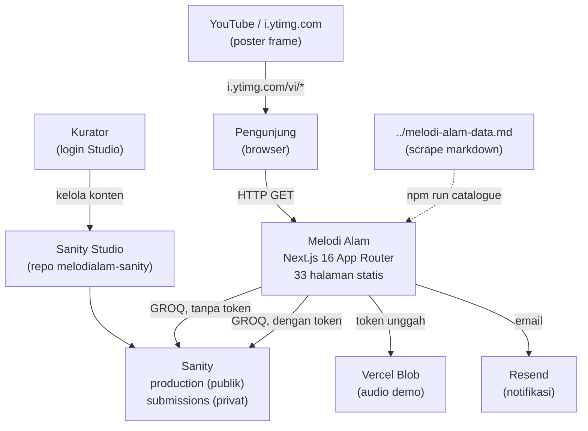
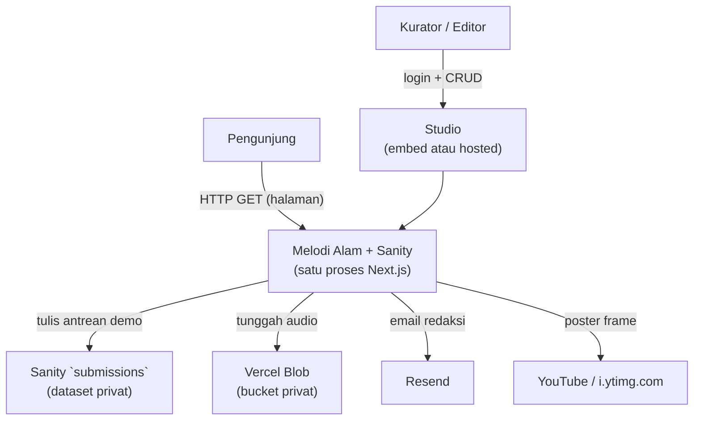
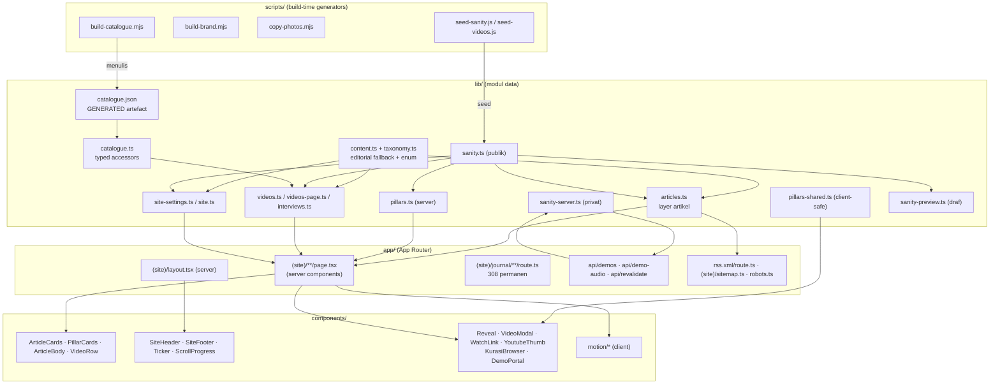
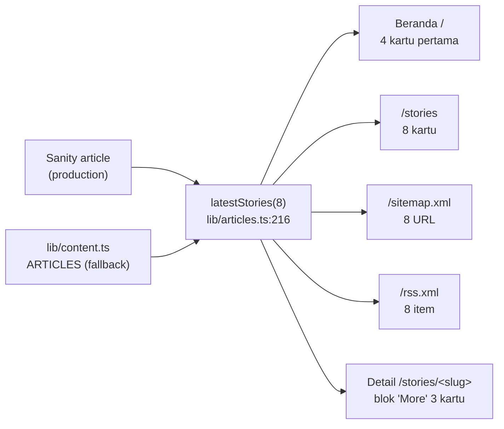
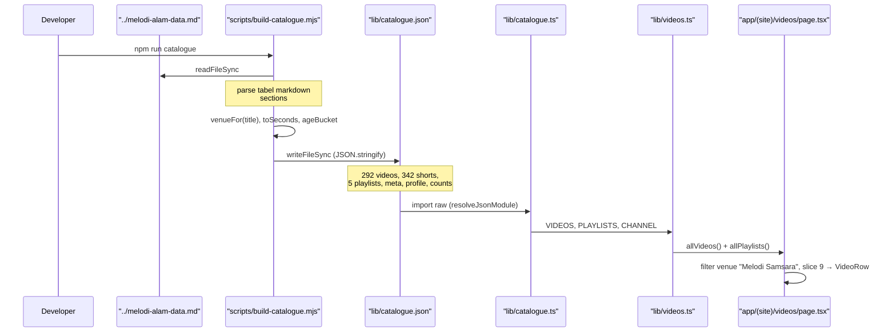
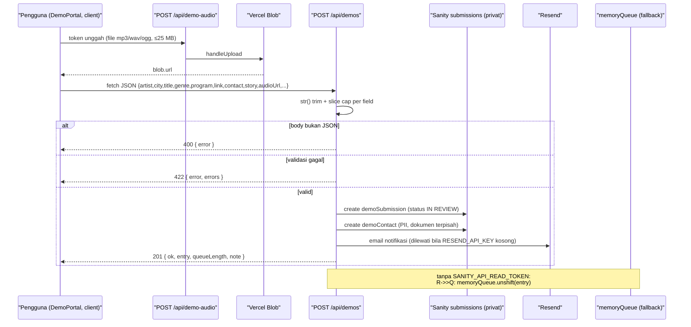

# ARCHITECTURE — Melodi Alam Web Platform

> **Catatan revisi (21 Okt 2026):** dokumen ini ditulis ulang untuk mencerminkan
> kondisi repo saat ini. Versi sebelumnya masih menggambarkan **Payload CMS 3 +
> Supabase** sebagai target; sejak itu backend-nya diganti **Sanity Studio**
> (ADR-0008) dan seluruh kode Payload sudah dihapus. Bagian "Proposed State"
> sekarang berisi pekerjaan yang benar-benar masih terbuka, bukan arsitektur
> Payload.
>
> **Jejak fitur yang sudah dihapus** dan tidak boleh lagi diceritakan sebagai
> fitur yang ada: `/pahlawan-kota` + `lib/pahlawan.ts` · `/spaces` + `SPACE_ITEMS` ·
> `VideosBrowser` + `/videos/arsip` · `JournalBrowser` · `HeroArticle` ·
> `FeatureCard` · `GENRE_ROWS` / `GenreRow` · `asOptions` di `lib/taxonomy.ts` ·
> `videosByIds` / `videosByVenue` · `demoStoreConfigured` · `draftPreviewConfigured` ·
> `cardCurtain.featureLabel` / `cardCurtain.featureCta` · `thumbnailFor` ·
> `interview.image`.
> `components/motion/ParallaxImage.tsx` **masih ada di repo tetapi tak terpakai**
> — tidak ada berkas yang mengimpornya.

Dokumen ini menetapkan batas modul, kepemilikan data, arah dependensi, dan alur
data platform web **Melodi Alam**. Isi dibagi menjadi dua keadaan yang dipisahkan
secara eksplisit:

- **Current State — TERVERIFIKASI.** Arsitektur yang ada di repo `melodi-alam/`
  saat dokumen ini ditulis. Setiap klaim dibaca langsung dari sumber, dan
 _build_, _lint_, serta _test_ dijalankan pada revisi ini.
- **Proposed State — RENCANA.** Pekerjaan yang benar-benar belum selesai:
  moderasi demo, integrasi Vercel yang belum terpasang, dan hak akses yang belum
  ditegakkan di build.

Label status yang dipakai konsisten: `TERVERIFIKASI` (dibaca di kode atau
dijalankan), `RENCANA` (direncanakan, belum ada), `ASUMSI` (diasumsikan),
`[PERLU VERIFIKASI]` (tidak dapat dikonfirmasi dari sumber).

Acuan requirement: `FR-001`…`FR-007`, `BR-001`…`BR-004`, `ACC-001`…`ACC-003`,
`OQ-001`…`OQ-003`, `NFR-001`…`NFR-004`, `RISK-001`…`RISK-003`. Teks PRD asli tidak
ada di repo; pemetaannya lewat `docs/PRD-REFERENCE.md` — sebagian baris di sana
sendiri sudah usang dan ditandai.

> **Dokumen saudara.** Panduan integrasi web ↔ CMS ada di
> [`SANITY-INTEGRATION.md`](SANITY-INTEGRATION.md); keputusan arsitektur di
> [`adr/`](adr/); hasil audit 21 Okt 2026 di
> [`AUDIT-2026-10-21.md`](AUDIT-2026-10-21.md).

---

## 1. Architecture Overview

Melodi Alam adalah **satu aplikasi Next.js 16 App Router** (`TERVERIFIKASI`,
`package.json` → `next@16.4.0`, `react@19.3.0`, Turbopack). Tidak ada backend
terpisah, tidak ada basis data milik sendiri, dan tidak ada service eksternal
yang wajib hidup agar situs render.

Bentuk arsitektur saat ini: **monolith Next.js dengan lapisan CMS baca-tulis di
luarnya**. Sanity Studio adalah CMS *headless* yang di-host terpisah di repo
`melodialam-sanity`; repo ini hanya **membaca** dari sana. Seluruh pembacaan
konten publik terjadi **di server** (server component atau route handler), tidak
pernah di browser.

Empat jalur runtime yang bukan statis murni (`TERVERIFIKASI`, `next build`):

| Jalur | Jenis | Kapan |
|---|---|---|
| Halaman daftar & detail | Static + Partial Prerender | build, di-*revalidate* tiap menit lewat tag cache |
| `POST /api/demos` · `POST /api/demo-audio` · `POST /api/revalidate` | Dynamic | per request |
| `GET /journal` · `GET /journal/[slug]` | Dynamic | 308 permanen ke `/stories` |
| `GET /rss.xml` · `/sitemap.xml` · `/robots.txt` | Static + revalidasi | build |

Modul data di `lib/` adalah tulang punggung:

| Modul | Peran | Sumber |
|---|---|---|
| `lib/articles.ts` | Lapisan artikel (CMS + fallback statis) | `TERVERIFIKASI` |
| `lib/content.ts` | Editorial yang ditulis tangan (fallback) | `TERVERIFIKASI` |
| `lib/taxonomy.ts` | Kosakata bersama: rubrik, enum demo, batas audio | `TERVERIFIKASI` |
| `lib/sanity.ts` | Klien Sanity **publik** (tanpa token) | `TERVERIFIKASI` |
| `lib/sanity-server.ts` | Klien dataset **privat** (memakai token) | `TERVERIFIKASI` |
| `lib/sanity-preview.ts` | Klien **draf** (memakai token) + verifikasi secret | `TERVERIFIKASI` |
| `lib/pillars.ts` / `lib/pillars-shared.ts` | Kurasi Instagram, sisi server / sisi klien | `TERVERIFIKASI` |
| `lib/videos.ts` · `lib/videos-page.ts` · `lib/interviews.ts` | Video, copy halaman, indeks wawancara | `TERVERIFIKASI` |
| `lib/site-settings.ts` · `lib/site.ts` | Copy situs: CMS dulu, konstanta sebagai fallback | `TERVERIFIKASI` |
| `lib/catalogue.json` · `lib/catalogue.ts` | Katalog YouTube **generated** + aksesornya | `TERVERIFIKASI` |

Target yang **sudah diambil** dan tidak dibuka ulang:

| ID | Keputusan | Nilai |
|---|---|---|
| ADR-0008 | Backend & CMS | **Sanity Studio**, dua dataset (`production` publik + `submissions` privat) |
| `OQ-001` | Moderasi demo | Submission privat sampai kurator menyetujui (ADR-0005) |
| ADR-0004 | Katalog video | Tetap artefak build-time, tidak masuk CMS |
| ADR-0001 | Artikel | Route nyata `/stories/[slug]`; pemutar video tetap modal tanpa URL |
| ADR-0006 | Test & hosting | Vitest (terpasang) + Playwright (belum); deploy ke Vercel |
| — | Tipografi | Inter + Red Hat Display + Instrument Serif + JetBrains Mono |

**Constraint arsitektural yang membentuk struktur:**

1. Konten publik dibaca **hanya di server**. Client component tidak pernah
   mengimpor `lib/sanity.ts` maupun `lib/sanity-server.ts`.
2. **Token tidak boleh menyentuh bundel klien.** Hanya `lib/sanity-server.ts` dan
   `lib/sanity-preview.ts` yang memegangnya.
3. **CMS menang bila terjangkau; berkas statis menjadi fallback.** Aturan ini
   berlaku seragam di artikel, video, wawancara, pengaturan situs, dan copy
   halaman video.
4. `lib/catalogue.json`, `public/brand/`, `public/photos/`, dan ikon aplikasi adalah
   **artefak generated** — ada aturan "jangan diedit tangan".

---

## 2. Requirements and Constraints

### 2.1 Architectural drivers

| Driver | Bukti / acuan |
|---|---|
| Situs publik cepat dan tanpa basis data sendiri | 33 halaman statis pada build (`TERVERIFIKASI` via `npm run build`) |
| Konten bisa diperbarui editor tanpa deploy | Sanity Studio + webhook revalidasi (`TERVERIFIKASI`) |
| Pipeline demo submission yang dimoderasi | `OQ-001`, ADR-0005, `app/api/demos/route.ts` |
| Metadata & SEO per artikel | `app/(site)/stories/[slug]/page.tsx` → `generateMetadata` + `opengraph-image.tsx` (`TERVERIFIKASI`) |
| Aksesibilitas dan reduced motion | `ACC-001`…`ACC-003`; `globals.css` + `MotionRoot` (`TERVERIFIKASI`) |
| Keamanan input demo | `SECURITY-PRIVACY.md`, `FR-005`, `BR-001` (`TERVERIFIKASI`) |

### 2.2 Confirmed constraints (TERVERIFIKASI)

- **Stack terkunci:** Next.js `16.4.0`, React `19.3.0`, TypeScript `^5`, Tailwind
  CSS `^4` lewat `@tailwindcss/turbopack`, `motion@^14.2.0`, `sharp@^0.35.5`,
  `@sanity/client@^8.9.0`, `@sanity/image-url@^2.1.1`, `@portabletext/react@^8.0.1`,
  `@vercel/analytics@^2.0.1`, `@vercel/blob@^2.8.2`, Vitest `^3.2.7`.
- **Port dev 3100** (`package.json`: `next dev -p 3100`; `next start -p 3100`).
- **Sepuluh skrip npm:** `dev`, `build`, `start`, `lint`, `test` (Vitest),
  `catalogue`, `brand`, `photos`, `seed:sanity`, `seed:videos`.
  Playwright **belum** terpasang.
- **`next.config.ts`**: `cacheComponents: true`, `partialPrefetching: true`,
  `poweredByHeader: false`, header keamanan (CSP *enforced* sebagian + CSP penuh
  *report-only*), `images.remotePatterns` hanya `i.ytimg.com/vi/**` dan
  `cdn.sanity.io/images/**`, dan aturan Turbopack untuk `*.css`.
- **Alias path** `@/*` → root proyek (`tsconfig.json` `paths`).
- **Tidak ada `.github/`** → belum ada CI di repo ini (`TERVERIFIKASI`).

### 2.3 Environment variables

| Variabel | Dibaca di | Wajib? | Catatan |
|---|---|---|---|
| `NEXT_PUBLIC_SITE_URL` | `lib/site.ts:18` | untuk produksi | Origin kanonik. Default kode `https://melodialam.id` |
| `SANITY_API_READ_TOKEN` | `lib/sanity-server.ts:22`, `lib/sanity-preview.ts:17` | opsional | Tanpa ini: antrean demo jatuh ke array in-memory, pratinjau 404 |
| `SANITY_REVALIDATE_SECRET` | `app/api/revalidate/route.ts:48`, `lib/sanity-preview.ts:39` | untuk webhook | Fallback secret pratinjau bila `SANITY_PREVIEW_SECRET` kosong |
| `SANITY_PREVIEW_SECRET` | `lib/sanity-preview.ts:39` | opsional | Secret pratinjau draf terpisah |
| `BLOB_READ_WRITE_TOKEN` | dibaca `@vercel/blob/client` di `app/api/demo-audio/route.ts` | untuk unggah audio | Tanpa ini rute menjawab `400` |
| `RESEND_API_KEY` | `app/api/demos/route.ts:146` | opsional | Tanpa ini notifikasi email inert |
| `DEMO_NOTIFY_TO` · `DEMO_NOTIFY_FROM` | `app/api/demos/route.ts:149-153` | opsional | Default: dua alamat partnership / `onboarding@resend.dev` |

`SANITY_PROJECT_ID` (`03sgar5q`), `SANITY_DATASET` (`production`), dan
`SANITY_SUBMISSIONS_DATASET` (`submissions`) **bukan** environment variable —
mereka literal di `lib/sanity-project.ts`, karena dua build berbeda (Next dan
Vite-nya Studio) mengekspos env dengan cara berbeda.

### 2.4 Assumptions (ASUMSI)

- `ASUMSI` — Tim kecil (1–3 kurator); tidak ada kebutuhan multi-tenant atau RBAC
  kompleks.
- `ASUMSI` — Trafik baca jauh lebih besar daripada trafik submit demo.
- `ASUMSI` — Cache Next (bukan cache browser) yang menjadi tempat "kesegaran"
  konten, dengan jendela `cacheLife("minutes")` per tag.

### 2.5 Unresolved questions (lihat Open Questions di akhir)

- Kapan kurator bisa mengubah status antrean demo? (`BR-002` — belum ada endpoint.)
- Apakah `melodialam.id` akan diaktifkan sebagai origin kanonik?
- Apakah `dynamicParams` pada `/stories/[slug]` dibiarkan default?

---

## 3. Architectural Style

### 3.1 Current State — TERVERIFIKASI

**Monolith Next.js + lapisan CMS baca-tulis di luar proses.** Batas modul
diberikan oleh *jenis berkas* (`lib/`, `components/`, `app/`, `scripts/`) dan oleh
directive `"use client"`.

Alasan bentuk ini cocok sekarang:

- Tidak ada deployment independen per domain.
- Konten editorial berubah melalui Studio, bukan melalui PR.
- Tidak ada basis data yang harus dijaga, dimigrasikan, atau dibayar.

Biaca/batasan:

- Konten **hanya** bisa berubah lewat Sanity; perubahan kode tetap butuh rebuild.
- Konten editorial punya **dua sumber**: CMS (utama) dan `lib/content.ts`
  (fallback). Keduanya bisa berbeda — fallback bukan cermin keadaan terkini.
- Tidak ada jalur tulis selain tiga route handler di `app/api/`.

### 3.2 Proposed State — RENCANA

Pekerjaan yang tersisa, urut dari yang paling mengikat:

1. **Moderasi demo yang benar-benar ditegakkan.** `BR-002` menyatakan hanya
   kurator boleh memindahkan status; saat ini tidak ada endpoint kurator sama
   sekali, dan aturan transisinya hanya tertulis di `docs/DATA-MODEL.md`.
2. **Pemasangan integrasi Vercel yang masih kosong.** Blob store
   (`BLOB_READ_WRITE_TOKEN`) dan Resend (`RESEND_API_KEY`) belum dibuat, sehingga
   unggah audio membalas `400` dan notifikasi redaksi tidak pernah terkirim.
3. **Pemisahan hak akses di level build.** `lib/sanity-server.ts` dan
   `lib/sanity-preview.ts` memegang token tetapi belum memakai
   `import "server-only"` — garantinya masih konvensi, bukan jaminan build-time.
4. **CI.** Tidak ada `.github/`; `npm run lint`, `npm test`, dan `npm run build`
   belum dijalankan otomatis pada setiap perubahan.

Alternatif yang dipertimbangkan dan ditolak (dicatat, bukan dibuka ulang):

| Alternatif | Alasan ditolak |
|---|---|
| Kembalikan CMS ke Payload / Supabase | Sudah satu kali ditolak dan digantikan; lihat ADR-0008 |
| Pindahkan katalog YouTube ke Sanity | 292 baris yang tidak pernah disunting manusia — ADR-0004 |
| Satu dataset Sanity untuk semuanya | Nomor WhatsApp musisi ikut jadi publik |

---

## 4. System Context and Component Diagrams

### 4.1 Context diagram — Current (TERVERIFIKASI)



Catatan: satu-satunya jalur **tulis** dari luar adalah `POST /api/demos`
(→ dataset privat `submissions`) dan `POST /api/demo-audio` (→ Blob).

### 4.2 Context diagram — Target (RENCANA)



`RENCANA` — moderate: `blob` dan `resend` sudah ada kodenya tetapi belum
dipasang; `studio` sudah hosted terpisah.

### 4.3 Component / module diagram — Current (TERVERIFIKASI)



**Aturan arah dependensi yang sudah berlaku (`TERVERIFIKASI`):**

- `lib/*` tidak pernah mengimpor dari `app/` atau `components/`.
- `components/*` boleh mengimpor `lib/*`; tidak pernah sebaliknya.
- `app/*` mengorkestrasi `lib/*` dan `components/*`.
- `scripts/*` hanya menulis ke berkas generated; tidak diimpor oleh runtime app.
- `lib/pillars-shared.ts` boleh masuk bundel klien; `lib/pillars.ts` tidak
  (karena menarik `next/cache` dan klien Sanity).

---

## 5. Module Inventory

Modul saat ini (TERVERIFIKASI):

| Module ID | Module Name | Responsibility | Owned Data | Dependencies | Public Interface |
|---|---|---|---|---|---|
| MOD-001 | `lib/content.ts` + `lib/taxonomy.ts` | Editorial fallback, rubrik, enum demo, batas audio | `ARTICLES` (12), `INTERVIEW_ROWS` (9), `TICKER_ITEMS` (4), `SEED_DEMOS` (3), `ARTICLE_CATEGORY_VALUES`, `DEMO_*` | — | Named const exports + tipe `Article`, `InterviewRow`, `DemoSubmission` |
| MOD-002 | `lib/articles.ts` | Lapisan artikel: CMS dulu, fallback statis | `ARTICLES_TAG` | MOD-001, MOD-009 | `allArticles()`, `latestStories(count)`, `feedArticles()`, `articleBySlug(slug)`, `staticArticleSlugs()` |
| MOD-003 | `lib/catalogue.json` | Artefak generated katalog YouTube | 292 video, 342 shorts, 5 playlist, `meta`, `profile`, `counts` | MOD-012 | Berkas JSON (data) |
| MOD-004 | `lib/catalogue.ts` | Aksesor bertipe di atas MOD-003 | tidak ada (turunan) | MOD-003 | `catalogue`, `CHANNEL`, `COUNTS`, `VIDEOS`, `SHORTS`, `PLAYLISTS`, `VENUES`, `getVideo`, `topVideos`, `latestVideos`, `viewCount`, `formatDuration` |
| MOD-005 | `lib/sanity.ts` | Klien Sanity dataset **publik**, tanpa token | `SANITY_API_VERSION`, `contentClient` | MOD-010 | `contentClient.fetch`, `imageUrl(source, {width,height})` |
| MOD-006 | `lib/sanity-server.ts` | Klien dataset **privat** `submissions` | `submissionsClient` (null tanpa token) | MOD-005, MOD-010 | `submissionsClient` |
| MOD-007 | `lib/sanity-preview.ts` | Baca draf + verifikasi secret | `draftClient`, `previewSecret()`, `secretMatches()` | MOD-005, MOD-010 | ketiganya |
| MOD-008 | `lib/pillars.ts` / `lib/pillars-shared.ts` | Kurasi Instagram per pillar | `PILLARS_TAG`; label, set pillar, `PillarPost`, `pillarDate()` | MOD-005 | `allPillarPosts()` (server) + kosakata (shared) |
| MOD-009 | `lib/videos.ts` · `lib/videos-page.ts` · `lib/interviews.ts` | Video, playlist, copy halaman, indeks wawancara | `VIDEOS_TAG`, `VIDEOS_PAGE_TAG`, `INTERVIEWS_TAG` | MOD-001, MOD-004, MOD-005 | `allVideos()`, `allPlaylists()`, `videoById()`, `latestVideos()`, `topVideos()`, `getVideosPageCopy()`, `allInterviews()` |
| MOD-010 | `lib/site-settings.ts` · `lib/site.ts` | Copy situs, nav, tautan luar | `SETTINGS_TAG`, `SITE`, `PRIMARY_NAV`, `SUBMIT_NAV`, `FOOTER_RUBRIKS`, `EXTERNAL_LINKS` | MOD-001, MOD-005 | `getSiteSettings()`, konstanta navigasi |
| MOD-011 | `app/` pages & route handlers | Presentasi rute, metadata, penulisan antrean | lihat §9 | MOD-002, MOD-006, MOD-007, MOD-008, MOD-009, MOD-010 | Rute HTTP |
| MOD-012 | `scripts/` | Generator artefak build-time + seeder | `lib/catalogue.json`, `public/brand/**`, `public/photos/**`, ikon app | sumber sibling di workspace | Skrip CLI (`npm run catalogue/brand/photos/seed:sanity/seed:videos`) |

Modul target (RENCANA — lihat §3.2 dan §13.3):

| Module ID | Module Name | Responsibility | Owned Data | Dependencies |
|---|---|---|---|---|
| MOD-101 | Endpoint moderasi kurator | Mengubah status antrean demo | status + audit | MOD-006 |
| MOD-102 | Bucket audio privat | Menyimpan file demo | objek blob | MOD-011 |
| MOD-103 | Notifikasi redaksi | Mengirim email kiriman baru | konfigurasi alamat | MOD-006 |
| MOD-104 | Gerbang CI | Menjalankan lint/test/build | konfigurasi workflow | — |

---

## 6. Module Specifications

### MOD-001 — `lib/content.ts` + `lib/taxonomy.ts` (TERVERIFIKASI)

- **Tujuan.** Sumber editorial yang ditulis tangan **dan** tempat kosakata
  bersamaCMS dan Studio.
- **Tanggung jawab.** 12 artikel lengkap, 9 baris wawancara, 4 item ticker,
  3 seed demo, 4 rubrik artikel, 4 status demo, 6 genre demo, 3 program demo,
  batas audio (25 MB / 3 ekstensi / 4 MIME).
- **Bukan tanggung jawab.** Tidak melakukan I/O, tidak tahu rute, tidak tahu
  Sanity.
- **Batas internal.** `Article.body` adalah **array of plain strings**, bukan
  HTML — sehingga content layer tidak dapat menyuntik markup.
- **Duplikasi yang disengaja.** `melodialam-sanity/lib/taxonomy.ts` memuat nilai
  yang sama; kedua berkas menyatakan itu di bagian atas. Studio tidak bisa
  mengimpor dari repo ini saat build, dan repo ini tidak boleh bergantung pada
  Studio.
- **Strategi pengujian.** `lib/content.test.ts` (9 kasus Vitest) mengunci
  `readingTimeMinutes`, `pillarDate`, dan `isArticleCategory`.

### MOD-002 — `lib/articles.ts` (TERVERIFIKASI)

- **Tujuan.** Satu-satunya tempat halaman membaca artikel.
- **Aturan tunggal.** "CMS menang saat terjangkau, berkas statis adalah
  fallback." Diimplementasikan di `allArticles()` (`lib/articles.ts:173`) dan
  `articleBySlug()` (`lib/articles.ts:228`).
- **Caching.** `"use cache"` + `cacheLife("minutes")` + `cacheTag("articles")`;
  pembacaan Sanity memakai `{ cache: "no-store" }` agar CDN Sanity tidak
  menyajikan salinan basi.
- **API publik.**
  - `allArticles()` — gabungan CMS + statis, diurutkan `dateISO` menurun.
  - `latestStories(count = 8)` — **sumber tunggal daftar cerita**: foto dulu
    (terbaru), lalu reel (terbaru). Dipakai beranda (4 pertama), `/stories` (8),
    sitemap (8), RSS (8), dan blok "More" di detail artikel.
  - `feedArticles()` — hanya artikel `mediaType !== "reel"`.
  - `articleBySlug(slug)` — CMS dulu, lalu statis.
  - `staticArticleSlugs()` — 12 slug untuk `generateStaticParams`.

### MOD-003 / MOD-004 — katalog (TERVERIFIKASI)

- **Isi artefak** (`lib/catalogue.json`): 292 video, 342 shorts, 5 playlist;
  `meta.scrapedAt = "14 Oktober 2026"`; `counts.byVenue` = Melodi Samsara 101,
  Interview 143, Melodi Taman 39, Arsip & Lainnya 9.
- **Hazard.** `views` adalah **string tampilan YouTube yang dibulatkan**, dan
  `uploaded` adalah **usia relatif terhadap tanggal scrape**. Setiap konsumen
  angka harus sadar ini.
- **Umur video dihitung ulang saat render.** `lib/videos.ts:133` mengikat
  offset relatif katalog ke tanggal scrape, sehingga label bergerak ke arah yang
  benar meski sudah usang.

### MOD-005 / MOD-006 / MOD-007 — tiga klien Sanity (TERVERIFIKASI)

| Modul | Perspektif | Token | Impor aman dari klien? |
|---|---|---|---|
| `lib/sanity.ts` | `published` | tidak | Ya |
| `lib/sanity-server.ts` | `published` | ya (`SANITY_API_READ_TOKEN`) | **Tidak** |
| `lib/sanity-preview.ts` | `drafts` | ya | **Tidak** |

- Pemisahan dataset **pemblokiran PII**: `submissions` tidak bisa dibaca tanpa
  token, dan `lib/sanity-server.ts` adalah satu-satunya jalan ke sana.
- `lib/sanity.ts` sengaja `useCdn: false` — pembacaan di-cache Next dan
  di-invalidate oleh webhook, jadi CDN Sanity di depannya akan menyajikan
  salinan basi tepat setelah yang baru tries Replace.
- `lib/sanity-preview.ts` memakai perbandingan **constant-time**
  (`secretMatches`, `lib/sanity-preview.ts:43`) agar secret tidak bisa diprobe
  byte demi byte.

### MOD-008 — pillar kurasi (TERVERIFIKASI)

- **Pemisahan yang mengikat.** `lib/pillars-shared.ts` = data murni
  (label, set pillar, bentuk `PillarPost`, `pillarDate`) dan boleh masuk bundel
  klien. `lib/pillars.ts` = sisi server (`next/cache` + Sanity) dan **tidak**
  boleh diimpor komponen klien.
- **Tidak ada fallback statis.** Kalau Sanity tak terjangkau, `allPillarPosts()`
  mengembalikan `[]` dan bagian-bagiannya tidak dirender. Ini disengaja: pool
  ini adalah konten baru tanpa sumber build-time.
- **Set pillar.** `PHOTO_PILLARS` = `fakta-musik`, `lirik`, `trivia`, `kutipan`;
  `REEL_PILLARS` = `rekomendasi`, `ulas-melodi`, `clipper`, `similar-song`.
  Skema Studio punya 9 pillar (`similar-song` dan `meme-humor` termasuk yang
  belum terisi).

### MOD-009 — video, copy halaman, wawancara (TERVERIFIKASI)

- `allVideos()` (`lib/videos.ts:209`) — entri CMS dulu (urut `publishedAt`
  menurun), lalu arsip katalog yang belum tergantikan.
- `allPlaylists()` — CMS dulu, jatuh ke `PLAYLISTS` katalog bila kosong.
- `getVideosPageCopy()` — judul/catatan halaman `/videos`; **catatan punya tiga
  keadaan**: belum diisi → hitung live, dikosongkan → tidak tampil, teks lain →
  tampil apa adanya.
- `allInterviews()` — daftar pendek pilihan editor; fallback ke
  `INTERVIEW_ROWS`. `SiteInterview` **tidak punya field `image`**: artwork-nya
  diturunkan dari `videoId` lewat `YoutubeThumb`.

### MOD-010 — copy situs (TERVERIFIKASI)

- `getSiteSettings()` (`lib/site-settings.ts:101`) membaca singleton
  `siteSettings` dan jatuh ke konstanta di `lib/site.ts` / `lib/content.ts`.
- `cardCurtain` kini **hanya** `articleLabel` + `articleCta` (label kanan atas
  dan tombol bawah panel hijau). Field `featureLabel` / `featureCta` sudah
  dihapus dari skema Studio.
- `url` dan `locale` **tidak** ada di CMS: origin harus datang dari environment
  supaya deployment pratinjau menghasilkan canonical yang benar.
- Angka kanal **tidak** ada di `siteSettings` — angka subscriber/view yang
  pernah membusuk dihapus dengan sengaja ("angka yang tak dirawat lebih buruk
  daripada tak ada angka").

### MOD-011 — halaman & route handler App Router (TERVERIFIKASI)

- **Pola.** Halaman tetap **server component**; interaktivitas diekstrak ke
  komponen client. Tidak ada halaman yang menyimpan state.
- **Metadata.** `generateMetadata` per artikel + `opengraph-image.tsx` /
  `twitter-image.tsx` 1200×630 digambar per artikel (`ImageResponse`).
- **JSON-LD.** Layout menyematkan `WebSite` + `Organization`; halaman artikel
  menambah `Article` + `BreadcrumbList`. Payload di-escape (`<` → `\u003c`).
- **`instant = false`** pada `/stories/[slug]` dan `/preview/[type]/[slug]` —
  deklarasi jujur bahwa segmen itu blocking, bukan penundaan yang disamarkan.

### MOD-012 — `scripts/` (TERVERIFIKASI)

| Skrip | Keluaran | Sumber |
|---|---|---|
| `build-catalogue.mjs` | `lib/catalogue.json` | `../melodi-alam-data.md` (dua kandidat lokasi) |
| `build-brand.mjs` | `public/brand/**`, `app/icon.png`, `app/apple-icon.png`, `app/favicon.ico` | `../../LOGO2/*.png` |
| `copy-photos.mjs` | `public/photos/**` | `../../FOTO PLACEHOLDER MELODI ALAM/` |
| `seed-sanity.js` | dokumen Sanity (artikel, playlist, wawancara, settings) | `lib/content.ts` + `lib/catalogue.json` |
| `seed-videos.js` | dokumen video Sanity | `lib/catalogue.json` |
| `gdrive-auth.mjs` · `gdrive-fetch.mjs` | kredensial + arsip foto Google Drive | API Drive (bukan bagian dari build situs) |

---

## 7. Dependency Rules

**Aturan yang berlaku (TERVERIFIKASI / RENCANA):**

| # | Aturan | Status |
|---|---|---|
| R1 | `lib/*` tidak boleh mengimpor `app/*` atau `components/*` | `TERVERIFIKASI` (dipatuhi) |
| R2 | `components/*` boleh mengimpor `lib/*`; arah sebaliknya dilarang | `TERVERIFIKASI` |
| R3 | `app/*` adalah orkestrator; boleh mengimpor `lib/*` dan `components/*` | `TERVERIFIKASI` |
| R4 | `scripts/*` tidak boleh diimpor runtime app; hanya menulis berkas generated | `TERVERIFIKASI` |
| R5 | `lib/catalogue.json` **tidak boleh diedit tangan** | `TERVERIFIKASI` (satu penulis: `build-catalogue.mjs`) |
| R6 | `lib/catalogue.ts` dan generator harus diubah bersamaan bila bentuk data berubah | `TERVERIFIKASI` (ADR-0004) |
| R7 | Hanya `lib/sanity-server.ts` dan `lib/sanity-preview.ts` yang boleh membaca token; keduanya **tidak boleh** diimpor komponen klien | `TERVERIFIKASI` (graf impor) · `RENCANA`: tambahkan `import "server-only"` |
| R8 | Hanya `lib/pillars-shared.ts` (bukan `lib/pillars.ts`) yang boleh diimpor komponen klien | `TERVERIFIKASI` |
| R9 | Tidak ada modul yang boleh memiliki dua sumber kebenaran untuk entitas yang sama | `TERVERIFIKASI` untuk CMS-vs-CMS; `ASUMSI` untuk CMS-vs-fallback (`lib/content.ts` memang sengaja berbeda isinya) |

**Pencegahan siklus.** Tidak ada siklus hari ini: `lib/` adalah daun graf dan
`site-settings → sanity → sanity-project` satu arah. Arah yang dilarang ke
depan: `lib/sanity.ts` → `lib/sanity-server.ts` (publik tidak boleh menarik
privat), dan modul klien → modul yang memegang token.

---

## 8. Data Ownership and Data Flow

### 8.1 Peta kepemilikan (TERVERIFIKASI)

| Data | Pemilik (authoritative) | Pembaca | Penulis |
|---|---|---|---|
| Artikel | Sanity `article` (dataset `production`) | MOD-002 → MOD-011 | Kurator di Studio |
| Artikel (fallback) | MOD-001 `ARTICLES` | MOD-002 | manusia (edit kode) |
| Kurasi Instagram | Sanity `pillarPost` | MOD-008 → MOD-011 | Kurator di Studio |
| Video terkurasi | Sanity `video` | MOD-009 → MOD-011 | Kurator di Studio |
| Playlist | Sanity `playlist` (fallback katalog) | MOD-009 | Kurator / seeder |
| Wawancara | Sanity `interview` (fallback `INTERVIEW_ROWS`) | MOD-009 | Kurator |
| Copy situs | Sanity `siteSettings` (fallback `lib/site.ts`) | MOD-010 → MOD-011 | Kurator |
| Copy halaman video | Sanity `videosPage` (fallback konstanta) | MOD-009 | Kurator |
| Katalog video | MOD-003 (generated) | MOD-004 → MOD-009 | MOD-012 |
| Antrean demo | Sanity `demoSubmission` + `demoContact` (privat) | MOD-006 → `app/api/demos` | `POST /api/demos` |
| Antrean demo (fallback) | array proses-lokal di `app/api/demos/route.ts` | `GET /api/demos` | `POST /api/demos` |

### 8.2 Data flow A — satu daftar cerita (TERVERIFIKASI)



Aturan yang menjaga angka ini: **sumber tunggal**. Beranda mengambil empat
pertama dari daftar yang sama dengan `/stories`; sitemap dan RSS mengambil
delapan yang sama. Karena itu jumlah artikel yang tampil di beranda, di
`/stories`, di sitemap, dan di feed tidak pernah berbeda.

Pola fallback: `allArticles()` menggabungkan dokumen CMS di atas peta slug
statis (dokumen CMS **menggantikan** artikel statis dengan slug yang sama),
lalu mengurutkan `dateISO` menurun. `latestStories()` membagi daftar itu menjadi
dua: foto dulu, lalu reel — sehingga slot utama selalu diisi cerita berpicture.

### 8.3 Data flow B — pipeline katalog (TERVERIFIKASI)



Detail penting (`TERVERIFIKASI`):

- Generator mencari sumber di dua kandidat: `../melodi-alam-data.md` (workspace
  root) atau `melodi-alam-data.md` (project root), lalu berhenti dengan pesan
  jelas bila tak ada.
- Output ditulis dengan `JSON.stringify(payload, null, 2)`.
- Halaman `/videos` **tidak** pernah mengirim seluruh katalog ke browser: yang
  dirender adalah sembilan baris `VideoRow` hasil filter server.

### 8.4 Data flow C — pipeline demo (TERVERIFIKASI)



Temuan struktural pada jalur ini (`TERVERIFIKASI`):

- **PII tidak pernah ikut pada baris yang dibaca publik.** Kontak manajer ditulis
  ke dokumen `demoContact` terpisah di dataset privat; kueri `demoSubmission`
  tidak pernah memilih field kontak.
- **Antrean publik hanya menampilkan status yang disetujui.** `GET /api/demos`
  memakai `status in $approved` dengan `DEMO_APPROVED_STATUSES`.
- **Fallback tanpa token tidak menyaring status.** Tanpa
  `SANITY_API_READ_TOKEN`, `GET /api/demos` mengembalikan seluruh
  `memoryQueue` — termasuk entri `IN REVIEW`. Ini temuan audit F06 dan masih
  terbuka.
- **Tidak ada jalur moderasi.** Tidak ada endpoint kurator yang mengubah
  status; `BR-002` belum ditegakkan di kode.
- **Store proses-lokal tidak konsisten di multi-instance.** Hanya berlaku pada
  cabang fallback, `ASUMSI` untuk perilaku Vercel multi-instance.

### 8.5 State ownership (TERVERIFIKASI)

| Jenis state | Tempat | Catatan |
|---|---|---|
| Pencarian & chip pillar | Lokal di `KurasiBrowser` | tidak di URL |
| State modal video | `VideoModal` via `CustomEvent("melodi:watch")` | tanpa URL — keputusan terkunci |
| State form demo | Lokal di `DemoPortal` | errors, banner, pending, file audio |
| Drawer navigasi | Lokal di `SiteHeader` | `hidden` + `aria-expanded` |
| Antrean demo (server) | Sanity `submissions`, atau array proses-lokal | array reset saat restart |
| Konten | Cache Next per tag | di-invalidate webhook |
| Cache tag | 6 tag: `articles`, `pillar-posts`, `interviews`, `siteSettings`, `videos`, `videosPage` | `app/api/revalidate/route.ts:30` |

---

## 9. Integration Contracts

### 9.1 `POST /api/demos` (TERVERIFIKASI)

Payload diterima: `{ artist, city, title, genre, program, link, contact, story,
audioName?, audioSize?, audioUrl? }`.

Cap per field setelah trim + `slice` (`app/api/demos/route.ts:206-216`):

| Field | Cap |
|---|---|
| `artist` | 120 |
| `city` | 80 |
| `title` | 160 |
| `genre` | 60 |
| `program` | 80 |
| `link` | 500 |
| `contact` | 160 |
| `story` | 2000 |
| `audioName` | 200 |
| `audioUrl` | 500 |

Respons:

| Status | Body | Kondisi |
|---|---|---|
| `413` | `{ error: "Kiriman terlalu besar." }` | body > 16 KB |
| `400` | `{ error: "Body harus berupa JSON." }` | body bukan JSON |
| `422` | `{ error, errors }` | field wajib kosong, `link` bukan `http(s)://`, `genre`/`program` di luar enum, audio di luar aturan |
| `503` | `{ error }` | Sanity privat tidak terjangkau saat menulis |
| `201` | `{ ok, entry, queueLength, note }` | sukses |

Field wajib: `artist`, `city`, `title`, `story`, `contact`, `link`. Kontrak penuh
ada di `API-CONTRACTS.md`.

### 9.2 `GET /api/demos` (TERVERIFIKASI)

`200 { queue: DemoSubmission[], count: number }`. Membaca status yang disetujui
dari Sanity; jatuh ke `memoryQueue` bila token atau dataset tidak ada. **Tidak
ada konsumen di UI mana pun** (`TERVERIFIKASI` — satu-satunya referensi
`/api/demos` di komponen klien adalah `fetch` POST di `DemoPortal.tsx:126`).

### 9.3 `POST /api/demo-audio` (TERVERIFIKASI)

`handleUpload` dari `@vercel/blob/client`. Membatasi tipe ke
`DEMO_AUDIO_TYPES` dan ukuran ke `DEMO_AUDIO_MAX_BYTES` (25 MB). Tanpa
`BLOB_READ_WRITE_TOKEN` → `400 { error }`. Token unggahan diterbitkan ke
peramban; ini temuan audit F04 (`RENCANA` untuk diperbaiki).

### 9.4 `POST /api/revalidate` (TERVERIFIKASI)

Secret dibaca dari header `x-webhook-secret` atau query `secret`, dibandingkan
constant-time dengan `SANITY_REVALIDATE_SECRET`. Tanpa env → `500`; secret
salah → `401`; benar → `200 { revalidated: true, tags: [...] }` dan enam tag
di-invalidate dengan `revalidateTag(tag, "max")`.

### 9.5 `GET /rss.xml` · `/sitemap.xml` · `/robots.txt` (TERVERIFIKASI)

- **RSS** — 8 item dari `latestStories(8)`, `Cache-Control: public, s-maxage=600`.
  Auto-discovery `<link rel="alternate">` disematkan di layout.
- **Sitemap** — 7 halaman statis + 8 URL artikel dari `latestStories(8)`.
  Pemutar video tidak masuk (modal tanpa URL, ADR-0001).
- **Robots** — `allow: "/"`, `disallow: "/api/"`, plus `sitemap` dan `host`.
  `/preview` **sengaja** tidak ditutup agar `noindex`-nya terbaca crawler.

### 9.6 Kontrak antar-modul internal (TERVERIFIKASI)

- MOD-012 → MOD-003: skema JSON di §8.3. Perubahan bentuk wajib disertai
  perubahan MOD-004 (R6).
- MOD-005 → MOD-001: `lib/content.ts` meng-*re-export* `lib/taxonomy.ts` supaya
  impor lama tetap bekerja.
- MOD-002 → MOD-011: `latestStories(8)` adalah satu-satunya daftar cerita yang
  boleh dipakai halaman mana pun.

---

## 10. Repository Structure

### 10.1 Struktur saat ini (TERVERIFIKASI)

```text
melodi-alam/
├── app/
│   ├── (site)/                       route group: shell situs
│   │   ├── layout.tsx                Root layout: 4 font, MotionRoot, ScrollProgress,
│   │   │                             skip-link, JSON-LD, Ticker, SiteHeader, <main>,
│   │   │                             SiteFooter, <Analytics />
│   │   ├── page.tsx                  Beranda: Latest News (4 FrontCard) + Curated News (4 PillarCard)
│   │   ├── not-found.tsx             404
│   │   ├── stories/page.tsx          /stories — grid 8 ArticleCard
│   │   ├── stories/[slug]/page.tsx   /stories/<slug> — detail artikel
│   │   ├── stories/[slug]/opengraph-image.tsx    1200×630 per artikel
│   │   ├── stories/[slug]/twitter-image.tsx     1200×630 per artikel
│   │   ├── bicara-melodi/page.tsx    /bicara-melodi — 9 episode Season 3
│   │   ├── videos/page.tsx           /videos — Melodi Samsara (9 VideoRow) + 5 playlist
│   │   ├── kurasi/page.tsx           /kurasi — Curated News (KurasiBrowser)
│   │   ├── tentang/page.tsx          /tentang — profil, ekosistem, kontak
│   │   ├── submit/page.tsx           /submit — formulir demo
│   │   ├── preview/[type]/[slug]/page.tsx   /preview/<type>/<slug> — pratinjau draf
│   │   ├── journal/route.ts          308 → /stories
│   │   ├── journal/[slug]/route.ts   308 → /stories/<slug>
│   │   └── sitemap.ts                /sitemap.xml
│   ├── api/
│   │   ├── demos/route.ts            GET + POST antrean demo
│   │   ├── demo-audio/route.ts       POST token unggah Vercel Blob
│   │   └── revalidate/route.ts       POST invalidasi 6 tag cache
│   ├── rss.xml/route.ts              /rss.xml
│   ├── robots.ts                     /robots.txt
│   ├── globals.css                   Tailwind v4 @theme + @utility + @source not
│   └── icon.png / apple-icon.png / favicon.ico   (generated, MOD-012)
├── components/
│   ├── ArticleCards.tsx              ArticleCard, FrontCard (server)
│   ├── ArticleBody.tsx               PortableText + paragraf statis (server)
│   ├── PillarCards.tsx               PillarCard, PillarRow, PillarHead (server)
│   ├── VideoRow.tsx                  Baris sesi (server)
│   ├── SiteFooter.tsx · Ticker.tsx · MelodiAlamLockup.tsx   (server)
│   ├── SiteHeader.tsx · ScrollProgress.tsx · Reveal.tsx      (client)
│   ├── VideoModal.tsx · WatchLink.tsx · YoutubeThumb.tsx     (client)
│   ├── KurasiBrowser.tsx · DemoPortal.tsx                    (client)
│   └── motion/                       MotionRoot, RevealText, CountUp, MarqueeTape,
│                                     ParallaxImage (TAK TERPAKAI)
├── lib/
│   ├── articles.ts · content.ts · taxonomy.ts
│   ├── sanity.ts · sanity-server.ts · sanity-preview.ts · sanity-project.ts
│   ├── pillars.ts · pillars-shared.ts
│   ├── videos.ts · videos-page.ts · interviews.ts
│   ├── site.ts · site-settings.ts
│   ├── catalogue.json (GENERATED) · catalogue.ts
│   └── content.test.ts               9 kasus Vitest
├── scripts/                          build-catalogue, build-brand, copy-photos,
│                                     seed-sanity, seed-videos, gdrive-*
├── public/
│   ├── brand/                        lockup logo (GENERATED)
│   ├── photos/                       33 foto placeholder (GENERATED)
│   └── og.png                        kartu sosial generik
├── next.config.ts                    cacheComponents, partialPrefetching, headers,
│                                     remotePatterns, aturan Turbopack
├── vitest.config.ts                  alias @/, environment node
├── package.json                      10 skrip npm
└── tsconfig.json                     alias @/* -> ./*
```

### 10.2 Struktur target (RENCANA)

```text
melodi-alam/
├── app/
│   ├── (site)/                      tetap
│   ├── api/kurasi/                  [RENCANA] endpoint moderasi kurator
│   └── api/demo-audio/              [RENCANA] bucket privat + key ditentukan server
├── lib/
│   ├── sanity-server.ts              [RENCANA] + import "server-only"
│   └── sanity-preview.ts             [RENCANA] + import "server-only"
├── .github/workflows/               [RENCANA] lint + test + build
└── ...                              [RENCANA] Playwright (ADR-0006)
```

---

## 11. Cross-Cutting Concerns

| Concern | Pemilik saat ini | Bukti / status | Target |
|---|---|---|---|
| Validasi input | `app/api/demos/route.ts` | `TERVERIFIKASI` — `str()`, enum, regex `link`, batas audio | Tetap di route |
| Keamanan/PII | `lib/sanity-server.ts` | `TERVERIFIKASI` — `demoContact` terpisah, dataset privat | Perketat `audioUrl` agar hanya host Blob sendiri (`RENCANA`, temuan F01) |
| Batas token | `lib/sanity-server.ts`, `lib/sanity-preview.ts` | `TERVERIFIKASI` — dijaga graf impor | `import "server-only"` (`RENCANA`) |
| Rate limit & idempotensi | — | Tidak ada (`TERVERIFIKASI`) | Wajib sebelum produksi (`RENCANA`, temuan F02) |
| Error handling | Per-komponen | `TERVERIFIKASI` — `catch` + banner di `DemoPortal`; fallback diam di semua pembacaan CMS | Standarkan (`RENCANA`) |
| Konfigurasi/env | `lib/site.ts`, `lib/sanity*.ts` | `TERVERIFIKASI` — 7 env yang dibaca | Lengkapi Blob + Resend (`RENCANA`) |
| Metadata/SEO | `app/(site)/**` | `TERVERIFIKASI` — canonical absolut, JSON-LD, OG per artikel, sitemap, RSS | Pasang domain sendiri (`RENCANA`) |
| Aksesibilitas | `globals.css` + komponen | `TERVERIFIKASI` — `:focus-visible` global + pasangan `:focus-within` untuk tiap reveal | `ACC-001`…`ACC-003` terpenuhi |
| CSP | `next.config.ts` | `TERVERIFIKASI` — CSP *enforced* sebagian + penuh *report-only* | Naikkan ke *enforced* setelah dibaca (`RENCANA`) |
| Testing | `lib/content.test.ts` | `TERVERIFIKASI` — Vitest 9 kasus; `npm run lint` bersih | Tambah Playwright + CI (`RENCANA`, ADR-0006) |
| Build/deploy | `next.config.ts` | `TERVERIFIKASI` — build statis 33 halaman | Vercel (`RENCANA` — webhook, Blob, Resend) |
| Observability | `@vercel/analytics` | `TERVERIFIKASI` — `<Analytics />` terpasang; **belum dinyalakan** di dashboard | Nyalakan (`RENCANA`) |

---

## 12. Architecture Decision Records

ADR kanonik hidup sebagai berkas terpisah di `docs/adr/0001..0008-*.md`.
Ringkasannya yang relevan dengan arsitektur:

### ADR-0001 — Artikel sebagai route nyata, video tetap modal

- **Decision.** `/stories/[slug]` crawlable; pemutar video modal tanpa URL.
- **Status.** `TERVERIFIKASI` (terimplementasi).

### ADR-0002 / ADR-0003 — Payload CMS 3 + Supabase

- **Status.** `TERVERIFIKASI` — **digantikan** ADR-0008. Seluruh kode Payload sudah
  dihapus; tidak ada `payload.config.ts`, `collections/`, `migrations/`, atau
  `lib/payload.ts` di repo ini.

### ADR-0004 — Katalog YouTube tetap build-time, bukan CMS

- **Decision.** `catalogue.json` tetap dihasilkan `npm run catalogue`; tidak
  dipindah ke CMS.
- **Konsekuensi.** Dua model konten berdampingan (editorial via CMS, katalog via
  artefak) — disengaja.
- **Status.** `TERVERIFIKASI` (terimplementasi).

### ADR-0005 — Antrean demo dimoderasi

- **Decision.** Submission privat sampai kurator menyetujui; antrean publik hanya
  entri approved.
- **Status.** `TERVERIFIKASI` untuk pembacaan (`GET /api/demos` menyaring
  status); `RENCANA` untuk penulisan moderasi (belum ada endpoint kurator).

### ADR-0006 — Vitest + Playwright, deploy ke Vercel

- **Status.** `TERVERIFIKASI` untuk Vitest; `RENCANA` untuk Playwright dan CI.

### ADR-0007 — Tipografi Inter + Red Hat Display

- **Status.** `TERVERIFIKASI` (terimplementasi di `app/(site)/layout.tsx`).

### ADR-0008 — Sanity Studio menggantikan Payload CMS 3 + Supabase

- **Decision.** Sanity Studio headless, di repo terpisah `melodialam-sanity`,
  dengan dua dataset: `production` (publik, tanpa token) dan `submissions`
  (privat, wajib token). `lib/content.ts` tetap sebagai fallback.
- **Konsekuensi positif.** Tidak ada basis data untuk dijaga; editor punya
  Studio dengan pratinjau dan riwayat versi; artikel tetap tanpa token.
- **Konsekuensi negatif.** Ketergantungan pada layanan pihak ketiga; fallback
  statis bukan cermin isi terkini; PII kini berada di CMS (mitigasi: dataset
  privat); satu secret dipakai untuk dua kapabilitas sampai `SANITY_PREVIEW_SECRET`
  dipasang (temuan F03).
- **Status.** `TERVERIFIKASI` (terimplementasikan).

---

## 13. Risks and Evolution Strategy

### 13.1 Risks (terhubung ke temuan terukur)

> ID register ini memakai namespace `ARCH-RISK-*` secara sengaja. `RISK-001`…`RISK-003`
> milik register risiko PRD (spam/unggahan, bandwidth & storage, pembatasan embed)
> dan dirujuk dokumen lain dengan arti itu.

| ID | Risiko | Bukti / status | Mitigasi |
|---|---|---|---|
| ARCH-RISK-001 | **Tailwind content scan** menabrak direktori tool dan mematikan seluruh CSS secara diam-diam | `TERVERIFIKASI` — `@source not "../.codegraph"`, `"../.gitnexus"`, `"../.next"` di `app/globals.css:9-11` | Setiap direktori tool baru di root wajib ditambah `@source not` |
| ARCH-RISK-002 | Batas server/client salah tempat → markup ter-render server membawa state tersembunyi | `TERVERIFIKASI` — aturan: SSR merender keadaan akhir, animasi hanya memperkaya | Review komponen client baru terhadap aturan ini |
| ARCH-RISK-003 | `catalogue.json` diedit tangan → drift dari scrape | `TERVERIFIKASI` — ADR-0004 | Jaga generator sebagai satu-satunya penulis |
| ARCH-RISK-004 | Fallback antrean demo in-memory hilang antar-instance | `TERVERIFIKASI` — array proses-lokal | Hilangkan cabangnya begitu token tersedia (`RENCANA`) |
| ARCH-RISK-005 | Dua sumber kebenaran editorial (CMS vs `lib/content.ts`) | `TERVERIFIKASI` — disengaja | Jaga `lib/content.ts` sebagai fallback, bukan sebagai sumber |
| ARCH-RISK-006 | Fallback statis tidak mencerminkan isi terkini bila Sanity mati | `TERVERIFIKASI` — konsekuensi ADR-0008 | `cacheLife("minutes")` + webhook revalidasi |
| ARCH-RISK-007 | `audioUrl` diterima dari host mana pun | `TERVERIFIKASI` — `app/api/demos/route.ts:249` | Batasi host ke store Blob sendiri (`RENCANA`, temuan F01) |
| ARCH-RISK-008 | Token unggah Blob diterbitkan tanpa batas | `TERVERIFIKASI` — `app/api/demo-audio/route.ts` | Server yang menentukan key + akses; bucket privat (`RENCANA`, temuan F04) |
| ARCH-RISK-009 | `POST /api/demos` tanpa rate limit | `TERVERIFIKASI` — tidak ada pembatas | Rate limit per IP + idempotensi key (`RENCANA`, temuan F02) |
| ARCH-RISK-010 | Secret dipakai untuk dua kapabilitas (draf + revalidasi) | `TERVERIFIKASI` — `lib/sanity-preview.ts:39` | Pasang `SANITY_PREVIEW_SECRET` terpisah (`RENCANA`, temuan F03) |

### 13.2 Constraints arsitektural dari temuan terukur

- **Tailwind source scanning (`TERVERIFIKASI`).** Scanner berjalan atas seluruh
  proyek dan bisa *panic* pada berkas terkunci (mis. `codegraph.db-shm`) sehingga
  menghasilkan CSS kosong tanpa error. Setiap direktori baru di root — termasuk
  yang akan ditambahkan — harus dievaluasi terhadap `@source not`.
- **Batas server/client (`TERVERIFIKASI`).** (a) Membaca `scrollWidth` di dalam
  frame loop memaksa reflow sinkron dan pernah menurunkan halaman ke ~1 rAF/detik
  sehingga `IntersectionObserver` berhenti dan konten tertahan `opacity: 0` —
  karena itu digantikan `ResizeObserver` di `MarqueeTape`. (b) Jangan memanggang
  keadaan tersembunyi ke HTML server-rendered; aturannya SSR merender keadaan
  akhir. (c) `ParallaxImage` menyelesaikan preferensi reduced motion di CSS
  (`.parallax-layer`), bukan di branch render, karena server tidak bisa tahu
  preferensi pengguna.
- **Pipeline artefak generated (`TERVERIFIKASI`).** `catalogue.json` dihasilkan
  dan tidak boleh diedit tangan; kelas yang dibuat via string interpolation
  (`aspect-[${x}]`) tidak terlihat Tailwind dan pernah meruntuhkan 12 frame
  kartu. Konsekuensi: nama kelas harus literal, dan artefak generated punya
  satu penulis (MOD-012).
- **Pemisahan data privat (`TERVERIFIKASI`).** Dataset `production` tidak pernah
  menyentuh `submissions`, dan `SANITY_SUBMISSIONS_DATASET` hanya dirujuk di
  satu tempat. Jangan longgarkan aturan ini demi kemudahan.
- **Penggunaan gambar (`TERVERIFIKASI`).** `next/image` dipakai untuk gambar
  Sanity dan lokal; thumbnail YouTube sengaja `` biasa agar tidak terkunci
  cache optimizer Vercel selama setahun (`components/YoutubeThumb.tsx:19-24`).
  `next/image` `fill` butuh ancestor berposisi; `transform: scale()` melembutkan
  foto. Detail UI ada di `DESIGN-SYSTEM.md` dan `FRONTEND-PLAN.md`.

### 13.3 Evolution strategy

1. **Tutup jalur moderasi.** Tambahkan endpoint kurator yang menerapkan aturan
   transisi `BR-002`; hapus cabang fallback tanpa penyaringan status.
2. **Pasang integrasi yang sudah kodenya ada.** Blob store privat dan Resend —
   dua baris env, dua fitur yang langsung hidup.
3. **Tegakkan batas token di level build.** `import "server-only"` pada
   `lib/sanity-server.ts` dan `lib/sanity-preview.ts`.
4. **Tambah gerbang mutu.** Playwright untuk alur kritis + workflow
   lint/test/build.
5. **Pemasangan domain.** `melodialam.id` + `NEXT_PUBLIC_SITE_URL` — canonical,
   sitemap, OG, dan RSS ikut benar.

Rollback: setiap langkah menambah pembaca atau pembacaan baru tanpa menghapus
sumber lama, sehingga rollback = mengembalikan pembaca ke `lib/*` atau ke
konstanta fallback.

---

## 14. Validation Checklist

- [x] Setiap modul punya tanggung jawab yang berbeda dan dapat dipertahankan (§5).
- [x] Setiap capability bisnis punya pemilik jelas (§8.1).
- [x] Tidak ada dependensi sirkular (`lib → lib`, satu arah) (`TERVERIFIKASI`).
- [x] Antarmuka publik eksplisit dan terbatas (§5, §9).
- [x] Aturan komunikasi antar-modul terdokumentasikan (§7).
- [x] Kepemilikan data & sumber kebenaran jelas (§8).
- [x] Aturan bisnis tidak bergantung pada perilaku UI spesifik.
- [x] Kegagalan integrasi punya perilaku yang didefinisikan (§9.1 status
      `400/413/422/503/201`).
- [x] Keamanan diterapkan di batas yang benar (validasi di route handler;
      PII di dataset privat).
- [x] Pengujian dapat memverifikasi modul kritis (9 kasus Vitest — `npm test`
      lulus saat revisi ini ditulis).
- [x] Struktur repo sesuai arsitektur yang didokumentasikan (§10).
- [x] Arsitektur sesuai kebutuhan operasional & kemampuan tim (satu app, tim kecil).
- [x] Tidak ada komponen yang ada hanya demi "best practice" — kecuali
      `ParallaxImage`, yang **sisa** dan tercatat sebagai utang (§1, §13).
- [ ] **Terbuka:** endpoint moderasi kurator (§3.2, Open Questions).
- [ ] **Terbuka:** branch fallback antrean demo yang tidak menyaring status
      (ARCH-RISK-004).

---

## Verification Notes

Berkas yang **dibaca langsung** untuk dokumen ini (semua di
`D:\Project Website Melodi Alam\melodi-alam\`):

- `package.json` — 10 skrip npm, 9 dependency + 10 devDependency, port 3100.
- `next.config.ts` — `cacheComponents`, `partialPrefetching`, `poweredByHeader`,
  blok `headers()` (CSP enforced + report-only, HSTS, Permissions-Policy),
  `images.remotePatterns` (`i.ytimg.com`, `cdn.sanity.io`), aturan Turbopack.
- `tsconfig.json` (alias `@/*`), `vitest.config.ts` (alias `@/`, environment node).
- `app/(site)/layout.tsx` — 4 font, skip-link, JSON-LD situs, auto-discovery RSS,
  urutan provider, `<main id="main">`, `<Analytics />`.
- `app/(site)/page.tsx` — `latestStories(8)`, slice 4, `FrontCard`, baris hitung
  `CountUp`, strip `PillarCard`, `allPillarPosts()`, `allVideos()`.
- `app/(site)/stories/page.tsx` — `latestStories(8)`, grid 4 kolom,
  `titleFirst={i % 2 === 1}`, `cardCurtain.articleLabel/articleCta`.
- `app/(site)/stories/[slug]/page.tsx` — `generateStaticParams`, `instant = false`,
  `generateMetadata`, JSON-LD Article + Breadcrumb, cover 4:5 `max-w-md`,
  `ArticleBody`, blok "More" 3 kartu.
- `app/(site)/stories/[slug]/opengraph-image.tsx` — `ImageResponse` 1200×630.
- `app/(site)/videos/page.tsx` — `SAMSARA_PREVIEW = 9`, `VideoRow`,
  `getVideosPageCopy()`, 5 playlist, `<VideoModal />`.
- `app/(site)/bicara-melodi/page.tsx` — `allInterviews()`, `videoById`,
  `YoutubeThumb` 160 px, `WatchButton` + `VideoModal`.
- `app/(site)/kurasi/page.tsx` — `allPillarPosts()` → `KurasiBrowser`.
- `app/(site)/tentang/page.tsx` — 3 blok, kontak, kanal resmi, tautan RSS.
- `app/(site)/submit/page.tsx` — `DemoPortal`.
- `app/(site)/not-found.tsx` — `PRIMARY_NAV`.
- `app/(site)/journal/route.ts` dan `app/(site)/journal/[slug]/route.ts` —
  `Response.redirect(..., 308)`.
- `app/(site)/preview/[type]/[slug]/page.tsx` — `noindex`, `instant = false`,
  `secretMatches`, `perspective: "drafts"`, tipe `journal` dan `kurasi`.
- `app/(site)/sitemap.ts` — 7 halaman + `latestStories(8)`.
- `app/rss.xml/route.ts` — `latestStories(8)`, header cache.
- `app/robots.ts` — `disallow: "/api/"`.
- `app/api/demos/route.ts` — GET/POST, cap field, validasi, status
  `400/413/422/503/201`, `demoSubmission` + `demoContact`, notifikasi Resend,
  fallback `memoryQueue`.
- `app/api/demo-audio/route.ts` — `handleUpload`, `DEMO_AUDIO_TYPES`,
  `DEMO_AUDIO_MAX_BYTES`, `400` tanpa token.
- `app/api/revalidate/route.ts` — 6 tag, `timingSafeEqual`, `500`/`401`/`200`.
- `app/globals.css` — `@source not` ×3, `@theme`, seluruh `@utility`, pasangan
  `:focus-within` (terbukti: `text-outline-muted`, `editorial-img`,
  `hover-reveal-curtain`, `hover-reveal-tag`, `corner-frame`,
  `dash-reveal-prefix`, `video-action-reveal`), blok `prefers-reduced-motion`.
- `components/*` — 13 berkas ber-`"use client"` (SiteHeader, ScrollProgress,
  Reveal, VideoModal, WatchLink, YoutubeThumb, KurasiBrowser, DemoPortal,
  motion/MotionRoot, motion/RevealText, motion/CountUp, motion/MarqueeTape,
  motion/ParallaxImage) dan 7 berkas server (ArticleCards, ArticleBody,
  PillarCards, VideoRow, SiteFooter, Ticker, MelodiAlamLockup).
- `lib/*` — articles, content, taxonomy, sanity, sanity-server, sanity-preview,
  sanity-project, pillars, pillars-shared, videos, videos-page, interviews,
  site-settings, site, catalogue, catalogue.json, content.test.ts.
- `scripts/*` — 7 berkas; sumber, keluaran, dan baris pertamanya dibaca.
- `melodialam-sanity/sanity/schemaTypes/` — `index.ts`, `article.ts`,
  `pillarPost.ts`, `siteSettings.ts`, `videosPage.ts`.

**Dijalankan pada revisi ini** (repo `melodi-alam`, Node di mesin ini):

- `npm run build` → **sukses**, `Generating static pages using 11 workers (33/33)`,
  tabel rute: 33 halaman statis; `/journal` dan `/journal/[slug]` = `ƒ` (dynamic
  redirect); `/stories/[slug]` = `◐` dengan 12 slug ter-prerender + fallback
  on-demand; `/preview/[type]/[slug]` = `◐`; `opengraph-image` dan
  `twitter-image` = `ƒ`. Halaman daftar menampilkan `Revalidate 1m · Expire 1h`.
- `npm run lint` → **bersih**, tanpa keluaran.
- `npm test` → **9/9 lulus** (`lib/content.test.ts`).
- `lib/catalogue.json` → 292 video, 342 shorts, 5 playlist,
  `scrapedAt = "14 Oktober 2026"`, `byVenue` = Samsara 101 / Interview 143 /
  Taman 39 / Arsip 9.

**Tidak dijalankan / tidak diperiksa:**

- `npm run dev` (server pengembangan), `npm run catalogue`, `npm run brand`,
  `npm run photos`, `npm run seed:sanity`, `npm run seed:videos`.
- Kondisi produksi Vercel dan Sanity: isi env, status Blob store, status Resend,
  status domain `melodialam.id`, status Web Analytics, dan konfigurasi webhook
  Sanity ("Trigger on: Create **+ Update**") — semuanya diambil dari
  `docs/AUDIT-2026-10-21.md` dan **tidak** diverifikasi ulang di sini.
- Jumlah dokumen nyata di Sanity (`pillarPost` 55 post, `article` 6 foto + 6
  reel) — berasal dari `docs/SANITY-INTEGRATION.md` dan `docs/AUDIT-2026-10-21.md`,
  bukan dari pengukuran langsung. Di mana pun jumlah itu disebut di dokumen ini,
  nilainya ditandai `[PERLU VERIFIKASI]`.
- `docs/PRD-REFERENCE.md` masih memuat baris usang (menyebut `VideosBrowser`,
  `/pahlawan-kota`, `BR-001`/`BR-004` "BELUM"); dokumen itu berada di luar
  lingkup revisi ini.
- Tidak ada berkas selain `docs/ARCHITECTURE.md` yang diubah.

---

## Open Questions

1. **Endpoint moderasi kurator.** `BR-002` mengharuskan status hanya bisa
   diubah kurator, dan aturan transisinya ada di `docs/DATA-MODEL.md`, tapi
   tidak ada kode yang menegakkannya. Siapa yang menjalankan aksi itu — antarmuka
   Studio, halaman admin sendiri, atau command CLI?
2. **Cabang fallback antrean demo.** Tanpa `SANITY_API_READ_TOKEN`, `GET /api/demos`
   mengembalikan seluruh antrean termasuk `IN REVIEW` (temuan audit F06).
   Apakah cabang itu dihapus (503) atau disaring seperti cabang CMS?
3. **Domain kanonik.** Default kode `lib/site.ts:18` adalah
   `https://melodialam.id`; audit 21 Okt mencatat domain itu belum resolve dan
   `NEXT_PUBLIC_SITE_URL` di Vercel masih menunjuk ke origin `vercel.app`.
   Kapan domain aktif dan env diperbarui?
4. **`dynamicParams` pada `/stories/[slug]`.** Dibiarkan default: artikel yang
   hanya ada di Sanity dirender on-demand lalu di-*cache*. Perlu dipastikan
   apakah itu yang diinginkan, atau `dynamicParams = false` yang lebih ketat.
5. **`ParallaxImage`.** Komponen masih ada di `components/motion/` tetapi tidak
   diimpor siapa pun. Dibuang, atau ada rencana memakainya kembali?
6. **Playwright.** ADR-0006 menyebut Vitest + Playwright; Playwright belum
   terpasang dan belum ada CI. Kasus E2E mana yang pertama menjadi syarat
   rilis?
7. **Detail konfigurasi Vercel.** Bucket name, kebijakan akses blob, dan
   alamat tujuan notifikasi email belum ditetapkan — perlu keputusan pemilik
   sebelum F01 dan F04 ditutup.
