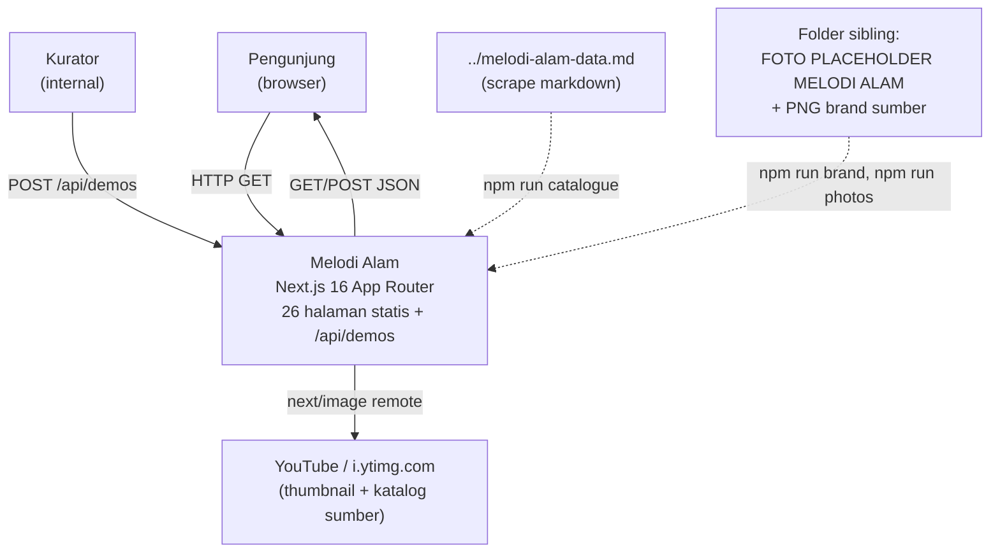
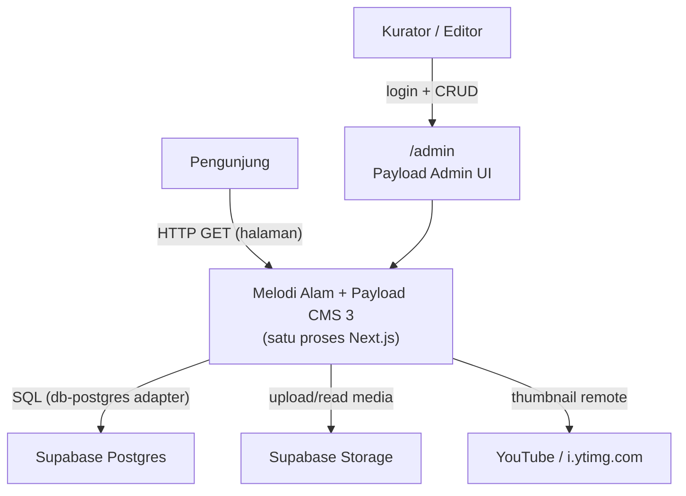
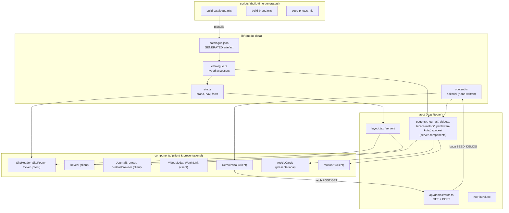
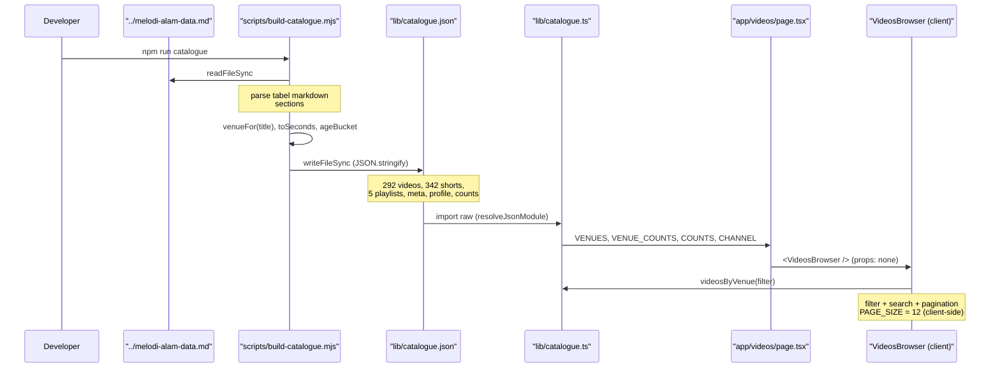
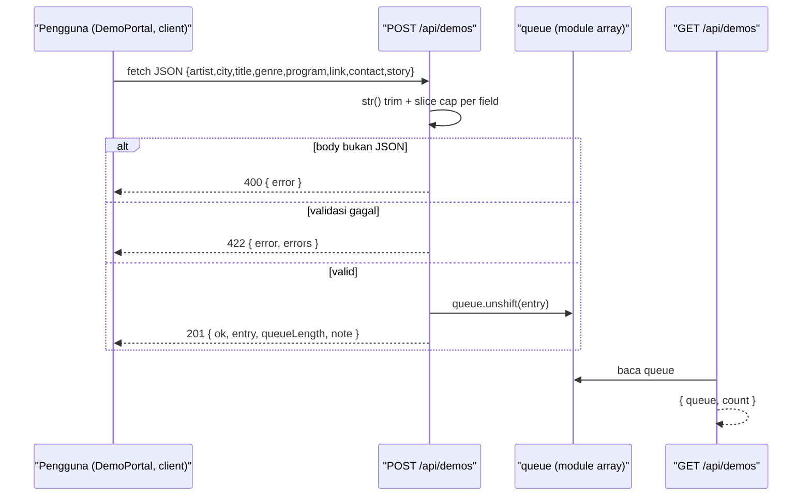

# ARCHITECTURE — Melodi Alam Web Platform

Dokumen ini menetapkan batas modul, kepemilikan data, arah dependensi, dan alur
data platform web **Melodi Alam**. Isi dibagi menjadi dua keadaan yang dipisahkan
secara eksplisit:

- **Current State — TERVERIFIKASI.** Arsitektur yang ada di repo `melodi-alam/`
  saat dokumen ini ditulis. Setiap klaim dibaca langsung dari sumber.
- **Proposed State — RENCANA.** Target arsitektur (Payload CMS 3 di dalam app ini
  + Supabase). Belum diimplementasikan. Fase ini **DOCS ONLY**.

Label status yang dipakai konsisten: `TERVERIFIKASI` (dibaca di kode atau dijalankan),
`RENCANA` (direncanakan, belum ada), `ASUMSI` (diasumsikan), `[PERLU VERIFIKASI]`
(tidak dapat dikonfirmasi dari sumber).

Acuan requirement: `FR-001`…`FR-007`, `BR-001`…`BR-004`, `ACC-001`…`ACC-003`,
`OQ-001`…`OQ-003`, `NFR-001`…`NFR-004`, `RISK-001`…`RISK-003`.

> **⚠️ Digantikan sebagian — baca ini dulu.**
> Dokumen ini disusun saat backend direncanakan memakai **Payload CMS 3 + Supabase**.
> Sejak itu CMS-nya diganti dengan **Sanity Studio**, dan seluruh kode Payload sudah
> dihapus.
>
> Bagian yang tidak lagi berlaku di dokumen ini: arsitektur backend, modul CMS, alur data
> tulis, dan kendala arsitektural. Lihat
> [`adr/0008-sanity-studio-menggantikan-payload.md`](adr/0008-sanity-studio-menggantikan-payload.md)
> dan [`SANITY-INTEGRATION.md`](SANITY-INTEGRATION.md) untuk keadaan sekarang. Bagian lain
> di dokumen ini masih relevan sejauh tidak menyangkut backend.

---

## 1. Architecture Overview

Melodi Alam adalah **satu aplikasi Next.js 16 App Router** (`TERVERIFIKASI`,
`package.json` → `next@16.4.0`, React `19.3.0`, Turbopack). Tidak ada backend
terpisah, tidak ada database, dan tidak ada environment variable yang dibaca di
mana pun saat ini (`TERVERIFIKASI` — grep tidak menemukan `process.env` dan tidak
ada file `.env`).

Bentuk arsitektur saat ini: **layered monolith statis dengan satu route handler
dinamis**. Seluruh halaman dirender pada build time; satu-satunya jalur runtime
dinamis adalah `POST /api/demos`.

Empat modul data di `lib/` adalah tulang punggungnya:

| Modul | Peran | Sumber |
|---|---|---|
| `lib/content.ts` | Sumber editorial yang ditulis tangan | `TERVERIFIKASI` |
| `lib/catalogue.json` | Artefak **generated** dari scrape YouTube | `TERVERIFIKASI` |
| `lib/catalogue.ts` | Aksesor bertipe di atas `catalogue.json` | `TERVERIFIKASI` |
| `lib/site.ts` | Copy brand, navigasi, tautan luar, fakta kanal | `TERVERIFIKASI` |

Target (`RENCANA`, keputusan pemilik — `OQ-002`): **Payload CMS 3 berjalan di dalam
app Next.js ini**, dengan **Supabase** sebagai Postgres dan object storage. Payload
tidak menjadi host terpisah; ia menempel pada App Router yang sudah ada.

**Keputusan kunci yang sudah dikunci** (jangan dibuka ulang, dokumentasikan saja):

| ID | Keputusan | Nilai |
|---|---|---|
| `OQ-002` | Backend & CMS | Payload CMS 3 di dalam app ini + Supabase (Postgres + Storage) |
| `OQ-001` | Moderasi demo | Moderated queue — submission privat sampai kurator menyetujui |
| — | Test & hosting | Vitest (unit/logic) + Playwright (E2E), deploy ke Vercel |
| — | Artikel | Route nyata `/journal/[slug]`; pemutar video tetap modal tanpa URL |
| — | Tipografi | Inter + Red Hat Display + Instrument Serif + JetBrains Mono |

**Constraint arsitektural yang membentuk struktur:**

1. Seluruh konten publik saat ini **build-time**. Tidak ada lapisan fetch server
   saat request untuk artikel/katalog.
2. Batas server/client ditentukan oleh kebutuhan interaktivitas, bukan estetika.
3. `lib/catalogue.json`, `public/brand/`, dan `public/photos/` adalah **artefak
   generated** — ada aturan "jangan diedit tangan".

---

## 2. Requirements and Constraints

### 2.1 Architectural drivers

| Driver | Bukti / acuan |
|---|---|
| Situs publik statis dan cepat | 26 halaman statis pada build (`TERVERIFIKASI` via brief) |
| Pembaruan konten tanpa deploy | Kebutuhan CMS — `RENCANA` |
| Pipeline demo submission yang dimoderasi | `OQ-001`, `FR-005`, `FR-006` |
| Pencarian/filter client-side | `/journal`, `/videos` (`TERVERIFIKASI`) |
| Metadata & SEO per artikel | `app/journal/[slug]/page.tsx` → `generateMetadata` (`TERVERIFIKASI`) |
| Aksesibilitas dan reduced motion | `ACC-001`…`ACC-003`; `globals.css` + `Reveal` |
| Keamanan input demo | `SECURITY-PRIVACY.md`, `FR-005` |

### 2.2 Confirmed constraints (TERVERIFIKASI)

- **Stack terkunci:** Next.js `16.4.0`, React `19.3.0`, TypeScript `^5`, Tailwind
  CSS `^4` lewat `@tailwindcss/turbopack`, `motion@^14.2.0`, `sharp@^0.35.5`.
- **Port dev 3100**, bukan 3000 (`package.json`: `next dev -p 3100`).
- **Skrip npm yang ada hanya enam:** `dev`, `build`, `start`, `lint`,
  `catalogue`, `brand`, `photos`. Tidak ada skrip test (`[PERLU VERIFIKASI]` untuk
  Vitest/Playwright — belum terpasang).
- **Tidak ada env var** yang dibaca; tidak ada `.env`.
- **`next.config.ts`** mengaktifkan `cacheComponents: true` dan
  `partialPrefetching: true`, dan hanya mengizinkan satu remote image host:
  `https://i.ytimg.com/vi/**`.
- **Alias path** `@/*` → root proyek (`tsconfig.json` `paths`).

### 2.3 Assumptions (ASUMSI)

- `ASUMSI` — Load early-stage; jumlah kurator kecil (1–3 orang). Tidak ada
  kebutuhan multi-tenant atau RBAC kompleks.
- `ASUMSI` — Deployment target Vercel, sehingga route handler berjalan sebagai
  serverless/edge function dan **state in-memory tidak reliabel secara horizontal**.
- `ASUMSI` — Traffic artikel/katalog jauh lebih besar daripada traffic submit demo.

### 2.4 Unresolved questions (lihat Open Questions di akhir)

- Sumber kebenaran tunggal pasca-migrasi: Payload saja, atau Payload + artefak
  build-time berdampingan?
- Nasib `lib/content.ts` dan `lib/catalogue.json` setelah Payload aktif.

---

## 3. Architectural Style

### 3.1 Current State — TERVERIFIKASI

**Layered monolith + build-time content layer.** Tidak ada modular monolith
eksplisit; batas modul saat ini diberikan oleh *jenis berkas* (`lib/`, `components/`,
`app/`, `scripts/`) dan oleh directive `"use client"`.

Alasan bentuk ini cocok sekarang:

- Tidak ada kebutuhan deployment independen per domain.
- Seluruh konten editorial berubah jarang dan melalui PR, bukan melalui UI.
- Andaian (sebelum Payload) tidak memerlukan database.

Biaya/batasan:

- Pembaruan konten = perubahan kode + rebuild + deploy.
- State dinamis (`/api/demos`) hilang saat proses restart.
- Tidak ada jalur tulis (write path) selain route handler demo.

### 3.2 Proposed State — RENCANA

**Modular monolith yang sama, dengan lapisan aplikasi (CMS) ditambahkan di dalam
proses yang sudah ada.**

- Payload CMS 3 menyatu ke App Router (bukan service terpisah).
- Supabase Postgres menjadi *source of truth* untuk entitas yang dapat diubah
  runtime (artikel baru, submission demo, media).
- Lapisan konten build-time (`lib/content.ts`, `lib/catalogue.json`) tetap ada
  selama migrasi sebagai *frozen read-only* sampai halaman dipindahkan.

Alternatif yang dipertimbangkan dan ditolak (dicatat, bukan dibuka ulang):

| Alternatif | Alasan ditolak |
|---|---|
| Payload studio sebagai host terpisah | Menambah satu deployment, CORS, dan duplikasi auth; lihat §12 ADR-002 |
| CMS headless SaaS pihak ketiga | Keluar dari keputusan pemilik; menambah vendor |
| Postgres langsung tanpa Payload | Tidak memenuhi kebutuhan editor non-teknis |

Trade-off utama target: menambah **dua sumber data** selama migrasi. Ini adalah
harga yang disadari; mitigasinya ada di §13.

---

## 4. System Context and Component Diagrams

### 4.1 Context diagram — Current (TERVERIFIKASI)



Catatan: tidak ada autentikasi, tidak ada admin, tidak ada database — sesuai
temuan kode.

### 4.2 Context diagram — Target (RENCANA)



`RENCANA` — nama adapter, rute admin, dan endpoint REST/GraphQL Payload
`[PERLU VERIFIKASI]` terhadap versi Payload 3 yang akhirnya dipasang.

### 4.3 Component / module diagram — Current (TERVERIFIKASI)



**Aturan arah dependensi yang sudah berlaku (`TERVERIFIKASI`):**

- `lib/*` tidak pernah mengimpor dari `app/` atau `components/`.
- `components/*` boleh mengimpor `lib/*`; tidak pernah sebaliknya.
- `app/*` mengorkestrasi `lib/*` dan `components/*`.
- `scripts/*` hanya menulis ke berkas generated; tidak diimpor oleh runtime app.

---

## 5. Module Inventory

Modul saat ini (TERVERIFIKASI):

| Module ID | Module Name | Responsibility | Owned Data | Dependencies | Public Interface |
|---|---|---|---|---|---|
| MOD-001 | `lib/content.ts` | Editorial hand-written + enum & seed demo | `ARTICLES`, `INTERVIEW_ROWS`, `GENRE_ROWS`, `SPACE_ITEMS`, `TICKER_ITEMS`, `SEED_DEMOS`, `DEMO_GENRES`, `DEMO_PROGRAMS` | tidak ada | Named const exports + tipe `Article`, `InterviewRow`, `GenreRow`, `SpaceItem`, `DemoSubmission`, `ArticleCategory` |
| MOD-002 | `lib/catalogue.json` | Artefak generated katalog YouTube | 292 videos, 342 shorts, 5 playlists, `meta`, `profile`, `counts` | dihasilkan MOD-008 | Berkas JSON (data) |
| MOD-003 | `lib/catalogue.ts` | Aksesor bertipe & util di atas MOD-002 | tidak ada (turunan) | MOD-002 | `catalogue`, `CHANNEL`, `PROFILE`, `COUNTS`, `VIDEOS`, `SHORTS`, `PLAYLISTS`, `VENUES`, `VENUE_COUNTS`, `fact`, `factValue`, `getVideo`, `videosByIds`, `videosByVenue`, `topVideos`, `latestVideos`, `viewCount`, `formatDuration`, `thumbnailFor` |
| MOD-004 | `lib/site.ts` | Copy brand, nav, tautan luar | `SITE`, `PRIMARY_NAV`, `SUBMIT_NAV`, `FOOTER_RUBRIKS`, `EXTERNAL_LINKS`, `CHANNEL_FACTS` | MOD-003 | Named const exports + `NavItem` |
| MOD-005 | `app/` pages | Presentasi rute & metadata | tidak ada (view) | MOD-001, MOD-003, MOD-004, MOD-006 | Rute HTTP |
| MOD-006 | `components/` | Interaktivitas client + presentational | UI state lokal | MOD-001, MOD-003 | Komponen React |
| MOD-007 | `app/api/demos/route.ts` | Validasi + queue demo in-memory | `queue` (array proses-lokal) | MOD-001 | `GET`, `POST /api/demos` |
| MOD-008 | `scripts/` | Generator artefak build-time | `lib/catalogue.json`, `public/brand/**`, `public/photos/**` | sumber sibling di workspace | Skrip CLI (`npm run catalogue/brand/photos`) |

Modul target (RENCANA):

| Module ID | Module Name | Responsibility | Owned Data | Dependencies |
|---|---|---|---|---|
| MOD-101 | Payload core in-app | Admin, collections, access control, REST/GraphQL | schema & records Postgres | MOD-102, MOD-103 |
| MOD-102 | Supabase Postgres | Persistensi entitas runtime | tabel koleksi Payload | — |
| MOD-103 | Supabase Storage | Media & aset unggahan | berkas media | — |
| MOD-104 | Demo moderation | Alur status submission (private → approved) | field status + audit | MOD-101, MOD-102 |

---

## 6. Module Specifications

### MOD-001 — `lib/content.ts` (TERVERIFIKASI)

- **Tujuan.** Satu-satunya sumber editorial yang ditulis tangan.
- **Tanggung jawab.** Artikel (12 entri), baris wawancara, baris genre/kota, item
  spaces, item ticker, enum genre & program demo, seed queue.
- **Bukan tanggung jawab.** Tidak menyimpan angka kanal (itu dari MOD-003), tidak
  melakukan I/O, tidak tahu rute.
- **Batas internal.** `Article.body` adalah **array of plain strings**, bukan HTML —
  sehingga content layer tidak dapat menyuntik markup (`TERVERIFIKASI`, komentar
  di kepala berkas). Ini batas keamanan yang harus dipertahankan saat pindah ke CMS.
- **Antarmuka.** Named const + tipe; lihat §5.
- **Strategi pengujian.** Unit test murni atas invarian data (mis. setiap
  `GENRE_ROWS[].videoId` ada di katalog atau `null`).

### MOD-002 / MOD-003 — katalog (TERVERIFIKASI)

- **Tujuan.** MOD-002 menyimpan hasil scrape; MOD-003 menyajikannya bertipe.
- **Tanggung jawab MOD-003.** Memetakan `catalogue.json` ke tipe yang di-*cast*
  (`raw as Catalogue`) dan menyediakan query: filter venue, pencarian by id,
  sorting by view count, parsing string view YouTube ("107K" → number).
- **Bukan tanggung jawab.** Tidak memutasi data; tidak menghasilkan artefak.
- **Hazard.** Bidang `views` adalah **string tampilan YouTube yang dibulatkan**,
  dan `uploaded` adalah **usia relatif terhadap tanggal scrape** (`TERVERIFIKASI`,
  `viewCount()` dan `ageBucket`). Setiap konsumen angka harus sadar ini.

### MOD-004 — `lib/site.ts` (TERVERIFIKASI)

- **Tujuan.** Copy brand/navigasi + fakta kanal.
- **Ketergantungan tak terduga.** `site.ts` **mengimpor `CHANNEL` dan `COUNTS`
  dari `./catalogue`** untuk membangun `CHANNEL_FACTS`. Jadi tidak ada angka yang
  di-hardcode di lapisan situs — angka kanal selalu dari artefak generated.

### MOD-005 — halaman App Router (TERVERIFIKASI)

- **Tanggung jawab.** Metadata, komposisi layout, pengambilan data build-time dari
  MOD-001/MOD-003/MOD-004, dan penyusunan komponen client.
- **Bukan tanggung jawab.** Tidak menyimpan state interaktif; tidak menulis data.
- **Pola.** Halaman tetap **server component**; interaktivitas diekstrak ke
  MOD-006 (mis. `app/journal/page.tsx` merender `<JournalBrowser />`).

### MOD-006 — komponen client (TERVERIFIKASI)

13 komponen ber-directive `"use client"` (dibaca langsung dari `components/`):

| Komponen | Mengapa harus client |
|---|---|
| `SiteHeader` | Drawer mobile + state toggle |
| `ScrollProgress` | Listener scroll |
| `Reveal` | `IntersectionObserver` |
| `JournalBrowser` | Filter kategori + live search + state |
| `VideosBrowser` | Filter venue + search + pagination + state |
| `VideoModal` | Modal + listener `CustomEvent("melodi:watch")` + Escape |
| `WatchLink` | Click handler dengan `href` asli sebagai progressive enhancement |
| `DemoPortal` | Form, preview audio lokal, `fetch` ke `/api/demos` |
| `motion/MotionRoot` | Provider animasi (`motion/react`) |
| `motion/RevealText` | Animasi teks |
| `motion/ParallaxImage` | Transform scroll |
| `motion/CountUp` | Angka beranimasi |
| `motion/MarqueeTape` | Marquee |

`ArticleCards` dan `SiteFooter` tidak ber-client (presentational), dirender dari
server component.

### MOD-007 — `app/api/demos/route.ts` (TERVERIFIKASI)

- **Tujuan.** Validasi boundary + queue demo.
- **Owned data.** `const queue: DemoSubmission[]` — **array proses-lokal**,
  di-seed dari `SEED_DEMOS`.
- **Bukan tanggung jawab.** Bukan database; tidak menyimpan `contact` (lihat §8.3).
- **Kontrak.** `MAX_FIELD = 500` sebagai default; cap per field eksplisit di §9.

### MOD-101…MOD-104 — target (RENCANA)

- **MOD-101 Payload core.** Menyediakan admin UI, definisi collection, kontrol
  akses, dan endpoint data. Menempel pada App Router; detail mount point
  `[PERLU VERIFIKASI]`.
- **MOD-102 Supabase Postgres.** Sumber kebenaran entitas runtime (artikel baru,
  submission demo, media metadata). Skema & migrasi dimiliki `DATA-MODEL.md`.
- **MOD-103 Supabase Storage.** Menyimpan media unggahan; menggantikan satu-satunya
  remote host `i.ytimg.com` untuk aset yang diunggah kurator.
- **MOD-104 Demo moderation.** Menerapkan `OQ-001`: submission privat sampai
  disetujui; queue publik hanya menampilkan entri approved dan **tidak memuat PII**.

---

## 7. Dependency Rules

**Aturan yang berlaku (TERVERIFIKASI / RENCANA):**

| # | Aturan | Status |
|---|---|---|
| R1 | `lib/*` tidak boleh mengimpor `app/*` atau `components/*` | `TERVERIFIKASI` (dipatuhi) |
| R2 | `components/*` boleh mengimpor `lib/*`; arah sebaliknya dilarang | `TERVERIFIKASI` |
| R3 | `app/*` adalah orkestrator; boleh mengimpor `lib/*` dan `components/*` | `TERVERIFIKASI` |
| R4 | `scripts/*` tidak boleh diimpor runtime app; hanya menulis berkas generated | `TERVERIFIKASI` |
| R5 | `lib/catalogue.json` **tidak boleh diedit tangan** | `TERVERIFIKASI` (hazard #8) |
| R6 | `lib/catalogue.ts` dan generator (`build-catalogue.mjs`) harus diubah bersamaan bila bentuk data berubah | `TERVERIFIKASI` (README) |
| R7 | `MOD-101` Payload hanya diakses dari server (route handler / server component); client tidak mengimpor SDK Payload | `RENCANA` |
| R8 | Tidak ada modul yang boleh memiliki dua sumber kebenaran untuk entitas yang sama | `RENCANA` (target migrasi) |

**Pencegahan siklus.** Tidak ada siklus hari ini karena `lib/` adalah daun graf dan
`site → catalogue → catalogue.json` satu arah. Saat Payload masuk, arah yang
dilarang adalah `MOD-003 → MOD-101` (modul aksesor statis tidak memanggil CMS)
dan `MOD-101 → MOD-005` (CMS tidak mengimpor halaman).

---

## 8. Data Ownership and Data Flow

### 8.1 Peta kepemilikan (TERVERIFIKASI)

| Data | Pemilik (authoritative) | Pembaca | Penulis |
|---|---|---|---|
| Artikel editorial | MOD-001 | MOD-005, MOD-006 | manusia (edit kode) |
| Katalog video | MOD-002 (generated) | MOD-003, MOD-004, MOD-005, MOD-006 | MOD-008 |
| Fakta kanal | MOD-002 | MOD-004 | MOD-008 |
| Brand & nav | MOD-004 | MOD-005, MOD-006 | manusia |
| Queue demo | MOD-007 (array) | MOD-006 | MOD-007 (POST) |

### 8.2 Data flow A — pipeline katalog (TERVERIFIKASI)

Jalur end-to-end dari scrape ke UI:



Detail penting (`TERVERIFIKASI`):

- Generator mencari sumber di dua kandidat: `../melodi-alam-data.md` (workspace root)
  atau `melodi-alam-data.md` (project root), lalu `process.exit(1)` bila tak ada.
- Output: `lib/catalogue.json`, ditulis dengan `JSON.stringify(payload, null, 2)`.
- `VideosBrowser` **tidak menerima props** — ia mengimpor langsung dari
  `@/lib/catalogue`, jadi seluruh dataset ikut ke bundle client.

### 8.3 Data flow B — pipeline demo (TERVERIFIKASI)



Temuan struktural pada jalur ini (`TERVERIFIKASI`):

- `contact` **tidak dipersistensi**. Nilainya hanya muncul kembali di string
  `note` pada respons `201`. Jadi tidak ada PII at rest hari ini — tetapi juga
  tidak ada cara kurator menghubungi artis. Ini gap yang harus diperbaiki secara
  sadar (lihat `SECURITY-PRIVACY.md`).
- File audio opsional **hanya dipratinjau di browser** (`URL.createObjectURL`);
  tidak ada upload.
- Karena store adalah array proses-lokal, respons `GET` **bergantung pada instance**
  yang melayani request. `ASUMSI` di Vercel (multi-instance) ini tidak konsisten.

### 8.4 State ownership (TERVERIFIKASI)

| Jenis state | Tempat | Catatan |
|---|---|---|
| UI state filter/search/pagination | Lokal di `JournalBrowser` / `VideosBrowser` | tidak di URL |
| State modal video | `VideoModal` via `CustomEvent` | tanpa URL — keputusan terkunci |
| Queue demo (server) | `array` modul di route handler | proses-lokal, reset saat restart |
| Konten | Build-time, tidak ada runtime state | — |

### 8.5 Target data flow (RENCANA)

Setelah Payload aktif, dua alur baru muncul:

1. **Edit konten.** Kurator → `/admin` → Payload `create`/`update` → adapter
   Postgres → Supabase. Halaman publik membaca dari Payload (via server component /
   route handler) menggantikan impor langsung `lib/content.ts`.
2. **Moderasi demo.** `POST /api/demos` → validasi (dipertahankan) → tulis ke
   koleksi Payload dengan `status = pending` → kurator menyetujui → `status =
   approved` → GET publik hanya mengembalikan entri approved (`OQ-001`).

Detail skema, migrasi, dan RLS dimiliki `DATA-MODEL.md` — bukan dokumen ini.

---

## 9. Integration Contracts

### 9.1 `POST /api/demos` (TERVERIFIKASI)

Payload diterima: `{ artist, city, title, genre, program, link, contact, story }`.

Cap per field setelah trim + `slice`:

| Field | Cap |
|---|---|
| `artist` | 120 |
| `city` | 80 |
| `title` | 160 |
| `genre` | 60 |
| `program` | 80 |
| `link` | 500 |
| `contact` | 160 |
| `story` | 2000 |

Respons:

| Status | Body | Kondisi |
|---|---|---|
| `400` | `{ error: "Body harus berupa JSON." }` | body bukan JSON |
| `422` | `{ error, errors }` | field wajib kosong, `link` bukan `http(s)://`, atau `genre`/`program` di luar enum |
| `201` | `{ ok, entry, queueLength, note }` | sukses |

Field wajib: `artist`, `city`, `title`, `story`, `contact`, `link`. Kontrak penuh
ada di `API-CONTRACTS.md`.

### 9.2 `GET /api/demos` (TERVERIFIKASI)

`200 { queue: DemoSubmission[], count: number }`.

### 9.3 Kontrak antar-modul internal (TERVERIFIKASI)

- MOD-008 → MOD-002: skema JSON di §8.2. Perubahan bentuk wajib disertai
  perubahan MOD-003 (R6).
- MOD-004 → MOD-003: `site.ts` membaca `CHANNEL` + `COUNTS`.

### 9.4 Kontrak target (RENCANA)

- App ↔ Supabase Postgres: koneksi via adapter Payload `[PERLU VERIFIKASI]` nama
  paket & varian koneksi (direct vs pooler).
- App ↔ Supabase Storage: bucket media + endpoint S3-compatible
  `[PERLU VERIFIKASI]`.
- Endpoint Payload REST/GraphQL: rute persis `[PERLU VERIFIKASI]` terhadap versi
  Payload 3 yang dipasang.

---

## 10. Repository Structure

### 10.1 Struktur saat ini (TERVERIFIKASI)

```text
melodi-alam/
├── app/
│   ├── layout.tsx            Root layout: 4 font, MotionRoot, ScrollProgress,
│   │                         Ticker, SiteHeader, <main>, SiteFooter, metadata
│   ├── page.tsx              Landing + teaser semua seksi
│   ├── globals.css           Tailwind v4 @theme + @utility + @source not
│   ├── icon.png / apple-icon.png / favicon.ico   (generated, MOD-008)
│   ├── not-found.tsx         404
│   ├── api/demos/route.ts    GET + POST queue demo (MOD-007)
│   ├── journal/page.tsx              index + JournalBrowser
│   ├── journal/[slug]/page.tsx       artikel statis + generateMetadata
│   ├── bicara-melodi/page.tsx        interview index
│   ├── videos/page.tsx               katalog + playlists
│   ├── pahlawan-kota/page.tsx        direktori genre/kota
│   ├── spaces/page.tsx               spaces & instruments
│   └── submit/page.tsx               form + queue
├── components/               (13 client component + presentational)
│   └── motion/               MotionRoot, RevealText, ParallaxImage, CountUp, MarqueeTape
├── lib/
│   ├── content.ts            MOD-001
│   ├── catalogue.json        MOD-002 (GENERATED)
│   ├── catalogue.ts          MOD-003
│   └── site.ts               MOD-004
├── scripts/                  MOD-008 (build-catalogue, build-brand, copy-photos)
├── public/
│   ├── brand/                medallion + wordmark (GENERATED)
│   └── photos/               33 foto placeholder (GENERATED)
├── next.config.ts            cacheComponents, partialPrefetching, remotePatterns
├── package.json              6 skrip npm
└── tsconfig.json             alias @/* -> ./*
```

### 10.2 Struktur target (RENCANA)

```text
melodi-alam/
├── app/
│   ├── (frontend)/           halaman publik (pindah tak wajib)
│   ├── (payload)/            mount Payload admin + API   [RENCANA, PERLU VERIFIKASI]
│   └── api/demos/route.ts    tetap; tulis ke koleksi Payload
├── lib/
│   ├── content.ts            frozen read-only selama migrasi
│   ├── catalogue.ts          tetap (katalog scrape tidak masuk CMS)
│   └── cms/                  [RENCANA] akses Payload terpusat (server-only)
├── payload.config.ts         [RENCANA] konfigurasi Payload
├── collections/              [RENCANA] definisi collection
└── ...
```

`RENCANA` — penempatan pasti `payload.config.ts` dan route group `(payload)`
`[PERLU VERIFIKASI]`.

---

## 11. Cross-Cutting Concerns

| Concern | Pemilik saat ini | Bukti / status | Target |
|---|---|---|---|
| Validasi input | MOD-007 | `TERVERIFIKASI` — `str()`, enum, regex `link` | Tetap di route; tambah validasi Payload (`RENCANA`) |
| Keamanan/PII | MOD-007 | `TERVERIFIKASI` — `contact` tak dipersistensi | Simpan sebagai PII terlindungi, bukan publik (`RENCANA`) |
| Error handling | Per-komponen | `TERVERIFIKASI` — `catch` + banner di `DemoPortal` | Standarkan (`RENCANA`) |
| Konfigurasi/env | — | `TERVERIFIKASI` — tidak ada env var hari ini | Env baru ditambahkan fase berikutnya: koneksi DB, `PAYLOAD_SECRET`, kunci Storage |
| Metadata/SEO | MOD-005 | `TERVERIFIKASI` — `metadata`/`generateMetadata` | Dipertahankan; jaga konsistensi nama brand (§13) |
| Aksesibilitas | `globals.css` + komponen | `TERVERIFIKASI` — `prefers-reduced-motion` dihormati | `ACC-001`…`ACC-003` |
| Testing | — | Tidak ada runner test (`[PERLU VERIFIKASI]`) | Vitest + Playwright (`RENCANA`) |
| Build/deploy | `next.config.ts` | `TERVERIFIKASI` — build statis | Vercel (`RENCANA`) |
| Observability | — | Tidak ada | `RENCANA` |

---

## 12. Architecture Decision Records

ADR kanonik hidup sebagai berkas terpisah di `docs/adr/0001..0005-*.md` (bagian
dari doc set). Ringkasannya yang relevan dengan arsitektur:

### ADR-001 — Pilih Next.js App Router monolith untuk situs publik

- **Context.** Situs editorial + katalog, tanpa kebutuhan multi-service.
- **Decision.** Satu app App Router, halaman statis.
- **Alternatives.** SPA terpisah + API; SSG statis terpisah dari app.
- **Consequences.** Cepat & sederhana; biaya: perubahan konten butuh rebuild.
- **Status.** `TERVERIFIKASI` (terimplementasi).

### ADR-002 — Payload CMS 3 berjalan di dalam app ini (bukan studio terpisah)

- **Context.** `OQ-002`; situs sudah jadi app Next.js; kurator butuh UI edit.
- **Decision.** Payload menempel pada App Router yang ada.
- **Alternatives.** (a) Host studio terpisah; (b) CMS SaaS headless.
- **Consequences.** Satu deployment, tanpa CORS/auth ganda, memakai ulang auth
  Next; risiko: bundle & routing lebih rapat, upgrade Payload terikat versi Next.
  Alternatif (a) ditolak karena menambah permukaan operasional tanpa manfaat.
- **Status.** `RENCANA` (belum diimplementasikan).

### ADR-003 — Supabase sebagai Postgres + Storage

- **Context.** `OQ-002`; butuh DB terkelola + object storage.
- **Decision.** Supabase untuk keduanya.
- **Alternatives.** Postgres terkelola lain + S3 lain; self-host.
- **Consequences.** Satu vendor, RLS tersedia; detail ditangani `DATA-MODEL.md`.
- **Status.** `RENCANA`.

### ADR-004 — Katalog YouTube tetap build-time, bukan CMS

- **Context.** Katalog berasal dari scrape (`melodi-alam-data.md`) dan bersifat
  turunan, bukan editorial.
- **Decision.** `catalogue.json` tetap dihasilkan `npm run catalogue`; tidak
  dipindah ke Payload.
- **Alternatives.** Impor manual katalog ke CMS.
- **Consequences.** Menghindari duplikasi 600+ record; tetapi berarti dua model
  konten (editorial via CMS, katalog via artefak) berdampingan.
- **Status.** `RENCANA` (diusulkan di dokumen ini) — **perlu persetujuan pemilik**.

### ADR-005 — Artikel sebagai route nyata, video tetap modal

- **Context.** Sudah dikunci pemilik.
- **Decision.** `/journal/[slug]` crawlable; pemutar video modal tanpa URL.
- **Consequences.** SEO artikel; biaya: video tak dapat di-deeplink.
- **Status.** `TERVERIFIKASI` (terimplementasi).

---

## 13. Risks and Evolution Strategy

### 13.1 Risks (terhubung ke temuan terukur)

> ID register ini memakai namespace `ARCH-RISK-*` secara sengaja. `RISK-001`…`RISK-003`
> milik register risiko PRD (spam/unggahan, bandwidth & storage, pembatasan embed) dan
> dirujuk dokumen lain dengan arti itu. Jangan memakai kedua namespace secara campur.

| ID | Risiko | Bukti / status | Mitigasi |
|---|---|---|---|
| ARCH-RISK-001 | **Tailwind content scan** menabrak direktori tool dan mematikan seluruh CSS secara diam-diam | `TERVERIFIKASI` — `@source not "../.codegraph"`, `"../.gitnexus"`, `"../.next"` di `globals.css` | Setiap direktori tool baru di root proyek wajib ditambah `@source not` |
| ARCH-RISK-002 | Batas server/client salah tempat → markup ter-render server membawa state tersembunyi | `TERVERIFIKASI` — aturan: SSR merender keadaan akhir, animasi hanya memperkaya | Review komponen client baru terhadap aturan ini |
| ARCH-RISK-003 | `catalogue.json` diedit tangan → drift dari scrape | `TERVERIFIKASI` — hazard #8 | Jaga generator sebagai satu-satunya penulis; review diff artefak |
| ARCH-RISK-004 | State demo in-memory hilang antar-instance | `TERVERIFIKASI` — array proses-lokal | Digantikan Postgres (`MOD-102`) — `RENCANA` |
| ARCH-RISK-005 | Selama migrasi, dua sumber kebenaran editorial | `RENCANA` | Bekukan `lib/content.ts` read-only; migrasi per-halaman, bukan big-bang |
| ARCH-RISK-006 | Ketergantungan Payload pada versi Next | `RENCANA` | Pin versi, uji upgrade di preview |

### 13.2 Constraints arsitektural dari temuan terukur

Temuan berikut adalah **constraint arsitektural**, bukan trivia. Yang mengubah
struktur:

- **Tailwind source scanning (temuan #1, TERVERIFIKASI).** Karena scanner Tailwind
  berjalan atas seluruh proyek dan bisa *panic* pada berkas terkunci (mis.
  `codegraph.db-shm`) sehingga menghasilkan CSS kosong tanpa error, setiap
  direktori baru di root — termasuk yang akan ditambah migrasi — harus dievaluasi
  terhadap `@source not`. Ini keputusan struktur, bukan konfigurasi kosmetik.
- **Batas server/client (temuan #4, #5, TERVERIFIKASI).** (a) Membaca `scrollWidth`
  di dalam frame loop memaksa reflow sinkron dan pernah menurunkan halaman ke
  ~1 rAF/detik sehingga `IntersectionObserver` berhenti dan konten tertahan
  `opacity: 0` — karena itu digantikan `ResizeObserver`. (b) Jangan memanggang
  keadaan tersembunyi ke HTML server-rendered; aturannya SSR merender keadaan
  akhir. Keduanya menentukan di mana state dan efek boleh hidup → memengaruhi
  batas MOD-005/MOD-006.
- **Pipeline artefak generated (temuan #8, #6, TERVERIFIKASI).** `catalogue.json`
  dihasilkan dan tidak boleh diedit tangan; kelas yang dibuat via string
  interpolation (`aspect-[${x}]`) tidak terlihat Tailwind dan pernah meruntuhkan
  12 frame kartu. Konsekuensi: nama kelas harus literal, dan artefak generated
  punya satu penulis (MOD-008).
- Temuan lain yang tetap relevan secara front-end namun tidak mengubah batas
  modul: `next/image` `fill` butuh ancestor berposisi (temuan #2);
  `transform: scale()` melembutkan foto — parallax memakai box oversized
  (temuan #3); Next 16 mengganti `priority` → `preload` dan default `qualities`
  → `[75]` (temuan #7). Detail UI ada di `DESIGN-SYSTEM.md` dan `FRONTEND-PLAN.md`.

### 13.3 Evolution strategy

1. **Fase docs (sekarang).** Tidak ada perubahan kode.
2. **Fondasi CMS (`RENCANA`).** Pasang Payload + Supabase, buat collection
   `Articles` & `DemoSubmissions`, mount admin. `lib/*` belum disentuh.
3. **Migrasi demo + moderasi (`RENCANA`).** Pindahkan `MOD-007` ke koleksi Payload;
   terapkan alur approve (`OQ-001`); simpan `contact` sebagai PII terlindungi.
4. **Migrasi artikel per-slug (`RENCANA`).** Pindahkan `/journal` dan
   `/journal/[slug]` membaca dari Payload; bekukan `lib/content.ts`.
5. **Pembersihan (`RENCANA`).** Hapus jalur statis yang tak lagi dipakai.

Rollback: setiap langkah menambah pembaca baru tanpa menghapus sumber lama sampai
terbukti setara — sehingga rollback = mengembalikan pembaca ke `lib/*`.

---

## 14. Validation Checklist

- [x] Setiap modul punya tanggung jawab yang berbeda dan dapat dipertahankan (§5).
- [x] Setiap capability bisnis punya pemilik jelas (§8.1).
- [x] Tidak ada dependensi sirkular (`lib → lib`, satu arah) (`TERVERIFIKASI`).
- [x] Antarmuka publik eksplisit dan terbatas (§5, §9).
- [x] Aturan komunikasi antar-modul terdokumentasi (§7).
- [x] Kepemilikan data & sumber kebenaran jelas (§8).
- [x] Aturan bisnis tidak bergantung pada perilaku UI spesifik.
- [x] Detail infrastruktur tidak bocor ke modul bisnis (saat ini belum ada infra).
- [x] Kegagalan integrasi punya perilaku yang didefinisikan (§9.1 status `400/422/201`).
- [x] Keamanan diterapkan di batas yang benar (validasi di `MOD-007`).
- [x] Pengujian dapat memverifikasi modul kritis (target Vitest/Playwright).
- [x] Struktur repo sesuai arsitektur yang didokumentasikan (§10).
- [x] Arsitektur sesuai kebutuhan operasional & kemampuan tim (satu app, tim kecil).
- [x] Tidak ada komponen yang ada hanya demi "best practice" (`ASUMSI`).
- [ ] **Terbuka:** sumber kebenaran tunggal pasca-migrasi (§13.2, Open Questions).

---

## Verification Notes

Berkas yang dibaca langsung untuk dokumen ini:

- `melodi-alam/package.json` — versi `next@16.4.0`, `react@19.3.0`, `motion@^14.2.0`,
  `sharp@^0.35.5`, `@tailwindcss/turbopack@^4`, enam skrip npm, port 3100.
- `melodi-alam/next.config.ts` — `cacheComponents`, `partialPrefetching`,
  `images.remotePatterns` (hanya `i.ytimg.com`), rule Turbopack Tailwind.
- `melodi-alam/app/layout.tsx` — empat font, urutan provider, `<main>`, metadata.
- `melodi-alam/app/page.tsx` — konsumsi `ARTICLES`, `GENRE_ROWS`, `INTERVIEW_ROWS`,
  `SPACE_ITEMS`, `latestVideos`, `videosByIds`, `COUNTS`.
- `melodi-alam/app/globals.css` (60 baris pertama) — tiga direktif `@source not`,
  `@theme` token, layer base.
- `melodi-alam/lib/site.ts` — `SITE`, `PRIMARY_NAV`, `SUBMIT_NAV`, `FOOTER_RUBRIKS`,
  `EXTERNAL_LINKS`, `CHANNEL_FACTS`, fungsi `compact`.
- `melodi-alam/lib/catalogue.ts` — seluruh aksesor & util (lihat §5).
- `melodi-alam/lib/content.ts` — struktur & ekspor; tipe `Article`,
  `InterviewRow`, `GenreRow`, `SpaceItem`, `DemoSubmission`; `DEMO_GENRES`,
  `DEMO_PROGRAMS`, `SEED_DEMOS`; catatan "array of plain strings".
- `melodi-alam/app/api/demos/route.ts` — `GET`/`POST`, cap field, validasi,
  status `400/422/201`, fakta `contact` tak dipersistensi.
- `melodi-alam/scripts/build-catalogue.mjs` — sumber kandidat, parsing section,
  `venueFor`, `toSeconds`, `ageBucket`, penulisan `lib/catalogue.json`.
- `melodi-alam/scripts/copy-photos.mjs` — sumber/`public/photos`, 33 berkas.
- `melodi-alam/scripts/build-brand.mjs` (50 baris pertama) — output `public/brand`.
- `melodi-alam/app/videos/page.tsx`, `app/journal/page.tsx`,
  `app/journal/[slug]/page.tsx`, `app/submit/page.tsx` — pola server component.
- `melodi-alam/components/VideosBrowser.tsx`, `VideoModal.tsx`, `DemoPortal.tsx`
  (bagian awal) — batas client.
- `melodi-alam/tsconfig.json` — alias `@/*`.
- Direktori `components/` (13 berkas `"use client"`), `scripts/` (3 berkas),
  `lib/` (4 berkas), `public/brand/` (6 berkas), `public/photos/` (33 berkas).
- `melodi-alam/README.md` — konteks tambahan (catatan: README menyebut Unsplash &
  Plus Jakarta Sans; ini **stale** dibanding kode — lihat Open Questions).

Tidak dijalankan: `npm run build`, `npm run dev`, `npm run lint`, `npm run
catalogue`. Tidak ada berkas selain `docs/ARCHITECTURE.md` yang diubah. Fase
DOCS ONLY dipatuhi.

---

## Open Questions

1. **Sumber kebenaran tunggal pasca-migrasi.** Apakah `lib/content.ts` dan
   `lib/catalogue.json` dipertahankan sebagai artefak build-time di samping
   Payload, atau dihapus? Rekomendasi dokumen ini: katalog tetap artefak
   (ADR-004), editorial pindah penuh ke Payload. **Perlu keputusan pemilik.**
2. ~~**Konsistensi nama brand.**~~ **Selesai.** Header `<h1>` sempat memakai
   wordmark "MELODI SAMSARA" sementara `lib/site.ts` memakai `SITE.name =
   "MELODI ALAM"`. Sejak kit logo di `LOGO2/`, masthead dan blok ekosistem di
   footer memakai wordmark `MelodiAlamWordmark` (`alt="Melodi Alam"`), jadi
   header, metadata, dan footer kini menamai situs yang sama.
3. **README stale.** `README.md` masih menyebut remote image Unsplash dan font
   Plus Jakarta Sans, sementara `next.config.ts` hanya mengizinkan `i.ytimg.com`
   dan `layout.tsx` memuat Inter/Red Hat Display/Instrument Serif/JetBrains Mono.
   README perlu diselaraskan (di luar lingkup dokumen ini).
4. **Detail konfigurasi Payload & Supabase.** Versi paket, mount point `(payload)`,
   adapter Postgres, bucket Storage, dan varian koneksi
   `[PERLU VERIFIKASI]` — perlu diverifikasi saat implementasi.
5. **Env var baru.** Tidak ada env var hari ini; `DATABASE_URI`, `PAYLOAD_SECRET`,
   dan kredensial Storage adalah tambahan fase berikutnya, bukan asumsi sekarang.
6. **Testing runner.** Tidak ada skrip test/Vitest/Playwright di `package.json`
   (`TERVERIFIKASI`); keputusan pemilik menargetkan keduanya (`RENCANA`).
7. **Konsistensi `GET /api/demos` di multi-instance.** Perilaku pada deployment
   Vercel multi-instance belum diuji (`ASUMSI`).
