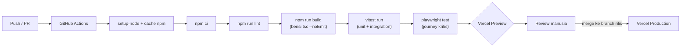
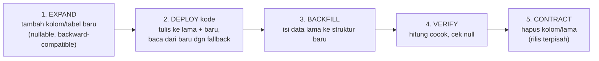

# DEPLOYMENT.md — CI/CD, Environments, dan Rollback Melodi Alam

> **Catatan (20 Okt 2026):** halaman `/pahlawan-kota` dan `lib/pahlawan.ts` sudah
> dihapus dari repo. `GENRE_ROWS` di `lib/content.ts` dan dokumen `pahlawanRow`
> di Sanity disimpan sebagai arsip. Bagian dokumen ini yang masih menyebut
> direktori tersebut adalah catatan historis.

> **Status fase: DOCS ONLY.** Tidak ada berkas CI yang dibuat, tidak ada dependensi yang
> dipasang, tidak ada `.env` yang dibuat, tidak ada konfigurasi hosting yang ditambahkan.
> Satu-satunya perintah yang dijalankan pada fase ini adalah `npm run build` (untuk
> mengambil angka build yang nyata) — lihat "Verification Notes".

**Target deploy: Vercel** (`ADR-0006`). **Belum ada apa pun yang ter-deploy:** tidak ada
direktori `.github/`, tidak ada berkas `.env`, tidak ada proyek Vercel, tidak ada
konfigurasi hosting. Karena itu:

- Semua klaim tentang **build itu sendiri** dapat `TERVERIFIKASI` (dijalankan / dibaca).
- Semua klaim tentang **deploy, CI, environment, dan rollback** adalah `RENCANA`.

Cara membaca label (konsisten dengan `docs/TEST-STRATEGY.md`):

| Label | Arti |
|---|---|
| `TERVERIFIKASI` | Dibaca langsung di kode/dijalankan pada fase ini |
| `RENCANA` | Direncanakan fase ini; belum ada |
| `ASUMSI` | Diasumsikan; perlu konfirmasi |
| `[PERLU VERIFIKASI]` | Tidak dapat diverifikasi dari workspace |

Acuan keputusan: **`ADR-0002`** (Payload CMS 3 in-app + Supabase), **`ADR-0003`** (Supabase =
Postgres + Storage), **`ADR-0004`** (video catalogue tetap build-time), **`ADR-0005`**
(moderated demo queue), **`ADR-0006`** (Vitest + Playwright, deploy ke Vercel). Acuan
requirement: `FR-001`…`FR-007`, `NFR-001`…`NFR-004`, `RISK-001`…`RISK-003`.

> **⚠️ Digantikan sebagian — baca ini dulu.**
> Dokumen ini disusun saat backend direncanakan memakai **Payload CMS 3 + Supabase**.
> Sejak itu CMS-nya diganti dengan **Sanity Studio**, dan seluruh kode Payload sudah
> dihapus.
>
> Bagian yang tidak lagi berlaku di dokumen ini: variabel lingkungan, migrasi basis data,
> dan langkah deploy backend. Lihat
> [`adr/0008-sanity-studio-menggantikan-payload.md`](adr/0008-sanity-studio-menggantikan-payload.md)
> dan [`SANITY-INTEGRATION.md`](SANITY-INTEGRATION.md) untuk keadaan sekarang. Bagian lain
> di dokumen ini masih relevan sejauh tidak menyangkut backend.

---

## 1. Delivery Context and Assumptions

### 1.1 Konteks pengiriman (`TERVERIFIKASI`)

| Aspek | Nilai | Bukti |
|---|---|---|
| Jenis aplikasi | Web SSR/static hybrid — Next.js App Router | `package.json` |
| Framework | Next.js `16.4.0`, Turbopack | `package.json`, output build |
| Runtime | React `19.3.0` | `package.json` |
| Bahasa | TypeScript `^5` | `package.json` |
| Gaya | Tailwind CSS `^4` via `@tailwindcss/turbopack` | `package.json`, `next.config.ts` |
| Lint | ESLint `^9` + `eslint-config-next` `16.4.0` | `package.json` |
| Node/npm lokal (terukur) | Node `v24.15.0`, npm `11.12.1` | dijalankan saat fase ini |
| Hosting target | **Vercel** | `ADR-0006` (`RENCANA`) |
| Port dev/start | **3100** (sengaja bukan 3000) | `package.json` |
| Tim | Kecil (owner + kontributor; lihat `docs/CONTRIBUTING.md`) | `ASUMSI` |
| Frekuensi rilis | Belum ditetapkan | `[PERLU VERIFIKASI]` |

**Implikasi port 3100 (`TERVERIFIKASI`, catatan penting).** `-p 3100` hanya relevan untuk
`next dev` dan `next start` **di lokal dan di CI**. Vercel **tidak** memakai flag ini —
platform menentukan port via variabel `PORT` saat menjalankan serverless/Next runtime.
Pilihan 3100 **tidak boleh** dianggap konfigurasi produksi.

### 1.2 Skrip yang benar-benar ada (`TERVERIFIKASI`)

`package.json` punya 10 skrip, termasuk `test` (Vitest). Tidak ada skrip `typecheck` atau `deploy`.

| Command | Isi |
|---|---|
| `npm run dev` | `next dev -p 3100` |
| `npm run build` | `next build` |
| `npm run start` | `next start -p 3100` |
| `npm run lint` | `eslint` |
| `npm run catalogue` | `node scripts/build-catalogue.mjs` |
| `npm run brand` | `node scripts/build-brand.mjs` |
| `npm run photos` | `node scripts/copy-photos.mjs` |

Tidak ada skrip `typecheck` terpisah; `tsc --noEmit` dijalankan sebagai bagian dari
`next build` (output build menampilkan tahap "Running TypeScript ...").

### 1.3 Apa yang build lakukan hari ini (`TERVERIFIKASI`, angka terukur)

`npm run build` dijalankan sekali dari `melodi-alam/` pada fase ini. Output nyata
(disalin apa adanya):

```
▲ Next.js 16.4.0 (Turbopack)
✓ Running next.config.ts took 37ms
- Cache Components enabled
- Partial Prefetching enabled

  Creating an optimized production build ...
✓ Compiled successfully in 665ms
  Running TypeScript ...
  Finished TypeScript in 1754ms ...
  Collecting page data using 11 workers ...
  Generating static pages using 11 workers (0/26) ...
  Generating static pages using 11 workers (6/26)
  Generating static pages using 11 workers (12/26)
  Generating static pages using 11 workers (19/26)
✓ Generating static pages using 11 workers (26/26) in 1359ms
  Finalizing page optimization ...

Route (app)
┌ ○ /
├ ○ /_not-found
├ ƒ /api/demos
├ ○ /apple-icon.png
├ ○ /bicara-melodi
├ ○ /icon.png
├ ○ /journal
├   /journal/[slug]
│ ├ ◐ /journal/[slug]
│ ├ ○ /journal/dua-dekade-endah-n-rhesa
│ ├ ○ /journal/melankolia-di-priok-baladagehel-dongker
│ └ ◐ [+10 more paths]
├ ○ /pahlawan-kota
├ ○ /spaces
├ ○ /submit
└ ○ /videos

○  (Static)             prerendered as static content
◐  (Partial Prerender)  prerendered as static HTML with dynamic server-streamed content
ƒ  (Dynamic)            server-rendered on demand
```

Angka **terukur** yang harus dipakai sebagai baseline (bukan estimasi):

| Metrik | Nilai terukur |
|---|---|
| Halaman statis yang di-generate | **26** |
| Waktu compile | **665 ms** |
| Waktu TypeScript | **1754 ms** |
| Waktu generate static pages | **~8 s** (32/32) |
| Worker paralel | **11** |
| Muat `next.config.ts` | **37 ms** |

### 1.4 Rute: statis vs dinamis (`TERVERIFIKASI`)

| Rute | Jenis build | Catatan |
|---|---|---|
| `/` | `○` Static | Landing |
| `/_not-found` | `○` Static | `app/not-found.tsx` |
| `/api/demos` | `ƒ` **Dynamic** | **Route handler** (`GET`, `POST`; 503 kalau Sanity gagal) |
| `/api/demo-audio` | `ƒ` **Dynamic** | Token unggah audio ke Vercel Blob (maks 25 MB) |
| `/api/revalidate` | `ƒ` **Dynamic** | Webhook Sanity → 6 tag cache |
| `/journal/[slug]/opengraph-image` · `twitter-image` | `ƒ` **Dynamic** | Kartu sosial 1200×630 per artikel |
| `/apple-icon.png` | `○` Static | Rute metadata otomatis dari `app/apple-icon.png` |
| `/icon.png` | `○` Static | Rute metadata otomatis dari `app/icon.png` |
| `/bicara-melodi` | `○` Static | |
| /journal | Static | Grid 6 kartu (Stories, hanya feed foto); tanpa filter/search |
| `/journal/[slug]` | `○` Static + `◐` Partial Prerender | 12 slug statis; artikel baru dari CMS dirender sesuai permintaan |
| `/tentang` | `○` Static | Profil, ekosistem, kontak & partnership |
| `/rss.xml` | `○` Static | RSS 2.0 dari artikel feed foto |
| `/preview/[type]/[slug]` | `◐` Partial Prerender | Pratinjau draf; butuh `?secret=` |
| `/submit` | `○` Static | Form POST ke `/api/demos` |
| `/videos` | `○` Static | Seleksi 9 sesi Samsara + Bicara Melodi + playlists; **tidak** ada daftar katalog 292 video |

**Kenapa ada `◐` Partial Prerender.** `next.config.ts` mengaktifkan
**Cache Components** dan **Partial Prefetching** (`TERVERIFIKASI`):

```ts
// next.config.ts
const nextConfig: NextConfig = {
  cacheComponents: true,
  partialPrefetching: true,
  images: {
    remotePatterns: [
      { protocol: "https", hostname: "i.ytimg.com", pathname: "/vi/**" },
    ],
  },
  turbopack: { rules: { "*.css": { loaders: ["@tailwindcss/turbopack"], as: "*.css" } } },
};
```

Konsekuensi deploy (`ASUMSI`, `[PERLU VERIFIKASI]`): sebagian HTML di-shell-kan statis dan
sisanya di-stream saat request. Ini berarti **preview dan production harus memakai runtime
Next.js yang sama** dengan lokal — perbedaan versi runtime dapat mengubah perilaku
`◐`. Next.js `16.4.0` masih sangat baru; dukungan penuh dan versi Node default di Vercel
belum dikonfirmasi di workspace → `[PERLU VERIFIKASI]`.

**`images.remotePatterns` (`TERVERIFIKASI`).** Satu-satunya host remote yang diizinkan
adalah **`https://i.ytimg.com/vi/**`** (thumbnail YouTube untuk baris video). Semua gambar
lain dilayani lokal dari `public/`. Konsekuensi keamanan/deploy: permintaan
`next/image` ke host selain `i.ytimg.com` akan **gagal** (tidak akan dioptimasi). Jika
fase berikutnya mengubah sumber gambar (mis. Supabase Storage), pola ini harus
diperbarui — kalau tidak, gambar akan broken di produksi. Coin ini juga berarti CSP/domain
allowlist gambar sudah sempit secara default.

### 1.5 Pipeline aset build-time sebagai risiko deploy (`TERVERIFIKASI`)

Sebagian berkas di repo ini **generated**, bukan ditulis tangan. Berkas-berkas itu menjadi
masalah deploy karena sumbernya berada **di luar repo** (lihat §4.6).

| Artefak hasil | Generator | Sumber | Dikomit atau di-regenerate? | Kalau langkah dilewati pada clean checkout |
|---|---|---|---|---|
| `lib/catalogue.json` (192.670 byte) | `npm run catalogue` → `scripts/build-catalogue.mjs` | `../melodi-alam-data.md` (fallback: `melodi-alam-data.md` di root proyek) | **Belum di-track** (`TERVERIFIKASI`) | **`next build` GAGAL** — `lib/catalogue.ts` meng-import JSON ini |
| `public/brand/melodi-alam-lockup-black.png` | `npm run brand` → `scripts/build-brand.mjs` | `../LOGO2/Melodi Alam Text Logo - Black.png` (dipotong apa adanya — tanpa recolor) | **Di-track** | Masthead dan dua blok footer kehilangan logo → aset 404 |
| `app/icon.png` (512 px, favicon) | `npm run brand` → `scripts/build-brand.mjs` | `../LOGO2/Melodi Alam Logo Only - Color.png` | **Belum di-track** | Rute `/icon.png` kosong / fallback |
| `app/apple-icon.png` (180 px) | `npm run brand` → `scripts/build-brand.mjs` | `../LOGO2/Melodi Alam Logo Only - Color.png` | **Belum di-track** | Rute `/apple-icon.png` kosong / fallback |
| `app/favicon.ico` (16/32/48) | `npm run brand` → `scripts/build-brand.mjs` | `../LOGO2/Melodi Alam Logo Only - Color.png` | **Di-track** (`TERVERIFIKASI`, satu-satunya artefak generated yang masuk git) | Favicon lama/bawaan Next.js tetap ada |
| `public/photos/*` (33 berkas) | `npm run photos` → `scripts/copy-photos.mjs` | `../../FOTO PLACEHOLDER MELODI ALAM` | **Belum di-track** | Semua foto artikel/space → aset 404 |

Catatan: **seluruh proyek belum ter-commit** selain initial scaffold (`git log` hanya
menampilkan satu commit "Initial commit from Create Next App"; `app/`, `lib/`, `scripts/`,
`components/`, `docs/` semuanya masih untracked). Jadi "belum di-track" di atas berarti
"belum masuk git sama sekali", bukan "sengaja di-ignore". Yang penting: **clean checkout
dari git saat ini tidak dapat di-build**, karena artefak generated tidak ada.

### 1.6 Asumsi (`ASUMSI`)

- Satu environment produksi cukup untuk v1.0; tidak ada staging terpisah (Preview per-PR
  menggantikan peran staging). Ini konsisten dengan `docs/TEST-STRATEGY.md` §8.1.
- Pengguna awal hanya kurator internal + publik anonim; tidak ada beban tinggi
  (`NFR-001` belum diuji skala).
- Sumber data luar-repo (`melodi-alam-data.md`, `logobulet.png`, `logotext.png`,
  `FOTO PLACEHOLDER MELODI ALAM/`) berasal dari mesin yang sama dan tidak berubah sesering
  kode → asumsi untuk strategi `commit-generated` di §4.6.
- Empat release blocker "PRD §14.2" dipetakan sebagai `B1`…`B4` di `docs/TEST-STRATEGY.md`
  §6.3; teks PRD tidak ada di workspace → `[PERLU VERIFIKASI]`.

---

## 2. Environment Plan

Rencana tiga environment. Tidak ada satu pun yang berjalan hari ini (`RENCANA`).

| Environment | Tujuan | Data | Deploy Trigger | Akses |
|---|---|---|---|---|
| **Local** | Pengembangan + unit test | `lib/*.json` + `SEED_DEMOS` in-memory | Manual: `npm run dev` (port 3100) | Developer di mesin sendiri |
| **Preview** | Review per-PR, E2E, cek visual | Demo store in-memory (kosong per instance); nanti Supabase branch/schema terpisah | **Otomatis** saat PR dibuka/di-update (`RENCANA`) | Tim internal (URL ber-token) |
| **Production** | Situs publik | Supabase Postgres + Storage (nanti); hari ini in-memory | **Otomatis saat merge ke branch rilis** (`RENCANA`) | Publik |

### 2.1 Apa yang membedakan tiap environment

| Dimensi | Local | Preview | Production |
|---|---|---|---|
| Sumber data editorial | `lib/content.ts` + `lib/catalogue.json` (statis, build-time) | sama (build-time) | sama sampai Payload aktif (`ADR-0002`) |
| Demo queue | Array in-memory (`SEED_DEMOS`) | Array in-memory, **per instance** — reset tiap deploy/restart | idem; **akan** jadi Supabase (`ADR-0005`) |
| Env vars dibaca | **nol** | **nol** (hari ini) | **nol** (hari ini) |
| Secret | tidak ada | tidak ada (hari ini) | tidak ada (hari ini) |
| Media | `public/` | `public/` | `public/`; nanti Supabase Storage (`ADR-0003`) |
| Domain | `localhost:3100` | `*.vercel.app` auto | domain publik (`[PERLU VERIFIKASI]` — belum ditetapkan) |
| Data persisten | tidak | tidak | tidak (hari ini) |

### 2.2 Fakta kritis: kode membaca **nol** environment variable (`TERVERIFIKASI`)

- Tidak ada berkas `.env*` di mana pun di repo (pencarian rekursif, kecuali `node_modules`
  → nol hasil).
- `npm run dev`, `next build`, dan `next start` semuanya berjalan tanpa env apa pun.
- `.gitignore` meng-ignore `.env*` (baris 34) — jadi secret **tidak akan** ikut ter-commit.
  Konsekuensi: berkas template seperti `.env.example` **juga** ter-ignore kecuali ditambah
  `!.env.example`. Ini relevan saat fase Supabase memperkenalkan env pertama.

Karena nol env dibaca kode hari ini, **semua** variabel di §3 adalah hal baru yang
diperkenalkan fase berikutnya. Tidak ada satu pun yang dipakai sekarang.

---

## 3. Configuration and Secrets Inventory

Hari ini: **tidak ada** variabel (`TERVERIFIKASI`). Di bawah ini adalah inventaris
**`RENCANA`** untuk fase Supabase + Payload (`ADR-0002`, `ADR-0003`). Nama variabel adalah
**usulan konvensi**; kontrak persis Payload/Supabase belum ditulis di repo → bagian yang
belum pasti ditandai `[PERLU VERIFIKASI]`.

| Variable | Scope | Secret? | Per-environment Notes |
|---|---|---|---|
| `NEXT_PUBLIC_SUPABASE_URL` | **client** | Tidak | URL proyek Supabase; aman terekspos ke browser. Boleh sama di Preview/Prod bila instance sama, **sebaiknya** berbeda per env |
| `NEXT_PUBLIC_SUPABASE_ANON_KEY` | **client** | Tidak (`publishable`) | Anon/publishable key. Aman **hanya jika** RLS aktif (`ADR-0003`). Wajib berbeda Preview vs Prod |
| `SUPABASE_SERVICE_ROLE_KEY` | **server saja** | **YA** | **Tidak boleh** ber-prefix `NEXT_PUBLIC_`; **tidak boleh** di-import komponen client; hanya di route handler / server action / Payload access control |
| `PAYLOAD_SECRET` | **server saja** | **YA** | Kunci penandatanganan Payload (session/token). Panjang acak; rotasi bila bocor |
| `SUPABASE_STORAGE_BUCKET` | server (config) | Tidak | Nama bucket Storage untuk audio/artikel (`ADR-0003`); bisa juga publik bila bucket memang publik |
| `DATABASE_URL` / `POSTGRES_URL` | server saja | **YA** | String koneksi Postgres untuk adapter Payload (`@payloadcms/db-postgres`). **Nama pasti + bentuk wiring `[PERLU VERIFIKASI]`** |

### 3.1 Aturan service role key (WAJIB)

**`SUPABASE_SERVICE_ROLE_KEY` tidak pernah boleh mencapai client.** Aturan operasional
(`RENCANA`):

1. **Tanpa prefix `NEXT_PUBLIC_`** — variabel ber-prefix itu di-inline ke bundle browser
   oleh Next.js; service role key akan bocor permanen ke setiap pengunjung.
2. **Import server-only.** Hanya dibaca di `app/api/**/route.ts`, server action, atau kode
   Payload. Tambahkan guard (mis. `import "server-only"` di modul yang membacanya) bila
   memungkinkan.
3. **Key anon hanya aman bila RLS aktif.** Anon key memang untuk publik; jangan
   menaruh data privat di tabel tanpa Row Level Security — lihat `docs/DATA-MODEL.md`.
4. **Nilai berbeda per environment.** Preview memakai key/instance berbeda dari Production;
   jangan bagikan satu service role key ke semua environment.
5. **Rotasi.** Bila bocor (ter-commit, ter-log, tampil di screenshot): rotasi segera di
   dashboard Supabase, perbarui env Vercel, lalu re-deploy. Jangan hanya menimpa commit.

### 3.2 Penyimpanan secret

- **Produksi & Preview (`RENCANA`):** Environment Variables Vercel, per-scope
  (Production / Preview / Development). Tandai setiap entri sebagai *sensitive* bila
  tersedia. **`[PERLU VERIFIKASI]`** — perilaku UI/penandaan spesifik platform tidak
  diverifikasi di workspace.
- **Lokal (`RENCANA`):** `.env.local`, sudah ter-ignore oleh `.env*`. Jangan pernah
  membuat `.env` yang ter-commit.
- **CI (`RENCANA`):** GitHub Actions Secrets (untuk secret yang dibutuhkan job test,
  mis. `SUPABASE_SERVICE_ROLE_KEY` untuk integration test terhadap branch Supabase).

### 3.3 Inventaris diperluas saat fase berikutnya

Setiap env baru **wajib** masuk tabel §3 dan ditandai scope-nya sebelum dipakai. Aturan
gate: tidak boleh ada variabel yang dibaca kode namun tidak tercatat di sini
(lihat §12).

---

## 4. CI Pipeline Specification

**Tidak ada CI hari ini** (`TERVERIFIKASI`): tidak ada direktori `.github/` di root proyek
(verifikasi rekursif; yang muncul hanya `.github/` di dalam `node_modules` paket pihak
ketiga). Seluruh spesifikasi di bawah adalah `RENCANA`.

### 4.1 Alur (`RENCANA`)



Vercel Preview dibuat oleh integrasi Git Vercel (bukan oleh workflow Actions), berjalan
paralel dengan job test. `RENCANA` — belum ada integrasi yang dikonfigurasi.

### 4.2 Tahapan dan blocking rule (`RENCANA`)

| Tahap | Perintah | Blokir merge? | Alasan |
|---|---|---|---|
| Install | `npm ci` (pakai `package-lock.json`) | **Ya** | Reproducible; lockfile ada (`TERVERIFIKASI`) |
| Lint | `npm run lint` | **Ya** | Sudah hijau (brief §2); regresi mudah ditangkap |
| Build + typecheck | `npm run build` | **Ya** | Menangkap stylesheet gagal (`RISK` Tailwind, §9) dan error tipe/rute |
| Unit + integration | `vitest run` | **Ya** | Cepat, deterministik (`docs/TEST-STRATEGY.md` §9.2) |
| E2E journey kritis | `playwright test` (`E-01`, `E-05`, `E-08`, 404) | **Ya** | Journey paling mahal bila rusak |
| E2E keyboard/reduced-motion | `playwright test` (`ACC-001`, `ACC-002`) | `ACC-001` **Ya**; `ACC-002` **Ya setelah diperbaiki** | `ACC-002` merah hari ini (`docs/TEST-STRATEGY.md` §9.2) |
| Perf `P-01` | dalam suite E2E | **Warning** di PR, blokir di rilis | Flaky-prone di runner bersama |
| Coverage % | `vitest run --coverage` | **Warning** | Diagnostik, bukan sasaran |

Skrip `test` (Vitest) **sudah ada** hari ini — `npm test`, 9 kasus di `lib/content.test.ts`; Playwright belum (`package.json` kini 10 skrip, termasuk `test`). Skrip
yang diusulkan ada di `docs/TEST-STRATEGY.md` §9.1 (`test`, `test:watch`, `test:e2e`,
`test:e2e:report`).

### 4.3 Caching (`RENCANA`)

- `actions/setup-node` dengan `cache: npm` (key dari `package-lock.json`).
- Cache `.next/cache` antar-job opsional; gunakan hash lockfile + sumber sebagai key.
- Jangan cache `node_modules` mentah (risiko native module `sharp` tidak cocok platform).
  `sharp` (`^0.35.5`) dipakai skrip build saja (`TERVERIFIKASI`), bukan runtime.

### 4.4 Matriks OS/node (`RENCANA`)

| Item | Nilai usulan | Catatan |
|---|---|---|
| Runner | `ubuntu-latest` | Sederhana, murah |
| Node | versi yang dipin | Lokal terukur `v24.15.0`; **pin eksplisit** (`.nvmrc` atau `engines`) karena belum ada pin hari ini (`[PERLU VERIFIKASI]` untuk default Vercel) |
| Engine browser (E2E) | Chromium (blokir); Firefox/WebKit advisory | `docs/TEST-STRATEGY.md` §8.5 |

### 4.5 Definisi workflow usulan (`RENCANA`, bukan berkas yang sudah ada)

Contoh kerangka (belum boleh dibuat di fase DOCS ONLY; disediakan sebagai target):

```yaml
# .github/workflows/ci.yml  — RENCANA, belum ada
name: CI
on:
  pull_request:
  push:
    branches: [main]

jobs:
  verify:
    runs-on: ubuntu-latest
    steps:
      - uses: actions/checkout@v4
      - uses: actions/setup-node@v4
        with:
          node-version-file: .nvmrc   # RENCANA: belum ada .nvmrc
          cache: npm
      - run: npm ci
      - run: npm run lint
      - run: npm run build          # build + typecheck
      - run: npx vitest run         # Vitest sudah terpasang
      - run: npx playwright install --with-deps chromium
      - run: npx playwright test    # RENCANA: belum terpasang
```

Semua langkah di atas adalah target. **Tidak ada satu pun yang berjalan hari ini.**

### 4.6 Artefak generated di CI — bahaya utama karena sumber di luar repo (`TERVERIFIKASI`)

Ini adalah hambatan paling konkret untuk deploy pertama.

**Temuan:** dua dari tiga generator bergantung pada berkas **di luar repo**
`melodi-alam/`:

| Generator | Membaca | Ada fallback? | Lokasi terverifikasi |
|---|---|---|---|
| `scripts/build-catalogue.mjs` | `../melodi-alam-data.md`, lalu `./melodi-alam-data.md` | **Ada** (fallback di root proyek) | `D:\Project Website Melodi Alam\melodi-alam-data.md` (ada) |
| `scripts/build-brand.mjs` | `../../logobulet.png`, `../../logotext.png` (ROOT = dua level di atas `scripts/`) | **Tidak** | keduanya ada di workspace root |
| `scripts/copy-photos.mjs` | `../../FOTO PLACEHOLDER MELODI ALAM/` | **Tidak** (keluar kode 1 bila hilang) | ada di workspace root |

**Kenyataan repo (`TERVERIFIKASI`):** hanya `melodi-alam/` yang merupakan git repo
(workspace root `D:\Project Website Melodi Alam` **bukan** git repo). Jadi berkas-berkas
sumber di atas **tidak berada di repo mana pun**. Sebuah runner CI yang meng-`checkout`
hanya `melodi-alam` **tidak akan** memiliki `melodi-alam-data.md`, `logobulet.png`,
`logotext.png`, maupun folder foto.

**Konsekuensi (WAJIB ditangani sebelum deploy pertama):**

1. CI **tidak dapat** menjalankan `npm run catalogue` / `brand` / `photos`.
2. `next build` **meng-import `lib/catalogue.json`**, jadi build **gagal** bila JSON itu
   tidak ada. Karena seluruh proyek saat ini untracked, **clean checkout hari ini tidak
   dapat di-build** (`TERVERIFIKASI`).
3. Karena `../...` tak tersedia di CI, langkah regenerate **tidak mungkin** dijalankan di
   runner tanpa menambahkan berkasnya dari suatu tempat.

**Pilihan strategi (`RENCANA`) — pilih dan dokumentasikan:**

| Opsi | Cara kerja | Kelebihan | Kekurangan |
|---|---|---|---|
| **A. Commit artefak generated (disarankan untuk v1.0)** | Tambahkan `lib/catalogue.json`, `public/brand/`, `public/photos/`, `app/icon.png`, `app/apple-icon.png`, `app/favicon.ico` ke git | Build CI dapat berjalan; tidak butuh berkas luar repo; deploy deterministik | Artefak besar (~1,4 MB foto + 0,9 MB medallion) masuk git; perlu disiplin regenerate saat data sumber berubah |
| **B. Pindahkan sumber ke dalam repo** | Letakkan `melodi-alam-data.md` (+ PNG sumber + foto) di dalam `melodi-alam/`, jalankan generator sebagai langkah build | Self-contained; generasi teruji di CI | Menambah aset biner besar ke repo; mengubah asumsi path skrip |
| **C. Ambil sumber di CI dari lokasi privat** | Langkah CI mengunduh sumber dari storage privat sebelum generate | Repo tetap bersih | Butuh kredensial + penyimpanan tambahan; lebih rumit; `[PERLU VERIFIKASI]` |

**Rekomendasi (`RENCANA`): Opsi A untuk v1.0.** Alasan: sederhana, build deterministik,
dan hanya `lib/catalogue.json` yang wajib ada agar build lulus; aset gambar lain hanya
memengaruhi tampilan. Jika Opsi A dipilih, tambahkan job guard opsional yang, di mesin
developer, menjalankan `npm run catalogue` dan memeriksa `git diff --exit-code
lib/catalogue.json` untuk memastikan artefak tidak basi.

**Peringatan urutan (`TERVERIFIKASI`):** `npm run catalogue` menulis ke
`lib/catalogue.json`. Jangan menjalankannya di dalam job build CI bila sumber
`melodi-alam-data.md` tidak ada — skrip akan `process.exit(1)` dan menggagalkan pipeline.

---

## 5. Deployment and Promotion Strategy

### 5.1 Strategi (`RENCANA`, `ADR-0006`)

- **Preview deployment per PR** — setiap PR memicu Vercel Preview unik; review code + klik
  URL Preview.
- **Production** — merge ke branch rilis (mis. `main`) memicu deploy otomatis ke
  Production.
- Tidak ada blue-green/canary manual; Vercel menangani atomisitas rilis + rollback instan
  (§8). Ini right-sized untuk tim kecil.

### 5.2 Promosi (`RENCANA`)

| Tahap | Pemicu | Hasil | Siapa menyetujui |
|---|---|---|---|
| Preview | PR dibuka/di-update | URL `*.vercel.app` + job CI | otomatis |
| Production | merge ke `main` (atau tag) | Domain produksi | review PR + gate CI hijau |

### 5.3 Konfigurasi platform (`RENCANA`, `[PERLU VERIFIKASI]`)

- Framework preset: Next.js; install `npm ci`; build `npm run build`; output default
  (`.next`). Next.js `16.4.0` + Cache Components **belum diverifikasi** terhadap versi
  runtime Vercel default → konfirmasi sebelum deploy pertama.
- Root directory: `melodi-alam` (repo saat ini adalah subfolder dari workspace; bila repo
  git dibuat di root `melodi-alam`, ini default). `[PERLU VERIFIKASI]`.
- **Tidak ada setting Vercel lain yang diklaim ada** — semua di atas adalah target, bukan
  konfigurasi yang sudah dibuat.

---

## 6. Migration and Data Handling Plan

### 6.1 Hari ini (`TERVERIFIKASI`)

- Tidak ada database. `/api/demos` memakai array **module-level** (`const queue =
  [...SEED_DEMOS]`) di `app/api/demos/route.ts`: store **process-local**, reset saat
  restart/deploy (brief §6).
- Tidak ada PII yang tersimpan (`contact` hanya di-echo di `note`).
- Karena itu, **data loss saat deploy hari ini bukan isu** — setiap deploy memang memulai
  ulang antrean dari `SEED_DEMOS`. Ini **berhenti benar** begitu Supabase masuk (`ADR-0003`,
  `ADR-0005`).

### 6.2 Setelah Supabase masuk (`RENCANA`, `ADR-0002`/`ADR-0003`)

Aturan migrasi (expand-and-contract) wajib diikuti karena kode lama dan baru dapat hidup
bersama selama deploy:



Aturan tambahan (`RENCANA`):

1. **Migrasi non-destruktif dulu.** Tambah kolom/tabel; jangan drop/rename di rilis yang
   sama dengan perubahan kode.
2. **Backup sebelum destruktif.** `CONTRACT` (drop) hanya setelah backup + verifikasi.
3. **Urutan:** migrasi **sebelum** deploy kode untuk `EXPAND`; `CONTRACT` **setelah** kode
   lama benar-benar tidak jalan.
4. **RLS sebagai bagian migrasi.** Kebijakan Row Level Security diuji bersama migrasi,
   bukan ditambal belakangan (`ADR-0003`; lihat `docs/DATA-MODEL.md`).
5. Verifikasi migrasi: hitung baris/`null` yang tidak diharapkan; jangan mengandalkan
   "migrasi sukses" tanpa cek data.

### 6.3 Batas (`RENCANA`)

- Tabel video catalogue tetap **build-time** (`ADR-0004`) — tidak dimigrasikan ke DB.
- Store demo in-memory **digantikan** Supabase; transisi ini yang membuat §6.1 tidak lagi
  berlaku, sehingga rollback data jadi relevan (§8.3).

---

## 7. Versioning and Release Process

### 7.1 Versi (`RENCANA`)

- Sumber versi: `package.json` `version` (saat ini `0.1.0`, `TERVERIFIKASI`).
- Skema: **SemVer** ringan (`MAJOR.MINOR.PATCH`), di-tag di git (mis. `v0.2.0`).
- `CHANGELOG.md` diperbarui per rilis (berkas ada di root proyek, brief §11).
- Tidak ada penerbitan paket; versi hanya penanda rilis.

### 7.2 Proses rilis (`RENCANA`)

1. Semua gate CI hijau (§4.2).
2. `CHANGELOG.md` diperbarui.
3. Bump `version` di `package.json` + tag git.
4. Merge ke `main` → deploy Production.
5. Smoke test pasca-deploy (§10.2).

---

## 8. Rollback and Recovery Plan

### 8.1 Aplikasi — rollback instan Vercel (`RENCANA`)

- Vercel menyimpan setiap deployment; **Instant Rollback** mempromosikan deployment
  sebelumnya tanpa rebuild. Ini rollback tingkat aplikasi, target pulih dalam hitungan
  detik–menit.
- Pemicu rollback (usulan): error 5xx naik, halaman putih/stylesheet kosong (lihat §9),
  atau regresi journey kritis setelah rilis.
- Keputusan: owner produk (atau kontributor yang memegang akses Vercel).
- **Rollback kode TIDAK mengembalikan data.** Bila rilis menyertakan migrasi destruktif,
  rollback aplikasi bisa membuat kode lama membaca struktur baru → §8.3.

### 8.2 Alternatif: forward-fix

Untuk perubahan berisiko rendah, deploy perbaikan kecil lebih cepat daripada rollback.
Aturan: pilih rollback bila data/korupsi terlibat; pilih forward-fix bila hanya UI.

### 8.3 Database — rollback via expand-and-contract (`RENCANA`)

Setelah Supabase masuk (`ADR-0003`), "rollback migrasi" **bukan** `drop` terbalik:

- Karena `EXPAND` backward-compatible (§6.2), kode lama tetap dapat membaca skema baru —
  sehingga rollback aplikasi aman selama fase `EXPAND`.
- `CONTRACT` (drop kolom/tabel) **tidak dapat** di-rollback tanpa backup. Karena itu
  `CONTRACT` dipisah ke rilis tersendiri, setelah kode lama dipensiunkan.
- **Backup sebelum destruktif** adalah prasyarat keras. Cara/jadwal backup Supabase
  `[PERLU VERIFIKASI]` (belum dikonfigurasi).
- RTO/RPO belum ditetapkan → `[PERLU VERIFIKASI]`.

### 8.4 Data demo — peralihan status (`TERVERIFIKASI` → berubah)

- **Hari ini:** deploy mereset antrean in-memory. "Kehilangan data" saat deploy memang
  perilaku yang diharapkan, jadi rollback data tidak relevan.
- **Setelah Supabase:** submission berstatus `pending`/`approved`/`rejected` (`ADR-0005`)
  menjadi data nyata. Rollback yang menyertakan migrasi skema submission **wajib** paham
  §8.3, dan PII (`contact`) akhirnya tersimpan → ikuti `docs/SECURITY-PRIVACY.md`.

---

## 9. Monitoring and Alerting Plan

**Belum ada monitoring apa pun hari ini** (`TERVERIFIKASI` — tidak ada kode/integrasi
observability). Seluruh bagian ini `RENCANA`.

### 9.1 Sinyal minimum (`RENCANA`)

| Sinyal | Sumber usulan | Ambang awal (usulan) |
|---|---|---|
| Availability | Vercel / uptime check eksternal | > 1 kegagalan beruntun pada root |
| Error rate 5xx | Log Vercel / function errors | > 1% selama 5 menit |
| Latency p95 | Vercel Analytics | ambang belum ditetapkan (`[PERLU VERIFIKASI]`) |
| `POST /api/demos` error rate | log route handler | lonjakan 4xx/5xx |
| Build/deploy failure | notifikasi Vercel | setiap kegagalan |

### 9.2 Kondisi yang wajib memicu perhatian (spesifik repo ini)

- **Stylesheet kosong** — regresi Tailwind `@source` (§10 hazard) menghasilkan situs tanpa
  gaya namun **200 OK**; tidak terdeteksi oleh error-rate. Mitigasi: smoke visual per
  rilis (§10.2) + gate build.
- **Halaman `opacity: 0`** — regresi frame-loop bisa menyembunyikan konten tanpa error.
  Deteksi: smoke manual/otomatis konten reveal terlihat.
- **Error `next/image` remote pattern** — bila sumber gambar berubah tanpa memperbarui
  `remotePatterns`, muncul 400 dari optimizer.

### 9.3 Kepemilikan & proses insiden (`RENCANA`)

- Pemilik alert: owner produk/teknisi utama. Belum ada rotasi on-call (tim kecil).
- Insiden: identifikasi → putuskan rollback (§8) atau forward-fix → catat di
  `CHANGELOG.md`/postmortem singkat. Jaga agar alert tidak berisik: hanya sinyal di §9.1.

---

## 10. Release Checklist

### 10.1 Empat release blocker (`ASUMSI` — teks PRD tidak tersedia)

`docs/TEST-STRATEGY.md` §6.3 memetakan empat blocker "PRD §14.2" sebagai `B1`…`B4`.
Teks PRD tidak ada di workspace → pemetaan ini `ASUMSI` dan **harus dikonfirmasi**.
Ditambah syarat kelayakan deploy dari brief §2:

| Blocker | Tema | Bukti lulus |
|---|---|---|
| `B1` | Pipeline submission end-to-end + moderasi + tanpa kebocoran PII | E2E submit + `E-08` hijau |
| `B2` | Aksesibilitas: reduced motion + keyboard + alt/semantik | `ACC-001` hijau; `ACC-002` diperbaiki lalu hijau |
| `B3` | Build bersih & semua rute publik jalan (termasuk 404, metadata) | `npm run build` + smoke rute (§10.2) |
| `B4` | Tidak ada regresi interaksi terkunci (`DEC-002`/`DEC-003`) | E2E hover/focus `DEC-002`/`DEC-003` |
| Kelayakan | **Halaman statis tidak turun dari 26** tanpa alasan (brief §2) | cek output build = `26/26` |

### 10.2 Smoke test pasca-deploy (berbasis daftar rute nyata)

Dijalankan pada URL Preview **dan** Production. Semua ruta berasal dari output build
`TERVERIFIKASI` (§1.4).

| # | Cek | Rute |
|---|---|---|
| 1 | Landing memuat, stylesheet terpasang (bukan halaman tanpa gaya) | `/` |
| 2 | Stories memuat; satu grid 6 kartu feed foto, tanpa filter/search | `/journal` |
| 3 | Artikel terbuka dari kartu; `<h1>` = judul artikel | `/journal/<slug>` (uji ≥2, termasuk `dua-dekade-endah-n-rhesa`) |
| 4 | Interview index memuat | `/bicara-melodi` |
| 5 | Katalog video memuat; modal putar membuka `[role="dialog"]` | `/videos` |
| 6 | Directory genre/kota memuat | `/pahlawan-kota` |
| 7 | Showcase spaces memuat | `/spaces` |
| 8 | Form submit memuat; submit valid → `[role="status"]` sukses, antrean +1 | `/submit` → `POST /api/demos` |
| 9 | `GET` antrean mengembalikan `{ queue, count }` | `/api/demos` |
| 10 | Rute tak dikenal → 404 | `/rute-tidak-ada` |
| 11 | Favicon/touch icon disajikan | `/favicon.ico`, `/icon.png`, `/apple-icon.png` |
| 12 | Thumbnail YouTube termuat (remote pattern `i.ytimg.com`) | baris video di `/` atau `/videos` |

### 10.3 Checklist pra-rilis (`RENCANA`)

- [ ] Gate CI hijau: lint, build (+typecheck), Vitest, E2E journey kritis (§4.2).
- [ ] **Artefak generated tersedia di checkout yang akan di-build** (§4.6) — paling
      kritis untuk deploy pertama.
- [ ] `CHANGELOG.md` + bump versi + tag (§7).
- [ ] Tidak menambah direktori tool baru di root tanpa `@source not` (§11 `H1`).
- [ ] `remotePatterns` cocok dengan semua sumber gambar (§1.4, §9.2).
- [ ] Env var baru tercatat di §3 (bila fase Supabase sudah jalan).
- [ ] Backup DB sebelum migrasi destruktif (§6.2, §8.3).

### 10.4 Checklist pasca-rilis (`RENCANA`)

- [ ] Jalankan smoke test §10.2 di Production.
- [ ] Konfirmasi jumlah halaman statis tetap 26 (atau alasan penurunan dicatat).
- [ ] Pantau sinyal §9.1 selama periode awal.
- [ ] Siapkan rollback instan (§8.1) bila ada regresi.

---

## 11. Risks and Open Questions

### 11.1 Bahaya deploy yang sudah terbukti (`TERVERIFIKASI`)

**`H1` — Tailwind content scan menelusuri direktori tool → stylesheet kosong secara senyap.**
Tailwind v4 menelusuri seluruh proyek untuk mendeteksi kelas. Di repo ini
`.codegraph/` menyimpan SQLite WAL (`codegraph.db-shm`) yang terkunci saat server MCP
berjalan; Turbopack panic (`os error 33`) ketika streaming `globals.css` dan **seluruh
stylesheet gagal di-generate** — tanpa error yang jelas, hanya situs tanpa gaya. Perbaikan:
tiga direktif `@source not` di `app/globals.css` (relatif ke `app/globals.css`):

```css
@source not "../.codegraph";   /* -> melodi-alam/.codegraph */
@source not "../.gitnexus";    /* -> melodi-alam/.gitnexus */
@source not "../.next";        /* -> melodi-alam/.next */
```

**Aturan operasional:** **setiap direktori tool baru di root proyek wajib menambah satu
`@source not`** pada `globals.css`, kalau tidak stylesheet bisa kosong senyap.

Catatan tambahan (`TERVERIFIKASI`): `.gitignore` sudah meng-ignore `/.playwright-mcp` dan
`/.brand-check`, tetapi `globals.css` **tidak** meng-exclude keduanya. Saat ini
`.playwright-mcp/` berada di **workspace root** (di luar `melodi-alam/`) sehingga belum
tersentuh scan; `/.brand-check` belum ada. Jika salah satu muncul di dalam root
`melodi-alam/`, tambahkan `@source not` yang sesuai. `.playwright-mcp` di workspace root
**tidak** memengaruhi build `melodi-alam` (lihat §12).

**`H2` — Port 3100 hanya relevan lokal/CI.** `-p 3100` ada di `dev` dan `start`
(`TERVERIFIKASI`). Vercel mengabaikannya (menentukan port via runtime). Jangan menganggap
3100 sebagai konfigurasi produksi, dan jangan meng-hardcode `http://localhost:3100` di kode
selain konfigurasi test.

**`H3` — `next/image` `fill` butuh ancestor berposisi.** Delapan instance dengan parent
`static` pernah stretch + `sizes` salah → upscale 8×. Ini hazard kualitas visual yang juga
muncul saat preview/deploy; lihat `docs/TEST-STRATEGY.md` (`R2`).

**`H4` — SSR yang membakar hidden state.** `translateY(115%)` inline membuat heading
permanen tak terlihat bila callback gagal. Aturan: SSR merender state final (§11.2).

**`H5` — Kelas Tailwind dari interpolasi string tidak ter-generate.** `aspect-[${x}]`
menghasilkan tidak ada rule. Di CI, ini muncul sebagai regresi visual tanpa error build.

**`H6` — Dependensi sumber di luar repo (§4.6).** Build pertama dapat gagal total pada
clean checkout. Ini bahaya deploy paling nyata saat ini.

### 11.2 Risiko terencana (`RENCANA`)

| ID | Risiko | Dampak | Mitigasi |
|---|---|---|---|
| `D1` | Clean checkout tidak dapat di-build (artefak generated tak ter-commit) | Rilis pertama gagal | Opsi A §4.6: commit artefak generated |
| `D2` | Next `16.4.0` + Cache Components tak cocok runtime Vercel | Build/`◐` berbeda dari lokal | `[PERLU VERIFIKASI]` sebelum deploy pertama |
| `D3` | Service role key bocor ke client | Kritis (akses penuh DB) | §3.1: tanpa `NEXT_PUBLIC_`, server-only, RLS |
| `D4` | Rollback aplikasi setelah migrasi destruktif | Kode lama vs skema baru tidak cocok | Expand-and-contract (§6.2, §8.3) |
| `D5` | State demo in-memory tidak konsisten di multi-instance Vercel | Antrean hilang/tak konsisten | Supabase (`ADR-0005`); dicatat `docs/FRONTEND-PLAN.md` |
| `D6` | Stylesheet kosong senyap (`H1`) lolos ke produksi | Situs tanpa gaya | Gate build + smoke visual §10.2 |
| `D7` | Direktori tool baru ditambah tanpa `@source not` | `H1` terulang | Aturan `H1` + review PR |

### 11.3 Open Questions

1. **Artefak generated: commit atau regenerate?** Rekomendasi `RENCANA` adalah Opsi A
   (commit). Keputusan owner diperlukan karena menyentuh ukuran repo dan alur kerja.
2. **Sumber luar repo.** Apakah `melodi-alam-data.md`, `logobulet.png`, `logotext.png`, dan
   `FOTO PLACEHOLDER MELODI ALAM/` akan dipindah ke dalam repo, atau tetap dikelola
   manual? Ini menentukan apakah CI dapat meregenerasi aset.
3. **Versi Node di Vercel.** Lokal `v24.15.0`; default Vercel `[PERLU VERIFIKASI]`.
   Perlukah `.nvmrc`/`engines`?
4. **Next.js 16.4.0 di Vercel.** Dukungan penuh (termasuk Cache Components) belum
   dikonfirmasi `[PERLU VERIFIKASI]`.
5. **Domain produksi.** Belum ditetapkan.
6. **Ambang monitoring** (§9.1) dan **RTO/RPO** (§8.3) belum ditetapkan.
7. **Teks PRD §14.2** untuk empat release blocker `B1`…`B4` tidak tersedia →
   pemetaannya `ASUMSI`.
8. **Branch rilis.** Nama branch produksi (mis. `main`) dan kebijakan tag belum
   ditetapkan.

---

## Verification Notes

Berkas dan sistem yang dibaca/dijalankan **langsung** pada fase ini (semua relatif ke
`D:\Project Website Melodi Alam\melodi-alam\` kecuali disebut lain):

- `package.json` — 10 skrip persis seperti §1.2; dependensi dan devDependencies seperti
  §1.1; **tanpa** skrip/test runner.
- `next.config.ts` — `cacheComponents: true`, `partialPrefetching: true`,
  `images.remotePatterns` hanya `i.ytimg.com` (`/vi/**`), rule Turbopack
  `@tailwindcss/turbopack`.
- `.gitignore` — `.env*`, `/coverage`, `/.next/`, `/out/`, `/build`, `.vercel`,
  `*.tsbuildinfo`, `next-env.d.ts`, `/.codegraph`, `/.gitnexus`, `/.playwright-mcp`,
  `/.brand-check`.
- `app/globals.css` — tepat tiga `@source not`: `../.codegraph`, `../.gitnexus`,
  `../.next`.
- `scripts/build-catalogue.mjs` — `SOURCE_CANDIDATES` = `../melodi-alam-data.md` lalu
  `./melodi-alam-data.md`; `process.exit(1)` bila tak ada; menulis `lib/catalogue.json`.
- `scripts/build-brand.mjs` — `ROOT = ../..`; membaca `logobulet.png` + `logotext.png`;
  menulis `public/brand/*` + `app/icon.png`, `app/apple-icon.png`, `app/favicon.ico`;
  tanpa fallback path.
- `scripts/copy-photos.mjs` — `SRC = ../../FOTO PLACEHOLDER MELODI ALAM`; `process.exit(1)`
  bila tak ada; menulis `public/photos/*`; tanpa fallback path.
- `docs/TEST-STRATEGY.md` §1, §6.3, §8, §9, §12 — acuan label, gate, dan `B1`…`B4`.
- `docs/API-CONTRACTS.md`, `docs/DATA-MODEL.md`, `docs/ARCHITECTURE.md`,
  `docs/FRONTEND-PLAN.md` — acuan `ADR-0002`…`ADR-0006` dan bahaya in-memory.

Pemeriksaan yang **dijalankan**:

- `npm run build` sekali dari `melodi-alam/` → output nyata disalin di §1.3 (26 halaman,
  compile 665 ms, TypeScript 1754 ms, generate 1359 ms, 11 worker).
- `node -v` → `v24.15.0`; `npm -v` → `11.12.1`.
- Dev server yang sedang berjalan di **port 3100** (PID 9364,
  `node_modules/next/dist/server/lib/start-server.js`) **dihentikan** sebelum build;
  port 3100 dikonfirmasi kosong setelahnya.
- Pencarian rekursif `.env*` (kecuali `node_modules`) → **nol hasil**.
- Pencarian rekursif direktori `.github` → hanya di dalam `node_modules`; **tidak ada**
  `.github/` di root proyek.
- `git ls-files` untuk artefak generated → hanya `app/favicon.ico` **ter-track**;
  `lib/catalogue.json`, `app/icon.png`, `app/apple-icon.png`, `public/brand/`,
  `public/photos/` **untracked**.
- `git log` → satu commit "Initial commit from Create Next App"; seluruh kode baru
  masih untracked.
- Ukuran artefak: `lib/catalogue.json` 192.670 byte; `public/brand/` 6 berkas
  (`medallion.png` 908.655 B, `medallion-256.png` 87.564 B, `medallion-128.png` 28.852 B,
  `samsara-wordmark.png` 239.519 B, `samsara-wordmark-forest.png` 101.360 B,
  `samsara-wordmark-ink.png` 80.961 B); `public/photos/` 33 berkas; `app/icon.png`
  273.926 B, `app/apple-icon.png` 51.782 B, `app/favicon.ico` 9.942 B.
- Sibling di workspace root `D:\Project Website Melodi Alam`: `melodi-alam-data.md`,
  `logobulet.png`, `logotext.png`, `FOTO PLACEHOLDER MELODI ALAM`, `.playwright-mcp`
  — semuanya **di luar** repo `melodi-alam`.

**Tidak** dijalankan / tidak diklaim: tidak ada CI yang dijalankan, tidak ada deploy, tidak
ada `.env` dibuat, tidak ada dependensi dipasang, tidak ada perubahan kode selain berkas
ini. Dev server **tidak** dibiarkan berjalan.

---

## Open Questions

Lihat §11.3 untuk daftar lengkap. Yang paling menghambat rilis pertama, berurutan:

1. **Artefak generated** — commit atau regenerate? (§4.6 `D1`). Tanpa keputusan ini,
   clean checkout tidak dapat di-build dan deploy pertama gagal.
2. **Sumber luar repo** — pindah ke dalam repo atau tetap manual? Menentukan apakah CI
   bisa meregenerasi aset sama sekali.
3. **Next 16.4.0 + Cache Components di Vercel** — `[PERLU VERIFIKASI]`.
4. **Teks PRD §14.2** — empat release blocker `B1`…`B4` masih `ASUMSI`.
5. **Domain produksi, versi Node, branch rilis, ambang monitoring, RTO/RPO** — belum
   ditetapkan.
