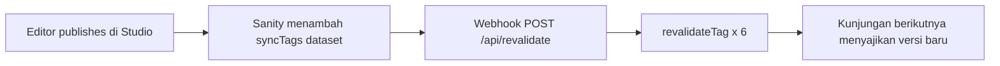

# DEPLOYMENT.md — CI/CD, Environments, dan Rollback Melodi Alam

> **Status fase (21 Okt 2026):** situs **sudah ter-deploy** ke Vercel
> (`melodialam-website.vercel.app`) dan berjalan dengan **Sanity Studio**
> sebagai CMS. Dokumen ini memakai **Payload CMS 3 + Supabase** sudah tidak
> berlaku dan tidak lagi diceritakan sebagai feature yang ada — lihat
> [`adr/0008-sanity-studio-menggantikan-payload.md`](adr/0008-sanity-studio-menggantikan-payload.md).
>
> Halaman `/pahlawan-kota`, `/spaces`, `/videos/arsip`, dan `/journal` (sebagai
> halaman) juga sudah dihapus. `/journal` kini hanya **redirect 308**.

Cara membaca label (konsisten dengan `docs/TEST-STRATEGY.md`):

| Label | Arti |
|---|---|
| `TERVERIFIKASI` | Dibaca langsung di kode/dijalankan pada fase ini |
| `RENCANA` | Direncanakan; belum ada |
| `ASUMSI` | Diasumsikan; perlu konfirmasi |
| `[PERLU VERIFIKASI]` | Tidak dapat diverifikasi dari workspace |

Acuan keputusan: **`ADR-0006`** (Vitest + Playwright, deploy ke Vercel),
**`ADR-0008`** (Sanity Studio menggantikan Payload). Acuan requirement:
`BR-001`…`BR-007`, `RISK-001`…`RISK-003`. Acuan audit:
[`audit-2026-10-21.md`](audit-2026-10-21.md). Acuan kontrak:
[`API-CONTRACTS.md`](API-CONTRACTS.md).

---

## 1. Delivery Context and Assumptions

### 1.1 Konteks pengiriman (`TERVERIFIKASI`)

| Aspek | Nilai | Bukti |
|---|---|---|
| Jenis aplikasi | Web SSR/static hybrid — Next.js App Router | `package.json` |
| Framework | Next.js `16.4.2`, Turbopack | `package.json`, output build |
| Runtime | React `19.3.0` | `package.json` |
| Bahasa | TypeScript `^5` | `package.json` |
| Gaya | Tailwind CSS `^4` via `@tailwindcss/turbopack` | `package.json`, `next.config.ts` |
| Lint | ESLint `^9` + `eslint-config-next` `16.4.2` | `package.json` |
| Versi paket | `0.2.0` (`package.json`) | `TERVERIFIKASI` |
| Node/npm (dipin) | Node `24.22.1` (`.nvmrc`, `engines.node`), npm `11.19.1` | `TERVERIFIKASI` 23 Okt 2026 |
| Hosting | **Vercel** (produksi + preview) | `TERVERIFIKASI` (audit 21 Okt 2026) |
| CMS | **Sanity Studio** — dataset `production` (publik) + `submissions` (privat) | `lib/sanity-project.ts` |
| Port dev/start | **3100** (sengaja bukan 3000) | `package.json` |
| Tim | Kecil (owner + kontributor; lihat `docs/CONTRIBUTING.md`) | `ASUMSI` |
| Frekuensi rilis | Belum ditetapkan | `[PERLU VERIFIKASI]` |

**Implikasi port 3100 (`TERVERIFIKASI`, catatan penting).** `-p 3100` hanya
relevan untuk `next dev` dan `next start` **di lokal dan di CI**. Vercel
**tidak** memakai flag ini — platform menentukan port via variabel `PORT` saat
menjalankan serverless/Next runtime. Pilihan 3100 **tidak boleh** dianggap
konfigurasi produksi.

### 1.2 Skrip yang benar-benar ada (`TERVERIFIKASI`)

`package.json` punya **10 skrip**, termasuk `test` (Vitest). Tidak ada skrip
`typecheck` atau `deploy`.

| Command | Isi |
|---|---|
| `npm run dev` | `next dev -p 3100` |
| `npm run build` | `next build` |
| `npm run start` | `next start -p 3100` |
| `npm run lint` | `eslint` |
| `npm test` | `vitest run` |
| `npm run catalogue` | `node scripts/build-catalogue.mjs` |
| `npm run brand` | `node scripts/build-brand.mjs` |
| `npm run photos` | `node scripts/copy-photos.mjs` |
| `npm run seed:sanity` | kompilasi `lib/content-fallback.ts` + `lib/taxonomy.ts` → jalankan `scripts/seed-sanity.cjs` |
| `npm run seed:videos` | `node scripts/seed-videos.cjs` |

Tidak ada skrip `typecheck` terpisah; `tsc --noEmit` dijalankan sebagai bagian
dari `next build` (output build menampilkan tahap "Running TypeScript ...").

### 1.3 Apa yang build lakukan hari ini (`TERVERIFIKASI`, angka terukur)

`npm run build` dijalankan sekali dari `melodi-alam/` pada 21 Okt 2026. Output
nyata (disalin apa adanya):

```
> melodi-alam@0.2.0 build
> next build

▲ Next.js 16.4.3 (Turbopack)
- Environments: .env
✓ Running next.config.ts took 49ms
- Cache Components enabled
- Partial Prefetching enabled

  Creating an optimized production build ...
✓ Compiled successfully in 960ms
  Running TypeScript ...
  Finished TypeScript in 2.6s ...
  Collecting page data using 11 workers ...
  Generating static pages using 11 workers (0/33) ...
  Generating static pages using 11 workers (8/33)
  Generating static pages using 11 workers (16/33)
  Generating static pages using 11 workers (24/33)
✓ Generating static pages using 11 workers (33/33) in 1780ms
  Finalizing page optimization ...

Route (app)                                             Revalidate  Expire
┌ ○ /                                                           1m      1h
├ ○ /_not-found
├ ƒ /api/demo-audio
├ ƒ /api/demos
├ ƒ /api/revalidate
├ ○ /apple-icon.png
├ ○ /bicara-melodi                                              1m      1h
├ ○ /icon.png
├ ƒ /journal
├ ƒ /journal/[slug]
├ ○ /kurasi                                                     1m      1h
├   /preview/[type]/[slug]                                      1m      1h
│ └ ◐ /preview/[type]/[slug]                                    1m      1h
├ ○ /robots.txt
├ ○ /rss.xml                                                    1m      1h
├ ○ /sitemap.xml                                                1m      1h
├ ○ /stories                                                    1m      1h
├   /stories/[slug]                                             1m      1h
│ ├ ◐ /stories/[slug]                                           1m      1h
│ ├ ○ /stories/spill-pilihan-lagu-arctic-monkeys                1m      1h
│ ├ ○ /stories/melankolia-di-priok-baladagehel-dongker          1m      1h
│ └ ◐ [+10 more paths]
├ ƒ /stories/[slug]/opengraph-image-1w7it6
├ ƒ /stories/[slug]/twitter-image-1w7it6
├ ○ /submit                                                     1m      1h
├ ○ /tentang                                                    1m      1h
└ ○ /videos                                                     1m      1h

○  (Static)             prerendered as static content
◐  (Partial Prerender)  prerendered as static HTML with dynamic server-streamed content
ƒ  (Dynamic)            server-rendered on demand
```

Angka **terukur** yang harus dipakai sebagai baseline (bukan estimasi):

| Metrik | Nilai terukur |
|---|---|
| Halaman statis yang di-generate | **33** |
| Waktu compile | **960 ms** |
| Waktu TypeScript | **2.6 s** |
| Waktu generate static pages | **1.78 s** (33/33) |
| Worker paralel | **11** |
| Muat `next.config.ts` | **49 ms** |
| Cache window konten | `Revalidate 1m`, `Expire 1h` |

Angka waktu **bervariasi antar-jalan** (run sebelumnya: compile 1198 ms,
TypeScript 2.5 s, generate 2.0 s). Yang **tidak** berubah antar-jalan adalah
**33 halaman** dan tabel rute di atas — itulah yang jadi baseline.

### 1.4 Rute: statis vs dinamis (`TERVERIFIKASI`)

Tabel ini adalah **tabel rute resmi** untuk smoke test dan Environ.

| Rute | Jenis build | Isi | Sumber data |
|---|---|---|---|
| `/` | `○` Static | "Latest News" (grid 2×2 = 4 kartu) + strip "Curated News" (4 post kurasi) | `latestStories(8)` + `allPillarPosts()` |
| `/stories` | `○` Static | "Stories" — grid 4 kolom, 8 kartu (foto lalu reel), badge "Reel" | `latestStories(8)` |
| `/stories/<slug>` | `○` Static + `◐` Partial Prerender | Detail artikel; 12 slug statis di-prerender, slug dari CMS dirender saat diminta | `articleBySlug` + `latestStories(8)` |
| `/tentang` | `○` Static | Profil, ekosistem (Samsara Bogor, SVVARA, INFIA), kontak & partnership | statis |
| `/kurasi` | `○` Static | "Curated News" — kotak cari + chip per pillar | `allPillarPosts()` |
| `/bicara-melodi` | `○` Static | 9 episode wawancara Season 3 | `allInterviews()` + `lib/catalogue.json` |
| `/videos` | `○` Static | **Melodi Samsara** — 9 baris sesi + 5 playlist | `allVideos()` + `allPlaylists()` + `getVideosPageCopy()` |
| `/privasi` | `●` Static | Kebijakan privasi (data form demo, penyimpanan, hak penghapusan) | `siteSettings` | — |
| `/ketentuan` | `●` Static | Ketentuan pengiriman karya | `siteSettings` | — |
| `/api/health` | `ƒ` Dynamic | 200 bila Sanity terjangkau, 503 bila tidak — titik untuk uptime monitor | `lib/sanity.ts` | — |
| `/submit` | `○` Static | Formulir demo 9 bagian (termasuk unggah audio opsional) | `POST /api/demos` |
| `/preview/<type>/<slug>?secret=…` | `◐` Partial Prerender | Pratinjau draf (`journal` atau `kurasi`), `noindex`, 404 bila secret salah | Sanity `perspective: "drafts"` |
| `/journal` | `ƒ` **Dynamic** | **308 permanen** → `/stories` | route handler |
| `/journal/<slug>` | `ƒ` **Dynamic** | **308 permanen** → `/stories/<slug>` | route handler |
| `/api/demos` | `ƒ` **Dynamic** | `GET` antrean approved + `POST` submission | Sanity dataset `submissions` |
| `/api/demo-audio` | `ƒ` **Dynamic** | Token unggah audio ke Vercel Blob (maks 25 MB) | `@vercel/blob/client` |
| `/api/revalidate` | `ƒ` **Dynamic** | Webhook Sanity → 6 tag cache | `SANITY_REVALIDATE_SECRET` |
| `/rss.xml` | `○` Static | RSS 2.0 dari 8 cerita terbaru | `latestStories(8)` |
| `/sitemap.xml` | `○` Static | 7 halaman + 8 artikel | `latestStories(8)` |
| `/robots.txt` | `○` Static | `allow: /`, `disallow: /api/` | statis |
| `/stories/<slug>/opengraph-image` | `ƒ` **Dynamic** | Kartu OG 1200×630 per artikel | Sanity |
| `/stories/<slug>/twitter-image` | `ƒ` **Dynamic** | Kartu Twitter 1200×630 per artikel | Sanity |
| `/_not-found` | `○` Static | Halaman 404 | `app/(site)/not-found.tsx` |
| `/icon.png` · `/apple-icon.png` | `○` Static | Rute metadata otomatis | `app/icon.png`, `app/apple-icon.png` |

**Kenapa ada `◐` Partial Prerender.** `next.config.ts` mengaktifkan **Cache
Components** dan **Partial Prefetching** (`TERVERIFIKASI`):

```ts
// next.config.ts
const nextConfig: NextConfig = {
  cacheComponents: true,
  partialPrefetching: true,
  poweredByHeader: false,
  images: {
    remotePatterns: [
      { protocol: "https", hostname: "i.ytimg.com", pathname: "/vi/**" },
      { protocol: "https", hostname: "cdn.sanity.io", pathname: "/images/**" },
    ],
  },
  turbopack: { rules: { "*.css": { loaders: ["@tailwindcss/turbopack"], as: "*.css" } } },
};
```

Konsekuensi deploy (`ASUMSI`, `[PERLU VERIFIKASI]`): sebagian HTML di-shell-kan
statis dan sisanya di-stream saat request. Ini berarti **preview dan
production harus memakai runtime Next.js yang sama** dengan lokal — perbedaan
versi runtime dapat mengubah perilaku `◐`.

**`images.remotePatterns` (`TERVERIFIKASI`).** Dua host remote yang diizinkan:
`https://i.ytimg.com/vi/**` (thumbnail YouTube) dan
`https://cdn.sanity.io/images/**` (artikel Sanity). Host persis, bukan open
proxy. Gambar artikel **wajib** datang dari Sanity — kalau sumber gambar
berubah, pola ini harus diperbarui atau gambar akan broken di produksi.

**Header keamanan (`TERVERIFIKASI`, `next.config.ts`).** Semua rute
menerima `X-Content-Type-Options: nosniff`,
`Referrer-Policy: strict-origin-when-cross-origin`,
`X-Frame-Options: SAMEORIGIN`, `Permissions-Policy` (camera/mic/geo/payment
dimatikan), `Strict-Transport-Security`
(`max-age=63072000; includeSubDomains; preload`), CSP dasar (enforced), dan
CSP penuh dalam mode `Content-Security-Policy-Report-Only`. CSP penuh
(report-only) mengizinkan `connect-src` ke host Sanity **dan** ke host Vercel
Blob (`https://*.public.blob.vercel-storage.com`,
`https://*.blob.vercel-storage.com`) — tanpa itu, unggah audio demo dari
browser akan diblokir begitu CSP report-only itu diaktifkan.

### 1.5 Pipeline aset build-time (`TERVERIFIKASI`, **berubah**)

Sebagian berkas di repo ini **generated**, bukan ditulis tangan. **Perubahan
penting sejak dokumen versi lama: semua artefak generated sekarang sudah
di-commit ke git**, jadi *clean checkout dapat di-build*.

| Artefak hasil | Generator | Sumber | Status git | Kalau langkah dilewati pada clean checkout |
|---|---|---|---|---|
| `lib/catalogue.json` (193.574 byte) | `npm run catalogue` → `scripts/build-catalogue.mjs` | `../melodi-alam-data.md` (fallback: `./melodi-alam-data.md`) | **Di-track** | `next build` **GAGAL** — `lib/catalogue.ts` meng-import JSON ini |
| `public/brand/melodi-alam-lockup-black.png` (87.030 byte) | `npm run brand` → `scripts/build-brand.mjs` | `../../LOGO2/Melodi Alam Text Logo - Black.png` | **Di-track** | Logo masthead/footer hilang → aset 404 |
| `app/icon.png` (165.501 byte) | `npm run brand` | `../../LOGO2/Melodi Alam Logo Only - Color.png` | **Di-track** | Rute `/icon.png` kosong / fallback |
| `app/apple-icon.png` (42.766 byte) | `npm run brand` | idem | **Di-track** | Rute `/apple-icon.png` kosong / fallback |
| `app/favicon.ico` (9.535 byte) | `npm run brand` | idem | **Di-track** | Favicon lama/bawaan Next.js tetap ada |
| `public/photos/*` (33 berkas `.webp`) | `npm run photos` → `scripts/copy-photos.mjs` | `../../FOTO PLACEHOLDER MELODI ALAM/` | **Di-track** | Semua foto artikel → aset 404 |

Konsekuensi yang tersisa (`TERVERIFIKASI`): **CI tidak dapat meregenerasi**
artefak-artefak ini, karena sumbernya berada **di luar repo** `melodi-alam/`
(`melodi-alam-data.md`, `LOGO2/`, `FOTO PLACEHOLDER MELODI ALAM/`) dan tidak
pernah di-commit. Build tetap bisa jalan karena artefaknya ikut ter-commit —
hanya **regenerasi** yang mustahil di runner. Aturan operasional: kalau data
katalog berubah, jalankan `npm run catalogue` di mesin developer lalu **commit
 hasilnya**.

### 1.6 Asumsi (`ASUMSI`)

- Satu environment produksi cukup untuk v1.0; tidak ada staging terpisah
  (Preview per-PR menggantikan peran staging). Konsisten dengan
  `docs/TEST-STRATEGY.md` §8.1.
- Pengguna awal hanya kurator internal + publik anonim; tidak ada beban tinggi
  (`NFR-001` belum diuji skala).
- Sumber data luar-repo (`melodi-alam-data.md`, `LOGO2/`, `FOTO PLACEHOLDER
  MELODI ALAM/`) berasal dari mesin yang sama dan tidak berubah sesering kode.
- Empat release blocker "PRD §14.2" dipetakan sebagai `B1`…`B4` di
  `docs/TEST-STRATEGY.md` §6.3; teks PRD tidak ada di workspace →
  `[PERLU VERIFIKASI]`.

---

## 2. Environment Plan

Tiga environment. **Production sudah berjalan** di Vercel
(`melodialam-website.vercel.app` — `TERVERIFIKASI` lewat audit 21 Okt 2026
yang memeriksa endpoint produksi). Keberadaan Preview per-PR
`[PERLU VERIFIKASI]`; Local berjalan di mesin developer.

| Environment | Tujuan | Data | Deploy Trigger | Akses |
|---|---|---|---|---|
| **Local** | Pengembangan + unit test | Sanity dataset `production` (publik) + `lib/catalogue.json` | Manual: `npm run dev` (port 3100) | Developer di mesin sendiri |
| **Preview** | Review per-PR, E2E, cek visual | Sanity `production`; demo queue di dataset `submissions` | **Otomatis** saat PR dibuka/di-update (`RENCANA` — belum ada CI di repo) | Tim internal (URL ber-token) |
| **Production** | Situs publik (`melodialam-website.vercel.app`) | Sanity `production` + `submissions`; audio di Vercel Blob (belum ada) | **Otomatis saat merge ke branch rilis** | Publik |

### 2.1 Apa yang membedakan tiap environment

| Dimensi | Local | Preview | Production |
|---|---|---|---|
| Sumber data editorial | Sanity `production` + fallback `lib/content-fallback.ts` | Sanity `production` | Sanity `production` |
| Demo queue | Sanity `submissions` **atau** array in-memory bila token kosong | idem | Sanity `submissions` |
| Env var dibaca | `NEXT_PUBLIC_SITE_URL`, `SANITY_API_READ_TOKEN`, `SANITY_REVALIDATE_SECRET`, `SANITY_PREVIEW_SECRET` | idem + opsional | idem + opsional (`SANITY_PREVIEW_SECRET`, `BLOB_READ_WRITE_TOKEN`, `RESEND_API_KEY`) |
| Secret | ada di `.env` lokal (git-ignored) | Environment Variables Vercel | Environment Variables Vercel |
| Media | `public/photos/*` + `cdn.sanity.io` | idem | idem + Vercel Blob (belum) |
| Domain | `localhost:3100` | `*.vercel.app` auto | `melodialam-website.vercel.app`; `melodialam.id` **belum resolve** |
| Data persisten | Sanity (dataset privat) | Sanity | Sanity |

---

## 3. Configuration and Secrets Inventory

### 3.1 Environment variables (`TERVERIFIKASI`)

Nama dan scope dibaca dari kode (`lib/site.ts`, `lib/sanity-server.ts`,
`lib/sanity-preview.ts`, `app/api/demo-audio/route.ts`,
`app/api/demos/route.ts`, `app/api/revalidate/route.ts`) dan dari
`.env.example`.

| Variable | Scope | Secret? | Wajib? | Efek |
|---|---|---|---|---|
| `NEXT_PUBLIC_SITE_URL` | client + server | Tidak | **Ya** di produksi | Canonical origin, sitemap, RSS, `robots.txt`, OG. Kosong → jatuh ke literal `https://melodialam.id` (`lib/site.ts:18`) |
| `SANITY_API_READ_TOKEN` | server saja | **YA** | **Ya** | Grant read pada dataset privat `submissions` + write. Kosong → demo queue jatuh ke array in-memory dan pratinjau draf selalu 404 |
| `SANITY_REVALIDATE_SECRET` | server saja | **YA** | **Ya** | Shared secret webhook `POST /api/revalidate`. Kosong → route menjawab `500` |
| `SANITY_PREVIEW_SECRET` | server saja | **YA** | Tidak | Secret pratinjau draf, **terpisah** dari secret revalidasi (tanpa fallback). Kosong → pratinjau selalu 404 |
| `SANITY_REVALIDATE_SECRET_PREVIOUS` | server saja | Tidak | Tidak | Nilai secret revalidasi **sebelum** rotasi. Hanya masa transisi — **sudah dikosongkan** (22 Okt 2026); boleh dihapus dari dasbor |
| `BLOB_READ_WRITE_TOKEN` | server saja | **YA** | Tidak | Token unggah audio. Kosong → `POST /api/demo-audio` menjawab `400` |
| `RESEND_API_KEY` | server saja | **YA** | Tidak | Notifikasi email redaksi. Kosong → notifikasi **inert** (tidak ada panggilan HTTP) |
| `DEMO_NOTIFY_TO` | server saja | Tidak | Tidak | Override penerima notifikasi, dipisah koma. Default `melodialam.ip@gmail.com,helfan@infia.co` |
| `DEMO_NOTIFY_FROM` | server saja | Tidak | Tidak | Override pengirim. Default `Melodi Alam <onboarding@resend.dev>` |

### 3.2 Yang **tidak** dipakai lagi

| Variable | Status | Catatan |
|---|---|---|
| `DATABASE_URL` | **Tidak dibaca kode mana pun** (`TERVERIFIKASI`) | Sisa era Supabase. **Sudah dihapus dari `.env` lokal** (22 Okt 2026) |
| `PAYLOAD_SECRET` | Tidak ada | Era Payload. Kode Payload sudah dihapus seluruhnya |
| `NEXT_PUBLIC_SUPABASE_URL` · `NEXT_PUBLIC_SUPABASE_ANON_KEY` · `SUPABASE_SERVICE_ROLE_KEY` | Tidak ada | Era Supabase |

### 3.3 Penyimpanan secret

- **Produksi & Preview (`TERVERIFIKASI`):** Environment Variables Vercel,
  per-scope (Production / Preview / Development). Penandaan "sensitive" per
  entri `[PERLU VERIFIKASI]` — perilaku UI platform tidak diverifikasi di
  workspace.
- **Lokal (`TERVERIFIKASI`):** berkas `.env` ada di root repo dan di-ignore
  oleh `.gitignore` (pola `.env*` dengan pengecualian `!.env.example`). Baris
  34–36 `.gitignore` memastikan **template ikut ter-commit** tetapi berkas
  rahasia tidak.
- **CI (ada, 22 Okt 2026):** `.github/workflows/ci.yml` menjalankan `npm run lint`, `npx next typegen`, `npx tsc --noEmit`, `npm test`, dan `npm run build` pada setiap push ke `main` dan setiap pull request. Langkah `next typegen` wajib: tipe rute (`PageProps`) dibuat oleh Next.js dan berkas-nya tidak ikut ter-commit. Tidak butuh secret — dataset `production` bisa dibaca tanpa token. Bila nanti butuh secret, secret disimpan di
  GitHub Actions Secrets.

### 3.4 Sisa era Supabase di `.env` lokal (`TERVERIFIKASI`)

Baris `DATABASE_URL` **sudah dihapus** dari `.env` lokal (22 Okt 2026). Nilai itu
sisa konfigurasi era Supabase yang **tidak dibaca satu pun modul**, dan
menghapus barisnya membuat `.env` lokal mencerminkan bentuk yang benar.

`.env.example` (yang **sudah** di-commit) memuat **sepuluh variabel**:
`SANITY_API_READ_TOKEN`, `SANITY_REVALIDATE_SECRET`, `SANITY_PREVIEW_SECRET`
(opsional), `BLOB_READ_WRITE_TOKEN` (opsional), `RESEND_API_KEY` (opsional),
`DEMO_NOTIFY_TO` dan `DEMO_NOTIFY_FROM` (opsional, ada default),
`NEXT_PUBLIC_SITE_URL`, serta `GDRIVE_CLIENT_JSON` dan `GDRIVE_AUTH_PORT` untuk
skrip lokal tarik foto Google Drive — ditambah penjelasan kenapa project id
Sanity bukan variabel lingkungan (lihat `lib/sanity-project.ts`).

`.env` **lokal** berbeda: isinya `DATABASE_URL` (baca §3.2), `NEXT_PUBLIC_SITE_URL`,
`SANITY_API_READ_TOKEN`, dan `SANITY_REVALIDATE_SECRET` — tanpa
`SANITY_PREVIEW_SECRET`, `BLOB_READ_WRITE_TOKEN`, maupun `RESEND_API_KEY`.

### 3.5 Aturan secret

1. **Tanpa prefix `NEXT_PUBLIC_`** untuk apa pun yang rahasia — variabel
   ber-prefix itu di-inline ke bundle browser oleh Next.js.
2. **`SANITY_API_READ_TOKEN` hanya boleh dibaca kode server.**
   `lib/sanity-server.ts` dan `lib/sanity-preview.ts` adalah satu-satunya
   pemegangnya; keduanya tidak boleh di-import komponen client.
3. **Nilai berbeda per environment.** Preview dan Production tidak berbagi
   secret revalidasi.
4. **Rotasi.** Bila bocor (ter-commit, ter-log, tampil di screenshot): rotasi
   segera di dashboard Sanity/Vercel, perbarui env, lalu re-deploy. Jangan
   hanya menimpa commit.

---

## 4. Alur Build, Run, dan Deploy

### 4.1 Alur lokal (`TERVERIFIKASI`)

```bash
npm ci          # install sesuai package-lock.json
npm run lint    # eslint
npm test        # vitest run → 20 kasus, 1 file
npm run build   # next build → 33 halaman statis
npm run start   # next start -p 3100
```

Hasil `npm test` yang dijalankan pada fase ini (21 Okt 2026):

```
✓ lib/content-fallback.test.ts (20 tests) 4ms

Test Files  1 passed (1)
     Tests  9 passed (9)
  Duration  1.34s
```

`npm run dev` (`next dev -p 3100`) untuk pengembangan; `npm run start`
(`next start -p 3100`) untuk menjalankan hasil build. Keduanya memakai port
**3100**, bukan 3000.

### 4.2 Build di Vercel (`RENCANA` / `[PERLU VERIFIKASI]`)

| Item | Nilai | Status |
|---|---|---|
| Framework preset | Next.js | `RENCANA` |
| Install | `npm ci` | `RENCANA` |
| Build command | `npm run build` | `RENCANA` |
| Output | default (`.next`) | `RENCANA` |
| Node runtime | perlu dikonfirmasi terhadap default Vercel untuk Next `16.4.2` + Cache Components | `[PERLU VERIFIKASI]` |
| Root directory | repo ini adalah subfolder dari workspace | `[PERLU VERIFIKASI]` |

### 4.3 Urutan build yang aman (`TERVERIFIKASI`)

Urutan ini **wajib** dan sudah diuji:

1. `npm ci` — `package-lock.json` ada.
2. `npm run lint` — harus hijau.
3. `npm test` — 20 kasus Vitest.
4. `npm run build` — 33 halaman statis. **Jangan** menjalankan
   `npm run catalogue` / `brand` / `photos` di runner: sumbernya di luar repo
   dan skripnya `process.exit(1)` bila sumber tidak ada (§1.5).
5. Deploy.

### 4.4 CI (`TERVERIFIKASI` — belum ada)

**Tidak ada CI hari ini**: tidak ada direktori `.github/` di root repo (verifikasi
rekursif; yang muncul hanya `.github/` di dalam `node_modules` paket pihak
ketiga). Tidak ada workflow YAML. Semua spesifikasi di bawah `RENCANA`.

Tahap yang direncanakan (meniru `docs/TEST-STRATEGY.md` §9.1):

| Tahap | Perintah | Blokir merge? | Alasan |
|---|---|---|---|
| Install | `npm ci` | **Ya** | Reproducible; lockfile ada |
| Lint | `npm run lint` | **Ya** | Sudah hijau; regresi mudah ditangkap |
| Build + typecheck | `npm run build` | **Ya** | Menangkap error tipe/rute dan stylesheet gagal |
| Unit | `npm test` | **Ya** | Cepat, deterministik |
| E2E journey kritis | `playwright test` | **Ya** | Playwright belum terpasang (`RENCANA`) |
| Coverage % | `vitest run --coverage` | **Warning** | Diagnostik, bukan sasaran |

Kerangka workflow (belum boleh dibuat pada fase DOCS ONLY):

```yaml
# .github/workflows/ci.yml  — RENCANA, belum ada
name: CI
on:
  pull_request:
  push:
    branches: [main]

jobs:
  verify:
    runs-on: ubuntu-latest
    steps:
      - uses: actions/checkout@v4
      - uses: actions/setup-node@v4
        with:
          node-version-file: .nvmrc
          cache: npm
      - run: npm ci
      - run: npm run lint
      - run: npm test
      - run: npm run build          # build + typecheck
```

Caching (`RENCANA`): `actions/setup-node` dengan `cache: npm` (key dari
`package-lock.json`). Cache `.next/cache` antar-job opsional. Jangan cache
`node_modules` mentah (risiko native module `sharp` tidak cocok platform) —
`sharp` dipakai skrip build saja, bukan runtime.

Matriks OS/node (`TERVERIFIKASI`): runner `ubuntu-latest`; Node dari `.nvmrc`
(`24.22.1`), CI memakai `node-version-file: .nvmrc`, dan `package.json` memuat
`engines.node: ">=24.22.1 <25"`. Project Vercel memakai `24.x` — sama dengan
project Samsara Group.

---

## 5. Deployment and Promotion Strategy

### 5.1 Strategi (`RENCANA`, `ADR-0006`)

- **Preview deployment per PR** — setiap PR memicu Vercel Preview unik; review
  code + klik URL Preview.
- **Production** — merge ke branch rilis (mis. `main`) memicu deploy otomatis.
- Tidak ada blue-green/canary manual; Vercel menangani atomisitas rilis +
  rollback instan (§8). Ini right-sized untuk tim kecil.

### 5.2 Promosi (`RENCANA`)

| Tahap | Pemicu | Hasil | Siapa menyetujui |
|---|---|---|---|
| Preview | PR dibuka/di-update | URL `*.vercel.app` + job CI | otomatis |
| Production | merge ke `main` (atau tag) | Domain produksi | review PR + gate CI hijau |

### 5.3 Konfigurasi platform (`RENCANA`, `[PERLU VERIFIKASI]`)

- Framework preset: Next.js; install `npm ci`; build `npm run build`; output
  default (`.next`).
- Tidak ada setting Vercel lain yang diklaim ada di dokumen ini — semua di
  atas adalah target, bukan konfigurasi yang sudah dibuat.

---

## 6. Migration and Data Handling Plan

### 6.1 Hari ini (`TERVERIFIKASI`)

- **Tidak ada database.** Satu-satunya store yang menulis adalah dataset privat
  Sanity `submissions` (dokumen `demoSubmission` + `demoContact`). Bila
  `SANITY_API_READ_TOKEN` kosong, `/api/demos` jatuh ke array **module-level**
  (`memoryQueue`) — store process-local, reset saat restart/deploy.
- Kontak manajer **tersimpan** (di dokumen `demoContact` terpisah), bukan lagi
  sekadar di-echo di string `note`.
- Audio demo **tidak** lewat server: browser mengunggah langsung ke Vercel
  Blob, dan submission hanya membawa URL-nya.

### 6.2 Sanity menggantikan migrasi basis data (`TERVERIFIKASI`)

Tidak ada migrasi skema SQL. Yang ada adalah **alur konten**:



Kalau webhook belum terpasang, konten tetap muncul — hanya setelah jendela
cache (1 menit) habis. Jadi webhook adalah **peningkatan kecepatan**, bukan
syarat agar berfungsi.

Aturan isi konten (`RENCANA` bila perlu migrate):

1. **Perubahan struktural di Studio bisa merusak situs.** Contoh nyata:
   menghapus field `siteSettings.cardCurtain` membuat kartu kehilangan label.
2. **Tipe dataset baru wajib masuk daftar webhook** (§7.2).
3. **Konten baru =.slug baru.** Slug artikel yang diubah membuat URL lama
   mati; tidak ada pengalihan otomatis selain `/journal` → `/stories`.

### 6.3 Batas (`TERVERIFIKASI`)

- Katalog video tetap **build-time** (`ADR-0004`) — `lib/catalogue.json` di
  dalam repo, bukan dokumen Sanity.
- Halaman `/stories/[slug]` memakai `dynamicParams` default `true`: 12 slug
  statis di-prerender, sisanya dirender saat diminta **tanpa rebuild**.
- Kolase kurasi (`pillarPost`) tidak punya fallback statis — kalau Sanity tak
  terjangkau, seksi simply tidak dirender.

---

## 7. Integrasi Sanity

### 7.1 Dataset dan token (`TERVERIFIKASI`)

| Dataset | Sifat | Isi | Token |
|---|---|---|---|
| `production` | **Publik** | `siteSettings`, `article`, `interview`, `video`, `playlist`, `pillarPost`, `videosPage` | Tidak perlu token untuk baca |
| `submissions` | **Privat** | `demoSubmission`, `demoContact` | `SANITY_API_READ_TOKEN` |

Project id dan nama dataset adalah **literal** di `lib/sanity-project.ts`
(bukan env var), karena file itu dibangun dua kali — oleh Next untuk Studio
tertanam dan oleh bundler Sanity sendiri — dan keduanya hanya sepakat pada
bentuk literal.

### 7.2 Webhook revalidasi (`RENCANA` — dipasang manual)

Dipasang di `sanity.io/manage` → project → **API → Webhooks**:

| Setelan | Nilai | Status |
|---|---|---|
| **URL** | `https://melodialam-website.vercel.app/api/revalidate` | `RENCANA` |
| **Method** | `POST` | `RENCANA` |
| **Secret** | nilai yang sama dengan `SANITY_REVALIDATE_SECRET` | `RENCANA` |
| **Filter** | `_type in ["article", "pillarPost", "interview", "siteSettings", "video", "playlist", "videosPage"]` — 7 tipe yang disebut di `app/api/revalidate/route.ts:21-26` | `TERVERIFIKASI` (kode) |
| **Filter** | **8 tipe** — audit terakhir mencatat filter harus 8 tipe; tipe kedelapan belum terverifikasi di repo (`[PERLU VERIFIKASI]`, kandidat: `demoSubmission` di dataset `submissions`) | `[PERLU VERIFIKASI]` |
| **Trigger on** | **Create + Update** — tanpa centang Update, menyunting artikel tidak memicu webhook apa pun | **`TERVERIFIKASI` 22 Okt 2026** — publish → halaman segar dalam **2,1 detik** |
| **Projection** | `{_type, _id}` | `RENCANA` |

**⚠️ Tindakan pemilik.** Pada pemeriksaan terakhir, di layar webhook Sanity
**hanya "Create" yang tercentang**. Itu harus diperbaiki: publish hasil edit
adalah **update**, sehingga tanpa centang Update konten hasil suntingan tidak
segera muncul di situs. Perbaiki di dashboard Sanity, bukan di kode.

Isi kolom **Secret** pada webhook Sanity (Advanced settings); Sanity lalu
mengirim tanda tangan `sanity-webhook-signature` (HMAC-SHA256, jendela ±5
menit). Header buatan `x-webhook-secret` masih diterima route sebagai cadangan
untuk pemanggil manual, tetapi webhook Sanity tidak lagi memakainya (dihapus
25 Okt 2026). Webhook tanpa bukti identitas ditolak `401` — endpoint revalidasi
terbuka adalah cara mudah menjadikan
cache sebagai sasaran serangan.

Route membuang **enam** tag cache sekaligus: `articles`, `pillar-posts`,
`interviews`, `siteSettings`, `videos`, `videosPage`.

### 7.3 Pratinjau draf (`TERVERIFIKASI`)

Rute `/preview/<type>/<slug>?secret=…` membaca perspektif `drafts` dengan
token. **`SANITY_PREVIEW_SECRET` sudah di-set** (22 Okt 2026) dan **terpisah** dari
secret revalidasi (`lib/sanity-preview.ts:38-40`) — satu
nilai melindungi dua kapabilitas. Lihat §11 butir 5.

---

## 8. Rollback and Recovery Plan

### 8.1 Aplikasi — rollback instan Vercel (`RENCANA`)

- Vercel menyimpan setiap deployment; **Instant Rollback** mempromosikan
  deployment sebelumnya tanpa rebuild. Ini rollback tingkat aplikasi, target
  pulih dalam hitungan detik–menit.
- Pemicu rollback (usulan): error 5xx naik, halaman putih/stylesheet kosong
  (§12.1 `H1`), atau regresi journey kritis setelah rilis.
- Keputusan: owner produk (atau kontributor yang memegang akses Vercel).
- **Rollback kode TIDAK mengembalikan konten.** Konten ada di Sanity, bukan di
  repo — jadi rollback aplikasi tidak menyentuh isi artikel.

### 8.2 Alternatif: forward-fix

Untuk perubahan berisiko rendah, deploy perbaikan kecil lebih cepat daripada
rollback. Aturan: pilih rollback bila gambar/asset rusak; pilih forward-fix bila
hanya UI.

### 8.3 Konten — publish ulang (`TERVERIFIKASI`)

Tidak ada "rollback migrasi" di Sanity; yang ada adalah:

1. **Konten adalah data, bukan kode.** Menolak publish mengembalikan versi
   sebelumnya; kedua versi tetap tersimpan di riwayat dokumen.
2. **Perubahan field yang merusak** (mis. menghapus field yang dibaca
   `lib/site-settings.ts`) diperbaiki dengan publish ulang — atau dengan
   rollback deploy bila kodenya yang salah.
3. **Blob tidak ikut rollback.** Objek audio yang sudah terunggah tidak hilang
   saat rollback; tidak ada job pembersih (`RENCANA`).

### 8.4 Data demo — persistensi di Sanity (`TERVERIFIKASI`)

- **Hari ini:** submission hidup di dataset privat `submissions`. Menghapus
  dokumen `demoSubmission` **tidak** menghapus `demoContact` (PII) atau objek
  audio — lihat `audit-2026-10-21.md` F07. Aksi kurator harus ikut menghapus
  keduanya.
- **Rollback aplikasi tidak menyentuh antrean demo** — antrean bukan bagian
  dari build.

---

## 9. Monitoring and Alerting Plan

Monitoring formal belum ada. Yang terpasang hari ini (`TERVERIFIKASI`):

| Sarana | Status | Catatan |
|---|---|---|
| Vercel Web Analytics | `@vercel/analytics` terpasang + `<Analytics />` di `app/(site)/layout.tsx:181` — **tapi belum dinyalakan di dashboard** | `RENCANA` — perlu dinyalakan di dashboard Vercel |
| `@vercel/blob` | Terpasang; **store belum dibuat** | `RENCANA` |
| Resend | Kode notifikasi ada; `RESEND_API_KEY` belum di-set | `RENCANA` |
| Log route handler | `console.error` di `app/api/demos/route.ts` (gagal simpan, gagal email) dan `app/api/demo-audio/route.ts` | `TERVERIFIKASI` |
| Error tracking eksternal (Sentry dsb.) | Tidak ada | `RENCANA` |

### 9.1 Sinyal minimum yang direncanakan (`RENCANA`)

| Sinyal | Sumber usulan | Ambang awal (usulan) |
|---|---|---|
| Availability | Vercel / uptime check eksternal | > 1 kegagalan beruntun pada root |
| Error rate 5xx | Log Vercel / function errors | > 1% selama 5 menit |
| Latency p95 | Vercel Analytics | ambang belum ditetapkan (`[PERLU VERIFIKASI]`) |
| `POST /api/demos` error rate | log route handler | lonjakan 4xx/5xx |
| Build/deploy failure | notifikasi Vercel | setiap kegagalan |

### 9.2 Kondisi yang wajib memicu perhatian (spesifik repo ini)

- **Stylesheet kosong** — regresi Tailwind `@source` (§12.1 `H1`) menghasilkan
  situs tanpa gaya namun **200 OK**; tidak terdeteksi oleh error-rate.
  Mitigasi: smoke visual per rilis (§10.2) + gate build.
- **Halaman `opacity: 0`** — regresi frame-loop bisa menyembunyikan konten tanpa
  error.
- **Error `next/image` remote pattern** — bila sumber gambar Sanity berubah
 path tanpa memperbarui `remotePatterns`, muncul 400 dari optimizer.
- **Konten hilang mendadak** — Sanity tak terjangkau → `allPillarPosts()`
  mengembalikan `[]` dan seksi kurasi hilang tanpa error HTTP.

### 9.3 Kepemilikan & proses insiden (`RENCANA`)

- Pemilik alert: owner produk/teknisi utama. Belum ada rotasi on-call (tim
  kecil).
- Insiden: identifikasi → putuskan rollback (§8) atau forward-fix → catat di
  `CHANGELOG.md`/postmortem singkat.

---

## 10. Release Checklist

### 10.1 Empat release blocker (`ASUMSI` — teks PRD tidak tersedia)

`docs/TEST-STRATEGY.md` §6.3 memetakan empat blocker "PRD §14.2" sebagai
`B1`…`B4`. Teks PRD tidak ada di workspace → pemetaan ini `ASUMSI` dan **harus
dikonfirmasi**.

| Blocker | Tema | Bukti lulus |
|---|---|---|
| `B1` | Pipeline submission end-to-end + moderasi + tanpa kebocoran PII | Submit form → dokumen `demoSubmission` + `demoContact` terpisah |
| `B2` | Aksesibilitas: reduced motion + keyboard + alt/semantik | `ACC-001` hijau; `ACC-002` diperbaiki lalu hijau |
| `B3` | Build bersih & semua rute publik jalan (termasuk 404, metadata) | `npm run build` + smoke rute (§10.2) |
| `B4` | Tidak ada regresi interaksi terkunci (`DEC-002`/`DEC-003`) | E2E hover/focus |
| Kelayakan | **Halaman statis tidak turun dari 33** tanpa alasan | cek output build = `33/33` |

### 10.2 Smoke test pasca-deploy (berbasis daftar rute nyata)

Dijalankan pada URL Preview **dan** Production. Semua rute berasal dari output
build `TERVERIFIKASI` (§1.4).

| # | Cek | Rute |
|---|---|---|
| 1 | Landing memuat, stylesheet terpasang (bukan halaman tanpa gaya) | `/` |
| 2 | Stories memuat; grid 8 kartu, 4 kolom, badge "Reel" pada yang reel | `/stories` |
| 3 | Artikel terbuka dari kartu; `<h1>` = judul artikel | `/stories/<slug>` (uji ≥2, termasuk `spill-pilihan-lagu-arctic-monkeys`) |
| 4 | Curated News memuat; kotak cari + chip pillar bekerja | `/kurasi` |
| 5 | Halaman wawancara memuat; 9 episode Season 3 | `/bicara-melodi` |
| 6 | Melodi Samsara memuat; 9 baris sesi + 5 playlist | `/videos` |
| 7 | Halaman tentang memuat | `/tentang` |
| 8 | Form submit memuat; submit valid → `[role="status"]` sukses | `/submit` → `POST /api/demos` |
| 9 | Unggah audio: setelah memilih berkas, banner "gagal diunggah" **muncul** bila Blob store belum ada (`RENCANA` — lihat §11 butir 2) | `/submit` → `POST /api/demo-audio` |
| 10 | `GET` antrean mengembalikan `{ queue, count }` | `/api/demos` |
| 11 | Redirect permanen bekerja | `/journal` → `/stories` (308), `/journal/<slug>` → `/stories/<slug>` (308) |
| 12 | Feed dan peta situs valid | `/rss.xml`, `/sitemap.xml`, `/robots.txt` |
| 13 | Kartu sosial artikel dilayani (PNG 1200×630) | `/stories/<slug>/opengraph-image` |
| 14 | Rute tak dikenal → 404 | `/rute-tidak-ada` |
| 15 | Favicon/touch icon disajikan | `/favicon.ico`, `/icon.png`, `/apple-icon.png` |
| 16 | Thumbnail YouTube termuat (remote pattern `i.ytimg.com`) | baris video di `/videos` |

### 10.3 Checklist pra-rilis (`RENCANA`)

- [ ] Gate hijau: lint, `npm test`, build (+typecheck) (§4.3).
- [ ] **Artefak generated ter-commit** (§1.5) — kalau `lib/catalogue.json`
      berubah, `npm run catalogue` sudah dijalankan dan hasilnya di-commit.
- [ ] `CHANGELOG.md` + bump versi + tag (lihat §12.3 butir 8).
- [ ] Tidak menambah direktori tool baru di root tanpa `@source not` (§12.1 `H1`).
- [ ] `remotePatterns` cocok dengan semua sumber gambar (§1.4, §9.2).
- [ ] Env var baru tercatat di §3.1.

### 10.4 Checklist pasca-rilis (`RENCANA`)

- [ ] Jalankan smoke test §10.2 di Production.
- [ ] Konfirmasi jumlah halaman statis tetap 33 (atau alasan penurunan dicatat).
- [ ] Pantau sinyal §9.1 selama periode awal.
- [ ] Siapkan rollback instan (§8.1) bila ada regresi.

---

## 11. Tindakan yang menunggu pemilik

Daftar ini **bukan** pekerjaan kode — semuanya butuh akses ke dasbor Vercel atau
Sanity. Statusnya berasal dari `audit-2026-10-21.md` (21 Okt 2026) dan tetap
perlu dikonfirmasi saat dibaca.

| # | Tindakan | Akibat kalau belum dikerjakan | Status |
|---|---|---|---|
| 1 | **Lampirkan domain `melodialam.id`** | Domain belum resolve → `NEXT_PUBLIC_SITE_URL` masih menunjuk ke `https://melodialam-website.vercel.app`, sehingga **canonical, sitemap, RSS, `robots.txt`, dan OG** semuanya menunjuk ke alamat preview | `RENCANA` (owner) |
| 2 | **Buat Blob store** di proyek Vercel | `BLOB_READ_WRITE_TOKEN` belum ada → `POST /api/demo-audio` menjawab `400` dan form tidak bisa melampirkan audio | `RENCANA` (owner) |
| 3 | **Set `RESEND_API_KEY`** (+ opsional `DEMO_NOTIFY_TO`) | Notifikasi email ke redaksi **inert**; submission tetap tersimpan, tapi meja redaksi tidak diberi tahu | `RENCANA` (owner) |
| 4 | **Nyalakan Vercel Web Analytics** di dashboard | `<Analytics />` sudah terpasang, tapi tidak ada data yang terkumpul | `RENCANA` (owner) |
| 5 | ~~**Set `SANITY_PREVIEW_SECRET`** (terpisah dari `SANITY_REVALIDATE_SECRET`)~~ | **Selesai 22 Okt 2026** — sudah dipasang; fallback sudah dihapus (`audit-2026-10-21.md` F03) | — |
| 6 | **Centang "Update"** di webhook Sanity dan samakan filter ke 8 tipe | Menyunting artikel di Studio **tidak** memicu webhook; konten baru muncul paling cepat setelah jendela cache 1 menit | `RENCANA` (owner) |
| 7 | ~~**Arahkan webhook Sanity ke secret revalidasi yang baru**, lalu hapus `SANITY_REVALIDATE_SECRET_PREVIOUS`~~ | **Selesai 22 Okt 2026** — webhook memakai secret baru (dibuktikan: publish → halaman segar dalam 8,2 detik), secret lama kini **401** | — |
| 8 | ~~**Hapus `DATABASE_URL`** dari `.env` lokal~~ | **Selesai 22 Okt 2026** | `RENCANA` (owner) |

---

## 12. Risks and Open Questions

### 12.1 Bahaya deploy yang sudah terbukti (`TERVERIFIKASI`)

**`H1` — Tailwind content scan menelusuri direktori tool → stylesheet kosong
secara senyap.** Tailwind v4 menelusuri seluruh proyek untuk mendeteksi kelas.
Di repo ini `.codegraph/` menyimpan SQLite WAL (`codegraph.db-shm`) yang
terkunci saat server MCP berjalan; Turbopack panic (`os error 33`) ketika
streaming `globals.css` dan **seluruh stylesheet gagal di-generate** — tanpa
error yang jelas, hanya situs tanpa gaya. Perbaikan: tiga direktif `@source not`
di `app/globals.css` (relatif ke `app/globals.css`):

```css
@source not "../.codegraph";   /* -> melodi-alam/.codegraph */
@source not "../.gitnexus";    /* -> melodi-alam/.gitnexus */
@source not "../.next";        /* -> melodi-alam/.next */
```

**Aturan operasional:** **setiap direktori tool baru di root proyek wajib
menambah satu `@source not`** pada `globals.css`, kalau tidak stylesheet bisa
kosong senyap.

Catatan tambahan (`TERVERIFIKASI`): `.gitignore` sudah meng-ignore
`/.playwright-mcp`, tetapi `globals.css` **tidak** meng-exclude `.playwright-mcp`
maupun `/.brand-check`. Bila salah satu muncul di dalam root `melodi-alam/`,
tambahkan `@source not` yang sesuai.

**`H2` — Port 3100 hanya relevan lokal/CI.** `-p 3100` ada di `dev` dan `start`
(`TERVERIFIKASI`). Vercel mengabaikannya (menentukan port via runtime). Jangan
menganggap 3100 sebagai konfigurasi produksi, dan jangan meng-hardcode
`http://localhost:3100` di kode selain konfigurasi test.

**`H3` — `next/image` `fill` butuh ancestor berposisi.** Instance dengan parent
`static` pernah stretch + `sizes` salah → upscale. Ini hazard kualitas visual
yang juga muncul saat preview/deploy; lihat `docs/TEST-STRATEGY.md` (`R2`).

**`H4` — SSR yang membakar hidden state.** `translateY(115%)` inline membuat
heading permanen tak terlihat bila callback gagal. Aturan: SSR merender state
final.

**`H5` — Kelas Tailwind dari interpolasi string tidak ter-generate.**
`aspect-[${x}]` menghasilkan tidak ada rule. Di CI, ini muncul sebagai regresi
visual tanpa error build.

**`H6` — Sumber generator di luar repo (§1.5).** Build *berhasil* di clean
checkout karena artefaknya ter-commit, tetapi **regenerasi** tidak mungkin di
runner. Kalau katalog atau aset berubah, `npm run catalogue`/`brand`/`photos`
hanya bisa dijalankan di mesin developer.

**`H7` — Canonical masih ke domain preview.** Selama `melodialam.id` belum
resolve (§11 butir 1), `NEXT_PUBLIC_SITE_URL` menunjuk ke `*.vercel.app`.
Efeknya: canonical menunjuk ke URL yang tidak akan menjadi alamat final —
dampak SEO besar, dan tidak terlihat dari kode karena nilainya datang dari env.

### 12.2 Risiko terencana (`RENCANA`)

| ID | Risiko | Dampak | Mitigasi |
|---|---|---|---|
| `D1` | Clean checkout tidak dapat di-build | Rilis pertama gagal | **Selesai** — artefak generated sudah di-commit (§1.5) |
| `D2` | Next `16.4.2` + Cache Components tak cocok runtime Vercel | Build/`◐` berbeda dari lokal | `[PERLU VERIFIKASI]` |
| `D3` | `SANITY_API_READ_TOKEN` bocor ke client | Kritis (akses dataset privat + seluruh PII kontak) | §3.5: tanpa `NEXT_PUBLIC_`, server-only |
| `D4` | Blob store belum ada | Unggah audio selalu 400 | §11 butir 2 |
| `D5` | Queue demo in-memory bila token kosong | Submission hilang saat restart | Pastikan token ter-set di produksi |
| `D6` | Stylesheet kosong senyap (`H1`) lolos ke produksi | Situs tanpa gaya | Gate build + smoke visual §10.2 |
| `D7` | Direktori tool baru ditambahkan tanpa `@source not` | `H1` terulang | Aturan `H1` + review PR |
| `D8` | Webhook Sanity hanya memicu Create | Konten hasil suntingan lambat muncul | §11 butir 6 |
| `D9` | ~~`audioUrl` diterima dari host mana pun~~ | Audio asing masuk ke redaksi | **Ditutup 21 Okt 2026**: server kini menolak URL audio yang hostnya bukan `*.blob.vercel-storage.com` (`isOwnBlobUrl()` di `app/api/demos/route.ts`). Hanya `D4` yang masih membuka: tanpa Blob store, tidak ada unggahan sama sekali |

### 12.3 Open Questions

1. **Artefak generated:siapa yang regenerate?** Sumbernya di luar repo, jadi
   hanya mesin developer yang bisa. Siapa yang bertanggung jawab saat data
   katalog berubah?
2. ~~**Versi Node di Vercel.**~~ **Selesai 23 Okt 2026**: `.nvmrc` (24.22.1),
   `engines.node` di `package.json`, CI lewat `node-version-file`, dan project
   Vercel diset `24.x` — sama dengan project Samsara Group.
3. **Next.js 16.4.3 di Vercel.** Dukungan penuh (termasuk Cache Components)
   belum dikonfirmasi `[PERLU VERIFIKASI]`.
4. **Domain produksi.** `melodialam.id` sudah dibeli tetapi belum resolve;
   `melodialam.com` milik pihak lain (parked) dan tidak dipakai.
5. **Filter webhook tipe kedelapan.** Sudah ada 7 tipe yang disebut di kode;
   tipe kedelapan belum terverifikasi (§7.2).
6. **Ambang monitoring** (§9.1) dan **RTO/RPO** belum ditetapkan.
7. **Teks PRD §14.2** untuk empat release blocker `B1`…`B4` tidak tersedia →
   pemetaannya `ASUMSI`.
8. **Branch rilis.** Nama branch produksi (mis. `main`) dan kebijakan tag belum
   ditetapkan.

---

## Catatan Verifikasi (Verification Notes)

Berkas dan sistem yang dibaca/dijalankan **langsung** pada fase ini (semua
relatif ke `D:\Project Website Melodi Alam\melodi-alam\` kecuali disebut lain):

- `app/api/demos/route.ts` — kontrak `GET`/`POST`, validasi, `audioUrl`
  (https + ekstensi), `demoContact` terpisah, `503` bila Sanity gagal.
- `app/api/demo-audio/route.ts` — token unggah Blob, `allowedContentTypes`,
  `maximumSizeInBytes` 25 MB, `400` bila token tidak ada.
- `app/api/revalidate/route.ts` — 6 tag, `sanity-webhook-signature` (HMAC)
  dengan `x-webhook-secret` cadangan, `401`/`500`.
- `app/rss.xml/route.ts`, `app/sitemap.ts`, `app/robots.ts` — feed,
  peta situs, aturan perayapan.
- `app/(site)/journal/route.ts` dan `app/(site)/journal/[slug]/route.ts` —
  redirect `308`.
- `app/(site)/preview/[type]/[slug]/page.tsx` — pratinjau draf, `noindex`,
  `notFound()` bila secret salah.
- `app/(site)/layout.tsx:181` — `<Analytics />` terpasang.
- `lib/site.ts` — `SITE.url` dari `NEXT_PUBLIC_SITE_URL`, fallback
  `https://melodialam.id`; daftar nav (`/stories`, `/bicara-melodi`, `/videos` =
  Melodi Samsara, `/kurasi` = Curated News).
- `lib/sanity-project.ts` — project id literal, dataset `production` (publik) +
  `submissions` (privat).
- `lib/sanity-server.ts`, `lib/sanity-preview.ts` —Fallback antrean in-memory
  dan fallback secret pratinjau.
- `lib/taxonomy.ts`, `lib/content-fallback.ts` — enum demo, `SEED_DEMOS` (3 entri),
  batas audio 25 MB.
- `next.config.ts` — `cacheComponents`, `partialPrefetching`,
  `poweredByHeader: false`, `images.remotePatterns` (`i.ytimg.com/vi/**` +
  `cdn.sanity.io/images/**`), header keamanan (CSP enforced + report-only
  dengan `connect-src` ke host Vercel Blob), HSTS.
- `package.json` — **10 skrip** persis seperti §1.2; dependensi
  (`next 16.4.2`, `react 19.3.0`, `@sanity/client ^8.9.0`, `@vercel/analytics
  ^2.0.1`, `@vercel/blob ^2.8.2`, `vitest ^3.2.7`); **tanpa** `payload`,
  `supabase`, `express`, atau `graphql` terpasang.
- `.env.example` — **enam variabel**: `SANITY_API_READ_TOKEN`,
  `SANITY_REVALIDATE_SECRET`, `SANITY_PREVIEW_SECRET`, `BLOB_READ_WRITE_TOKEN`,
  `RESEND_API_KEY`, `NEXT_PUBLIC_SITE_URL`, plus penjelasan project id
  literal.
- `.env` (lokal) — memuat `DATABASE_URL` yang **tidak dibaca kode mana pun**,
  serta `NEXT_PUBLIC_SITE_URL`, `SANITY_API_READ_TOKEN`,
  `SANITY_REVALIDATE_SECRET`. Tidak ada `SANITY_PREVIEW_SECRET`,
  `BLOB_READ_WRITE_TOKEN`, atau `RESEND_API_KEY`.
- `.gitignore` — `.env*` dengan pengecualian `!.env.example`; `/.codegraph`,
  `/.gitnexus`, `/.playwright-mcp`.
- `app/globals.css` — tepat tiga `@source not`: `../.codegraph`, `../.gitnexus`,
  `../.next`.
- `scripts/build-catalogue.mjs` — `SOURCE_CANDIDATES` =
  `../melodi-alam-data.md` lalu `./melodi-alam-data.md`; `process.exit(1)` bila
  tak ada; menulis `lib/catalogue.json`.
- `scripts/build-brand.mjs` — `ROOT = ../..`; membaca `LOGO2/*.png`; menulis
  `public/brand/*` + `app/icon.png`, `app/apple-icon.png`, `app/favicon.ico`.
- `scripts/copy-photos.mjs` — `SRC = ../../FOTO PLACEHOLDER MELODI ALAM`;
  `process.exit(1)` bila tak ada; menulis `public/photos/*`.
- `git log` → HEAD `a974b50` ("Move the Stories page to /stories"); **136
  berkas** ter-track. Working tree **tidak** bersih saat dokumen ini ditulis
  (perubahan belum di-commit) — kode aplikasi (`app/`, `lib/`, `components/`,
  `scripts/`) **tidak** berubah.
- `git ls-files` → `lib/catalogue.json`, `app/icon.png`, `app/apple-icon.png`,
  `app/favicon.ico`, `public/brand/melodi-alam-lockup-black.png`, dan **33**
  berkas `public/photos/*.webp` **sudah ter-track**.
- `docs/audit-2026-10-21.md`, `docs/SANITY-INTEGRATION.md`,
  `docs/API-CONTRACTS.md`, `docs/DATA-MODEL.md`, `docs/ARCHITECTURE.md`,
  `docs/TEST-STRATEGY.md` — acuan label, gate, `B1`…`B4`, dan temuan audit
  (F01–F08).
- `docs/adr/0001`…`0008` — acuan keputusan.

Pemeriksaan yang **dijalankan**:

- `npm run build` dua kali dari `melodi-alam/` (21 Okt 2026) → output nyata
  disalin di §1.3 (**33** halaman, compile 960 ms, TypeScript 2.6 s, generate
  1.78 s, 11 worker, `next.config.ts` 49 ms). Tabel rute identik di kedua
  run.
- `npm test` → `vitest run` 3.2.7, **1 file / 20 kasus lulus**, durasi ~1 s.
- `node -v` → `v24.22.1`; `npm -v` → `11.19.1`; `package.json` → `engines`/
  tidak ada, versi paket `0.2.0`.
- Pencarian rekursif `.github` → hanya di dalam `node_modules`; **tidak ada**
  `.github/` di root proyek.
- `git status --short` → `app/`, `lib/`, `components/`, `scripts/` **tidak
  berubah**; hanya berkas `.md` dan `next.config.ts`/`package.json`/
  `.env.example` yang sudah berubah oleh sesi dokumentasi lain sebelum
  dokumen ini ditulis (lihat catatan di atas).
- Ukuran artefak: `lib/catalogue.json` 193.574 byte; `app/icon.png` 165.501
  byte; `app/apple-icon.png` 42.766 byte; `app/favicon.ico` 9.535 byte;
  `public/brand/melodi-alam-lockup-black.png` 87.030 byte.

**Tidak** dijalankan / tidak diklaim: CI GitHub Actions belum pernah berjalan di repo ini (ditambahkan 22 Okt 2026), tidak ada
deploy, tidak ada `.env` dibuat atau diubah, tidak ada dependensi dipasang,
tidak ada perubahan kode yang dilakukan oleh sesi dokumentasi ini (hanya dua
berkas `.md` di `docs/`). Tidak ada probing ke endpoint produksi. Status
dashboard Vercel/Sanity (Blob store, Resend, Web Analytics, webhook, domain)
**tidak diverifikasi ulang** di fase ini — diambil dari
`audit-2026-10-21.md` dan ditandai `[PERLU VERIFIKASI]` di §11.

---

## Open Questions

Lihat §12.3 untuk daftar lengkap. Yang paling menghambat rilis berikutnya,
berurutan:

1. **Domain `melodialam.id`** — belum resolve; canonical/sitemap/OG masih ke
   `*.vercel.app` (§11 butir 1, `H7`).
2. **Blob store** — belum dibuat; unggah audio selalu 400 (§11 butir 2).
3. **Webhook Sanity** — "Trigger on: Update" **sudah bekerja** (22 Okt 2026); filter belum 8
   tipe (§11 butir 6, `D8`).
4. **Resend + Web Analytics** — belum diset/dinyalakan (§11 butir 3–4).
5. **`SANITY_PREVIEW_SECRET`** — sudah dipasang (22 Okt 2026); pratinjau memakai secret sendiri
   (§11 butir 5).
6. **CI** — belum ada `.github/`; gate build/lint/test belum otomatis (§4.4).
7. **Artefak generated** — siapa yang regenerate saat sumber berubah (§12.3
   butir 1).
8. **Versi Node, branch rilis, ambang monitoring, RTO/RPO** — belum ditetapkan.
