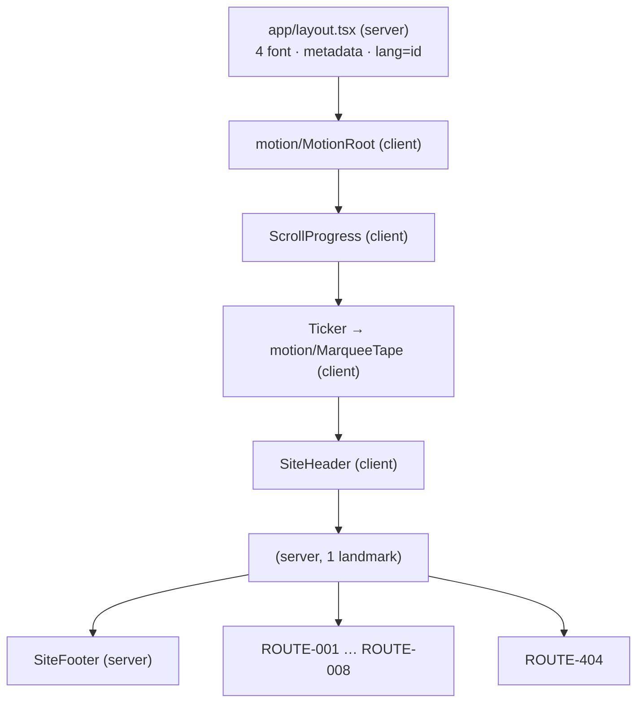
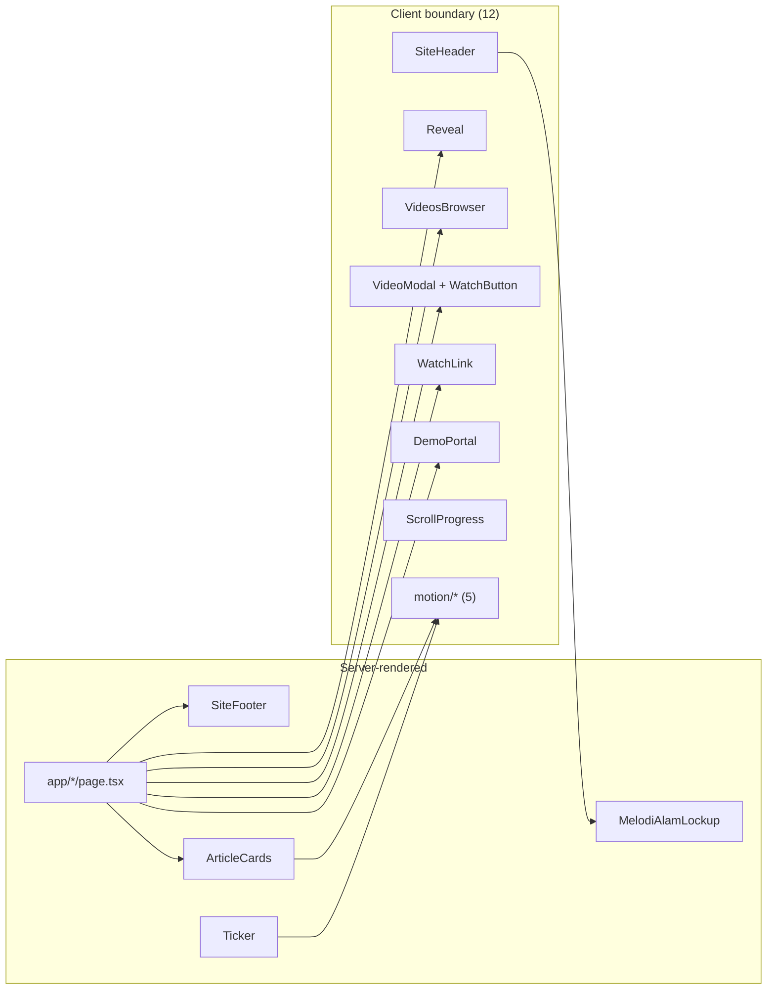
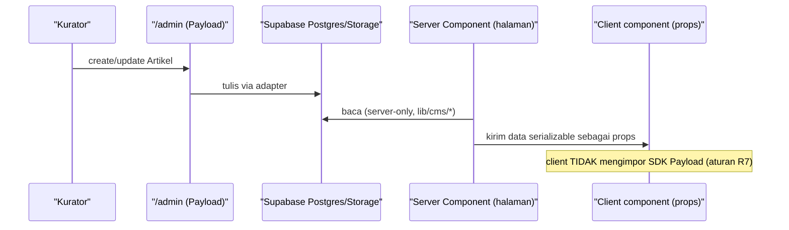

# FRONTEND-PLAN — Melodi Alam Web Platform

> **Catatan (21 Okt 2026):** `components/VideosBrowser.tsx` dan halaman `/videos/arsip`
> sudah dihapus — situs tidak menampilkan daftar 292 video. `/videos` kini merender
> seleksi server (`VideoRow`). Rujukan ke `VideosBrowser` di bawah adalah catatan historis.

> **Catatan (20 Okt 2026):** halaman `/pahlawan-kota` dan `lib/pahlawan.ts` sudah
> dihapus dari repo. `GENRE_ROWS` di `lib/content.ts` dan dokumen `pahlawanRow`
> di Sanity disimpan sebagai arsip. Bagian dokumen ini yang masih menyebut
> direktori tersebut adalah catatan historis.

Dokumen ini merinci **front-end yang benar-benar ada** di repo `melodi-alam/` dan
**rencana integrasinya** saat artikel/video berpindah ke Payload CMS 3 + Supabase.
Isi dipisah eksplisit, mengikuti konvensi `docs/ARCHITECTURE.md`:

- **Current State — TERVERIFIKASI.** Rute, komponen, batas `"use client"`, state,
  lapisan motion, dan interaksi hover yang ada di kode saat dokumen ini ditulis.
  Setiap klaim dibaca langsung dari berkas.
- **Implementation Gaps.** Requirement yang belum terpenuhi (terutama `ACC-002`).
- **Proposed Changes / Migration — RENCANA.** Target integrasi. Belum
  diimplementasikan. Fase ini **DOCS ONLY**.

Label status yang dipakai konsisten: `TERVERIFIKASI` (dibaca di kode atau
dijalankan), `RENCANA` (direncanakan, belum ada), `ASUMSI` (diasumsikan),
`[PERLU VERIFIKASI]` (tidak dapat dikonfirmasi dari sumber).

Acuan keputusan: `ADR-0002` (Payload 3 in-app + Supabase), `ADR-0003` (Supabase =
Postgres + Storage), `ADR-0004` (katalog video tetap build-time), `ADR-0005`
(moderated demo queue). Acuan requirement: `FR-001`…`FR-007`, `ACC-001`…`ACC-003`,
`NFR-001`…`NFR-004`, `DEC-002`, `DEC-003`.

> Catatan cakupan: nama ADR di atas mengacu pada penomoran yang dipakai
> `docs/ARCHITECTURE.md` §12 dan `docs/DATA-MODEL.md` (ADR-0002…ADR-0005).
> Berkas `docs/adr/000N-*.md` belum ada di repo ini `[PERLU VERIFIKASI]`.

> **⚠️ Digantikan sebagian — baca ini dulu.**
> Dokumen ini disusun saat backend direncanakan memakai **Payload CMS 3 + Supabase**.
> Sejak itu CMS-nya diganti dengan **Sanity Studio**, dan seluruh kode Payload sudah
> dihapus.
>
> Bagian yang tidak lagi berlaku di dokumen ini: batas server/client yang menyebut Payload
> dan rute `/admin`. Lihat
> [`adr/0008-sanity-studio-menggantikan-payload.md`](adr/0008-sanity-studio-menggantikan-payload.md)
> dan [`SANITY-INTEGRATION.md`](SANITY-INTEGRATION.md) untuk keadaan sekarang. Bagian lain
> di dokumen ini masih relevan sejauh tidak menyangkut backend.

---

## 1. Implementation Overview

**Produk.** Melodi Alam — platform media musik Indonesia: jurnalisme editorial
(*Stories*), hub katalog YouTube (*Watch*), pipeline pengiriman demo (*Submit
Demo*), dan showcase ekosistem fisik (Samsara / Svarga / Acasa, turntable
SVVARA). Bagian dari PT Infia Pariwara Nusantara (INFIA Corp).

**Stack front-end (`TERVERIFIKASI`, `package.json` + `next.config.ts`).**

| Item | Nilai |
|---|---|
| Framework | Next.js `16.4.0`, App Router, Turbopack |
| React | `19.3.0` |
| Bahasa | TypeScript `^5`, alias `@/*` → root proyek |
| Styling | Tailwind CSS `^4` via `@tailwindcss/turbopack`; token di `app/globals.css` `@theme` |
| Animasi | `motion` `^14.2.0` (import dari `motion/react`) |
| Dev port | `3100` (`next dev -p 3100`) |
| Cache | `cacheComponents: true`, `partialPrefetching: true` |
| Remote image | hanya `i.ytimg.com/vi/**` |

**Strategi front-end saat ini.** *Layered monolith statis.* Seluruh halaman
dirender pada build time; satu-satunya jalur runtime dinamis adalah
`POST /api/demos`. Halaman tetap **server component**; interaktivitas diekstrak ke
komponen `"use client"` berdaun sesempit mungkin. Tidak ada library state
manajemen, tidak ada router tambahan, tidak ada data-fetching library — dan
dokumen ini **tidak** mengusulkan penambahan salah satunya.

**Prinsip yang mengikat implementation (dari temuan terukur, lihat brief §9).**

1. Batas server/client ditentukan oleh **kebutuhan interaktivitas**, bukan estetika.
2. **SSR merender keadaan akhir; animasi hanya menambah.** Jangan memanggang state
   tersembunyi ke HTML yang dirender server.
3. Nama kelas Tailwind harus **literal** (tanpa interpolasi string).
4. `lib/catalogue.json` adalah artefak generated — **satu penulis** (`scripts/`).
5. `next/image` `fill` butuh ancestor berposisi.
6. `transform: scale()` melembutkan foto → parallax memakai box oversized.
7. Setiap direktori tool baru di root proyek perlu `@source not` (RISK-001).

**Strategi implementasi (RENCANA).** Tambahkan lapisan CMS **tanpa** menulis ulang
halaman yang sudah berfungsi: sumber data bergeser per-halaman dari impor
`lib/content.ts` ke pembacaan server-only dari Payload (`ADR-0002`, `ADR-0003`),
sementara katalog video **tetap** artefak build-time (`ADR-0004`). Rollback =
mengembalikan pembaca ke `lib/*` (lihat `ARCHITECTURE.md` §13.3).

---

## 2. Requirements and Dependencies

### 2.1 Sumber requirement

| Sumber | Peran | Status |
|---|---|---|
| `melodi-docs-brief.md` | Ground truth terverifikasi; menang atas dokumen lain | `TERVERIFIKASI` |
| `docs/ARCHITECTURE.md` | Batas modul, kepemilikan data, ADR | `TERVERIFIKASI` |
| `docs/DATA-MODEL.md` | Skema target, moderasi, storage | `TERVERIFIKASI` |
| PRD (ID `FR`/`ACC`/`NFR`/`DEC`) | Acuan requirement produk | Teks persisnya tidak ada di repo ini → `[PERLU VERIFIKASI]` |

**Pemetaan acuan requirement yang dipakai dokumen ini** (label jujur):

| ID | Dipakai untuk | Dasar |
|---|---|---|
| `FR-001`…`FR-004` | Empat permukaan publik: Stories, Watch, Submit, showcase | `ASUMSI` (pemetaan atas brief §1) |
| `FR-005` | Form/pipeline demo submission | `TERVERIFIKASI` (ARCHITECTURE §2.1) |
| `FR-006` | Moderasi/antrean demo | `TERVERIFIKASI` (ARCHITECTURE §2.1) |
| `FR-007` | Metadata/SEO permukaan publik | `ASUMSI` |
| `ACC-001` | Reduced motion dihormati | `ASUMSI` (brief §8) |
| `ACC-002` | Affordance hover-reveal juga harus bekerja via `:focus-within` | `TERVERIFIKASI` (dinyatakan pada brief tugas) |
| `ACC-003` | Alt text & semantik | `ASUMSI` (kebijakan alt nyata di kode) |
| `NFR-001`…`NFR-004` | Non-fungsional: performa statis, SEO, aksesibilitas, reliabilitas | `ASUMSI`; teks persis `[PERLU VERIFIKASI]` |
| `DEC-002` | Hierarchy heading reveal strip `—` | `TERVERIFIKASI` (brief §8) |
| `DEC-003` | Row reveal `[ ▶ ] — [ M \| WATCH ↗ ]` | `TERVERIFIKASI` (brief §8) |

### 2.2 Dependency integrasi (RENCANA)

| Dependency | Arah | Status |
|---|---|---|
| Payload CMS 3 collections | App (server) → Payload | `RENCANA`; mount point `(payload)` `[PERLU VERIFIKASI]` |
| Supabase Postgres | Payload → DB | `RENCANA`; adapter `@payloadcms/db-postgres` (dari DATA-MODEL) |
| Supabase Storage | App → bucket `media`, `demo-audio` | `RENCANA` |
| `lib/catalogue.json` | Build-time, tidak berubah | `TERVERIFIKASI` + `ADR-0004` |
| Vercel | Hosting; route handler serverless | `RENCANA` (keputusan pemilik) |

### 2.3 Asumsi (ASUMSI)

- `ASUMSI` — Load awal; kurator 1–3 orang; tanpa multi-tenant/RBAC kompleks.
- `ASUMSI` — Trafik baca (artikel/katalog) jauh lebih besar dari trafik submit.
- `ASUMSI` — Vercel multi-instance membuat state in-memory tidak reliabel.
- `ASUMSI` — Client component tidak boleh mengimpor SDK Payload (aturan R7
  ARCHITECTURE §7); data editorial harus tiba lewat props dari server component.

### 2.4 Blocker / gap yang diketahui

| Gap | Dampak | Status |
|---|---|---|
| `ACC-002` tidak terpenuhi: semua affordance hover-reveal hanya `:hover` | Pengguna keyboard tidak dapat memunculkan `—`/row-action/curtain | `TERVERIFIKASI` (lihat §10.3) |
| `GET /api/demos` tidak dikonsumsi UI mana pun | Antrean publik dihapus dari `/submit` (16 Okt 2026); `GET` tetap tanpa konsumen | `TERVERIFIKASI` (lihat §7.2) |
| `contact` tidak dipersistensi | Kurator tak dapat menghubungi artis | `TERVERIFIKASI` (brief §6) |
| VideoModal tanpa manajemen fokus | Fokus tidak masuk/terkembali; tidak ada focus trap | `TERVERIFIKASI` (lihat §10.2) |
| Label form tak terasosiasi (`Field` tanpa `htmlFor`/`id`) | Field selain audio tidak punya label programatik | `TERVERIFIKASI` (lihat §10.2) |

---

## 3. Route and Navigation Specification

Semua halaman berada di bawah root layout tunggal
(`app/layout.tsx`) sehingga **shell** identik di seluruh rute:
`MotionRoot` → `ScrollProgress` → `Ticker` → `SiteHeader` →
`<main class="mx-auto max-w-[1360px] space-y-20 px-4 py-10 sm:px-8">` → `SiteFooter`.

### 3.1 Struktur rute saat ini (TERVERIFIKASI)

| Route ID | Path | Berkas | Mode render | Data yang dibaca | Client component yang di-mount |
|---|---|---|---|---|---|
| ROUTE-001 | `/` | `app/page.tsx` | Static (server component) | `ARTICLES`, `GENRE_ROWS`, `INTERVIEW_ROWS`, `SPACE_ITEMS` (`lib/content`); `latestVideos`, `videosByIds`, `CHANNEL`, `COUNTS` (`lib/catalogue`) | `Reveal`, `RevealText`, `CountUp`, `ParallaxImage`, `WatchButton`, `WatchLink`, `VideoModal` |
| ROUTE-002 | `/journal` (Stories) | `app/journal/page.tsx` | Static | `feedArticles()` (Sanity → fallback `ARTICLES`) | `Reveal`, `ArticleCards.ArticleCard` |
| ROUTE-003 | `/journal/[slug]` | `app/journal/[slug]/page.tsx` | Static, `generateStaticParams` → 12 slug | `ARTICLES` (sebagai `ALL`), `CATEGORY_LABELS`; `generateMetadata` per slug | tidak ada `"use client"` langsung; `ArticleCard` (server) menyeret `ParallaxImage`? **Tidak** — lihat catatan di bawah |
| ROUTE-004 | `/bicara-melodi` | `app/bicara-melodi/page.tsx` | Static | `INTERVIEW_ROWS` (`lib/content`); `videosByIds` (`lib/catalogue`) | `Reveal`, `WatchButton`, `VideoModal` |
| ROUTE-005 | `/videos` | `app/videos/page.tsx` | Static | `CHANNEL`, `COUNTS`, `PLAYLISTS` (`lib/catalogue`) | `Reveal`, `VideosBrowser`, `VideoModal` |
| ROUTE-006 | `/pahlawan-kota` | `app/pahlawan-kota/page.tsx` | Static | `allPahlawanRows()` (`lib/pahlawan`): Sanity `pahlawanRow`, fallback `GENRE_ROWS` | `Reveal` |
| ROUTE-007 | `/spaces` | `app/spaces/page.tsx` | Static | `SPACE_ITEMS` (`lib/content`) | `Reveal` |
| ROUTE-008 | `/submit` | `app/submit/page.tsx` | Static | `DEMO_GENRES`, `DEMO_PROGRAMS`, `DEMO_AUDIO_*` (via `DemoPortal`) | `Reveal`, `DemoPortal` |
| ROUTE-009 | `/api/demos` | `app/api/demos/route.ts` | Route handler (`GET`, `POST`) | `SEED_DEMOS`, `DEMO_GENRES`, `DEMO_PROGRAMS` (`lib/content`); `queue` in-memory | — |
| ROUTE-404 | sembarang path lain | `app/not-found.tsx` | Static | `PRIMARY_NAV` (`lib/site`) | — |

Catatan penghitungan: brief §5 memuat 10 baris tabel (8 halaman + API + 404).
Build melaporkan **26 static pages** (brief §2), konsisten dengan 8 rute halaman
di mana ROUTE-003 ter-ekspansi menjadi 12 halaman ter-prerender, ditambah rute
metadata/ikon yang dihasilkan Next `[PERLU VERIFIKASI: komposisi 26 angka persis]`.

### 3.2 Parameter, akses, dan fallback

| Route | Parameter | Akses | Fallback |
|---|---|---|---|
| ROUTE-003 | path `slug` (12 nilai dari `ARTICLES`) | publik | `ALL.find` gagal → `notFound()` → `app/not-found.tsx`. `dynamicParams` dibiarkan default; slug tak dikenal dirender on-demand lalu 404 (`TERVERIFIKASI` membaca kode) |
| ROUTE-002 | — | publik | — grid selalu memuat 6 kartu feed foto; tanpa filter/pencarian (disederhanakan 16 Okt 2026) |
| ROUTE-005 | state filter/page/query di memori (bukan URL) | publik | `VideoRow` kosong → pesan "Tidak ada video yang cocok."; `safePage` dijepit ke rentang valid |
| ROUTE-009 | — | publik (tidak ada auth) | `400` body bukan JSON; `422` validasi gagal; `201` sukses |

**Tidak ada** rute terproteksi, redirect, atau deep-link ber-state di URL saat ini
(`TERVERIFIKASI`). State filter/pencarian **tidak** dipersistensi ke query string —
konsekuensinya tidak dapat dibagikan/di-bookmark (`ASUMSI`: ini perilaku yang
diterima, bukan keluhan yang dibuka ulang).

### 3.3 Hubungan layout



---

## 4. Page and Component Inventory

Klasifikasi lapisan yang dipakai di seluruh dokumen ini:

- **Shell / layout** — hidup di root layout atau bagian dari kerangka global.
- **Composite** — menyusun sebuah kapabilitas utuh dan memegang state fitur.
- **Pattern** — pola UI dapat-dipakai-ulang berukuran kecil (affordance, wrapper).
- **Primitive** — elemen dasar presentasional tanpa state.
- **Motion primitive** — pembungkus animasi (`components/motion/*`).

### 4.1 Ringkasan rute → komponen

| Route | Server (page) | Composite/Pattern | Motion | Video affordance |
|---|---|---|---|---|
| ROUTE-001 `/` | `page.tsx` | `ArticleCards.FrontCard`, `WatchLink` | `Reveal`, `RevealText`, `CountUp`, | `VideoModal`, `WatchButton` |
| ROUTE-002 `/journal` | `page.tsx` | `ArticleCards.ArticleCard` (grid 6 kartu) | `Reveal` | — |
| ROUTE-003 `/journal/[slug]` | `page.tsx` | `ArticleCards.ArticleCard` | — | — |
| ROUTE-004 `/bicara-melodi` | `page.tsx` | — | `Reveal` | `VideoModal`, `WatchButton` |
| ROUTE-005 `/videos` | `page.tsx` | `VideosBrowser` (+`WatchLink`) | `Reveal` | `VideoModal`, `WatchButton` |
| ROUTE-006 `/pahlawan-kota` | `page.tsx` | — | `Reveal` | — |
| ROUTE-007 `/spaces` | `page.tsx` | — | `Reveal` | — |
| ROUTE-008 `/submit` | `page.tsx` | `DemoPortal` | `Reveal` | — |

### 4.2 Batas server/client (`TERVERIFIKASI`, dibaca dari directive)

**12 berkas `"use client"`** di `components/`:

`SiteHeader`, `ScrollProgress`, `Reveal`, `VideosBrowser`,
`VideoModal`, `WatchLink`, `DemoPortal`, `motion/MotionRoot`, `motion/RevealText`,
`motion/ParallaxImage`, `motion/CountUp`, `motion/MarqueeTape`.

**Server component (tanpa directive)** di `components/`:

`SiteFooter`, `Ticker`, `ArticleCards`, `MelodiAlamLockup`.



**Aturan yang berlaku:** `lib/*` tidak pernah mengimpor `app/*`/`components/*`;
`components/*` boleh mengimpor `lib/*`; `scripts/*` tidak diimpor runtime
(`TERVERIFIKASI`, ARCHITECTURE §7).

### 4.3 Pemilik state & sumber kebenaran (ringkas)

| Data/UI | Pemilik | Pembaca | Status |
|---|---|---|---|
| Artikel editorial | `lib/content.ts` | ROUTE-001/002/003 | `TERVERIFIKASI` |
| Katalog video | `lib/catalogue.json` (generated) | ROUTE-001/004/005 | `TERVERIFIKASI` |
| Fakta kanal | `lib/catalogue.json` | `lib/site.ts` → footer | `TERVERIFIKASI` |
| Brand & nav | `lib/site.ts` | layout, `SiteHeader` | `TERVERIFIKASI` |
| Antrean demo (klien) | **dihapus 16 Okt 2026** — `DemoPortal` tidak lagi menampilkan antrean | — | `TERVERIFIKASI` |
| Antrean demo (server) | array `queue` di route handler | **tidak ada konsumen** | `TERVERIFIKASI` |

---

## 5. Component Implementation Specifications

Setiap komponen di bawah **dibaca langsung**. Kolom "Mengapa client/server"
menjelaskan alasan teknis nyata, bukan estetika.

### 5.1 Shell / layout

| Komponen | Lapisan | Server/Client | Mengapa | Props | Dipakai di |
|---|---|---|---|---|---|
| `MotionRoot` | Shell | **Client** | `MotionConfig` adalah konteks `motion/react` | `children` | root layout (semua rute) |
| `SiteHeader` | Shell | **Client** | `usePathname()` + `useState` drawer | — | semua rute |
| `SiteFooter` | Shell | **Server** | murni presentasional | — | semua rute |
| `Ticker` | Shell | **Server** | hanya menyusun `TICKER_ITEMS`; loop diserahkan ke `MarqueeTape` | — | semua rute |
| `ScrollProgress` | Shell | **Client** | listener `scroll`/`resize` + `useState(pct)` | — | semua rute |
| `Reveal` | Shell/Pattern | **Client** | `IntersectionObserver` + `useState(visible)` | `children`, `as?: "section"\|"div"\|"article"`, `className?` | ROUTE-001,002,004,005,006,007,008 |

Catatan `SiteHeader` (`TERVERIFIKASI`): drawer ditutup **pada tap** link
(`onClick={closeDrawer}`), bukan di `useEffect`, dengan komentar eksplisit bahwa
ini menghindari cascading render saat navigasi dari dalam drawer. Nav desktop
memakai `aria-current="page"` via `isActive()`; badge nav (`YT`) dirender bila ada.

### 5.2 Composite

| Komponen | Lapisan | Server/Client | Mengapa | Props | Dipakai di |
|---|---|---|---|---|---|
| `VideosBrowser` | Composite | **Client** | filter venue + search + pagination | — (mengimpor `@/lib/catalogue`) | ROUTE-005 |
| `DemoPortal` | Composite | **Client** | form, preview audio lokal, `fetch` POST | — | ROUTE-008 |
| `VideoModal` | Composite | **Client** | state modal + listener `CustomEvent` + Escape | — | ROUTE-001,004,005,006 |
| `ArticleCards` | Composite (server) | **Server** | presentasional; mengekspor 2 komponen | lihat §5.3 | ROUTE-001,002,003 |

`ArticleCards` mengekspor: `ArticleCard` (Stories), `FrontCard` (beranda) (+
helper internal `CardImage` dan konstanta `COVER_FRAME`). Setiap kartu adalah
**satu** `<Link>` yang membungkus seluruh kartu — pola `after:absolute inset-0`
yang lama tidak menangkap klik di area teks, jadi diganti anchor sungguhan.

### 5.3 Presentational / pattern / primitive

| Komponen | Lapisan | Server/Client | Props | Dipakai di |
|---|---|---|---|---|
| `ArticleCard` | Composite/Server | Server | `article: Article`, `titleFirst?: boolean`, `index?: number` | ROUTE-002 (via browser), ROUTE-003 |
| `FrontCard` | Composite/Server | Server | `article: Article`, `lead?: boolean` | ROUTE-001 (grid 2×2) |
| `CardImage` (internal) | Primitive | Server | `article`, `readLabel`, `noteCta` (frame 4:5) | di dalam `ArticleCard` |
| `WatchButton` (dari `VideoModal`) | Pattern | **Client** | `id`, `title`, `className?`, `children` | ROUTE-001,004,005,006 |
| `WatchLink` | Pattern | **Client** | `id`, `title`, `className?`, `children` | ROUTE-001,005 |
| `SubmitLink` (dari `Ticker`) | Pattern | Server | `className?` | `SiteHeader` (nav desktop) |
| `MelodiAlamLockup` | Primitive | Server | `width?`, `sizes?`, `className?`, `alt?` (default `"Melodi Alam"`), `eager?` | `SiteHeader`, `SiteFooter` (dua blok) |

**Progressive enhancement `WatchLink` (`TERVERIFIKASI`).** Anchor menyimpan
`href="https://www.youtube.com/watch?v={id}"` yang nyata (crawlable dan berfungsi
tanpa hydration). `onClick` mencegah default **hanya** untuk klik kiri tanpa
modifier (`metaKey/ctrlKey/shiftKey/altKey` lolos ke perilaku native), lalu
mengirim `CustomEvent("melodi:watch")`.

**`WatchButton` (`TERVERIFIKASI`).** `<button type="button">` dengan
`aria-label={`Putar ${title}`}`, `className` selalu diawali `relative` (kebutuhan
`next/image fill`), dan `stopPropagation()` + `preventDefault()` sebelum
mengirim event yang sama.

**`MelodiAlamLockup` (`TERVERIFIKASI`).** Satu-satunya aset merek yang dirender
halaman: masthead dan dua blok footer memakainya. Ukuran diatur `className`
(`w-[...]` + `h-auto`); atribut `width`/`height` di `next/image` memakai ukuran
asli artwork (2021×286), bukan ukuran tampilan — tinggi hasil optimasi dibulatkan,
jadi atribut turunan tidak pernah sama dengan kotak yang dirender dan Next
mencatat warning "width or height modified" di tiap page load.

**Aset merek (`TERVERIFIKASI`).** `npm run brand` hanya menulis dua hal:
`public/brand/melodi-alam-lockup-black.png`, dipotong apa adanya dari
`LOGO2/Melodi Alam Text Logo - Black.png` (tanpa recolor; jarak
medallion–wordmark adalah jarak artwork-nya), dan ikon app dari
`LOGO2/Melodi Alam Logo Only - Color.png`. Tidak ada medallion warna, crop
wordmark, atau aset Samsara di halaman.

### 5.4 Rincian per-komponen penting (`TERVERIFIKASI`)

**`/journal` (Stories).** Satu grid kartu `ArticleCard` (6 feed foto) dirender langsung oleh
server component — tanpa filter, pencarian, hitungan, atau header hierarki.
`JournalBrowser` dihapus 16 Oktober 2026; pola `titleFirst` ganjil/genap tetap
dipertahankan di grid (`BR-003`).

**`VideosBrowser`.** `PAGE_SIZE = 12`; `type Filter = Venue | "all"` dari
`VENUES`. `reset(fn)` mengatur ulang `page` ke 0 saat filter/search berubah.
Indikator "`{matches.length} video • halaman {n} / {m}`". Navigasi Prev/NEXT
dengan `disabled` yang sesuai; ada link kanal eksternal di tengah grid 3 kolom.

**`DemoPortal`.** Form `noValidate` dengan 8 field bernomor; `Field` merender
`<label>` + `children` + `<p role="alert">` bila ada error. Submit mengirim JSON
ke `POST /api/demos`. Preview audio memakai `URL.createObjectURL` (tidak diunggah)
dan di-`revoke` saat diganti/berhasil. Antrean kanan ("Incoming Demo Queue")
**dihapus 16 Okt 2026** — halaman kini hanya formulir + banner konfirmasi;
`DemoPortal` tidak lagi membaca `SEED_DEMOS` atau menambahkan `data.entry`.

**`VideoModal`.** Dirender sekali per halaman yang memakainya; dibuka imperatif
lewat `window.dispatchEvent(new CustomEvent("melodi:watch", { detail: { id, title } }))`.
Menangani tombol `Escape` lewat listener `keydown` global; klik backdrop
(`e.target === e.currentTarget`) menutup; iframe `youtube.com/embed/{id}?autoplay=1`
dengan `allow` dan `allowFullScreen`. Tombol tutup berlabel "Tutup [ESC] ✕".

---

## 6. Motion Layer

Seluruh komponen ini adalah **client component** dan merupakan bagian *load-bearing*,
bukan hiasan. Untuk tiap primitif, batasan yang membentuknya dicatat — inilah
alasan kode tampak seperti sekarang (brief §9).

### 6.1 `MotionRoot` — satu tuas global (`TERVERIFIKASI`)

`<MotionConfig reducedMotion="user">` membungkus seluruh aplikasi. Konsekuensi
yang disengaja: `motion` melepas animasi *transform* dan *layout* — menyisakan
fade opacity — saat OS meminta reduced motion, **sehingga komponen individual
tidak perlu penjaga sendiri**.

**Pengecualian yang didokumentasikan di kode:** nilai *scroll-linked* adalah
`style` motion value, bukan animasi, jadi komponen yang menurunkannya memeriksa
`useReducedMotion` sendiri (`ParallaxImage`, `CountUp`, `MarqueeTape`) — dan
`Reveal` memakai `matchMedia("(prefers-reduced-motion: reduce)")` langsung.

### 6.2 `RevealText` — mask yang di-arm di klien (`TERVERIFIKASI`)

Batasan yang membentuknya: **jangan memanggang state tersembunyi ke SSR.**
Versi lama menuliskan `translateY(115%)` inline ke output server, sehingga satu
callback viewport yang meleset membuat heading **tak terlihat permanen**.

- SSR merender **keadaan akhir** yang terbaca; `initial={false}` pada
  `motion.span` mencegah Motion menulis keadaan tersembunyi ke markup.
- `armed` di-set lewat `useIsoLayoutEffect` (fallback `useEffect` di server) agar
  mask tidak berkedip mundur.
- Trigger adalah **pembacaan rect langsung** pada `scroll`/`resize`, bukan
  callback `IntersectionObserver`, dengan komentar bahwa reveal tidak boleh
  bergantung pada callback yang tak dapat dipastikan berjalan.
- `DESCENDER_ROOM = "0.18em"` menjaga ekor huruf g/y/j/p/q tidak terpotong kotak
  `overflow-hidden`, dengan `margin-bottom` negatif agar tinggi baris tetap.
- Spasi dirender sebagai text node nyata → heading tetap membungkus seperti teks biasa.

### 6.3 `ParallaxImage` — box oversized, bukan `scale()` (`TERVERIFIKASI`)

Batasan yang membentuknya: **`transform: scale()` pada wrapper melembutkan foto.**
Browser merasterisasi pada ukuran layout lalu meng-upscale bitmap; `sizes` tidak
dapat menggambarkan faktor skala yang tak terlihat (terukur: hero menyajikan
1328px ke render 1581px, upscale 1.45x).

- Frame tetap di tempat layout; **gambar di dalam yang bergerak** → tinggi halaman
  tidak bertambah dan scroll tidak direbut.
- Box gambar dibuat lebih tinggi dari frame sebesar `distance + EDGE_HEADROOM`
  (`EDGE_HEADROOM = 32`) di **tiap** sisi, sehingga lebar render = lebar frame dan
  `sizes` tetap eksak.
- `useScroll({offset:["start end","end start"]})` → `useSpring` → `useTransform`
  ke rentang `[distance, -distance]`.
- Saat `useReducedMotion()` true, travel dibuang (`{top:0,bottom:0}`), sesuai
  rekomendasi Motion untuk nilai turunan scroll.

### 6.4 `CountUp` — SSR merender angka nyata (`TERVERIFIKASI`)

Batasan yang membentuknya: jangan biarkan kegagalan hydration/callback
meninggalkan angka `0` di halaman.

- Server merender **nilai final** (`to.toLocaleString("id-ID")`); hitungan berjalan
  *menurun* dari nilai itu.
- Menulis ke `node.textContent` alih-alih React state → hitungan 1.6s = **satu**
  render, bukan ~90.
- Jika elemen sudah terlihat saat mount, reset ke 0 terjadi di **layout effect**,
  sehingga nilai final tidak sempat dicat lalu ditarik kembali.
- `useInView({ once: true, amount: 0.6 })`; `useReducedMotion()` melewati animasi.

### 6.5 `MarqueeTape` — loop Motion, bukan keyframe CSS (`TERVERIFIKASI`)

Batasan yang membentuknya (dua hal, keduanya load-bearing):

1. **Membaca `scrollWidth` di dalam frame loop memaksa reflow sinkron** pada frame
   yang sama dengan penulisan `transform` Motion → halaman kelaparan hingga
   terukur **1 requestAnimationFrame per detik**, `IntersectionObserver` berhenti,
   konten tertahan `opacity: 0`. Solusi: ukur lebar loop via **`ResizeObserver`**,
   bukan per frame.
2. Tape **idle saat di luar viewport** (`useInView`) dan saat hover karena hidup di
   masthead dan tak terlihat sebagian besar kunjungan.

Detail lain: kecepatan = `BASE_SPEED (62) + boost * VELOCITY_SCALE (0.5)`,
di-spring dari `useVelocity(scrollY)`; wrap dua arah agar reverse cepat tidak
keluar ujung; **sengaja bukan skew** (skew setrip selebar halaman menggeser tepi
sebesar `tan(angle) x halfWidth` ~100px dan merobek strip); children dirender dua
kali oleh komponen (bukan oleh pemanggil) karena matematika wrap bergantung pada
dua paruh identik.

---

## 7. State Management Plan

### 7.1 Inventaris state (`TERVERIFIKASI`)

| State ID | State | Kategori | Pemilik | Sumber kebenaran | Konsumen | Persistence |
|---|---|---|---|---|---|---|
| ST-04 | `filter` (Venue \| "all") | Local UI | `VideosBrowser` | komponen | `all` | tidak |
| ST-05 | `query` | Local UI | `VideosBrowser` | komponen | `matches` | tidak |
| ST-06 | `page` (0-based) | Local UI | `VideosBrowser` | komponen | `safePage`,`rows` | tidak |
| ST-07 | `all`/`matches`/`pageCount`/`safePage`/`rows` | Derived (`useMemo`) | `VideosBrowser` | diturunkan | render baris | — |
| ST-08 | `queue` (antrean demo) | **dihapus 16 Okt 2026** | — | — | — | — |
| ST-09 | `errors` (per-field) | Local UI | `DemoPortal` | respons `422` | `Field` | tidak |
| ST-10 | `banner` (status/error) | Local UI | `DemoPortal` | respons server / `catch` | `role="status"` | tidak |
| ST-11 | `pending` | Local UI | `DemoPortal` | komponen | tombol submit `disabled` | tidak |
| ST-12 | `audioFile`/`audioSrc` | Local UI + Blob | `DemoPortal` | `File` yang dipilih | preview `<audio>` + unggah ke Vercel Blob saat submit (route `/api/demo-audio`) | URL hasil unggah masuk `audioUrl` |
| ST-13 | `drawerOpen` | Local UI | `SiteHeader` | komponen | drawer `hidden` | tidak |
| ST-14 | video modal `{id,title} \| null` | Local UI | `VideoModal` | event `melodi:watch` | dialog | tidak |
| ST-15 | `pct` (progress) | Local UI | `ScrollProgress` | `scrollY` | lebar bar | tidak |
| ST-16 | `visible` | Local UI | `Reveal` | `IntersectionObserver` | kelas `is-visible` | tidak |
| ST-17 | `armed` / `shown` | Local UI | `RevealText` | rect read | mask | tidak |
| ST-18 | `queue` (server) | Server | `app/api/demos` | array modul | **tidak ada konsumen** | proses-lokal, reset saat restart |

> `ST-01`–`ST-03` (state `JournalBrowser`) dihapus 16 Oktober 2026 — `/journal`
> kini dirender server tanpa state klien.

**Tidak ada** application state, URL state, atau persistent client state.
Redux/Zustand/Context global **tidak** diperlukan dan tidak dipakai
(`TERVERIFIKASI`).

### 7.2 Protokol modal video — mengapa event window, bukan Context (`TERVERIFIKASI`)

`VideoModal` dan pemicunya (`WatchButton`, `WatchLink`) **tidak berada dalam satu
subtree React yang sama**, dan sering tidak punya hubungan parent/child:

- `VideoModal` di-mount **sekali** oleh server component halaman
  (`<VideoModal />` di ROUTE-001/004/005/006), bukan oleh komponen yang merender baris.
- Pemicu berada di kedalaman berbeda — di ROUTE-005 pemicu dirender oleh
  `VideosBrowser`, **yang sendirinya client component**, dan barisnya
  unmount/remount setiap kali filter atau halaman berubah.

Context React akan menuntut sebuah provider yang membungkus **keduanya**. Komposisi
yang dirender server tidak menyediakannya; menambahkannya berarti memindahkan
`VideoModal` (dan provider) ke satu client boundary besar yang membungkus halaman
— memperbesar bundle klien dan memaksa boundary client naik tanpa alasan
tampilan. Komentar kode menyatakan desainnya: modal "Rendered once and shared by
every page that needs a 'watch' affordance" dan "open it imperatively through
`window.dispatchEvent`".

`CustomEvent("melodi:watch")` memberi satu **protokol tunggal** yang dipakai
`<button>` (`WatchButton`) dan `<a href>` (`WatchLink`) tanpa prop-drilling, dan
membiarkan modal tetap ter-mount sementara baris di sekitarnya berganti.
Kelemahan yang harus dicatat jujur: ini **global side channel** — hanya boleh ada
satu `VideoModal` aktif per halaman (si kode mematuhi itu), tanpa type-safety
event, dan tanpa URL sehingga tidak dapat di-deep-link (`DEC` pemilik: video tetap
modal). `ASUMSI`: ini diterima sebagai konsekuensi keputusan "video tanpa URL".

### 7.3 Aturan sinkronisasi & reset (RENCANA, tetap berlaku)

- **Filter berubah → `page` = 0** (sudah dilakukan `reset()`; pertahankan saat
  data pindah ke props).
- **Submit sukses → reset form + revoke object URL + banner sukses** (sudah ada).
- **`<VideoModal />` tunggal per halaman** — pertahankan sebagai invarian; jika
  suatu saat ditambahkan, tambahkan asersi/uji.
- **Jangan menyimpan salinan `query` di store** — tidak ada store yang boleh
  menduplikasi URL/komponen state (aturan skill §5).

---

## 8. Data Flow and API Integration

### 8.1 Alur A — Submit demo (`TERVERIFIKASI`)

```mermaid
sequenceDiagram
  participant U as "Pengguna"
  participant F as "DemoPortal (client)"
  participant R as "POST /api/demos"
  participant Q as "queue (array modul)"

  U->>F: isi 8 field, klik Kirim
  F->>F: preventDefault · setPending(true) · reset errors/banner
  F->>R: fetch JSON {artist,city,title,genre,program,link,contact,story}
  R->>R: str() trim + slice cap per field
  alt body bukan JSON
    R-->>F: 400 { error }
  else validasi gagal
    R-->>F: 422 { error, errors }
  else valid
    R->>Q: queue.unshift(entry)
    R-->>F: 201 { ok, entry, queueLength, note }
  end
  alt 201
    F->>F: unshift entry ke queue; banner sukses; reset form + audio
  else error
    F->>F: setErrors(errors); setBanner(error)
  end
  F->>F: finally setPending(false)
```

**Temuan terverifikasi pada alur ini:**

- `contact` **tidak dipersistensi**; hanya muncul di string `note` respons `201`.
  Tidak ada PII at rest hari ini — tetapi juga tidak ada cara kurator menghubungi
  artis (brief §6; SECURITY-PRIVACY.md).
- File audio hanya di-`URL.createObjectURL` lokal; **tidak ada unggahan**.
- `GET /api/demos` **tidak dikonsumsi** oleh UI mana pun (`TERVERIFIKASI` — satu-satunya
  referensi `/api/demos` di kode klien adalah `fetch` POST di `DemoPortal`). Antrean
  publik yang dulu tampil di `/submit` **dihapus 16 Okt 2026** — tidak ada lagi UI
  yang menampilkan entri demo.
- Karena store proses-lokal, `GET` bergantung pada instance yang melayani request
  (`ASUMSI` Vercel multi-instance → tidak konsisten). `RISK-004`.

### 8.2 Alur B — Modal video (`TERVERIFIKASI`)

`Klik WatchButton / WatchLink → CustomEvent("melodi:watch", {id,title}) →
VideoModal setState → iframe youtube embed → Escape/backdrop → setState(null)`.
Perbedaannya dengan `WatchLink`: bila modifier/middle-click, event native tetap
berjalan (tab baru ke YouTube) — **progressive enhancement** yang harus
dipertahankan saat migrasi.

### 8.3 Kontrak API yang ada

`GET /api/demos` → `200 { queue: DemoSubmission[], count: number }`.
`POST /api/demos` → cap field: artist 120, city 80, title 160, genre 60, program
80, link 500, contact 160, story 2000; status `400/422/201`. Field wajib:
`artist`, `city`, `title`, `story`, `contact`, `link`. Kontrak penuh di
`API-CONTRACTS.md` (`TERVERIFIKASI`, brief §6 + `route.ts`).

### 8.4 Integrasi data editorial (RENCANA)



---

## 9. UI State and Interaction Specifications

### 9.1 Matriks state per area (yang perlu ditangani saat migrasi)

| Area | Initial | Loading | Empty | Error | Sukses | Catatan |
|---|---|---|---|---|---|---|
| `/journal` | daftar penuh | — (data statis) | empty-state + "Reset Filter" | — | — | `RENCANA`: tambah loading/error bila data lewat Payload |
| `/videos` | hal. 1 dari 12 | — | "Tidak ada video yang cocok." | — | — | pagination `safePage` |
| `/submit` | form bersih, queue = seed | `pending` → tombol "Mengirim…" | — | banner + `role="alert"` per field | banner `role="status"` | `400/422/fetch-fail` punya pesan |
| `/journal/[slug]` | artikel | — | — | slug tak dikenal → `notFound()` | — | `RENCANA`: bila Slug hilang di Payload → 404 |
| Modal video | tertutup | — | — | — | — | **tidak ada** state error bila embed gagal (`[PERLU VERIFIKASI]` perlu ditambah?) |

### 9.2 Perilaku form submit (sudah ada, pertahankan)

Field wajib (`artist`, `city`, `title`, `story`, `contact`, `link`) divalidasi
**server-side** di route handler; klien tidak melakukan validasi pre-submit
(`noValidate`, tanpa pola klien). Pesan error muncul per-field lewat `role="alert"`
dan banner ringkas lewat `role="status"`. `pending` mencegah double-submit.
`RENCANA`: pertahankan validasi server sebagai otoritatif; klien hanya boleh
menambah UX (mis. cek `file.size` audio) — **tidak** menggantikan server.

---

## 10. Design System, Responsive, and Accessibility Integration

Token lengkap dimiliki `docs/DESIGN-SYSTEM.md`. Di sini hanya yang mengikat
front-end.

### 10.1 Yang sudah ditangani (TERVERIFIKASI)

| Area | Implementasi | Di mana |
|---|---|---|
| Reduced motion | `@media (prefers-reduced-motion: reduce)` memaksa durasi animasi/transisi 0.01ms, `scroll-behavior: auto`, dan memaksa `.reveal-section`/`.stagger-item` terlihat | `globals.css` |
| Reduced motion (Motion) | `MotionConfig reducedMotion="user"` + `useReducedMotion` per primitif scroll | `MotionRoot`, `ParallaxImage`, `CountUp`, `MarqueeTape`, `Reveal` |
| Nama tombol video | `aria-label={`Putar ${title}`}` | `WatchButton` |
| Drawer | `aria-expanded` + `aria-controls="mobile-nav"`; `hidden` saat tertutup; label tombol berganti "Tutup ✕"/"Menu ☰" | `SiteHeader` |
| Nav aktif | `aria-current="page"` | `SiteHeader` (nav desktop) |
| Filter | `aria-pressed` | `VideosBrowser` |
| Search | `<label htmlFor>` + `sr-only` | `VideosBrowser` |
| Feedback form | `role="alert"` (per-field), `role="status"` (banner) | `DemoPortal` |
| Dialog video | `role="dialog"`, `aria-modal="true"`, `aria-label`, tutup via `Escape`/backdrop, `title` iframe | `VideoModal` |
| Alt text | Artikel/genre/space → `article.title`/`row.title`; thumbnail video → `alt=""` (dekoratif, tombol memberi nama); footer wordmark `alt=""` karena salinan menamai venue | lihat `MelodiAlamLockup`, `ArticleCards`, halaman |
| Landmark | `<header>`, `<main>`, `<footer>`, `<nav>` | layout + `SiteHeader`/`SiteFooter` |
| Halaman 404 | `<h1>` semantik + daftar link navigasi | `app/not-found.tsx` |

### 10.2 Gap aksesibilitas (jujur, `TERVERIFIKASI`)

| # | Gap | Bukti |
|---|---|---|
| A1 | **`ACC-002` tidak terpenuhi.** Semua affordance hover-reveal hanya `:hover`; **tidak ada satu pun** selektor `:focus`/`:focus-within`/`:focus-visible` di `globals.css` | grep `focus-within\|:focus` pada `globals.css` → **0 hasil** |
| A2 | `VideoModal` **tanpa focus trap / initial focus / focus return**; tidak mengunci scroll body; fokus dapat menab ke belakang backdrop | membaca `VideoModal.tsx` |
| A3 | Drawer **tanpa** manajemen fokus, **tanpa** tutup via `Escape`, dan nav mobile **tanpa** `aria-current` | `SiteHeader.tsx` |
| A4 | `Field` di `DemoPortal` merender `<label>` **tanpa `htmlFor`** dan input **tanpa `id`** → label tidak terasosiasi programatik (kecuali audio yang punya `htmlFor="demo-audio"`) | `DemoPortal.tsx` |
| A5 | **Tidak ada skip-link** ke `<main>` | layout |
| A6 | `.video-action-reveal` ber-`pointer-events: none` + `overflow:hidden` + `max-width:0` saat tidak hover → tombol di dalamnya **tidak terlihat** saat difokus keyboard | `globals.css`, `VideoModal.tsx` |
| A7 | Rasio kontras `text-neutral-500`/`neutral-400` pada putih berpotensi < 4.5:1 `[PERLU VERIFIKASI]` — kebijakan warna dimiliki `DESIGN-SYSTEM.md` | — |
| A8 | Reveal `MarqueeTape` menggunakan `onMouseEnter/Leave` (pointer) untuk jeda; tidak ada padanan keyboard (ticker tidak interaktif, jadi minor) | `MarqueeTape.tsx` |

**Rekomendasi perbaikan (RENCANA, bukan fase ini):** pada §10.3 layanan CSS,
tambahkan pasangan `:focus-within` untuk tiap `.group:hover` dan `:hover` pada
utilitas reveal; tambahkan focus trap + `inert` pada dialog; asosiasikan label
form; tambahkan skip-link.

### 10.3 Verifikasi interaksi hover yang dikunci (`DEC-002`, `DEC-003`)

Tiga perilaku dikunci pemilik (brief §8). Ketiganya **ADA** di kode, tetapi
**hanya via `:hover`** — karena itu tetap melanggar `ACC-002`.

| Locked interaction | Ada? | Implementasi | Dipakai di | Catatan fungsional |
|---|---|---|---|---|
| `DEC-002` strip `—` pada hierarchy heading | **Ada di CSS, tanpa pemakaian** | `.dash-reveal-item` + `.dash-reveal-prefix`; pemicu `.dash-reveal-item:hover .dash-reveal-prefix` | — (satu-satunya pemakainya, `JournalBrowser`, dihapus 16 Okt 2026) | Hover-only (A1). Utilitas dibiarkan di `globals.css` untuk heading hierarki berikutnya |
| `DEC-003` row reveal `[ ▶ ] — [ M \| WATCH ↗ ]` | **Ada** | `.video-action-reveal`; pemicu `.group:hover .video-action-reveal` | ROUTE-001 (video teaser + genre rows), ROUTE-005 (`VideoRow`) | Hover-only (A1, A6). **Nilai fungsional bervariasi** — lihat di bawah. ROUTE-006 tidak lagi memakai reveal: grup aksi dihapus atas permintaan |
| Curtain + corner brackets pada thumbnail artikel | **Ada** | `.hover-reveal-curtain` (curtain) + `.corner-frame` (bracket), pemicu `.group:hover …` | Curtain: `ArticleCards.CardImage` (ROUTE-002/003) & `FrontCard` (ROUTE-001). Bracket: juga pada box gambar ROUTE-001 (genre) & ROUTE-006 | Hover-only (A1). Di ROUTE-001 genre & ROUTE-006 bracket muncul **tanpa** curtain (tidak ada `.hover-reveal-curtain` di sana) |

**Temuan fungsional (gap yang harus diperbaiki, `TERVERIFIKASI`):**

- **ROUTE-001 genre rows:** tombol `▶` di dalam `.video-action-reveal` adalah
  `<span>`, dan badge `M | Watch ↗` adalah `<div>` — **tidak ada** elemen
  interaktif. Barisnya ber-`cursor-pointer` tetapi tanpa handler/link. Reveal-nya
  **murni dekoratif**; tidak ada tujuan navigasi.
- **ROUTE-006 `pahlawan-kota`:** grup aksi (`▶`/`✎`, `—`, badge `M | READ/WATCH ↗`)
  **dihapus atas permintaan**. Baris kini signpost murni — tidak ada objek `target`,
  `WatchButton`, maupun `VideoModal`; baris dibaca Sanity-first (`pahlawanRow`).
- **ROUTE-005 `VideosBrowser`:** ▶ adalah `WatchButton` fungsional dan judul adalah
  `WatchLink`; badge `M | Watch ↗` tetap `<div>`. Ini instance yang paling lengkap.
- **ROUTE-001 video teaser:** ▶ adalah `WatchButton`, judul adalah `WatchLink`,
  badge `<div>`. Lengkap.

Ringkasan: `DEC-002` **terpenuhi secara visual** (satu permukaan, ROUTE-002);
`DEC-003` **terpenuhi secara visual** pada baris video (ROUTE-001/ROUTE-005;
ROUTE-006 dikecualikan atas permintaan); **curtain + bracket terpenuhi** di kartu
artikel. Yang **belum**: paritas keyboard
(`ACC-002`), dan "wiring" navigasi pada baris genre `ROUTE-001`
(meski ini lebih dekat ke `FR-001`/`FR-004` daripada ke `DEC-002`/`DEC-003`).

### 10.4 Responsive (`TERVERIFIKASI`, ringkas)

Breakpoint Tailwind (`sm`/`md`/`lg`) mengemudi: masthead 3 kolom di `md+` (wordmark
span penuh di bawah `md`); nav desktop `lg:flex`, drawer `lg:hidden`; grid kartu
1→2→4 kolom (`/journal`) dan 1→2→5 (`/spaces`, playlists); baris video
`flex-wrap` → `md:flex-nowrap`; `DemoPortal` `lg:grid-cols-12` (8+4).
`body { overflow-x: hidden }` dipasang global. Tap target tombol play bulat
`h-11 w-11` (44px) — sesuai batas minimum.

---

## 11. Implementation Roadmap

Fase mengikuti dependency nyata. **Semua task `RENCANA`** — tidak ada satu pun
yang dieksekusi pada fase DOCS ini.

| Task ID | Task | Route/Komponen terkait | Dependencies | Acceptance Criteria | Tests |
|---|---|---|---|---|---|
| FE-A1 | Bekukan `lib/content.ts` sebagai read-only selama migrasi | `lib/content.ts` | — | Tidak ada tulis simbolis; pembaca berhenti memodifikasi | lint + review diff |
| FE-A2 | Tambah lapisan akses server-only `lib/cms/*` (di atas Payload) | baru | Payload terpasang | Client tidak pernah mengimpor `lib/cms` (R7) | aturan lint/boundary |
| FE-A3 | Tambah pasangan `:focus-within` untuk seluruh utilitas reveal | `globals.css` | — | Semua `.group:hover` punya pasangan `:focus-within` | uji keyboard manual/E2E (`ACC-002`) |
| FE-B1 | `/journal` membaca artikel dari Sanity dan merender satu grid 6 kartu feed foto (penyederhanaan Stories, **selesai** 16 Okt 2026) | ROUTE-002 | — | 12 kartu selalu tampil; tanpa state klien | Playwright: hitung 12 kartu (`E-03`) |
| FE-B2 | `/journal/[slug]` membaca via Payload + revalidasi | ROUTE-003 | FE-A2 | 12 slug awalnya tetap valid; slug tak ada → 404 | unit lookup + E2E 404 |
| FE-C1 | Migrasi `/submit` ke koleksi `DemoSubmissions` + moderasi | ROUTE-008, ROUTE-009 | FE-A2 | Buat → `moderation_status='pending'`; antrean publik hanya `approved` | integrasi + E2E submit |
| FE-C2 | **Dibatalkan 16 Okt 2026** — antrean publik dihapus dari `/submit`; tidak ada antrean klien untuk diganti | ROUTE-008 | FE-C1 | — | — |
| FE-C3 | Persist `contact` sebagai PII + hapus echo di `note` | ROUTE-009 | FE-C1 | Kontak tersimpan terlindungi, tidak publik | uji akses + review |
| FE-C4 | Unggah audio ke bucket `demo-audio` (cap 25MB) | `DemoPortal` | FE-C1 | Preview tetap; unggahan sukses/gagal tertangani | E2E unggah + cap |
| FE-D1 | Manajemen fokus `VideoModal` (trap, initial, return) | `VideoModal` | — | Fokus masuk dialog, tidak keluar, kembali ke pemicu | E2E keyboard |
| FE-D2 | Perbaiki label form (`htmlFor`/`id`) & skip-link | `DemoPortal`, layout | — | Setiap input punya nama aksesibel | uji a11y |
| FE-D3 | Wiring navigasi baris genre (`ROUTE-001`) | `page.tsx` | — | Baris genre punya tujuan navigasi nyata | E2E klik |
| FE-E1 | Verifikasi build/lint/tsc + rute setelah migrasi | semua | FE-B*,FE-C* | Build hijau, tanpa regresi statis | `npm run build`, `lint` |

**Paralelisme:** FE-A3, FE-D1, FE-D2, FE-D3 tidak bergantung pada Payload dan boleh
berjalan lebih dulu (perbaikan murni front-end, langsung menutup `ACC-002`).
FE-B* dan FE-C* bergantung pada FE-A2.

---

## 12. Testing Plan

Runner target: **Vitest** (unit/logic) + **Playwright** (E2E) — keputusan pemilik,
`RENCANA`. Tidak ada skrip test di `package.json` saat ini (`TERVERIFIKASI`).

| Level | Sasaran | Contoh kasus |
|---|---|---|
| Unit | `viewCount`, `videosByVenue`, pemetaan cap `str()` | parsing "107K"→107000; filter venue; cap 120/80/160 |
| Unit | Invarian data `lib/content.ts` | setiap `INTERVIEW_ROWS[].videoId` ada di katalog |
| Component | `VideosBrowser` render + interaksi | filter mengubah daftar; pagination men-`disabled` PREV di hal. 1; empty-state muncul |
| Component | `DemoPortal` state | `pending` menonaktifkan tombol; `422` menampilkan `role="alert"` per field |
| Integration | `POST /api/demos` kontrak | `400`, `422` (per-field), `201`; `queue.unshift` |
| E2E | Journey kritis | buka artikel dari kartu → `/journal/[slug]`; buka modal via `WatchButton` → tutup `Escape`; submit demo sukses |
| E2E | Keyboard/`ACC-002` | Tab ke tombol play → reveal terlihat; Tab masuk dialog → fokus terperangkap |
| Build | `npm run build` + `npm run lint` + `tsc --noEmit` | hijau, jumlah halaman statis terverifikasi |

**Anti-pola yang dihindari:** jangan menulis test yang hanya meng-cermin detail
implementasi (mis. menghitung render) tanpa memverifikasi perilaku pengguna.

---

## 13. Risks and Open Questions

### 13.1 Risiko

| ID | Risiko | Bukti/status | Mitigasi |
|---|---|---|---|
| FE-R1 | Tailwind content scan menabrak direktori tool baru → CSS kosong senyap | `TERVERIFIKASI` (`@source not` ×3) | Tambah `@source not` untuk setiap direktori tool baru (`RISK-001`) |
| FE-R2 | Batas client salah → SSR membawa state tersembunyi | `TERVERIFIKASI` (aturan SSR-renders-final) | Review setiap client component baru terhadap aturan |
| FE-R3 | Migrasi membuat dua sumber kebenaran editorial | `RENCANA` | Bekukan `lib/content.ts` read-only; migrasi per-halaman (`RISK-005`) |
| FE-R4 | Client component ikut menyeret dataset besar (mis. seluruh katalog) | `TERVERIFIKASI` (`VideosBrowser` impor `@/lib/catalogue`) | `ADR-0004` menahan katalog di build-time; optimasi kirim-potongan via props sebagai `RENCANA` opsional |
| FE-R5 | `ACC-002` tertinggal → regresi aksesibilitas permanen | `TERVERIFIKASI` (grep `:focus` = 0) | FE-A3 masuk Fase A; uji keyboard di Definition of Done |
| FE-R6 | Event `melodi:watch` global tanpa tipe → dua modal bentrok | `TERVERIFIKASI` (satu modal per halaman) | Pertahankan invarian satu `<VideoModal />`/halaman |
| FE-R7 | `GET /api/demos` tanpa konsumen saat migrasi → antrean tetap palsu | **Dihapus 16 Okt 2026** — antrean publik dihapus dari `/submit`; `GET` tetap tanpa konsumen | — |

### 13.2 Open Questions (ringkas; detail di akhir dokumen)

- Nama ADR `ADR-0002`…`ADR-0005` dipakai lintas dokumen, tetapi `docs/adr/` belum
  ada `[PERLU VERIFIKASI]`.
- Apakah `/journal/[slug]` tetap ingin *statis* atau menerima ISR/revalidasi saat
  konten menjadi editable? (`FR-007`/`NFR-001` menuntut keputusan ini.)
- **Ditutup 16 Okt 2026:** antrean publik dihapus dari `/submit`; pertanyaan
  pangkas-`story` tidak berlaku lagi.

---

## 14. Definition of Done

Front-end dianggap selesai untuk suatu fase bila, secara **observable**:

1. **Fungsional** — semua 8 rute halaman + `/api/demos` + 404 berperilaku seperti
   §3; filter/search/pagination bekerja; modal video buka/tutup; submit demo
   menghasilkan status yang benar.
2. **State** — tidak ada duplikasi sumber kebenaran; filter berubah → `page` 0;
   submit sukses → form reset + audio revoked; satu `<VideoModal />` per halaman.
3. **Aksesibilitas** — reduced motion dihormati; **`ACC-002` terpenuhi**
   (reveal dapat dimunculkan via `:focus-within`); dialog mengelola fokus;
   label form terasosiasi; `aria-current` di nav desktop **dan** mobile.
4. **Interaksi terkunci** — `DEC-002` dan `DEC-003` tetap ada pada baris video;
   direktori `/pahlawan-kota` sengaja tanpa aksi (grup dihapus atas permintaan).
5. **Data** — katalog tetap build-time (`ADR-0004`); editorial dari Payload
   (`ADR-0002`, `ADR-0003`); moderasi demo tetap (`ADR-0005`), tetapi antrean
   publik dihapus dari `/submit` (16 Okt 2026).
6. **Build & test** — `npm run build`, `npm run lint`, `tsc --noEmit` hijau;
   unit + E2E kritis lulus; jumlah halaman statis tidak turun tanpa alasan.
7. **Konvensi** — nama kelas Tailwind literal; `@source not` lengkap; `next/image`
   `fill` selalu punya ancestor berposisi.

---

## Verification Notes

Berkas yang dibaca **langsung** untuk dokumen ini (semua di
`D:\Project Website Melodi Alam\melodi-alam\`):

- `app/layout.tsx` — 4 font variable, `MotionRoot`, `ScrollProgress`, `Ticker`,
  `SiteHeader`, `<main>`, `SiteFooter`, `metadata`; `data-scroll-behavior="smooth"`.
- `app/not-found.tsx` — 404 memakai `PRIMARY_NAV`.
- `app/page.tsx` (ROUTE-001) — konsumsi `ARTICLES`, `GENRE_ROWS`, `INTERVIEW_ROWS`,
  `SPACE_ITEMS`, `latestVideos`, `videosByIds`, `CHANNEL`, `COUNTS`; pemakaian
  `RevealText`/`CountUp`/`ParallaxImage`/`WatchButton`/`WatchLink`/`VideoModal`.
- `app/journal/page.tsx` — `Reveal` + grid `ArticleCard` (6 kartu, `feedArticles()`);
  `JournalBrowser` dihapus 16 Oktober 2026.
- `app/journal/[slug]/page.tsx` — `generateStaticParams`, `generateMetadata`,
  `notFound()`, `ArticleCard`, drop cap; **tidak ada `Reveal`**.
- `app/bicara-melodi/page.tsx` — `INTERVIEW_ROWS` + `videosByIds` + `WatchButton`
  + `VideoModal`.
- `app/videos/page.tsx` — `PLAYLISTS` (sortir count), `CHANNEL`, `COUNTS`,
  `VideosBrowser`, `VideoModal`.
- `app/pahlawan-kota/page.tsx` — `GENRE_ROWS`; objek `target` dihitung tetapi
  **hanya `label`** yang dipakai (temuan gap §10.3).
- `app/spaces/page.tsx` — `SPACE_ITEMS`, link `<a>` kondisional.
- `app/submit/page.tsx` — `Reveal` + `DemoPortal`.
- `app/api/demos/route.ts` — `GET`/`POST`, cap field, validasi, `400/422/201`,
  `contact` tak dipersistensi, `note`.
- `app/globals.css` (seluruh 373 baris) — `@source not` ×3, `@theme`, seluruh
  `@utility`, selektor `.group:hover`, blok `prefers-reduced-motion`.
- `components/SiteHeader.tsx`, `SiteFooter.tsx`, `Ticker.tsx`, `ScrollProgress.tsx`,
  `Reveal.tsx`, `ArticleCards.tsx`, `VideosBrowser.tsx`,
  `VideoModal.tsx`, `WatchLink.tsx`, `DemoPortal.tsx`, `MelodiAlamLockup.tsx`.
- `components/motion/MotionRoot.tsx`, `RevealText.tsx`, `ParallaxImage.tsx`,
  `CountUp.tsx`, `MarqueeTape.tsx`.
- `lib/site.ts`, `lib/catalogue.ts`, `lib/content.ts` (tipe + ekspor + seed/enum).
- `package.json`, `next.config.ts` (versi, skrip, `cacheComponents`,
  `partialPrefetching`, `remotePatterns`).
- `docs/ARCHITECTURE.md`, `docs/DATA-MODEL.md` (acuan ADR & skema target).
- Brief `melodi-docs-brief.md` (ground truth).

Pemeriksaan grep yang dijalankan:

- `/api/demos|SEED_DEMOS` (hanya `*.tsx`) → hanya `DemoPortal` (POST), **tidak ada**
  konsumen `GET`. (**Pembaruan 16 Okt 2026:** `SEED_DEMOS` juga sudah tidak ada di
  `DemoPortal` — antrean publik dihapus.)
- `focus-within|:focus|focus-visible` pada `app/globals.css` → **0 hasil**
  (dasar temuan A1 / `ACC-002`).

**Tidak dijalankan:** `npm run build`, `npm run dev`, `npm run lint`, `npm run
catalogue`. **Tidak ada** berkas selain `docs/FRONTEND-PLAN.md` yang dibuat atau
diubah. Fase DOCS ONLY dipatuhi.

Yang **tidak** dapat dikonfirmasi dari sumber (ditandai `[PERLU VERIFIKASI]` di
teks): teks persis PRD untuk `FR-001`…`FR-007`, `ACC-001`…`ACC-003`,
`NFR-001`…`NFR-004`; penomoran/berkas ADR; komposisi persis "26 static pages";
kontras warna final (dimiliki `DESIGN-SYSTEM.md`).

---

## Open Questions

1. **Teks & pemetaan ID PRD.** Dokumen ini memakai `FR`/`ACC`/`NFR`/`DEC` sesuai
   brief dan `ARCHITECTURE.md`, tetapi PRD mentah tidak ada di repo. Pemetaan
   `FR-001`…`FR-004` dan `NFR-001`…`NFR-004` adalah `ASUMSI` — perlu diselaraskan
   dengan `docs/PRD-REFERENCE.md`.
2. **Berkas ADR.** `ADR-0002`…`ADR-0005` diacu lintas dokumen, tetapi
   `docs/adr/000N-*.md` belum ada. Perlu dibuat agar rujukan tidak menggantung.
3. **Mode render `/journal/[slug]` pasca-CMS.** Tetap sepenuhnya statis, memakai
   ISR, atau on-demand revalidation? Ini keputusan arsitektur yang memengaruhi
   `FR-007`/`NFR-001` dan belum diputuskan.
4. **Cakupan antrean publik.** **Ditutup 16 Okt 2026:** antrean publik dihapus
   dari `/submit`; pertanyaan pangkas-`story` tidak berlaku lagi.
5. **Nasib `GET /api/demos`.** Tanpa konsumen hari ini; apakah tetap dipertahankan
   sebagai endpoint kurator, atau diganti server component di migrasi?
6. **`dynamicParams` pada `/journal/[slug]`.** Dibiarkan default (slug tak dikenal
   dirender on-demand lalu 404). Perlu dikonfirmasi apakah pemilik menginginkan
   `dynamicParams = false` untuk build yang lebih ketat.
7. **Kontras warna.** `text-neutral-500`/`neutral-400` pada latar putih berpotensi
   di bawah 4.5:1; `DESIGN-SYSTEM.md` yang memutuskan, bukan dokumen ini.
