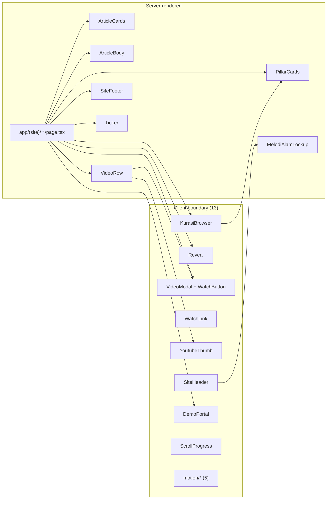

# FRONTEND-PLAN — Melodi Alam Web Platform

> **Catatan revisi (21 Okt 2026):** dokumen ini ditulis ulang untuk mencerminkan
> kondisi repo saat ini. Versi sebelumnya masih membahas `VideosBrowser`,
> `/pahlawan-kota`, `/spaces`, `JournalBrowser`, dan CMS Payload.
>
> **Jejak fitur yang sudah dihapus** dan tidak boleh lagi diceritakan sebagai
> fitur yang ada: `/pahlawan-kota` + `lib/pahlawan.ts` · `/spaces` + `SPACE_ITEMS` ·
> `VideosBrowser` + `/videos/arsip` · `JournalBrowser` · `HeroArticle` ·
> `FeatureCard` · `GENRE_ROWS` / `GenreRow` · `asOptions` di `lib/taxonomy.ts` ·
> `videosByIds` / `videosByVenue` · `demoStoreConfigured` · `draftPreviewConfigured` ·
> `cardCurtain.featureLabel` / `cardCurtain.featureCta` · `thumbnailFor` ·
> `interview.image`.
> `components/motion/ParallaxImage.tsx` **sudah dihapus (22 Okt 2026)** — tak ada importer.

Dokumen ini merinci **front-end yang benar-benar ada** di repo `melodi-alam/`.
Isi dipisah eksplisit, mengikuti konvensi `docs/ARCHITECTURE.md`:

- **Current State — TERVERIFIKASI.** Rute, komponen, batas `"use client"`,
  state, lapisan motion, dan interaksi hover yang ada di kode saat dokumen ini
  ditulis. Setiap klaim dibaca langsung dari berkas; `npm run build`,
  `npm run lint`, dan `npm test` dijalankan pada revisi ini.
- **Implementation Gaps.** Requirement yang belum terpenuhi.
- **Proposed Changes — RENCANA.** Perbaikan yang direncanakan. Belum
  diimplementasikan.

Label status yang dipakai konsisten: `TERVERIFIKASI` (dibaca di kode atau
dijalankan), `RENCANA` (direncanakan, belum ada), `ASUMSI` (diasumsikan),
`[PERLU VERIFIKASI]` (tidak dapat dikonfirmasi dari sumber).

Acuan keputusan: ADR-0001 (artikel route, video modal), ADR-0004 (katalog video
tetap build-time), ADR-0005 (antrean demo dimoderasi), ADR-0006 (Vitest +
Playwright), ADR-0007 (tipografi), ADR-0008 (Sanity Studio menggantikan Payload).
Acuan requirement: `FR-001`…`FR-007`, `ACC-001`…`ACC-003`, `NFR-001`…`NFR-004`,
`BR-001`…`BR-004`.

> **Catatan cakupan:** teks PRD asli tidak ada di repo ini; pemetaan ID-nya lewat
> `docs/PRD-REFERENCE.md`, dan sebagian baris di sana sudah usang (masih menyebut
> `VideosBrowser`, `/pahlawan-kota`, dan menandai `BR-001`/`BR-004` "BELUM"
> padahal keduanya sudah ada di kode).

> **Dokumen saudara:** batas modul dan alur data ada di
> [`ARCHITECTURE.md`](ARCHITECTURE.md); panduan integrasi CMS di
> [`SANITY-INTEGRATION.md`](SANITY-INTEGRATION.md); token dan utilitas di
> [`DESIGN-SYSTEM.md`](DESIGN-SYSTEM.md).

---

## 1. Implementation Overview

**Produk.** Melodi Alam — platform media musik Indonesia: jurnalisme editorial
(*Stories*), sesi panggung (*Melodi Samsara*), kurasi feed Instagram (*Curated
News*), wawancara (*Bicara Melodi*), pipeline pengiriman demo (*Submit Karya*),
dan halaman profil (*Tentang*). Bagian dari PT Infia Pariwara Nusantara
(INFIA Corp).

**Stack front-end (`TERVERIFIKASI`, `package.json` + `next.config.ts`).**

| Item | Nilai |
|---|---|
| Framework | Next.js `16.4.0`, App Router, Turbopack |
| React | `19.3.0` |
| Bahasa | TypeScript `^5`, alias `@/*` → root proyek |
| Styling | Tailwind CSS `^4` via `@tailwindcss/turbopack`; token di `app/globals.css` `@theme` |
| Animasi | `motion` `^14.2.0` (import dari `motion/react`) |
| Konten | `@sanity/client` `^8.9.0`, `@sanity/image-url` `^2.1.1`, `@portabletext/react` `^8.0.1` |
| Form | `@vercel/blob` `^2.8.2`, `@vercel/analytics` `^2.0.1` |
| Dev port | `3100` (`next dev -p 3100`) |
| Cache | `cacheComponents: true`, `partialPrefetching: true` |
| Remote image | `i.ytimg.com/vi/**` dan `cdn.sanity.io/images/**` |
| Test | Vitest `^3.2.7` (`npm test`) |

**Strategi front-end saat ini.** *Layered monolith statis dengan server
component sebagai default.* Halaman tetap **server component**; interaktivitas
diekstrak ke komponen `"use client"` berdaun sesempit mungkin. Tidak ada library
state manajemen, tidak ada router tambahan, tidak ada data-fetching library —
dan dokumen ini **tidak** mengusulkan penambahan salah satunya.

**Batas server/client yang menentukan bentuk kode.** Konten editorial dibaca
**hanya di server** melalui `lib/articles.ts`, `lib/pillars.ts`, `lib/videos.ts`,
`lib/interviews.ts`, dan `lib/site-settings.ts`. Client component tidak pernah
mengimpor klien Sanity; satu-satunya kebalikannya adalah
`lib/pillars-shared.ts`, yang sengaja hanya berisi data murni agar bisa ikut ke
bundel klien.

**Prinsip yang mengikat implementation (dari temuan terukur).**

1. Batas server/client ditentukan oleh **kebutuhan interaktivitas**, bukan
   estetika.
2. **SSR merender keadaan akhir; animasi hanya menambah.** Jangan memanggang
   state tersembunyi ke HTML yang dirender server.
3. Nama kelas Tailwind harus **literal** (tanpa interpolasi string).
4. `lib/catalogue.json` adalah artefak generated — **satu penulis** (`scripts/`).
5. `next/image` `fill` butuh ancestor berposisi.
6. `transform: scale()` melembutkan foto → parallax memakai box oversized.
7. Setiap direktori tool baru di root proyek perlu `@source not`.
8. **Thumbnail YouTube bukan `next/image`** — `` biasa + `srcset`, supaya
   poster yang diganti artis di YouTube tidak terkunci cache optimizer Vercel
   selama setahun.
9. **Satu `<Link>` per kartu**, bukan link judul + `::after` yang tidak
   menangkap klik di area teks.

---

## 2. Requirements and Dependencies

### 2.1 Sumber requirement

| Sumber | Peran | Status |
|---|---|---|
| `docs/ARCHITECTURE.md` | Batas modul, kepemilikan data, ADR | `TERVERIFIKASI` |
| `docs/SANITY-INTEGRATION.md` | Peta tulis-di-Studio → render-di-halaman | `TERVERIFIKASI` |
| `docs/DESIGN-SYSTEM.md` | Token, utilitas, aturan interaksi terkunci | `TERVERIFIKASI` |
| `docs/audit-2026-10-21.md` | Temuan keamanan & codebase yang masih terbuka | `TERVERIFIKASI` (sebagai dokumen) |
| PRD (ID `FR`/`ACC`/`NFR`/`DEC`) | Acuan requirement produk | Teks persisnya tidak ada di repo ini → `[PERLU VERIFIKASI]` |

**Pemetaan acuan requirement yang dipakai dokumen ini** (label jujur):

| ID | Dipakai untuk | Dasar |
|---|---|---|
| `FR-001` | Empat permukaan publik: Latest News / Stories / Watch / Curated News | `ASUMSI` (pemetaan atas kebutuhan saat ini) |
| `FR-002` | Grid artikel 4 kolom berselang-seling | `TERVERIFIKASI` — `ArticleCard` + `titleFirst` di `app/(site)/stories/page.tsx:35` |
| `FR-003` | Pembaca artikel penuh | `TERVERIFIKASI` — `app/(site)/stories/[slug]/page.tsx` |
| `FR-004` | Indeks wawancara tipografi | `TERVERIFIKASI` — `app/(site)/bicara-melodi/page.tsx` |
| `FR-005` | Daftar video bernomor dengan hover `[ ▶ ] — [ M \| WATCH ↗ ]` | `TERVERIFIKASI` — `components/VideoRow.tsx:49-70` |
| `FR-006` | Formulir demo 9 bagian | `TERVERIFIKASI` — `components/DemoPortal.tsx` |
| `FR-007` | Etalase Spaces & Instruments | `BERTENTANGAN` — `/spaces` dihapus atas permintaan |
| `BR-001` | Audio demo: 3 ekstensi, ≤ 25 MB, ditegakkan di klien **dan** server | `TERVERIFIKASI` — `lib/taxonomy.ts:76-78`, `DemoPortal.tsx:63-92`, `app/api/demos/route.ts:236-255` |
| `BR-002` | Status awal `IN REVIEW`, hanya kurator yang mengubah | `TERVERIFIKASI` untuk status awal; `RENCANA` untuk jalur moderasi |
| `BR-003` | Grid genap → judul dulu, ganjil → gambar dulu | `TERVERIFIKASI` — `titleFirst={i % 2 === 1}` |
| `BR-004` | Waktu baca = `max(1, ceil(kata ÷ 200))` | `TERVERIFIKASI` — `lib/content-fallback.ts:57-70`, diuji di `lib/content-fallback.test.ts` |
| `ACC-001` | Kontras teks utama | `ASUMSI` (kebijakan warna dimiliki `DESIGN-SYSTEM.md`) |
| `ACC-002` | Hover-reveal harus setara lewat keyboard (`:focus-within`) | `TERVERIFIKASI` — **terpenuhi**; lihat §10.2 |
| `ACC-003` | `prefers-reduced-motion` dihormati | `TERVERIFIKASI` — `globals.css:455-481` + `MotionRoot` |
| `NFR-001`…`NFR-004` | Non-fungsional: performa, SEO, aksesibilitas, sanitasi input | `ASUMSI`; teks persis `[PERLU VERIFIKASI]` |

### 2.2 Dependency integrasi

| Dependency | Arah | Status |
|---|---|---|
| Sanity `production` (publik) | App (server) → Sanity, tanpa token | `TERVERIFIKASI` |
| Sanity `submissions` (privat) | App (server) → Sanity, wajib token | `TERVERIFIKASI` |
| Sanity Studio (`melodialam-sanity`) | Kurator → Studio → dataset | `TERVERIFIKASI` |
| Vercel Blob | Browser → Blob (token dari server) | `TERVERIFIKASI` kodenya; `RENCANA` blob store belum dibuat |
| Resend | Server → Resend | `TERVERIFIKASI` kodenya; `RENCANA` `RESEND_API_KEY` belum diset |
| Vercel (hosting + revalidate webhook) | Studio → `POST /api/revalidate` | `TERVERIFIKASI` kodenya; `RENCANA` webhook belum dicentang "Trigger on: Create + Update" |
| `lib/catalogue.json` | Build-time, tidak berubah | `TERVERIFIKASI` + ADR-0004 |

### 2.3 Asumsi (ASUMSI)

- `ASUMSI` — Load awal; kurator 1–3 orang; tanpa multi-tenant/RBAC kompleks.
- `ASUMSI` — Trafik baca (artikel/katalog) jauh lebih besar dari trafik submit.
- `ASUMSI` — Client component tidak boleh mengimpor modul yang memegang token
  (aturan R7 `ARCHITECTURE.md` §7).

### 2.4 Blocker / gap yang diketahui

| Gap | Dampak | Status |
|---|---|---|
| Tidak ada endpoint moderasi kurator | `BR-002` belum ditegakkan; status hanya bisa diubah manual di Studio | `TERVERIFIKASI` |
| Cabang fallback `GET /api/demos` tidak menyaring status | Antrean `IN REVIEW` bisa terbaca publik bila token tidak ada | `TERVERIFIKASI` (audit F06) |
| `audioUrl` diterima dari host mana pun | Submit bisa mengarahkan kurator ke host asing | `TERVERIFIKASI` (audit F01) |
| Token unggah Blob diterbitkan tanpa batas | Objek bisa ditulis tanpa ada yang membersihkannya | `TERVERIFIKASI` (audit F04) |
| `POST /api/demos` tanpa rate limit | Dua tulis Sanity + satu email per request | `TERVERIFIKASI` (audit F02) |
| Drawer navigasi tanpa tutup via `Escape`, tanpa `aria-current` di nav mobile | Penyimpangan keyboard/mobile | `TERVERIFIKASI` (§10.2) |
| `GET /api/demos` tidak dikonsumsi UI mana pun | Endpoint hidup tanpa konsumen | `TERVERIFIKASI` (§7.1) |

---

## 3. Route and Navigation Specification

Semua halaman berada di bawah satu root layout (`app/(site)/layout.tsx`) sehingga
**shell** identik di seluruh rute:
`MotionRoot` → skip-link → `ScrollProgress` → `Ticker` → `SiteHeader` →
`<main id="main" tabIndex={-1}">` → `SiteFooter` → `<Analytics />`.

Navigasi utama (`lib/site.ts:29`): `Latest News` (`/`) · `Stories` (`/stories`) ·
`Bicara Melodi` (`/bicara-melodi`) · `Melodi Samsara` (`/videos`, badge "YT") ·
`Curated News` (`/kurasi`), plus tombol `Submit Karya` ke `/submit`.

### 3.1 Struktur rute saat ini (TERVERIFIKASI)

Bentuk render diambil dari output `next build` (21 Okt 2026): `○` = static,
`◐` = partial prerender, `ƒ` = dynamic.

| Route ID | Path | Berkas | Bentuk | Data yang dibaca | Client component yang di-mount |
|---|---|---|---|---|---|
| ROUTE-001 | `/` | `app/(site)/page.tsx` | `○` | `latestStories(8)`, `allPillarPosts()`, `allVideos()`, `getSiteSettings()` | `Reveal`, `RevealText`, `CountUp` |
| ROUTE-002 | `/stories` | `app/(site)/stories/page.tsx` | `○` | `latestStories(8)`, `getSiteSettings()` | `Reveal` |
| ROUTE-003 | `/stories/<slug>` | `app/(site)/stories/[slug]/page.tsx` | `◐` (12 slug ter-prerender + on-demand) | `articleBySlug(slug)`, `latestStories(8)`, `getSiteSettings()` | — |
| ROUTE-004 | `/bicara-melodi` | `app/(site)/bicara-melodi/page.tsx` | `○` | `allInterviews()`, `allVideos()` | `Reveal`, `VideoModal` (+`WatchButton`) |
| ROUTE-005 | `/videos` | `app/(site)/videos/page.tsx` | `○` | `allVideos()`, `allPlaylists()`, `getVideosPageCopy()`, `CHANNEL` | `Reveal`, `VideoModal` |
| ROUTE-006 | `/kurasi` | `app/(site)/kurasi/page.tsx` | `○` | `allPillarPosts()` | `Reveal`, `KurasiBrowser` |
| ROUTE-007 | `/tentang` | `app/(site)/tentang/page.tsx` | `○` | statis (`EXTERNAL_LINKS`, `SITE`) | `Reveal` |
| ROUTE-008 | `/submit` | `app/(site)/submit/page.tsx` | `○` | enum demo (`DEMO_GENRES`, `DEMO_PROGRAMS`, batas audio) | `Reveal`, `DemoPortal` |
| ROUTE-009 | `/preview/<type>/<slug>` | `app/(site)/preview/[type]/[slug]/page.tsx` | `◐`, `noindex` | Sanity `perspective: "drafts"` | — |
| ROUTE-010 | `/api/demos` | `app/api/demos/route.ts` | `ƒ` | `submissionsClient` atau `memoryQueue` | — |
| ROUTE-011 | `/api/demo-audio` | `app/api/demo-audio/route.ts` | `ƒ` | `@vercel/blob/client` | — |
| ROUTE-012 | `/api/revalidate` | `app/api/revalidate/route.ts` | `ƒ` | 6 tag cache | — |
| ROUTE-013 | `/rss.xml` | `app/rss.xml/route.ts` | `○` | `latestStories(8)` | — |
| ROUTE-014 | `/sitemap.xml` | `app/sitemap.ts` | `○` | `latestStories(8)` | — |
| ROUTE-015 | `/robots.txt` | `app/robots.ts` | `○` | `SITE.url` | — |
| ROUTE-016 | `/journal` | `app/(site)/journal/route.ts` | `ƒ` | — | 308 → `/stories` |
| ROUTE-017 | `/journal/<slug>` | `app/(site)/journal/[slug]/route.ts` | `ƒ` | — | 308 → `/stories/<slug>` |
| ROUTE-018 | `/stories/<slug>/opengraph-image` | `app/(site)/stories/[slug]/opengraph-image.tsx` | `ƒ` | `articleBySlug(slug)` | — |
| ROUTE-019 | `/stories/<slug>/twitter-image` | `app/(site)/stories/[slug]/twitter-image.tsx` | `ƒ` | `articleBySlug(slug)` | — |
| ROUTE-404 | sembarang path lain | `app/(site)/not-found.tsx` | `○` | `PRIMARY_NAV` | — |

Total: **33 halaman statis** pada build (`TERVERIFIKASI`, output `next build`).
Tabel rute juga memuat `/_not-found`, `/_global-error`, `/icon.png`,
`/apple-icon.png`, dan `/favicon.ico`.

### 3.2 Parameter, akses, dan fallback

| Route | Parameter | Akses | Fallback |
|---|---|---|---|
| ROUTE-003 | path `slug` | publik | `articleBySlug` → `notFound()` → `app/(site)/not-found.tsx`. `dynamicParams` dibiarkan default, jadi slug yang hanya ada di Sanity dirender on-demand lalu di-*cache* |
| ROUTE-009 | path `type` (`journal` \| `kurasi`), path `slug`, query `secret` | **ber-secret** | Tanpa `SANITY_API_READ_TOKEN` atau secret salah → `notFound()`. Perbandingan secret constant-time |
| ROUTE-001 | — | publik | `latestStories(8` → `allArticles()` → fallback `ARTICLES` di `lib/content-fallback.ts` bila Sanity tak terjangkau |
| ROUTE-002 | — | publik | idem |
| ROUTE-005 | — | publik | `allVideos()` → arsip katalog; `allPlaylists()` → `PLAYLISTS` katalog |
| ROUTE-006 | — | publik | `allPillarPosts()` → `[]`; bagian tidak dirender |
| ROUTE-010 | — | publik (tanpa auth) | `400` body bukan JSON · `413` body > 16 KB · `422` validasi gagal · `503` Sanity privat gagal menulis · `201` sukses |
| ROUTE-012 | header `x-webhook-secret` atau query `secret` | ber-secret | `500` bila env belum diset · `401` bila secret salah |

**Tidak ada** rute terproteksi selain pratinjau dan revalidasi, dan tidak ada
state di URL selain `?secret=` pada dua rute tersebut. Pencarian kurasi **tidak**
di-persistensi ke query string — konsekuensinya tidak dapat dibagikan
(`ASUMSI`: perilaku yang diterima, bukan keluhan yang dibuka ulang).

### 3.3 Hubungan layout

```mermaid
graph TB
  ROOT["app/(site)/layout.tsx (server)<br/>4 font · JSON-LD · skip-link · metadata"]
  MR["motion/MotionRoot (client)"]
  SP["ScrollProgress (client)"]
  TK["Ticker → motion/MarqueeTape (client)"]
  HD["SiteHeader (client)"]
  MAIN["<main id=main> (server, 1 landmark)"]
  FT["SiteFooter (server)"]
  ROOT --> MR --> SP --> TK --> HD --> MAIN --> FT
  MAIN --> R1["ROUTE-001 … ROUTE-009"]
  MAIN --> NF["ROUTE-404"]
  ROOT -.->|"JSON-LD + RSS auto-discovery"| MAIN
```

---

## 4. Page and Component Inventory

Klasifikasi lapisan yang dipakai di seluruh dokumen ini:

- **Shell / layout** — hidup di root layout atau bagian dari kerangka global.
- **Composite** — menyusun sebuah kapabilitas utuh dan memegang state fitur.
- **Pattern** — pola UI dapat-dipakai-ulang berukuran kecil.
- **Primitive** — elemen dasar presentasional tanpa state.
- **Motion primitive** — pembungkus animasi (`components/motion/*`).

### 4.1 Ringkasan rute → komponen

| Route | Server (page) | Composite/Pattern | Motion | Video affordance |
|---|---|---|---|---|
| ROUTE-001 `/` | `page.tsx` | `ArticleCards.FrontCard`, `PillarCards.PillarCard` | `Reveal`, `RevealText`, `CountUp` | — |
| ROUTE-002 `/stories` | `page.tsx` | `ArticleCards.ArticleCard` (grid 8) | `Reveal` | — |
| ROUTE-003 `/stories/[slug]` | `page.tsx` | `ArticleCards.ArticleCard` (blok "More"), `ArticleBody` | — | — |
| ROUTE-004 `/bicara-melodi` | `page.tsx` | `YoutubeThumb` | `Reveal` | `VideoModal`, `WatchButton` |
| ROUTE-005 `/videos` | `page.tsx` | `VideoRow`, `YoutubeThumb` | `Reveal` | `VideoModal`, `WatchLink`, `WatchButton` |
| ROUTE-006 `/kurasi` | `page.tsx` | `KurasiBrowser` + `PillarCards` | `Reveal` | — |
| ROUTE-007 `/tentang` | `page.tsx` | — | `Reveal` | — |
| ROUTE-008 `/submit` | `page.tsx` | `DemoPortal` | `Reveal` | — |
| ROUTE-009 `/preview` | `page.tsx` | `ArticleBody` | — | — |

### 4.2 Batas server/client (`TERVERIFIKASI`, dibaca dari directive)

**13 berkas `"use client"`** di `components/`:

`SiteHeader`, `ScrollProgress`, `Reveal`, `VideoModal`, `WatchLink`,
`YoutubeThumb`, `KurasiBrowser`, `DemoPortal`, `motion/MotionRoot`,
`motion/RevealText`, `motion/CountUp`, `motion/MarqueeTape`,
— `ParallaxImage` sudah dihapus (22 Okt 2026).

**Server component (tanpa directive)** di `components/`:

`ArticleCards`, `ArticleBody`, `PillarCards`, `VideoRow`, `SiteFooter`, `Ticker`
(sekalian mengekspor `SubmitLink`), `MelodiAlamLockup`.

**Aturan yang berlaku:** `lib/*` tidak pernah mengimpor `app/*`/`components/*`;
`components/*` boleh mengimpor `lib/*`; `scripts/*` tidak diimpor runtime
(`TERVERIFIKASI`, `ARCHITECTURE.md` §7). Klien Sanity hanya boleh masuk lewat
`lib/pillars-shared.ts` bila dipakai komponen klien.

### 4.3 Pemilik state & sumber kebenaran (ringkas)

| Data/UI | Pemilik | Pembaca | Status |
|---|---|---|---|
| Artikel editorial | Sanity `article` (fallback `lib/content-fallback.ts`) | ROUTE-001/002/003, sitemap, RSS | `TERVERIFIKASI` |
| Kurasi feed | Sanity `pillarPost` | ROUTE-001/006 | `TERVERIFIKASI` |
| Video | Sanity `video` + `lib/catalogue.json` | ROUTE-001/004/005 | `TERVERIFIKASI` |
| Wawancara | Sanity `interview` (fallback `INTERVIEW_ROWS`) | ROUTE-004 | `TERVERIFIKASI` |
| Copy situs | Sanity `siteSettings` (fallback `lib/site.ts`) | layout, header, footer, metadata | `TERVERIFIKASI` |
| Navigasi & rubric footer | `lib/site.ts` (kode, **bukan** CMS) | `SiteHeader`, `SiteFooter`, 404 | `TERVERIFIKASI` |
| Antrean demo (klien) | **tidak ada** — `DemoPortal` tidak menampilkan antrean | — | `TERVERIFIKASI` |
| Antrean demo (server) | Sanity `submissions`, atau array proses-lokal | **tidak ada konsumen** | `TERVERIFIKASI` |

---

## 5. Component Implementation Specifications

Setiap komponen di bawah **dibaca langsung**. Kolom "Mengapa client/server"
menjelaskan alasan teknis nyata, bukan estetika.

### 5.1 Shell / layout

| Komponen | Lapisan | Server/Client | Mengapa | Props | Dipakai di |
|---|---|---|---|---|---|
| `MotionRoot` | Shell | **Client** | `MotionConfig` adalah konteks `motion/react` | `children` | root layout (semua rute) |
| `SiteHeader` | Shell | **Client** | `usePathname()` + `useState` drawer | `brand: { tagline, strapline, est, owner }` | semua rute |
| `SiteFooter` | Shell | **Server** | murni presentasional | `settings: SiteSettings` | semua rute |
| `Ticker` | Shell | **Server** | menyusun item dari `siteSettings`; loop diserahkan ke `MarqueeTape` | `items: TickerItem[]` | semua rute |
| `ScrollProgress` | Shell | **Client** | listener `scroll`/`resize` + `useState(pct)` | — | semua rute |
| `Reveal` | Shell/Pattern | **Client** | `IntersectionObserver` + `useState(visible)` | `children`, `as?: "section"\|"div"\|"article"`, `className?` | ROUTE-001…008 |

Catatan `SiteHeader` (`TERVERIFIKASI`): drawer ditutup **pada tap** link
(`onClick={closeDrawer}`), bukan di `useEffect`, dengan komentar eksplisit bahwa
ini menghindari cascading render saat navigasi dari dalam drawer. Nav desktop
memakai `aria-current="page"` via `isActive()`; badge nav (`YT`) dirender bila
ada. Nav mobile **tidak** memakai `aria-current` — lihat §10.2.

Catatan `Ticker` (`TERVERIFIKASI`): `Ticker` adalah server component yang
memakai `<a>` biasa (bukan `next/link`) untuk item ber-`href`, dan `
` dengan
titik berdenyut untuk item tanpa tautan. Item datang dari
`siteSettings.tickerItems` yang maksimal 8 item.

### 5.2 Composite

| Komponen | Lapisan | Server/Client | Mengapa | Props | Dipakai di |
|---|---|---|---|---|---|
| `KurasiBrowser` | Composite | **Client** | kotak cari + chip pillar + pengelompokan | `posts: PillarPost[]` | ROUTE-006 |
| `DemoPortal` | Composite | **Client** | form, preview audio lokal, `upload` ke Blob, `fetch` POST | — | ROUTE-008 |
| `VideoModal` | Composite | **Client** | state modal + listener `CustomEvent` + `Escape` + focus trap | — | ROUTE-004, ROUTE-005 |
| `ArticleCards` | Composite | **Server** | presentasional; mengekspor 2 komponen | lihat §5.3 | ROUTE-001,002,003 |
| `PillarCards` | Composite | **Server** | presentasional; mengekspor 3 komponen | lihat §5.3 | ROUTE-001,006 |

### 5.3 Presentational / pattern / primitive

| Komponen | Lapisan | Server/Client | Props | Dipakai di |
|---|---|---|---|---|
| `ArticleCard` | Composite/Server | Server | `article`, `titleFirst?`, `index?`, `readLabel?`, `noteCta?` | ROUTE-002, ROUTE-003 |
| `FrontCard` | Composite/Server | Server | `article`, `lead?` | ROUTE-001 |
| `CardImage` (internal `ArticleCards`) | Primitive | Server | `article`, `readLabel`, `noteCta` (frame 4:5) | di dalam `ArticleCard` |
| `PillarCard` | Primitive | Server | `post`, `showPillar?` | ROUTE-001, ROUTE-006 |
| `PillarRow` | Primitive | Server | `post`, `index` | ROUTE-006 (bagian "Tonton") |
| `PillarHead` | Pattern | Server | `label`, `note` | ROUTE-006 |
| `VideoRow` | Composite/Server | Server | `video`, `index` | ROUTE-005 |
| `ArticleBody` | Composite/Server | Server | `rich?: unknown[]`, `paragraphs: string[]` | ROUTE-003, ROUTE-009 |
| `WatchButton` (dari `VideoModal`) | Pattern | **Client** | `id`, `title`, `className?`, `children` | ROUTE-004, ROUTE-005 |
| `WatchLink` | Pattern | **Client** | `id`, `title`, `className?`, `children` | ROUTE-005 |
| `YoutubeThumb` | Primitive | **Client** | `id`, `className?`, `sizes?`, `width?`, `height?` | ROUTE-004, ROUTE-005 |
| `SubmitLink` (dari `Ticker`) | Pattern | Server | `className?` | `SiteHeader` (nav desktop) |
| `MelodiAlamLockup` | Primitive | Server | `width?`, `sizes?`, `className?`, `alt?` (default `"Melodi Alam"`), `eager?` | `SiteHeader`, `SiteFooter` (dua blok) |

**Satu `<Link>` per kartu (`TERVERIFIKASI`, `components/ArticleCards.tsx:5-15`).**
Setiap kartu artikel adalah **satu** `<Link>` yang membungkus seluruh kartu —
gambar, judul, ringkasan, dan baris kaki. Versi lama menaruh link pada judul
dan meregangkan `::after` di atas kartu; pseudo-element itu berada di atas
artwork tetapi klik pada caption di bawahnya tidak melakukan apa pun. Anchor
sungguhan tidak bisa gagal menangkap.

**Thumbnail YouTube tanpa `next/image` (`TERVERIFIKASI`,
`components/YoutubeThumb.tsx`).** Satu komponen, **dua** call site: baris sesi
Melodi Samsara (`components/VideoRow.tsx:24`) dan indeks Bicara Melodi
(`app/(site)/bicara-melodi/page.tsx:67`). Atribut `srcset` 320w/480w/1280w plus
`sizes` per slot, dan `onError` turun bertahap `maxresdefault` → `sddefault` →
`hqdefault`. Setelah ketiga varian gagal, komponen merender "poster tidak
tersedia". `alt=""` (dekoratif — tombol pembungkus yang memberi nama).

**`ArticleBody` dua sumber, satu kolom (`TERVERIFIKASI`,
`components/ArticleBody.tsx`).** Artikel CMS membawa Portable Text dan dirender
lewat `<PortableText>` sehingga heading, list, kutipan, dan gambar inline
utuh; artikel statis membawa array string dan dirender sebagai paragraf. Keduanya
masuk ke `.article-prose` yang sama, sehingga tipografinya identik. Gambar inline
Portable Text memakai `` biasa, bukan `next/image` — Sanity CDN sudah
meresize dan mengonversi URL-nya, dan blok inline tidak menyimpan dimensi.

**`MelodiAlamLockup` (`TERVERIFIKASI`).** Satu-satunya aset merek yang dirender
halaman: masthead dan dua blok footer memakainya. Ukuran diatur `className`;
atribut `width`/`height` di `next/image` memakai ukuran asli artwork
(2021×286), bukan ukuran tampilan — optimizer membulatkan tinggi hasil
optimasi, jadi atribut turunan tidak pernah sama dengan kotak yang dirender.
`alt` bawaannya **`"Melodi Alam"`** (bukan kosong) di kedua blok footer.

**Aset merek (`TERVERIFIKASI`).** `npm run brand` menulis
`public/brand/melodi-alam-lockup-black.png` dari
`LOGO2/Melodi Alam Text Logo - Black.png` (tanpa recolor), ikon aplikasi dari
`LOGO2/Melodi Alam Logo Only - Color.png`, serta `app/icon.png`,
`app/apple-icon.png`, `app/favicon.ico`.

### 5.4 Rincian per-komponen penting (`TERVERIFIKASI`)

**Beranda.** Grid 2×2 = 4 `FrontCard` (thumbnail 4:5 kecil di kiri, rubrik +
tanggal, judul, ringkasan, "Baca Selengkapnya ↗"). Satu kartu pertama diberi
badge "Cover Story" (`lead`). Baris hitung memakai `CountUp` untuk
`{stories.length} artikel di journal` dan `{curatedVideos} sesi panggung`,
dengan "Semua artikel ↗" ke `/stories`. Di bawahnya strip "Curated News": 4
`PillarCard` foto terbaru dari pool kurasi (label pillar, judul, tanggal,
"Buka di IG ↗") plus "Semua kurasi ↗". Strip disembunyikan bila pool kosong.
Angka "sesi panggung" dihitung dari video yang sumbernya `cms` — bukan angka
hard-code.

**`/stories`.** Satu pool, grid 4 kolom, 8 kartu. `titleFirst={i % 2 === 1}`
membalik kolom genap agar judul tampil lebih dulu. Footer tiap kartu:
rubrik, badge **"Reel"** bila `article.mediaType === "reel"`, menit baca, dan
tanggal. Baris bawah: "Konten kurasi dari feed @melodi.alam" + "Curated News ↗".
Tanpa filter, tanpa pencarian, tanpa penghitung.

**`/stories/<slug>`.** Header (rubrik, tanggal, menit baca, sumber, penanda
"dari CMS" bila sumbernya CMS), `h1`, ringkasan serif, cover 4:5 `max-w-md` di
tengah, `ArticleBody`, footer ("8 artikel di journal • kurasi redaksi" + tautan
Instagram), lalu blok "More {rubrik}" — 3 kartu: rubrik sama dulu, lalu rubrik
lain, dari `latestStories(8)` yang sama.

**`/bicara-melodi`.** 9 episode Season 3, satu baris per episode: nama artis
(`font-display`, sangat besar), headline uppercase, durasi + umur unggahan,
`WatchButton` berisi `YoutubeThumb` 160 px, dan caption miring. Setiap baris
terhubung ke kanal lewat `Bicara Melodi S3 ↗`.

**`/videos` — Melodi Samsara.** `h1` "Melodi Samsara" dari
`getVideosPageCopy().samsaraTitle`, **9 baris** sesi (`VideoRow`: nomor dua
digit, thumbnail, judul, venue + umur, durasi + Featuring, tombol Watch),
baris "Sesi lainnya ada di kanal YouTube" + tombol "YouTube ↗", lalu **5
playlist** dalam grid 5 kolom, dan tautan "Curated News ↗". `VideoModal`
di-mount sekali di halaman ini.

**`/kurasi` — Curated News.** `KurasiBrowser`: kotak cari (`<input type="search">`
+ `<label class="sr-only">`), chip per pillar dengan `aria-pressed` dan
jumlahnya, lalu dua kelompok: "Baca — dari feed @melodi.alam" (pillar foto,
grid 6 kolom, `PillarCard`) dan "Tonton — dari feed @melodi.alam" (pillar reel,
`PillarRow`). Tanpa filter, tiap pillar menampilkan 6 posting terbaru; dengan
pencarian atau chip, batas 6 dilepas dan pencarian berjalan di seluruh pool
(batas tampilan 48). Bagian yang kosong setelah filter **dihilangkan**.
Setiap section punya `id` per pillar sehingga bisa di-anchor
(`/kurasi#fakta-musik`).

**`DemoPortal`.** Form `noValidate` dengan **9 bagian** bernomor: nama band,
kota, judul, genre, tujuan submit, link streaming/EPK, kontak WhatsApp/email
manajer, file audio opsional, cerita singkat. Setiap field punya `id` + `<label
htmlFor>` eksplisit. Audio diperiksa di peramban (ekstensi, MIME, ukuran ≤ 25 MB)
dan **diunggah langsung ke Vercel Blob** sebelum kiriman dikirim; URL-nya ikut
dalam payload. Submit mengirim JSON ke `POST /api/demos`; `422` memetakan
`errors` ke field dan memindahkan fokus ke field pertama yang bermasalah; sukses
mereset form dan mencabut object URL.

**`VideoModal`.** Dirender sekali per halaman yang memakainya; dibuka imperatif
lewat `window.dispatchEvent(new CustomEvent("melodi:watch", { detail: { id, title } }))`.
Menangani `Escape` lewat listener `keydown` global; klik backdrop
(`e.target === e.currentTarget`) menutup; iframe
`youtube.com/embed/{id}?autoplay=1` dengan `allow` dan `allowFullScreen`.
Tombol tutup berlabel "Tutup [ESC] ✕".

---

## 6. Motion Layer

Seluruh komponen ini adalah **client component** dan merupakan bagian
*load-bearing*, bukan hiasan. Untuk tiap primitif, batasan yang membentuknya
dicatat.

### 6.1 `MotionRoot` — satu tuas global (`TERVERIFIKASI`)

`<MotionConfig reducedMotion="user">` membungkus seluruh aplikasi. Konsekuensi
yang disengaja: `motion` melepas animasi *transform* dan *layout* — menyisakan
fade opacity — saat OS meminta reduced motion, **sehingga komponen individual
tidak perlu penjaga sendiri**.

**Pengecualian yang didokumentasikan di kode:** nilai *scroll-linked* adalah
`style` motion value, bukan animasi, jadi komponen yang menurunkannya memeriksa
`useReducedMotion` sendiri (`CountUp`, `MarqueeTape`) — dan `Reveal` memakai
`matchMedia("(prefers-reduced-motion: reduce)")` langsung.

### 6.2 `RevealText` — mask yang di-arm di klien (`TERVERIFIKASI`)

Batasan yang membentuknya: **jangan memanggang state tersembunyi ke SSR.**
Versi lama menuliskan `translateY(115%)` inline ke output server, sehingga satu
callback viewport yang meleset membuat heading **tak terlihat permanen**.

- SSR merender **keadaan akhir** yang terbaca; `initial={false}` pada
  `motion.span` mencegah Motion menulis keadaan tersembunyi ke markup.
- `armed` di-set lewat `useIsoLayoutEffect` (fallback `useEffect` di server)
  agar mask tidak berkedip mundur.
- Trigger adalah **pembacaan rect langsung** pada `scroll`/`resize`, bukan
  callback `IntersectionObserver`, dengan komentar bahwa reveal tidak boleh
  bergantung pada callback yang tak dapat dipastikan berjalan.
- `DESCENDER_ROOM = "0.18em"` menjaga ekor huruf g/y/j/p/q tidak terpotong kotak
  `overflow-hidden`, dengan `margin-bottom` negatif agar tinggi baris tetap.
- Spasi dirender sebagai text node nyata → heading tetap membungkus seperti teks biasa.

### 6.3 `ParallaxImage` — **sudah dihapus (22 Okt 2026)**

Komponen ini tidak pernah dipakai halaman mana pun. Sempat dicatat sebagai utang
di FE-H1; sekarang berkasnya sudah dibuang, jadi tidak ada lagi komponen mati di
`components/motion/`.
ada baris hitung beranda: dihitung saat render
  dari `videos.filter((video) => video.source === "cms").length`, jadi nilainya
  bergantung pada isi dataset CMS saat ini — **tidak** diverifikasi di sini.
- Kontras warna final (dimiliki `DESIGN-SYSTEM.md`).
- `docs/PRD-REFERENCE.md` masih memuat baris usang (menyebut `VideosBrowser`,
  `/pahlawan-kota`, dan menandai `BR-001`/`BR-004` "BELUM"); dokumen itu berada
  di luar lingkup revisi ini.
- Tidak ada berkas selain `docs/FRONTEND-PLAN.md` yang dibuat atau diubah.

---

## Open Questions

1. **Teks & pemetaan ID PRD.** Dokumen ini memakai `FR`/`ACC`/`NFR`/`BR` sesuai
   brief dan `ARCHITECTURE.md`, tetapi PRD mentah tidak ada di repo. Pemetaan
   `FR-001`…`FR-007` dan `NFR-001`…`NFR-004` adalah `ASUMSI` — perlu
   diselaraskan dengan `docs/PRD-REFERENCE.md`, yang sendiri masih memuat baris
   usang.
2. **`dynamicParams` pada `/stories/[slug]`.** Dibiarkan default, sehingga artikel
   yang hanya ada di Sanity dirender on-demand lalu di-*cache*. Perlu dipastikan
   apakah ia perlu dikunci ke build (`dynamicParams = false`) atau dibiarkan
   on-demand.
3. **Cabang fallback antrean demo.** Tanpa `SANITY_API_READ_TOKEN`, `GET /api/demos`
   mengembalikan seluruh antrean termasuk `IN REVIEW`. Disaring atau dihapus?
4. **Aktor moderasi.** Siapa yang menjalankan perubahan status `BR-002`? Studio,
   halaman admin sendiri, atau CLI?
5. **Bucket audio.** Privat atau publik? Token unggah saat ini diterbitkan ke
   peramban (`access: "public"`), dan nama file asli ikut ke URL publik.
6. ~~**`ParallaxImage`.** Komponen mati yang belum dibuang~~ — **dibuang 22 Okt 2026**
   rencana memakainya lagi?
7. **Kontras warna.** `text-neutral-500`/`neutral-400` pada latar putih
   berpotensi di bawah 4.5:1; `DESIGN-SYSTEM.md` yang memutuskan, bukan dokumen
   ini.
8. **Menu mobile & `aria-current`.** Dua hal yang belum dikerjakan dan tidak
   bertentangan dengan keputusan apa pun — tinggal dikerjakan.
