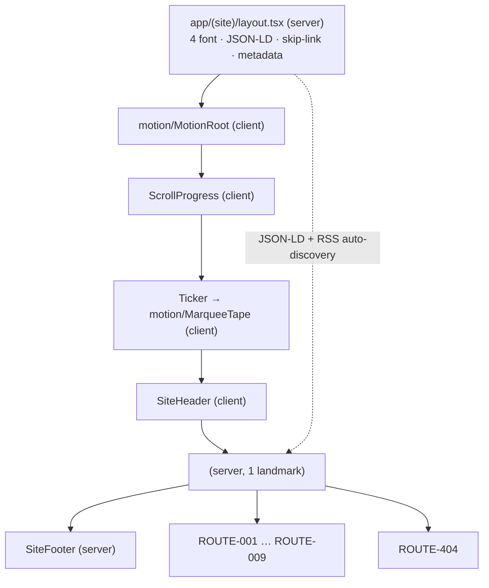
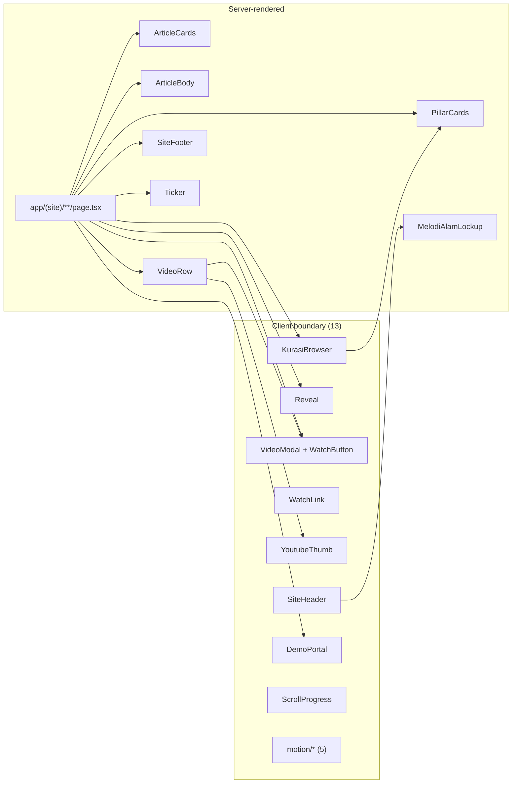
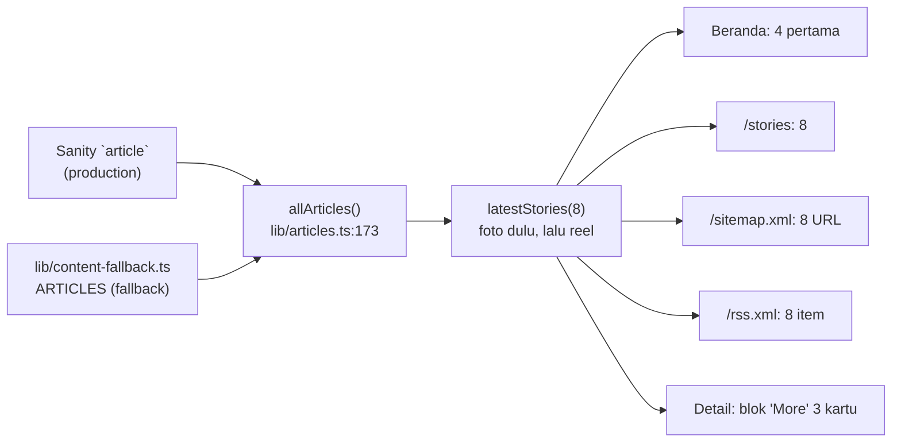
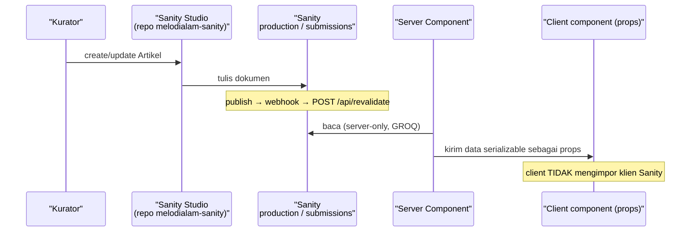

# FRONTEND-PLAN — Melodi Alam Web Platform

> **Catatan revisi (21 Okt 2026):** dokumen ini ditulis ulang untuk mencerminkan
> kondisi repo saat ini. Versi sebelumnya masih membahas `VideosBrowser`,
> `/pahlawan-kota`, `/spaces`, `JournalBrowser`, dan CMS Payload.
>
> **Jejak fitur yang sudah dihapus** dan tidak boleh lagi diceritakan sebagai
> fitur yang ada: `/pahlawan-kota` + `lib/pahlawan.ts` · `/spaces` + `SPACE_ITEMS` ·
> `VideosBrowser` + `/videos/arsip` · `JournalBrowser` · `HeroArticle` ·
> `FeatureCard` · `GENRE_ROWS` / `GenreRow` · `asOptions` di `lib/taxonomy.ts` ·
> `videosByIds` / `videosByVenue` · `demoStoreConfigured` · `draftPreviewConfigured` ·
> `cardCurtain.featureLabel` / `cardCurtain.featureCta` · `thumbnailFor` ·
> `interview.image`.
> `components/motion/ParallaxImage.tsx` **sudah dihapus (22 Okt 2026)** — tak ada importer.

Dokumen ini merinci **front-end yang benar-benar ada** di repo `melodi-alam/`.
Isi dipisah eksplisit, mengikuti konvensi `docs/ARCHITECTURE.md`:

- **Current State — TERVERIFIKASI.** Rute, komponen, batas `"use client"`,
  state, lapisan motion, dan interaksi hover yang ada di kode saat dokumen ini
  ditulis. Setiap klaim dibaca langsung dari berkas; `npm run build`,
  `npm run lint`, dan `npm test` dijalankan pada revisi ini.
- **Implementation Gaps.** Requirement yang belum terpenuhi.
- **Proposed Changes — RENCANA.** Perbaikan yang direncanakan. Belum
  diimplementasikan.

Label status yang dipakai konsisten: `TERVERIFIKASI` (dibaca di kode atau
dijalankan), `RENCANA` (direncanakan, belum ada), `ASUMSI` (diasumsikan),
`[PERLU VERIFIKASI]` (tidak dapat dikonfirmasi dari sumber).

Acuan keputusan: ADR-0001 (artikel route, video modal), ADR-0004 (katalog video
tetap build-time), ADR-0005 (antrean demo dimoderasi), ADR-0006 (Vitest +
Playwright), ADR-0007 (tipografi), ADR-0008 (Sanity Studio menggantikan Payload).
Acuan requirement: `FR-001`…`FR-007`, `ACC-001`…`ACC-003`, `NFR-001`…`NFR-004`,
`BR-001`…`BR-004`.

> **Catatan cakupan:** teks PRD asli tidak ada di repo ini; pemetaan ID-nya lewat
> `docs/PRD-REFERENCE.md`, dan sebagian baris di sana sudah usang (masih menyebut
> `VideosBrowser`, `/pahlawan-kota`, dan menandai `BR-001`/`BR-004` "BELUM"
> padahal keduanya sudah ada di kode).

> **Dokumen saudara:** batas modul dan alur data ada di
> [`ARCHITECTURE.md`](ARCHITECTURE.md); panduan integrasi CMS di
> [`SANITY-INTEGRATION.md`](SANITY-INTEGRATION.md); token dan utilitas di
> [`DESIGN-SYSTEM.md`](DESIGN-SYSTEM.md).

---

## 1. Implementation Overview

**Produk.** Melodi Alam — platform media musik Indonesia: jurnalisme editorial
(*Stories*), sesi panggung (*Melodi Samsara*), kurasi feed Instagram (*Curated
News*), wawancara (*Bicara Melodi*), pipeline pengiriman demo (*Submit Karya*),
dan halaman profil (*Tentang*). Bagian dari PT Infia Pariwara Nusantara
(INFIA Corp).

**Stack front-end (`TERVERIFIKASI`, `package.json` + `next.config.ts`).**

| Item | Nilai |
|---|---|
| Framework | Next.js `16.4.2`, App Router, Turbopack |
| React | `19.3.0` |
| Bahasa | TypeScript `^5`, alias `@/*` → root proyek |
| Styling | Tailwind CSS `^4` via `@tailwindcss/turbopack`; token di `app/globals.css` `@theme` |
| Animasi | `motion` `^14.2.0` (import dari `motion/react`) |
| Konten | `@sanity/client` `^8.9.0`, `@sanity/image-url` `^2.1.1`, `@portabletext/react` `^8.0.1` |
| Form | `@vercel/blob` `^2.8.2`, `@vercel/analytics` `^2.0.1` |
| Dev port | `3100` (`next dev -p 3100`) |
| Cache | `cacheComponents: true`, `partialPrefetching: true` |
| Remote image | `i.ytimg.com/vi/**` dan `cdn.sanity.io/images/**` |
| Test | Vitest `^3.2.7` (`npm test`) |

**Strategi front-end saat ini.** *Layered monolith statis dengan server
component sebagai default.* Halaman tetap **server component**; interaktivitas
diekstrak ke komponen `"use client"` berdaun sesempit mungkin. Tidak ada library
state manajemen, tidak ada router tambahan, tidak ada data-fetching library —
dan dokumen ini **tidak** mengusulkan penambahan salah satunya.

**Batas server/client yang menentukan bentuk kode.** Konten editorial dibaca
**hanya di server** melalui `lib/articles.ts`, `lib/pillars.ts`, `lib/videos.ts`,
`lib/interviews.ts`, dan `lib/site-settings.ts`. Client component tidak pernah
mengimpor klien Sanity; satu-satunya kebalikannya adalah
`lib/pillars-shared.ts`, yang sengaja hanya berisi data murni agar bisa ikut ke
bundel klien.

**Prinsip yang mengikat implementation (dari temuan terukur).**

1. Batas server/client ditentukan oleh **kebutuhan interaktivitas**, bukan
   estetika.
2. **SSR merender keadaan akhir; animasi hanya menambah.** Jangan memanggang
   state tersembunyi ke HTML yang dirender server.
3. Nama kelas Tailwind harus **literal** (tanpa interpolasi string).
4. `lib/catalogue.json` adalah artefak generated — **satu penulis** (`scripts/`).
5. `next/image` `fill` butuh ancestor berposisi.
6. `transform: scale()` melembutkan foto → parallax memakai box oversized.
7. Setiap direktori tool baru di root proyek perlu `@source not`.
8. **Thumbnail YouTube bukan `next/image`** — `` biasa + `srcset`, supaya
   poster yang diganti artis di YouTube tidak terkunci cache optimizer Vercel
   selama setahun.
9. **Satu `<Link>` per kartu**, bukan link judul + `::after` yang tidak
   menangkap klik di area teks.

---

## 2. Requirements and Dependencies

### 2.1 Sumber requirement

| Sumber | Peran | Status |
|---|---|---|
| `docs/ARCHITECTURE.md` | Batas modul, kepemilikan data, ADR | `TERVERIFIKASI` |
| `docs/SANITY-INTEGRATION.md` | Peta tulis-di-Studio → render-di-halaman | `TERVERIFIKASI` |
| `docs/DESIGN-SYSTEM.md` | Token, utilitas, aturan interaksi terkunci | `TERVERIFIKASI` |
| `docs/audit-2026-10-21.md` | Temuan keamanan & codebase yang masih terbuka | `TERVERIFIKASI` (sebagai dokumen) |
| PRD (ID `FR`/`ACC`/`NFR`/`DEC`) | Acuan requirement produk | Teks persisnya tidak ada di repo ini → `[PERLU VERIFIKASI]` |

**Pemetaan acuan requirement yang dipakai dokumen ini** (label jujur):

| ID | Dipakai untuk | Dasar |
|---|---|---|
| `FR-001` | Empat permukaan publik: Latest News / Stories / Watch / Curated News | `ASUMSI` (pemetaan atas kebutuhan saat ini) |
| `FR-002` | Grid artikel 4 kolom berselang-seling | `TERVERIFIKASI` — `ArticleCard` + `titleFirst` di `app/(site)/stories/page.tsx:35` |
| `FR-003` | Pembaca artikel penuh | `TERVERIFIKASI` — `app/(site)/stories/[slug]/page.tsx` |
| `FR-004` | Indeks wawancara tipografi | `TERVERIFIKASI` — `app/(site)/bicara-melodi/page.tsx` |
| `FR-005` | Daftar video bernomor dengan hover `[ ▶ ] — [ WATCH ]` (WATCH = tautan langsung ke video) | `TERVERIFIKASI` — `components/VideoRow.tsx` |
| `FR-006` | Formulir demo 9 bagian | `TERVERIFIKASI` — `components/DemoPortal.tsx` |
| `FR-007` | Etalase Spaces & Instruments | `BERTENTANGAN` — `/spaces` dihapus atas permintaan |
| `BR-001` | Audio demo: 3 ekstensi, ≤ 25 MB, ditegakkan di klien **dan** server | `TERVERIFIKASI` — `lib/taxonomy.ts:76-78`, `DemoPortal.tsx:63-92`, `app/api/demos/route.ts:236-255` |
| `BR-002` | Status awal `IN REVIEW`, hanya kurator yang mengubah | `TERVERIFIKASI` untuk status awal; `RENCANA` untuk jalur moderasi |
| `BR-003` | Grid genap → judul dulu, ganjil → gambar dulu | `TERVERIFIKASI` — `titleFirst={i % 2 === 1}` |
| `BR-004` | Waktu baca = `max(1, ceil(kata ÷ 200))` | `TERVERIFIKASI` — `lib/content-fallback.ts:57-70`, diuji di `lib/content-fallback.test.ts` |
| `ACC-001` | Kontras teks utama | `ASUMSI` (kebijakan warna dimiliki `DESIGN-SYSTEM.md`) |
| `ACC-002` | Hover-reveal harus setara lewat keyboard (`:focus-within`) | `TERVERIFIKASI` — **terpenuhi**; lihat §10.2 |
| `ACC-003` | `prefers-reduced-motion` dihormati | `TERVERIFIKASI` — `globals.css:455-481` + `MotionRoot` |
| `NFR-001`…`NFR-004` | Non-fungsional: performa, SEO, aksesibilitas, sanitasi input | `ASUMSI`; teks persis `[PERLU VERIFIKASI]` |

### 2.2 Dependency integrasi

| Dependency | Arah | Status |
|---|---|---|
| Sanity `production` (publik) | App (server) → Sanity, tanpa token | `TERVERIFIKASI` |
| Sanity `submissions` (privat) | App (server) → Sanity, wajib token | `TERVERIFIKASI` |
| Sanity Studio (`melodialam-sanity`) | Kurator → Studio → dataset | `TERVERIFIKASI` |
| Vercel Blob | Browser → Blob (token dari server) | `TERVERIFIKASI` kodenya; `RENCANA` blob store belum dibuat |
| Resend | Server → Resend | `TERVERIFIKASI` kodenya; `RENCANA` `RESEND_API_KEY` belum diset |
| Vercel (hosting + revalidate webhook) | Studio → `POST /api/revalidate` | `TERVERIFIKASI` kodenya; `RENCANA` webhook belum dicentang "Trigger on: Create + Update" |
| `lib/catalogue.json` | Build-time, tidak berubah | `TERVERIFIKASI` + ADR-0004 |

### 2.3 Asumsi (ASUMSI)

- `ASUMSI` — Load awal; kurator 1–3 orang; tanpa multi-tenant/RBAC kompleks.
- `ASUMSI` — Trafik baca (artikel/katalog) jauh lebih besar dari trafik submit.
- `ASUMSI` — Client component tidak boleh mengimpor modul yang memegang token
  (aturan R7 `ARCHITECTURE.md` §7).

### 2.4 Blocker / gap yang diketahui

| Gap | Dampak | Status |
|---|---|---|
| Tidak ada endpoint moderasi kurator | `BR-002` belum ditegakkan; status hanya bisa diubah manual di Studio | `TERVERIFIKASI` |
| Cabang fallback `GET /api/demos` tidak menyaring status | Antrean `IN REVIEW` bisa terbaca publik bila token tidak ada | `TERVERIFIKASI` (audit F06) |
| `audioUrl` diterima dari host mana pun | Submit bisa mengarahkan kurator ke host asing | `TERVERIFIKASI` (audit F01) |
| Token unggah Blob diterbitkan tanpa batas | Objek bisa ditulis tanpa ada yang membersihkannya | `TERVERIFIKASI` (audit F04) |
| `POST /api/demos` ~~tanpa rate limit~~ | Dua tulis Sanity + satu email per request | **Tertutup sebagian 22 Okt 2026** — rate limit + `Idempotency-Key` + honeypot (audit F02) |
| Drawer navigasi tanpa tutup via `Escape`, tanpa `aria-current` di nav mobile | Penyimpangan keyboard/mobile | `TERVERIFIKASI` (§10.2) |
| `GET /api/demos` tidak dikonsumsi UI mana pun | Endpoint hidup tanpa konsumen | `TERVERIFIKASI` (§7.1) |

---

## 3. Route and Navigation Specification

Semua halaman berada di bawah satu root layout (`app/(site)/layout.tsx`) sehingga
**shell** identik di seluruh rute:
`MotionRoot` → skip-link → `ScrollProgress` → `Ticker` → `SiteHeader` →
`<main id="main" tabIndex={-1}">` → `SiteFooter` → `<Analytics />`.

Navigasi utama (`lib/site.ts:29`): `Latest News` (`/`) · `Stories` (`/stories`) ·
`Bicara Melodi` (`/bicara-melodi`) · `Melodi Samsara` (`/videos`) ·
`Curated News` (`/kurasi`), plus tombol `Submit Karya` ke `/submit`.

### 3.1 Struktur rute saat ini (TERVERIFIKASI)

Bentuk render diambil dari output `next build` (21 Okt 2026): `○` = static,
`◐` = partial prerender, `ƒ` = dynamic.

| Route ID | Path | Berkas | Bentuk | Data yang dibaca | Client component yang di-mount |
|---|---|---|---|---|---|
| ROUTE-001 | `/` | `app/(site)/page.tsx` | `○` | `latestStories(8)`, `allPillarPosts()`, `allVideos()`, `getSiteSettings()` | `Reveal`, `RevealText`, `CountUp` |
| ROUTE-002 | `/stories` | `app/(site)/stories/page.tsx` | `○` | `latestStories(8)`, `getSiteSettings()` | `Reveal` |
| ROUTE-003 | `/stories/<slug>` | `app/(site)/stories/[slug]/page.tsx` | `◐` (12 slug ter-prerender + on-demand) | `articleBySlug(slug)`, `latestStories(8)`, `getSiteSettings()` | — |
| ROUTE-004 | `/bicara-melodi` | `app/(site)/bicara-melodi/page.tsx` | `○` | `allInterviews()`, `allVideos()` | `Reveal`, `VideoModal` (+`WatchButton`) |
| ROUTE-005 | `/videos` | `app/(site)/videos/page.tsx` | `○` | `allVideos()`, `allPlaylists()`, `getVideosPageCopy()`, `CHANNEL` | `Reveal`, `VideoModal` |
| ROUTE-006 | `/kurasi` | `app/(site)/kurasi/page.tsx` | `○` | `allPillarPosts()` | `Reveal`, `KurasiBrowser` |
| ROUTE-007 | `/tentang` | `app/(site)/tentang/page.tsx` | `○` | statis (`EXTERNAL_LINKS`, `SITE`) | `Reveal` |
| ROUTE-008 | `/submit` | `app/(site)/submit/page.tsx` | `○` | enum demo (`DEMO_GENRES`, `DEMO_PROGRAMS`, batas audio) | `Reveal`, `DemoPortal` |
| ROUTE-009 | `/preview/<type>/<slug>` | `app/(site)/preview/[type]/[slug]/page.tsx` | `◐`, `noindex` | Sanity `perspective: "drafts"` | — |
| ROUTE-010 | `/api/demos` | `app/api/demos/route.ts` | `ƒ` | `submissionsClient` atau `memoryQueue` | — |
| ROUTE-011 | `/api/demo-audio` | `app/api/demo-audio/route.ts` | `ƒ` | `@vercel/blob/client` | — |
| ROUTE-012 | `/api/revalidate` | `app/api/revalidate/route.ts` | `ƒ` | 6 tag cache | — |
| ROUTE-013 | `/rss.xml` | `app/rss.xml/route.ts` | `○` | `latestStories(8)` | — |
| ROUTE-014 | `/sitemap.xml` | `app/sitemap.ts` | `○` | `latestStories(8)` | — |
| ROUTE-015 | `/robots.txt` | `app/robots.ts` | `○` | `SITE.url` | — |
| ROUTE-016 | `/journal` | `app/(site)/journal/route.ts` | `ƒ` | — | 308 → `/stories` |
| ROUTE-017 | `/journal/<slug>` | `app/(site)/journal/[slug]/route.ts` | `ƒ` | — | 308 → `/stories/<slug>` |
| ROUTE-018 | `/stories/<slug>/opengraph-image` | `app/(site)/stories/[slug]/opengraph-image.tsx` | `ƒ` | `articleBySlug(slug)` | — |
| ROUTE-019 | `/stories/<slug>/twitter-image` | `app/(site)/stories/[slug]/twitter-image.tsx` | `ƒ` | `articleBySlug(slug)` | — |
| ROUTE-404 | sembarang path lain | `app/(site)/not-found.tsx` | `○` | `PRIMARY_NAV` | — |

Total: **33 halaman statis** pada build (`TERVERIFIKASI`, output `next build`).
Tabel rute juga memuat `/_not-found`, `/_global-error`, `/icon.png`,
`/apple-icon.png`, dan `/favicon.ico`.

### 3.2 Parameter, akses, dan fallback

| Route | Parameter | Akses | Fallback |
|---|---|---|---|
| ROUTE-003 | path `slug` | publik | `articleBySlug` → `notFound()` → `app/(site)/not-found.tsx`. `dynamicParams` dibiarkan default, jadi slug yang hanya ada di Sanity dirender on-demand lalu di-*cache* |
| ROUTE-009 | path `type` (`journal` \| `kurasi`), path `slug`, query `secret` | **ber-secret** | Tanpa `SANITY_API_READ_TOKEN` atau secret salah → `notFound()`. Perbandingan secret constant-time |
| ROUTE-001 | — | publik | `latestStories(8` → `allArticles()` → fallback `ARTICLES` di `lib/content-fallback.ts` bila Sanity tak terjangkau |
| ROUTE-002 | — | publik | idem |
| ROUTE-005 | — | publik | `allVideos()` → arsip katalog; `allPlaylists()` → `PLAYLISTS` katalog |
| ROUTE-006 | — | publik | `allPillarPosts()` → `[]`; bagian tidak dirender |
| ROUTE-010 | — | publik (tanpa auth) | `400` body bukan JSON · `413` body > 16 KB · `422` validasi gagal · `503` Sanity privat gagal menulis · `201` sukses |
| ROUTE-012 | tanda tangan `sanity-webhook-signature` (HMAC) atau header `x-webhook-secret` | ber-secret | `500` bila env belum diset · `401` bila bukti tidak cocok |

**Tidak ada** rute terproteksi selain pratinjau dan revalidasi, dan tidak ada
state di URL selain `?secret=` pada dua rute tersebut. Pencarian kurasi **tidak**
di-persistensi ke query string — konsekuensinya tidak dapat dibagikan
(`ASUMSI`: perilaku yang diterima, bukan keluhan yang dibuka ulang).

### 3.3 Hubungan layout



---

## 4. Page and Component Inventory

Klasifikasi lapisan yang dipakai di seluruh dokumen ini:

- **Shell / layout** — hidup di root layout atau bagian dari kerangka global.
- **Composite** — menyusun sebuah kapabilitas utuh dan memegang state fitur.
- **Pattern** — pola UI dapat-dipakai-ulang berukuran kecil.
- **Primitive** — elemen dasar presentasional tanpa state.
- **Motion primitive** — pembungkus animasi (`components/motion/*`).

### 4.1 Ringkasan rute → komponen

| Route | Server (page) | Composite/Pattern | Motion | Video affordance |
|---|---|---|---|---|
| ROUTE-001 `/` | `page.tsx` | `FrontCard` (`components/FrontCard.tsx`), `PillarCards.PillarCard` | `Reveal`, `RevealText`, `CountUp` | — |
| ROUTE-002 `/stories` | `page.tsx` | `ArticleCard` (`components/ArticleCards.tsx`) (grid 8) | `Reveal` | — |
| ROUTE-003 `/stories/[slug]` | `page.tsx` | `ArticleCard` (`components/ArticleCards.tsx`) (blok "More"), `ArticleBody` | — | — |
| ROUTE-004 `/bicara-melodi` | `page.tsx` | `YoutubeThumb` | `Reveal` | `VideoModal`, `WatchButton` |
| ROUTE-005 `/videos` | `page.tsx` | `VideoRow`, `YoutubeThumb` | `Reveal` | `VideoModal`, `WatchLink`, `WatchButton` |
| ROUTE-006 `/kurasi` | `page.tsx` | `KurasiBrowser` + `PillarCards` | `Reveal` | — |
| ROUTE-007 `/tentang` | `page.tsx` | — | `Reveal` | — |
| ROUTE-008 `/submit` | `page.tsx` | `DemoPortal` | `Reveal` | — |
| ROUTE-009 `/preview` | `page.tsx` | `ArticleBody` | — | — |

### 4.2 Batas server/client (`TERVERIFIKASI`, dibaca dari directive)

**13 berkas `"use client"`** di `components/`:

`SiteHeader`, `ScrollProgress`, `Reveal`, `VideoModal`, `WatchLink`,
`YoutubeThumb`, `KurasiBrowser`, `DemoPortal`, `motion/MotionRoot`,
`motion/RevealText`, `motion/CountUp`, `motion/MarqueeTape`,
— `ParallaxImage` sudah dihapus (22 Okt 2026).

**Server component (tanpa directive)** di `components/`:

`ArticleCards`, `ArticleBody`, `PillarCards`, `VideoRow`, `SiteFooter`, `Ticker`
(sekalian mengekspor `SubmitLink`), `MelodiAlamLockup`.



**Aturan yang berlaku:** `lib/*` tidak pernah mengimpor `app/*`/`components/*`;
`components/*` boleh mengimpor `lib/*`; `scripts/*` tidak diimpor runtime
(`TERVERIFIKASI`, `ARCHITECTURE.md` §7). Klien Sanity hanya boleh masuk lewat
`lib/pillars-shared.ts` bila dipakai komponen klien.

### 4.3 Pemilik state & sumber kebenaran (ringkas)

| Data/UI | Pemilik | Pembaca | Status |
|---|---|---|---|
| Artikel editorial | Sanity `article` (fallback `lib/content-fallback.ts`) | ROUTE-001/002/003, sitemap, RSS | `TERVERIFIKASI` |
| Kurasi feed | Sanity `pillarPost` | ROUTE-001/006 | `TERVERIFIKASI` |
| Video | Sanity `video` + `lib/catalogue.json` | ROUTE-001/004/005 | `TERVERIFIKASI` |
| Wawancara | Sanity `interview` (fallback `INTERVIEW_ROWS`) | ROUTE-004 | `TERVERIFIKASI` |
| Copy situs | Sanity `siteSettings` (fallback `lib/site.ts`) | layout, header, footer, metadata | `TERVERIFIKASI` |
| Navigasi & rubric footer | `lib/site.ts` (kode, **bukan** CMS) | `SiteHeader`, `SiteFooter`, 404 | `TERVERIFIKASI` |
| Antrean demo (klien) | **tidak ada** — `DemoPortal` tidak menampilkan antrean | — | `TERVERIFIKASI` |
| Antrean demo (server) | Sanity `submissions`, atau array proses-lokal | **tidak ada konsumen** | `TERVERIFIKASI` |

---

## 5. Component Implementation Specifications

Setiap komponen di bawah **dibaca langsung**. Kolom "Mengapa client/server"
menjelaskan alasan teknis nyata, bukan estetika.

### 5.1 Shell / layout

| Komponen | Lapisan | Server/Client | Mengapa | Props | Dipakai di |
|---|---|---|---|---|---|
| `MotionRoot` | Shell | **Client** | `MotionConfig` adalah konteks `motion/react` | `children` | root layout (semua rute) |
| `SiteHeader` | Shell | **Client** | `usePathname()` + `useState` drawer | `brand: { tagline, strapline, est, owner }` | semua rute |
| `SiteFooter` | Shell | **Server** | murni presentasional | `settings: SiteSettings` | semua rute |
| `Ticker` | Shell | **Server** | menyusun item dari `siteSettings`; loop diserahkan ke `MarqueeTape` | `items: TickerItem[]` | semua rute |
| `ScrollProgress` | Shell | **Client** | listener `scroll`/`resize` + `useState(pct)` | — | semua rute |
| `Reveal` | Shell/Pattern | **Client** | `IntersectionObserver` + `useState(visible)` | `children`, `as?: "section"\|"div"\|"article"`, `className?` | ROUTE-001…008 |

Catatan `SiteHeader` (`TERVERIFIKASI`): drawer ditutup **pada tap** link
(`onClick={closeDrawer}`), bukan di `useEffect`, dengan komentar eksplisit bahwa
ini menghindari cascading render saat navigasi dari dalam drawer. Nav desktop
memakai `aria-current="page"` via `isActive()`; badge nav tidak lagi dipakai — label `YT` di samping `Melodi Samsara` dihapus 24 Okt 2026
ada. Nav mobile **tidak** memakai `aria-current` — lihat §10.2.

Catatan `Ticker` (`TERVERIFIKASI`): `Ticker` adalah server component yang
memakai `<a>` biasa (bukan `next/link`) untuk item ber-`href`, dan `<div>` dengan
titik berdenyut untuk item tanpa tautan. Item datang dari
`siteSettings.tickerItems` yang maksimal 8 item.

### 5.2 Composite

| Komponen | Lapisan | Server/Client | Mengapa | Props | Dipakai di |
|---|---|---|---|---|---|
| `KurasiBrowser` | Composite | **Client** | kotak cari + chip pillar + pengelompokan | `posts: PillarPost[]` | ROUTE-006 |
| `DemoPortal` | Composite | **Client** | form, preview audio lokal, `upload` ke Blob, `fetch` POST | — | ROUTE-008 |
| `VideoModal` | Composite | **Client** | state modal + listener `CustomEvent` + `Escape` + focus trap | — | ROUTE-004, ROUTE-005 |
| `ArticleCards` | Composite | **Server** | presentasional; mengekspor 2 komponen | lihat §5.3 | ROUTE-001,002,003 |
| `PillarCards` | Composite | **Server** | presentasional; mengekspor 3 komponen | lihat §5.3 | ROUTE-001,006 |

### 5.3 Presentational / pattern / primitive

| Komponen | Lapisan | Server/Client | Props | Dipakai di |
|---|---|---|---|---|
| `ArticleCard` | Composite/Server | Server | `article`, `titleFirst?`, `index?`, `readLabel?`, `noteCta?` | ROUTE-002, ROUTE-003 |
| `FrontCard` | Composite/Server | Server | `article`, `lead?` | ROUTE-001 |
| `CardImage` (internal `ArticleCards`) | Primitive | Server | `article`, `readLabel`, `noteCta` (frame 4:5) | di dalam `ArticleCard` |
| `PillarCard` | Primitive | Server | `post`, `showPillar?` | ROUTE-001, ROUTE-006 |
| `PillarHead` | Pattern | Server | `label`, `note` | ROUTE-006 |
| `VideoRow` | Composite/Server | Server | `video`, `index` | ROUTE-005 |
| `ArticleBody` | Composite/Server | Server | `rich?: unknown[]`, `paragraphs: string[]` | ROUTE-003, ROUTE-009 |
| `WatchButton` (dari `VideoModal`) | Pattern | **Client** | `id`, `title`, `className?`, `children` | ROUTE-004, ROUTE-005 |
| `WatchLink` | Pattern | **Client** | `id`, `title`, `className?`, `children` | ROUTE-005 |
| `YoutubeThumb` | Primitive | **Client** | `id`, `className?`, `sizes?`, `width?`, `height?` | ROUTE-004, ROUTE-005 |
| `SubmitLink` (dari `Ticker`) | Pattern | Server | `className?` | `SiteHeader` (nav desktop) |
| `MelodiAlamLockup` | Primitive | Server | `width?`, `sizes?`, `className?`, `alt?` (default `"Melodi Alam"`), `eager?` | `SiteHeader`, `SiteFooter` (dua blok) |

**Satu `<Link>` per kartu (`TERVERIFIKASI`, `components/ArticleCards.tsx:5-15`).**
Setiap kartu artikel adalah **satu** `<Link>` yang membungkus seluruh kartu —
gambar, judul, ringkasan, dan baris kaki. Versi lama menaruh link pada judul
dan meregangkan `::after` di atas kartu; pseudo-element itu berada di atas
artwork tetapi klik pada caption di bawahnya tidak melakukan apa pun. Anchor
sungguhan tidak bisa gagal menangkap.

**Thumbnail YouTube tanpa `next/image` (`TERVERIFIKASI`,
`components/YoutubeThumb.tsx`).** Satu komponen, **dua** call site: baris sesi
Melodi Samsara (`components/VideoRow.tsx:24`) dan indeks Bicara Melodi
(`app/(site)/bicara-melodi/page.tsx:67`). Atribut `srcset` 320w/480w/1280w plus
`sizes` per slot, dan `onError` turun bertahap `maxresdefault` → `sddefault` →
`hqdefault`. Setelah ketiga varian gagal, komponen merender "poster tidak
tersedia". `alt=""` (dekoratif — tombol pembungkus yang memberi nama).

**`ArticleBody` dua sumber, satu kolom (`TERVERIFIKASI`,
`components/ArticleBody.tsx`).** Artikel CMS membawa Portable Text dan dirender
lewat `<PortableText>` sehingga heading, list, kutipan, dan gambar inline
utuh; artikel statis membawa array string dan dirender sebagai paragraf. Keduanya
masuk ke `.article-prose` yang sama, sehingga tipografinya identik. Gambar inline
Portable Text memakai `` biasa, bukan `next/image` — Sanity CDN sudah
meresize dan mengonversi URL-nya, dan blok inline tidak menyimpan dimensi.

**`MelodiAlamLockup` (`TERVERIFIKASI`).** Satu-satunya aset merek yang dirender
halaman: masthead dan dua blok footer memakainya. Ukuran diatur `className`;
atribut `width`/`height` di `next/image` memakai ukuran asli artwork
(2021×286), bukan ukuran tampilan — optimizer membulatkan tinggi hasil
optimasi, jadi atribut turunan tidak pernah sama dengan kotak yang dirender.
`alt` bawaannya **`"Melodi Alam"`** (bukan kosong) di kedua blok footer.

**Aset merek (`TERVERIFIKASI`).** `npm run brand` menulis
`public/brand/melodi-alam-lockup-black.png` dari
`LOGO2/Melodi Alam Text Logo - Black.png` (tanpa recolor), ikon aplikasi dari
`LOGO2/Melodi Alam Logo Only - Color.png`, serta `app/icon.png`,
`app/apple-icon.png`, `app/favicon.ico`.

### 5.4 Rincian per-komponen penting (`TERVERIFIKASI`)

**Beranda.** Grid 2×2 = 4 `FrontCard` (thumbnail 4:5 kecil di kiri, rubrik +
tanggal, judul, ringkasan, "Baca Selengkapnya "). Satu kartu pertama diberi
badge "Cover Story" (`lead`). Baris hitung memakai `CountUp` untuk
`{stories.length} artikel di journal` dan `{curatedVideos} sesi panggung`,
dengan "Semua artikel " ke `/stories`. Di bawahnya strip "Curated News": 4
`PillarCard` foto terbaru dari pool kurasi (label pillar, judul, tanggal,
"Buka di IG ") plus "Semua kurasi ". Strip disembunyikan bila pool kosong.
Angka "sesi panggung" dihitung dari video yang sumbernya `cms` — bukan angka
hard-code.

**`/stories`.** Satu pool, grid 4 kolom, 8 kartu. `titleFirst={i % 2 === 1}`
membalik kolom genap agar judul tampil lebih dulu. Footer tiap kartu:
rubrik, badge **"Reel"** bila `article.mediaType === "reel"`, menit baca, dan
tanggal. Baris bawah: "Konten kurasi dari feed @melodi.alam" + "Curated News ".
Tanpa filter, tanpa pencarian, tanpa penghitung.

**`/stories/<slug>`.** Header (rubrik, tanggal, menit baca, sumber, penanda
"dari CMS" bila sumbernya CMS), `h1`, ringkasan serif, cover 4:5 `max-w-md` di
tengah, `ArticleBody`, footer ("8 artikel di journal • kurasi redaksi" + tautan
Instagram), lalu blok "More {rubrik}" — 3 kartu: rubrik sama dulu, lalu rubrik
lain, dari `latestStories(8)` yang sama.

**`/bicara-melodi`.** 9 episode Season 3, satu baris per episode: nama artis
(`font-display`, sangat besar), headline uppercase, durasi + umur unggahan,
`WatchButton` berisi `YoutubeThumb` 160 px, dan caption miring. Setiap baris
terhubung ke kanal lewat `Bicara Melodi S3 `.

**`/videos` — Melodi Samsara.** `h1` "Melodi Samsara" dari
`getVideosPageCopy().samsaraTitle`, **9 baris** sesi (`VideoRow`: nomor dua
digit, thumbnail, judul, venue + umur, durasi + Featuring, tombol Watch),
baris "Sesi lainnya ada di kanal YouTube" + tombol "YouTube ", lalu **5
playlist** dalam grid 5 kolom, dan tautan "Curated News ". `VideoModal`
di-mount sekali di halaman ini.

**`/kurasi` — Curated News.** `KurasiBrowser`: kotak cari (`<input type="search">`
+ `<label class="sr-only">`), chip per pillar dengan `aria-pressed` dan
jumlahnya, lalu dua kelompok: "Baca — dari feed @melodi.alam" (pillar foto,
grid 6 kolom, `PillarCard`) dan "Tonton — dari feed @melodi.alam" (pillar reel,
`PillarCard`). Tanpa filter, tiap pillar menampilkan 6 posting terbaru; dengan
pencarian atau chip, batas 6 dilepas dan pencarian berjalan di seluruh pool
(batas tampilan 48). Bagian yang kosong setelah filter **dihilangkan**.
Setiap section punya `id` per pillar sehingga bisa di-anchor
(`/kurasi#fakta-musik`).

**`DemoPortal`.** Form `noValidate` dengan **9 bagian** bernomor: nama band,
kota, judul, genre, tujuan submit, link streaming/EPK, kontak WhatsApp/email
manajer, file audio opsional, cerita singkat. Setiap field punya `id` + `<label
htmlFor>` eksplisit. Audio diperiksa di peramban (ekstensi, MIME, ukuran ≤ 25 MB)
dan **diunggah langsung ke Vercel Blob** sebelum kiriman dikirim; URL-nya ikut
dalam payload. Submit mengirim JSON ke `POST /api/demos`; `422` memetakan
`errors` ke field dan memindahkan fokus ke field pertama yang bermasalah; sukses
mereset form dan mencabut object URL.

**`VideoModal`.** Dirender sekali per halaman yang memakainya; dibuka imperatif
lewat `window.dispatchEvent(new CustomEvent("melodi:watch", { detail: { id, title } }))`.
Menangani `Escape` lewat listener `keydown` global; klik backdrop
(`e.target === e.currentTarget`) menutup; iframe
`youtube.com/embed/{id}?autoplay=1` dengan `allow` dan `allowFullScreen`.
Tombol tutup berlabel "Tutup [ESC] ✕".

---

## 6. Motion Layer

Seluruh komponen ini adalah **client component** dan merupakan bagian
*load-bearing*, bukan hiasan. Untuk tiap primitif, batasan yang membentuknya
dicatat.

### 6.1 `MotionRoot` — satu tuas global (`TERVERIFIKASI`)

`<MotionConfig reducedMotion="user">` membungkus seluruh aplikasi. Konsekuensi
yang disengaja: `motion` melepas animasi *transform* dan *layout* — menyisakan
fade opacity — saat OS meminta reduced motion, **sehingga komponen individual
tidak perlu penjaga sendiri**.

**Pengecualian yang didokumentasikan di kode:** nilai *scroll-linked* adalah
`style` motion value, bukan animasi, jadi komponen yang menurunkannya memeriksa
`useReducedMotion` sendiri (`CountUp`, `MarqueeTape`) — dan `Reveal` memakai
`matchMedia("(prefers-reduced-motion: reduce)")` langsung.

### 6.2 `RevealText` — mask yang di-arm di klien (`TERVERIFIKASI`)

Batasan yang membentuknya: **jangan memanggang state tersembunyi ke SSR.**
Versi lama menuliskan `translateY(115%)` inline ke output server, sehingga satu
callback viewport yang meleset membuat heading **tak terlihat permanen**.

- SSR merender **keadaan akhir** yang terbaca; `initial={false}` pada
  `motion.span` mencegah Motion menulis keadaan tersembunyi ke markup.
- `armed` di-set lewat `useIsoLayoutEffect` (fallback `useEffect` di server)
  agar mask tidak berkedip mundur.
- Trigger adalah **pembacaan rect langsung** pada `scroll`/`resize`, bukan
  callback `IntersectionObserver`, dengan komentar bahwa reveal tidak boleh
  bergantung pada callback yang tak dapat dipastikan berjalan.
- `DESCENDER_ROOM = "0.18em"` menjaga ekor huruf g/y/j/p/q tidak terpotong kotak
  `overflow-hidden`, dengan `margin-bottom` negatif agar tinggi baris tetap.
- Spasi dirender sebagai text node nyata → heading tetap membungkus seperti teks biasa.

### 6.3 `ParallaxImage` — **sudah dihapus (22 Okt 2026)**

Komponen ini tidak pernah dipakai halaman mana pun. Sempat dicatat sebagai utang
di FE-H1; sekarang berkasnya sudah dibuang, jadi tidak ada lagi komponen mati di
`components/motion/`.

### 6.4 `CountUp` — SSR merender angka nyata (`TERVERIFIKASI`)

Batasan yang membentuknya: jangan biarkan kegagalan hydration/callback
meninggalkan angka `0` di halaman.

- Server merender **nilai final** (`to.toLocaleString("id-ID")`); hitungan berjalan
  *menurun* dari nilai itu.
- Menulis ke `node.textContent` alih-alih React state → hitungan 1.6s = **satu**
  render, bukan ~90.
- Jika elemen sudah terlihat saat mount, reset ke 0 terjadi di **layout effect**,
  sehingga nilai final tidak sempat dicat lalu ditarik kembali.
- `useInView({ once: true, amount: 0.6 })`; `useReducedMotion()` melewati animasi.

### 6.5 `MarqueeTape` — loop Motion, bukan keyframe CSS (`TERVERIFIKASI`)

Batasan yang membentuknya (dua hal, keduanya load-bearing):

1. **Membaca `scrollWidth` di dalam frame loop memaksa reflow sinkron** pada frame
   yang sama dengan penulisan `transform` Motion → halaman kelaparan hingga
   terukur **1 requestAnimationFrame per detik**, `IntersectionObserver` berhenti,
   konten tertahan `opacity: 0`. Solusi: ukur lebar loop via **`ResizeObserver`**,
   bukan per frame.
2. Tape **idle saat di luar viewport** (`useInView`) dan saat hover karena hidup di
   masthead dan tak terlihat sebagian besar kunjungan.

Detail lain: kecepatan = `BASE_SPEED (62) + boost * VELOCITY_SCALE (0.5)`,
di-spring dari `useVelocity(scrollY)`; wrap dua arah agar reverse cepat tidak
keluar ujung; **sengaja bukan skew**; children dirender dua kali oleh komponen
(bukan oleh pemanggil) karena matematika wrap bergantung pada dua paruh identik.

---

## 7. State Management Plan

### 7.1 Inventaris state (`TERVERIFIKASI`)

| State ID | State | Kategori | Pemilik | Sumber kebenaran | Konsumen | Persistence |
|---|---|---|---|---|---|---|
| ST-01 | `query` | Local UI | `KurasiBrowser` | komponen | `matches` | tidak |
| ST-02 | `pillar` (`"all"` \| nilai pillar) | Local UI | `KurasiBrowser` | komponen | `matches`, `aria-pressed` chip | tidak |
| ST-03 | `matched`, `readPillars`, `watchPillars`, `chips` | Derived (`useMemo`) | `KurasiBrowser` | diturunkan | render bagian | — |
| ST-04 | `errors` (per-field) | Local UI | `DemoPortal` | respons `422` | `Field` | tidak |
| ST-05 | `banner` + `bannerIsError` | Local UI | `DemoPortal` | respons server / `catch` | `role="status"` / `role="alert"` | tidak |
| ST-06 | `pending` | Local UI | `DemoPortal` | komponen | tombol submit `disabled` | tidak |
| ST-07 | `audioFile`/`audioName`/`audioSize`/`audioSrc`/`audioError` | Local UI + object URL | `DemoPortal` | `File` yang dipilih | preview `<audio>` + unggah ke Vercel Blob saat submit | URL hasil unggah masuk `audioUrl` |
| ST-08 | `drawerOpen` | Local UI | `SiteHeader` | komponen | drawer `hidden` | tidak |
| ST-09 | video modal `{id,title} \| null` | Local UI | `VideoModal` | event `melodi:watch` | dialog | tidak |
| ST-10 | `pct` (progress) | Local UI | `ScrollProgress` | `scrollY` | lebar bar | tidak |
| ST-11 | `visible` | Local UI | `Reveal` | `IntersectionObserver` | kelas `is-visible` | tidak |
| ST-12 | `armed` / `shown` | Local UI | `RevealText` | rect read | mask | tidak |
| ST-13 | `step` (varian poster) | Local UI | `YoutubeThumb` | `onError` | `src` poster | tidak |
| ST-14 | Antrean demo (server) | Server | `app/api/demos` | Sanity `submissions`, atau array proses-lokal | **tidak ada konsumen** | proses-lokal, reset saat restart |

> State `JournalBrowser` (filter kategori + pencarian) **dihapus** bersama
> halamannya; `/stories` kini dirender server tanpa state klien.

**Tidak ada** application state, URL state, atau persistent client state.
Redux/Zustand/Context global **tidak** diperlukan dan tidak dipakai
(`TERVERIFIKASI`).

### 7.2 Protokol modal video — mengapa event window, bukan Context (`TERVERIFIKASI`)

`VideoModal` dan pemicunya (`WatchButton`, `WatchLink`) **tidak berada dalam satu
subtree React yang sama**, dan sering tidak punya hubungan parent/child:

- `VideoModal` di-mount **sekali** oleh server component halaman
  (`<VideoModal />` di ROUTE-004 dan ROUTE-005), bukan oleh komponen yang
  merender baris.
- Pemicu berada di kedalaman berbeda — di ROUTE-005 pemicu dirender oleh
  `VideoRow`, dan barisnya di-*render* ulang tiap request.

Context React akan menuntut sebuah provider yang membungkus **keduanya**.
Komposisi yang dirender server tidak menyediakannya; menambahkannya berarti
memindahkan `VideoModal` (dan provider) ke satu client boundary besar yang
membungkus halaman — memperbesar bundle klien dan memaksa boundary client naik
tanpa alasan tampilan. Komentar kode menyatakan desainnya: modal "Rendered once
and shared by every page that needs a 'watch' affordance" dan "open it
imperatively through `window.dispatchEvent`".

`CustomEvent("melodi:watch")` memberi satu **protokol tunggal** yang dipakai
`<button>` (`WatchButton`) dan `<a href>` (`WatchLink`) tanpa prop-drilling, dan
membiarkan modal tetap ter-mount sementara baris di sekitarnya berganti.
Kelemahan yang harus dicatat jujur: ini **global side channel** — hanya boleh ada
satu `VideoModal` aktif per halaman (si kode mematuhi itu), tanpa type-safety
event, dan tanpa URL sehingga tidak dapat di-deep-link (`DEC` pemilik: video tetap
modal). `ASUMSI`: ini diterima sebagai konsekuensi keputusan "video tanpa URL".

### 7.3 Aturan sinkronisasi & reset

- **Pencarian/kurasi berubah → batas per pillar berubah.** Tanpa filter, tiap
  pillar dibatasi 6 posting; dengan filter, batas dilepas (dan section kosong
  dihilangkan). State tidak disalin ke URL.
- **Submit sukses → reset form + revoke object URL + banner sukses** (sudah ada).
- **`<VideoModal />` tunggal per halaman** — pertahankan sebagai invarian.
- **Jangan menyimpan salinan `query` di store** — tidak ada store yang boleh
  menduplikasi state komponen.

---

## 8. Data Flow and API Integration

### 8.1 Alur A — satu daftar cerita (`TERVERIFIKASI`)



Kunci Invariant ini: **angka di empat tempat tidak bisa berbeda**. Beranda,
`/stories`, sitemap, dan feed semuanya membaca `latestStories(8)` dari
`lib/articles.ts`. Tidak ada tempat lain yang menyusun daftar cerita sendiri.

### 8.2 Alur B — Submit demo (`TERVERIFIKASI`)

```mermaid
sequenceDiagram
  participant U as "Pengguna"
  participant F as "DemoPortal (client)"
  participant AU as "POST /api/demo-audio"
  participant BL as "Vercel Blob"
  participant R as "POST /api/demos"
  participant SC as "Sanity submissions (privat)"
  participant Q as "memoryQueue (fallback)"

  U->>F: isi 9 bagian, pilih file audio
  F->>F: cek ekstensi/MIME/ukuran ≤ 25 MB
  F->>AU: token unggah
  AU->>BL: handleUpload
  BL-->>F: blob.url
  F->>R: fetch JSON {artist,city,title,genre,program,link,contact,story,audioUrl,audioName,audioSize}
  R->>R: str() trim + slice cap per field
  alt body bukan JSON
    R-->>F: 400 { error }
  else validasi gagal
    R-->>F: 422 { error, errors }
  else valid
    R->>SC: create demoSubmission (IN REVIEW) + demoContact
    R-->>F: 201 { ok, entry, queueLength, note }
  end
  alt 201
    F->>F: reset form + revoke object URL + banner sukses
  else error
    F->>F: setErrors(errors); fokus field pertama; setBanner(error)
  end
  F->>F: finally setPending(false)
```

**Temuan terverifikasi pada alur ini:**

- **PII tidak ikut pada baris yang dibaca publik.** Kontak ditulis ke dokumen
  `demoContact` terpisah di dataset privat; `note` pada respons 201 hanya
  memberi tahu bahwa kontak tersimpan terpisah.
- **`GET /api/demos` tidak dikonsumsi UI mana pun** (`TERVERIFIKASI` — satu-satunya
  referensi `/api/demos` di komponen klien adalah `fetch` POST di
  `components/DemoPortal.tsx:126`). Antrean publik tidak lagi ada di `/submit`.
- **Cabang fallback tidak menyaring status.** Tanpa
  `SANITY_API_READ_TOKEN`, `GET /api/demos` mengembalikan seluruh `memoryQueue`,
  termasuk entri `IN REVIEW` (`TERVERIFIKASI`, audit F06).
- **Rate limit, `Idempotency-Key`, dan honeypot** sudah ada pada `POST`
  (`TERVERIFIKASI` 22 Okt 2026). CAPTCHA dan quota global belum — biayanya
  lebih besar daripada gunanya pada volume sekarang (audit F02).

### 8.3 Alur C — Modal video (`TERVERIFIKASI`)

`Klik WatchButton / WatchLink → CustomEvent("melodi:watch", {id,title}) →
VideoModal setState → iframe youtube embed → Escape/backdrop → setState(null)`.
Perbedaannya dengan `WatchLink`: bila modifier/middle-click, event native tetap
berjalan (tab baru ke YouTube) — **progressive enhancement** yang harus
dipertahankan.

### 8.4 Kontrak API yang ada

`GET /api/demos` → `200 { queue: DemoSubmission[], count: number }`.
`POST /api/demos` → cap field: artist 120, city 80, title 160, genre 60, program
80, link 500, contact 160, story 2000, audioName 200, audioUrl 500; status
`400/413/422/503/201`. Field wajib: `artist`, `city`, `title`, `story`, `contact`,
`link`. Body maksimum 16 KB. Kontrak penuh di `API-CONTRACTS.md`.

`POST /api/demo-audio` → `handleUpload`; tipe dibatasi ke 3 MIME audio, ukuran
25 MB, `addRandomSuffix: true`; tanpa token → `400`.

`POST /api/revalidate` → tanda tangan `sanity-webhook-signature` (HMAC-SHA256,
jendela ±5 menit) atau header `x-webhook-secret` cadangan, dibandingkan
constant-time; `500` (env kosong), `401` (bukti tidak cocok),
`200 { revalidated, tags }` (6 tag).

### 8.5 Integrasi CMS (TERVERIFIKASI)



---

## 9. UI State and Interaction Specifications

### 9.1 Matriks state per area

| Area | Initial | Loading | Empty | Error | Sukses | Catatan |
|---|---|---|---|---|---|---|
| `/` | 4 kartu + strip kurasi | — (data statis, di-*cache*) | strip kurasi tidak dirender bila pool kosong | — | — | angka sesi dihitung saat render |
| `/stories` | 8 kartu | — | — | — | — | grid penuh, tanpa filter |
| `/stories/<slug>` | artikel | — | — | slug tak dikenal → `notFound()` | — | blok "More" 3 kartu dari pool yang sama |
| `/kurasi` | 6 posting per pillar | — | "Belum ada post yang cocok. Coba kata kunci lain atau pilih “Semua”." | — | — | chip + cari, batas 6 / 48 |
| `/videos` | 9 sesi + 5 playlist | — | — | — | — | `Melodi Samsara` = 9 baris; sisanya di kanal |
| `/bicara-melodi` | 9 episode | — | — | — | — | statistik diambil dari video yang ditunjuk |
| `/submit` | form bersih | `pending` → tombol "Mengirim…" | — | banner `role="alert"` + `role="alert"` per field | banner `role="status"` | `400/413/422/503/fetch-fail` punya pesan |
| Modal video | tertutup | — | — | — | — | **tidak ada** state error bila embed gagal (`[PERLU VERIFIKASI]` perlu ditambah?) |

### 9.2 Perilaku form submit (sudah ada, pertahankan)

Field wajib (`artist`, `city`, `title`, `story`, `contact`, `link`) divalidasi
**server-side** di route handler; klien tidak melakukan validasi pre-submit
(`noValidate`, tanpa pola klien). Pesan error muncul per-field lewat `role="alert"`
dan banner ringkas lewat `role="status"`/`role="alert"`. `pending` mencegah
double-submit. Klien **boleh** menambah UX (cek `file.size` audio) — tetapi
**tidak** menggantikan server.

---

## 10. Design System, Responsive, and Accessibility Integration

Token lengkap dimiliki `docs/DESIGN-SYSTEM.md`. Di sini hanya yang mengikat
front-end.

### 10.1 Yang sudah ditangani (`TERVERIFIKASI`)

| Area | Implementasi | Di mana |
|---|---|---|
| Reduced motion | `@media (prefers-reduced-motion: reduce)` memaksa durasi animasi/transisi 0.01ms, `scroll-behavior: auto`, dan memaksa `.reveal-section`/`.stagger-item` terlihat | `app/globals.css:455-481` |
| Reduced motion (Motion) | `MotionConfig reducedMotion="user"` + `useReducedMotion` per primitif scroll | `MotionRoot`, `CountUp`, `MarqueeTape`, `Reveal` |
| Indikator fokus global | `:focus-visible { outline: 2px solid var(--color-forest) }` | `app/globals.css:57-60` |
| **Paritas keyboard** | **Setiap** affordance hover punya kembaran `.group:focus-within` / `.dash-reveal-item:focus-within` | `globals.css:169, 260, 286, 299, 339-340, 369, 393` |
| Skip-link | "Lompat ke konten utama" → `#main`; `<main id="main" tabIndex={-1}>` | `app/(site)/layout.tsx:154-159` |
| Nama tombol video | `aria-label={`Putar ${title}`}` | `WatchButton` |
| Drawer | `aria-expanded` + `aria-controls="mobile-nav"`; `hidden` saat tertutup; label tombol berganti "Tutup ✕"/"Menu ☰" | `SiteHeader` |
| Nav aktif | `aria-current="page"` (nav desktop) | `SiteHeader` |
| Filter kurasi | `aria-pressed` per chip | `KurasiBrowser` |
| Search kurasi | `<label htmlFor="kurasi-search" class="sr-only">` | `KurasiBrowser` |
| Feedback form | `role="alert"` (per-field), `role="status"`/`"alert"` (banner) | `DemoPortal` |
| Dialog video | `role="dialog"`, `aria-modal="true"`, `aria-labelledby`, tutup via `Escape`/backdrop, `title` iframe | `VideoModal` |
| **Manajemen fokus dialog** | Fokus masuk ke tombol tutup, `Tab` diputar di dalam panel, fokus kembali ke pemicu, scroll body dikunci | `VideoModal.tsx:56-100` |
| Label form | Setiap input punya `id` + `<label htmlFor>` | `DemoPortal` |
| Alt text | Kartu artikel & kurasi → judul post; thumbnail YouTube → `alt=""` (dekoratif, tombol memberi nama); wordmark → `alt="Melodi Alam"` | `ArticleCards`, `PillarCards`, `YoutubeThumb`, `MelodiAlamLockup` |
| Landmark | `<header>`, `<main>`, `<footer>`, `<nav>` | layout + `SiteHeader`/`SiteFooter` |
| Halaman 404 | `<h1>` semantik + daftar link navigasi | `app/(site)/not-found.tsx` |

### 10.2 Gap aksesibilitas (jujur, `TERVERIFIKASI`)

| # | Gap | Bukti |
|---|---|---|
| A1 | **Drawer mobile** tanpa tutup via `Escape`, tanpa focus trap, dan tanpa pemindahan fokus ke isi drawer saat dibuka | `components/SiteHeader.tsx:102-128` |
| A2 | **Nav mobile tanpa `aria-current`** — hanya berubah warna (`text-forest`), tidak ditandai secara programatik | `components/SiteHeader.tsx:108-119` |
| A3 | **Rasio kontras** `text-neutral-500`/`neutral-400` pada putih berpotensi < 4.5:1 `[PERLU VERIFIKASI]` — kebijakan warna dimiliki `DESIGN-SYSTEM.md` | — |
| A4 | Reveal `MarqueeTape` menggunakan `onMouseEnter/Leave` (pointer) untuk jeda; tidak ada padanan keyboard (ticker tidak interaktif, jadi minor) | `MarqueeTape.tsx:92-97` |
| A5 | Halaman daftar (`/stories`, `/kurasi`, `/videos`) memakai `<h2>` untuk judulnya, bukan `<h1>`; `<h1>` sitewide dipakai masthead | `app/(site)/**/page.tsx` |
| A6 | `.video-action-reveal` mulai dari `max-width: 0` + `opacity: 0` + `pointer-events: none`; pasangan `:focus-within` sudah ada sehingga keyboard **sudah** bisa memunculkannya. Sejak 26 Okt 2026 media query `<md` membuatnya selalu tampil untuk layar sentuh | `app/globals.css` |

**Catatan positif (perubahan sejak versi dokumen sebelumnya):** `ACC-002`
**terpenuhi** — `globals.css` kini memuat kembaran `:focus-within` untuk setiap
utilitas reveal (`text-outline-muted`, `editorial-img`, `hover-reveal-curtain`,
`hover-reveal-tag`, `corner-frame`, `dash-reveal-prefix`, `video-action-reveal`).
Skip-link sudah ada. Label form sudah terasosiasi. `VideoModal` sudah mengelola
fokus. Empat gap lama (A2, A3, A4, A5 versi lama) sudah tertutup.

### 10.3 Verifikasi interaksi hover yang dikunci (`DEC-002`, `DEC-003`)

Tiga perilaku dikunci pemilik. Ketiganya **ADA** di kode, dan kini **juga**
aktif lewat keyboard.

| Locked interaction | Ada? | Implementasi | Dipakai di | Catatan fungsional |
|---|---|---|---|---|
| `DEC-002` strip `—` pada hierarchy heading | **Ada di CSS** | `.dash-reveal-item` + `.dash-reveal-prefix`; pemicu `.dash-reveal-item:hover .dash-reveal-prefix` **dan** `:focus-within` | — (utilitas tersedia untuk heading hierarki berikutnya; pemakai sebelumnya, `JournalBrowser`, sudah dihapus) | Sudah ada pasangan keyboard |
| `DEC-003` row reveal `[ ▶ ] — [ WATCH ]` | **Ada** | `.video-action-reveal`; pemicu `.group:hover` **dan** `.group:focus-within` | ROUTE-005 (`VideoRow`) | `▶` = `WatchButton` fungsional, judul = `WatchLink`, `WATCH` = `<a>` tautan langsung ke video YouTube |
| Curtain + corner brackets pada thumbnail artikel | **Ada** | `.hover-reveal-curtain` + `.corner-frame`; pemicu `.group:hover` **dan** `.group:focus-within` | Curtain: `ArticleCard.CardImage` (ROUTE-002/003) · Bracket: `ArticleCard.CardImage` dan `FrontCard` (ROUTE-001) | Curtain hanya ada pada kartu artikel, bukan pada `PillarCard` |

### 10.4 Responsive (`TERVERIFIKASI`, ringkas)

Breakpoint Tailwind (`sm`/`md`/`lg`/`xl`) mengemudi: masthead 3 kolom di `md+`
(wordmark baris penuh di bawah `md`); nav desktop `lg:flex`, drawer `lg:hidden`;
grid beranda 1→2 kolom (`sm`); strip kurasi 2→4 kolom (`lg`); grid `/stories`
1→2→4 kolom; grid kurasi 2→3→6 kolom; blok "More" 1→2→3 kolom; grid playlist
1→2→5 kolom; `VideoRow` `flex-wrap` → `md:flex-nowrap`; cover artikel
`max-w-md` di tengah; baris video `min-w-[240px]`. `body { overflow-x: hidden }`
dipasang global. Tap target tombol play bulat `h-11 w-11` (44px) — sesuai batas
minimum.

---

## 11. Implementation Roadmap

Fase mengikuti dependency nyata. **Semua task `RENCANA`** — tidak ada satu pun
yang dieksekusi pada fase DOCS ini.

| Task ID | Task | Route/Komponen terkait | Dependencies | Acceptance Criteria | Tests |
|---|---|---|---|---|---|
| FE-A1 | Tambah `import "server-only"` pada modul yang memegang token | `lib/sanity-server.ts`, `lib/sanity-preview.ts` | — | Build gagal bila klien mengimpornya | percobaan build |
| FE-A2 | Tambah pasangan `:focus-within` untuk seluruh utilitas reveal | `app/globals.css` | — | **selesai** — sudah ada di `globals.css` | uji keyboard manual |
| FE-B1 | Saring status pada cabang fallback `GET /api/demos`, atau hapus cabangnya | `app/api/demos/route.ts` | — | `IN REVIEW` tak pernah terbaca publik | unit/integrasi |
| FE-B2 | Batasi host `audioUrl` ke store Blob milik operator | `app/api/demos/route.ts` | FE-C1 | URL asing → `422` | integrasi |
| FE-B3 | Pasang Blob store privat; server menentukan key + `access` | `app/api/demo-audio/route.ts` | — | objects tidak bisa ditulis tanpa batas | E2E unggah |
| FE-B4 | ~~Rate limit + `Idempotency-Key` pada `POST /api/demos`~~ | `app/api/demos/route.ts` | — | **Tertutup 22 Okt 2026** — Request berulang tidak menggandakan data | integrasi |
| FE-C1 | Tutup `Escape` + focus management untuk drawer mobile | `components/SiteHeader.tsx` | — | `Escape` menutup; fokus masuk drawer | E2E keyboard |
| FE-C2 | Tambahkan `aria-current` pada nav mobile | `components/SiteHeader.tsx` | — | Halaman aktif ditandai | uji a11y |
| FE-D1 | Allowlist skema pada `marks.link` di Portable Text | `components/ArticleBody.tsx` | — | Hanya `http/https/mailto/tel` | unit |
| FE-D2 | `typeof` check untuk `imagePath` | `lib/articles.ts` | — | Dokumen rusak tidak menggagalkan RSS | unit |
| FE-D3 | Buang karakter terlarang XML 1.0 di `xml()` | `app/rss.xml/route.ts` | — | Feed tetap valid | unit |
| FE-D4 | Cocokkan `id` video dengan `/^[\w-]{11}$/` di modal | `components/VideoModal.tsx` | — | Event berbahaya tidak masuk URL embed | unit |
| FE-E1 | Endpoint moderasi kurator (aturan transisi `BR-002`) | `app/api/**` | — | Hanya kurator yang bisa mengubah status | E2E |
| FE-F1 | Playwright: alur kritis (buka artikel, modal video, submit demo) | repo | FE-C* | 3 journey hijau | — |
| FE-F2 | CI: `lint` + `test` + `build` | `.github/workflows/` | FE-F1 | Pipeline hijau pada setiap PR | — |
| FE-G1 | Pasang domain `melodialam.id` + perbarui `NEXT_PUBLIC_SITE_URL` | `lib/site.ts` | — | Canonical, sitemap, OG, RSS benar | manual |
| FE-G2 | Pasang `SANITY_PREVIEW_SECRET` terpisah + rotasi secret lama | `lib/sanity-preview.ts` | — | Satu secret = satu kapabilitas | manual |
| FE-G3 | Webhook Sanity: centang **Create + Update**, filter 8 tipe | dashboard Sanity | — | Menyunting draf memicu revalidasi | manual |
| FE-G4 | Pasang `RESEND_API_KEY` + `DEMO_NOTIFY_TO` | `app/api/demos/route.ts` | — | Email redaksi terkirim | manual |
| FE-G5 | Naikkan CSP penuh ke *enforced* | `next.config.ts` | — | Tidak ada pelanggaran di console | manual |
| FE-H1 | ~~Buang `ParallaxImage` atau hidupkan kembali~~ | `components/motion/` | — | Tidak ada komponen mati | **Tertutup 22 Okt 2026** |

**Paralelisme:** FE-A1, FE-C1, FE-C2, FE-D1…FE-D4, FE-H1 tidak bergantung pada
layanan eksternal dan boleh berjalan lebih dulu. FE-B* bergantung pada FE-B3
(Blob store). FE-F1 bergantung pada FE-C* dan FE-E1. FE-G* adalah pekerjaan
dashboard.

---

## 12. Testing Plan

Runner terpasang: **Vitest** (`npm test`, 20 kasus di `lib/content-fallback.test.ts`).
Runner E2E: **Playwright belum terpasang** (`RENCANA`, ADR-0006).

| Level | Sasaran | Contoh kasus | Status |
|---|---|---|---|
| Unit | `readingTimeMinutes` | `max(1, ceil(kata ÷ 200))`; 200 kata = 1 menit; 201 kata = 2 menit | `TERVERIFIKASI` — lulus |
| Unit | `pillarDate` | `"2026-03-04"` → `"4 Mar 2026"`; `null` → `""` | `TERVERIFIKASI` — lulus |
| Unit | `isArticleCategory` | Menerima `"Fakta Musik"`; menolak string lain dan non-string | `TERVERIFIKASI` — lulus |
| Unit | `str()` + cap field | `artist` 120, `city` 80, `title` 160, `story` 2000 | `RENCANA` |
| Unit | Parsing `viewCount` | `"107K"` → 107000 | `RENCANA` |
| Component | `KurasiBrowser` | chip menyaring; bagian kosong menghilang; empty-state muncul | `RENCANA` |
| Component | `DemoPortal` state | `pending` menonaktifkan tombol; `422` menampilkan `role="alert"` per field | `RENCANA` |
| Integration | `POST /api/demos` | `400`, `413`, `422` (per-field), `201`; `demoContact` terpisah dari `demoSubmission` | `RENCANA` |
| Integration | `POST /api/revalidate` | `500` tanpa env, `401` secret salah, `200` + 6 tag | `RENCANA` |
| E2E | Journey kritis | buka artikel dari kartu → `/stories/<slug>`; buka modal via `WatchButton` → tutup `Escape`; submit demo sukses | `RENCANA` (Playwright) |
| E2E | Keyboard/`ACC-002` | Tab ke tombol play → reveal terlihat; Tab masuk dialog → fokus terperangkap | `RENCANA` (Playwright) |
| Build | `npm run build` + `npm run lint` + `npm test` | hijau; jumlah halaman statis = 33 | `TERVERIFIKASI` — hijau saat revisi ini ditulis |

**Anti-pola yang dihindari:** jangan menulis test yang hanya meng-cermin detail
implementasi (mis. menghitung render) tanpa memverifikasi perilaku pengguna.

---

## 13. Risks and Open Questions

### 13.1 Risiko

| ID | Risiko | Bukti/status | Mitigasi |
|---|---|---|---|
| FE-R1 | Tailwind content scan menabrak direktori tool baru → CSS kosong senyap | `TERVERIFIKASI` (`@source not` ×3) | Tambah `@source not` untuk setiap direktori tool baru |
| FE-R2 | Batas client salah → SSR membawa state tersembunyi | `TERVERIFIKASI` (aturan SSR-renders-final) | Review setiap client component baru terhadap aturan |
| FE-R3 | Dua sumber kebenaran editorial (CMS vs `lib/content-fallback.ts`) | `TERVERIFIKASI` — disengaja (ADR-0008) | Jaga `lib/content-fallback.ts` sebagai fallback, bukan sumber |
| FE-R4 | Client component menyeret dataset besar | `TERVERIFIKASI` — `KurasiBrowser` menerima `posts` sebagai props (bukan mengimpor Sanity) | Pertahankan pola "data masuk via props" |
| FE-R5 | `ACC-002` regresi → affordance hover kembali hover-only | `TERVERIFIKASI` — pasangan `:focus-within` ada; bisa hilang diam-diam saat utilitas CSS diedit | Uji keyboard di Definition of Done |
| FE-R6 | Event `melodi:watch` global tanpa tipe → dua modal bentrok | `TERVERIFIKASI` (satu modal per halaman) | Pertahankan invarian satu `<VideoModal />`/halaman |
| FE-R7 | `GET /api/demos` tanpa konsumen | `TERVERIFIKASI` | Tetap pertahankan sebagai endpoint kurator, atau hapus saat moderasi dibangun |
| FE-R8 | ~~Komponen mati menumpuk (`ParallaxImage`)~~ | `TERVERIFIKASI` — tidak ada importer, lalu **dibuang 22 Okt 2026** | FE-H1 |
| FE-R9 | Path gambar rusak membuat satu dokumen menggagalkan seluruh RSS | `TERVERIFIKASI` — `imagePath` tidak di-*type-check* | FE-D2 |

### 13.2 Open Questions (ringkas; detail di akhir dokumen)

- Apakah `dynamicParams` pada `/stories/[slug]` dibiarkan default (slug Sanity
  dirender on-demand) atau dikunci?
- ~~Kapan `ParallaxImage` dibuang atau dihidupkan kembali?~~ — dibuang 22 Okt 2026.
- Kapan Playwright dan CI masuk?
- Apakah `melodialam.id` akan menjadi origin kanonik, dan apa yang terjadi pada
  env lama?

---

## 14. Definition of Done

Front-end dianggap selesai untuk suatu fase bila, secara **observable**:

1. **Fungsional** — 9 rute halaman + 3 route handler API + 2 redirect + feed/
   sitemap/robots berperilaku seperti §3; kurasi bisa dicari dan difilter;
   modal video buka/tutup; submit demo menghasilkan status yang benar.
2. **State** — tidak ada duplikasi sumber kebenaran; daftar cerita berasal dari
   satu fungsi (`latestStories`); submit sukses → form reset + object URL
   dicabut; satu `<VideoModal />` per halaman.
3. **Aksesibilitas** — reduced motion dihormati; **`ACC-002` terpenuhi**
   (reveal dapat dimunculkan via `:focus-within`); dialog mengelola fokus;
   label form terasosiasi; skip-link ada; `aria-current` di nav desktop **dan**
   mobile.
4. **Interaksi terkunci** — `DEC-002` dan `DEC-003` tetap ada pada baris video dan
   punya pasangan keyboard.
5. **Data** — katalog tetap build-time (ADR-0004); editorial dari Sanity
   (ADR-0008); moderasi demo ditegakkan di kode (ADR-0005).
6. **Build & test** — `npm run build`, `npm run lint`, `npm test` hijau; jumlah
   halaman statis tidak turun tanpa alasan (baseline: 33).
7. **Konvensi** — nama kelas Tailwind literal; `@source not` lengkap; `next/image`
   `fill` selalu punya ancestor berposisi; satu `<Link>` per kartu; thumbnail
   YouTube tetap `` + `srcset`.

---

## Verification Notes

Berkas yang **dibaca langsung** untuk dokumen ini (semua di
`D:\Project Website Melodi Alam\melodi-alam\`):

- `package.json` — 10 skrip npm, versi dependency, port 3100.
- `next.config.ts` — `cacheComponents`, `partialPrefetching`, `poweredByHeader`,
  blok `headers()` (CSP enforced + report-only, HSTS, Permissions-Policy),
  `images.remotePatterns`, aturan Turbopack.
- `app/globals.css` — seluruh 481 baris: `@source not` ×3, `@theme`, seluruh
  `@utility`, pasangan `.group:focus-within` (7 pasang), blok
  `prefers-reduced-motion` dengan `.parallax-layer`.
- `app/(site)/layout.tsx` — 4 font, skip-link, JSON-LD `WebSite`/`Organization`,
  auto-discovery RSS, urutan provider, `<main id="main" tabIndex={-1}>`,
  `SiteFooter settings`, `<Analytics />`.
- `app/(site)/page.tsx` — `latestStories(8)`, slice 4, `FrontCard`, `CountUp`
  dua kali, `PillarCard` ×4, `allVideos()` untuk menghitung sesi terkurasi.
- `app/(site)/stories/page.tsx` — `latestStories(8)`, grid `sm:grid-cols-2
  lg:grid-cols-4`, `titleFirst={i % 2 === 1}`, `cardCurtain.articleLabel`/
  `articleCta`, baris "Curated News ".
- `app/(site)/stories/[slug]/page.tsx` — `generateStaticParams`,
  `instant = false`, `generateMetadata`, JSON-LD `Article` + `BreadcrumbList`,
  cover 4:5 `max-w-md`, `ArticleBody`, blok "More" 3 kartu.
- `app/(site)/stories/[slug]/opengraph-image.tsx` — `ImageResponse` 1200×630,
  `alt`, `size`, `contentType`.
- `app/(site)/videos/page.tsx` — `SAMSARA_PREVIEW = 9`, `VideoRow`,
  `getVideosPageCopy()`, grid playlist `lg:grid-cols-5`, `<VideoModal />`.
- `app/(site)/bicara-melodi/page.tsx` — `allInterviews()`, `videoById`,
  `YoutubeThumb` 160 px di dalam `WatchButton`, `<VideoModal />`.
- `app/(site)/kurasi/page.tsx` — `allPillarPosts()` → `KurasiBrowser`.
- `app/(site)/tentang/page.tsx` — 3 blok, kontak, alamat Samsara, kanal resmi,
  tautan RSS.
- `app/(site)/submit/page.tsx` — `DemoPortal`.
- `app/(site)/not-found.tsx` — `PRIMARY_NAV`.
- `app/(site)/journal/route.ts`, `app/(site)/journal/[slug]/route.ts` —
  `Response.redirect(..., 308)`.
- `app/(site)/preview/[type]/[slug]/page.tsx` — `robots: { index: false }`,
  `instant = false`, `secretMatches`, tipe `journal` dan `kurasi`.
- `app/sitemap.ts`, `app/rss.xml/route.ts`, `app/robots.ts` — sumber
  `latestStories(8)`, `disallow: "/api/"`.
- `app/api/demos/route.ts` — GET/POST, cap field, validasi, status
  `400/413/422/503/201`, `demoSubmission` + `demoContact`, notifikasi Resend,
  fallback `memoryQueue`, `APPROVED_QUERY`.
- `app/api/demo-audio/route.ts` — `handleUpload`, `DEMO_AUDIO_TYPES`,
  `DEMO_AUDIO_MAX_BYTES`, `400` tanpa token.
- `app/api/revalidate/route.ts` — 6 tag, `timingSafeEqual`, `500`/`401`/`200`.
- `components/*` — 13 berkas ber-`"use client"` (hasil grep directive) dan 7
  berkas server: `ArticleCards.tsx`, `ArticleBody.tsx`, `PillarCards.tsx`,
  `VideoRow.tsx`, `SiteFooter.tsx`, `Ticker.tsx`, `MelodiAlamLockup.tsx`.
  `components/motion/ParallaxImage.tsx` dibaca utuh dan **tidak diimpor siapa
  pun** (grep terhadap seluruh repo).
- `lib/*` — articles, content, taxonomy, sanity, sanity-server, sanity-preview,
  sanity-project, pillars, pillars-shared, videos, videos-page, interviews,
  site-settings, site, catalogue, catalogue.json, content.test.ts.
- `docs/adr/0008-sanity-studio-menggantikan-payload.md`,
  `docs/adr/0004-katalog-video-build-time.md` — untuk status keputusan.
- `docs/audit-2026-10-21.md` — sumber temuan F01–F10 (dirujuk, bukan
  diverifikasi ulang).

**Dijalankan pada revisi ini:**

- `npm run build` → **sukses**, `Generating static pages using 11 workers (33/33)`.
  Bentuk rute terbaca dari tabel output: `○` untuk `/`, `/stories`, `/kurasi`,
  `/videos`, `/bicara-melodi`, `/tentang`, `/submit`, `/rss.xml`, `/sitemap.xml`,
  `/robots.txt`; `◐` untuk `/stories/[slug]` (12 slug ter-prerender + "+10 more
  paths") dan `/preview/[type]/[slug]`; `ƒ` untuk `/journal`, `/journal/[slug]`,
  `opengraph-image`, `twitter-image`, dan ketiga route API.
- `npm run lint` → **bersih**, tanpa keluaran.
- `npm test` → **20/20 lulus** (`lib/content-fallback.test.ts`, 3 ms).

**Tidak dijalankan / tidak diperiksa:**

- `npm run dev` (server pengembangan) dan seluruh skrip `scripts/` — tidak
  diperlukan untuk memverifikasi klaim dokumen ini.
- **Kondisi produksi** (Vercel, Sanity, domain, Blob store, Resend, Web
  Analytics, konfigurasi webhook): diambil dari `docs/audit-2026-10-21.md` dan
  **tidak** diverifikasi ulang. Tidak ada permintaan jaringan ke produksi yang
  dilakukan.
- **Jumlah dokumen nyata di Sanity** (`pillarPost` 55 posting, `article` 6 foto +
  6 reel, `pillar` per posting): berasal dari `docs/SANITY-INTEGRATION.md` dan
  `docs/audit-2026-10-21.md`, bukan dari pengukuran langsung. Di mana pun
  jumlah itu disebut di dokumen ini, nilainya ditandai `[PERLU VERIFIKASI]`.
- **Angka "9 sesi panggung"** pada baris hitung beranda: dihitung saat render
  dari `videos.filter((video) => video.source === "cms").length`, jadi nilainya
  bergantung pada isi dataset CMS saat ini — **tidak** diverifikasi di sini.
- Kontras warna final (dimiliki `DESIGN-SYSTEM.md`).
- `docs/PRD-REFERENCE.md` masih memuat baris usang (menyebut `VideosBrowser`,
  `/pahlawan-kota`, dan menandai `BR-001`/`BR-004` "BELUM"); dokumen itu berada
  di luar lingkup revisi ini.
- Tidak ada berkas selain `docs/FRONTEND-PLAN.md` yang dibuat atau diubah.

---

## Open Questions

1. **Teks & pemetaan ID PRD.** Dokumen ini memakai `FR`/`ACC`/`NFR`/`BR` sesuai
   brief dan `ARCHITECTURE.md`, tetapi PRD mentah tidak ada di repo. Pemetaan
   `FR-001`…`FR-007` dan `NFR-001`…`NFR-004` adalah `ASUMSI` — perlu
   diselaraskan dengan `docs/PRD-REFERENCE.md`, yang sendiri masih memuat baris
   usang.
2. **`dynamicParams` pada `/stories/[slug]`.** Dibiarkan default, sehingga artikel
   yang hanya ada di Sanity dirender on-demand lalu di-*cache*. Perlu dipastikan
   apakah ia perlu dikunci ke build (`dynamicParams = false`) atau dibiarkan
   on-demand.
3. **Cabang fallback antrean demo.** Tanpa `SANITY_API_READ_TOKEN`, `GET /api/demos`
   mengembalikan seluruh antrean termasuk `IN REVIEW`. Disaring atau dihapus?
4. **Aktor moderasi.** Siapa yang menjalankan perubahan status `BR-002`? Studio,
   halaman admin sendiri, atau CLI?
5. **Bucket audio.** Privat atau publik? Token unggah saat ini diterbitkan ke
   peramban (`access: "public"`), dan nama file asli ikut ke URL publik.
6. ~~**`ParallaxImage`.** Komponen mati yang belum dibuang~~ — **dibuang 22 Okt 2026**.
   rencana memakainya lagi?
7. **Kontras warna.** `text-neutral-500`/`neutral-400` pada latar putih
   berpotensi di bawah 4.5:1; `DESIGN-SYSTEM.md` yang memutuskan, bukan dokumen
   ini.
8. **Menu mobile & `aria-current`.** Dua hal yang belum dikerjakan dan tidak
   bertentangan dengan keputusan apa pun — tinggal dikerjakan.
