# SECURITY-PRIVACY — Melodi Alam Web Platform

Dokumen ini adalah **tinjauan defensif** atas kode platform web **Melodi Alam**
sebagaimana adanya hari ini, ditambah **kontrol yang dibutuhkan fase target**.
Fokusnya: penanganan input, data pribadi (PII), dan kontrol penyalahgunaan.

Dua keadaan dipisahkan eksplisit, mengikuti `docs/ARCHITECTURE.md`,
`docs/DATA-MODEL.md`, dan `docs/API-CONTRACTS.md`:

- **Current State — `TERVERIFIKASI`.** Setiap temuan di §4 dibaca langsung dari
  sumber di repo `melodi-alam/`, disertai rujukan `berkas:baris`.
- **Target State — `RENCANA`.** Kontrol yang dibutuhkan fase berikutnya
  (moderated queue `ADR-0005`, Supabase Postgres + Storage `ADR-0003`). Belum
  diimplementasikan; fase ini **DOCS ONLY**.

Label status: `TERVERIFIKASI` (dibaca di kode), `RENCANA` (direncanakan),
`ASUMSI` (diasumsikan), `[PERLU VERIFIKASI]` (tidak dapat dikonfirmasi dari
sumber statis).

Acuan keputusan: **ADR-0005** (moderated demo queue), **ADR-0003** (Supabase =
Postgres + Storage). ADR-0002 (Payload CMS 3 in-app + Supabase) dirujuk sesuai
`docs/API-CONTRACTS.md` §1. Acuan requirement: `BR-001` (batas audio + tipe),
`RISK-001` (kontrol penyalahgunaan/abuse), `RISK-002` (retensi), serta
`NFR-001`…`NFR-004`.

> **Catatan cakupan.** Saat dokumen ini ditulis hanya ada **satu** route handler di
> repo, `app/api/demos/route.ts` (`GET`, `POST`), tanpa environment variable dan tanpa
> autentikasi. Sejak itu bertambah `app/api/revalidate/route.ts` dan variabel lingkungan
> Sanity. Klaim di bawah mengacu pada keadaan **saat itu**; yang menyangkut CMS sudah
> usang — lihat banner di atas.

> **⚠️ Digantikan sebagian — baca ini dulu.**
> Dokumen ini disusun saat backend direncanakan memakai **Payload CMS 3 + Supabase**.
> Sejak itu CMS-nya diganti dengan **Sanity Studio**, dan seluruh kode Payload sudah
> dihapus.
>
> Bagian yang tidak lagi berlaku di dokumen ini: penanganan PII di Postgres, kontrol akses
> koleksi, dan RLS. Lihat
> [`adr/0008-sanity-studio-menggantikan-payload.md`](adr/0008-sanity-studio-menggantikan-payload.md)
> dan [`SANITY-INTEGRATION.md`](SANITY-INTEGRATION.md) untuk keadaan sekarang. Bagian lain
> di dokumen ini masih relevan sejauh tidak menyangkut backend.

---

## 1. Ruang Lingkup dan Metode

### 1.1 Yang ditinjau

| Artefak | Baris | Alasan |
---|---|---|
| `app/api/demos/route.ts` | 103 (penuh) | Satu-satunya batas server; menangani input tak tepercaya |
| `components/DemoPortal.tsx` | 317 (penuh) | Form, pratinjau audio lokal, render antrean ke DOM |
| `components/VideosBrowser.tsx` | 216 (penuh) | Input pencarian pengguna → DOM + `` remote |
| `components/VideoModal.tsx` | 135 (penuh) | Konstruksi URL embed YouTube + iframe |
| `next.config.ts` | 32 (penuh) | `images.remotePatterns`; ketiadaan `headers()` |
| `app/layout.tsx` | 92 (penuh) | Metadata, font, kerangka HTML |
| `lib/content.ts` | kutipan | `DemoSubmission`, `DEMO_GENRES`, `DEMO_PROGRAMS`, `SEED_DEMOS` |

### 1.2 Metode

- **Pembacaan statis.** Tidak ada server yang dijalankan, tidak ada endpoint
  yang dipanggil, tidak ada exploit yang dicoba, tidak ada paket yang dipasang.
- **Pencarian lintas repo** untuk `dangerouslySetInnerHTML` (0 hasil),
  `headers|Content-Security-Policy|X-Frame-Options|process.env` di `*.ts`
  (0 hasil), `use server|server-only` (0 hasil), dan `rel="noreferrer"|noopener`
  (15 hasil, semua `noreferrer`).
- **Severity** mengikuti skala baku: Critical / High / Medium / Low /
  Informational (§8 skill), dinilai dari *exploitability realistis × dampak*
  untuk dataset ini — bukan dari pola umum semata.

### 1.3 Yang **tidak** ditinjau

- **Sistem yang berjalan.** Tidak ada bukti runtime. Klaim yang butuh sistem
  hidup ditandai `[PERLU VERIFIKASI]`.
- **Hosting/Vercel.** Header yang mungkin ditambahkan platform (mis. HSTS di
  domain Vercel) tidak dapat dikonfirmasi dari repo — `[PERLU VERIFIKASI]`.
- **Kode fase target.** Payload CMS 3, Supabase, RLS, Storage, Turnstile belum
  ada; §6 mendeskripsikan target, bukan mengklaim implementasi.
- **Penetration test dan kepatuhan hukum.** Di luar cakupan (§11).
- **Dependensi (supply chain).** Tidak ada `npm audit` yang dijalankan pada fase
  ini; lihat §11.

---

## 2. Gambaran Sistem dan Batas Kepercayaan

Hari ini situs adalah kumpulan halaman statis plus **satu** route handler
in-memory. Data editorial berasal dari `lib/content.ts` dan `lib/catalogue.json`
(keduanya build-time, bukan input pengguna).

```mermaid
flowchart LR
  subgraph Browser["Peramban (tak tepercaya)"]
    Form["DemoPortal form"]
    Q["Incoming Demo Queue (state lokal)"]
  end

  subgraph Next["Next.js 16.4.0 / Vercel"]
    RH["POST /api/demos"]
    G["GET /api/demos"]
    Mem[("queue: DemoSubmission&#91;&#93;<br/>in-memory, proses-lokal")]
    Cat[("lib/content.ts<br/>lib/catalogue.json")]
  end

  subgraph Ext["Pihak ketiga"]
    YT["iframe youtube.com/embed"]
    IMG["i.ytimg.com/vi/**"]
  end

  Form -->|"JSON 8 field (incl. contact)"| RH
  RH -->|"unshift(entry) tanpa contact"| Mem
  RH -->|"201 + note (echo contact)"| Form
  G --> Mem
  Q -.-> Cat
  Q -->|"seed SEED_DEMOS"| Cat
  Cat --> YT
  Cat --> IMG
```



**Batas kepercayaan (trust boundaries):**

| # | Batas | Arah | Catatan |
|---|---|---|---|
| B1 | Peramban → `POST /api/demos` | Tak tepercaya masuk | Satu-satunya input pengguna yang mencapai server |
| B2 | `route.ts` → memori proses | Internal | Entry disimpan tanpa `contact` (`TERVERIFIKASI`) |
| B3 | Halaman → `youtube.com/embed` | Keluar | `src` dari katalog statis, bukan input pengguna |
| B4 | Halaman → `i.ytimg.com/vi/**` | Keluar | Allow-list `next.config.ts` (`TERVERIFIKASI`) |
| B5 | Peramban → `link` submission | Tak tepercaya keluar | Divalidasi skema `http(s)` di server (`TERVERIFIKASI`) |

**Aktor:** pengunjung anonim (satu-satunya aktor yang ada hari ini); calon
kurator `RENCANA` (`ADR-0005`); pihak ketiga YouTube (embed + thumbnail).

---

## 3. Ringkasan Threat Model

| # | Ancaman | Komponen | Mitigasi hari ini | Residual |
|---|---|---|---|---|
| T1 | Spam submission membanjiri antrean (DoS/reputasi) | `POST /api/demos` | Cap field + validasi enum; **tanpa** rate limit/CAPTCHA/auth | **Sedang** (`RISK-001`) |
| T2 | Konten submission tak termoderasi tampil publik | `DemoPortal` queue | Tidak ada (`queue.unshift`); klien hanya menampilkan seed + kiriman sendiri | **Sedang** → `ADR-0005` |
| T3 | XSS tersimpan dari `artist`/`title`/`story`/`city` | `DemoPortal` | React auto-escape; **0** `dangerouslySetInnerHTML` | **Rendah** |
| T4 | Injeksi skema URL (`javascript:`, `data:`) via `link` | `DemoPortal` `href` | Regex `/^https?:\/\/.+/i` menolak skema lain | **Rendah** |
| T5 | Clickjacking / framing situs | Seluruh situs | **Tidak ada** `frame-ancestors`/`X-Frame-Options` | **Sedang** |
| T6 | MIME sniffing / kebocoran Referer | Seluruh situs | **Tidak ada** `X-Content-Type-Options`/`Referrer-Policy` | **Rendah** |
| T7 | Kebocoran PII kontak | `route.ts` | `contact` **tidak pernah** dipersistensi | **Rendah** hari ini |
| T8 | Kontrol iframe embed dibajak | `VideoModal` | `id` dari katalog statis; origin tetap | **Info** |
| T9 | Path traversal / eksekusi berkas audio | `DemoPortal` | Tidak ada unggahan (hanya blob lokal) | **N/A** hari ini |

---

## 4. Temuan (Findings)

Temuan diberi kode `SEC-Fxx`. Setiap temuan menyertakan lokasi, bukti,
dampak, remediasi, dan cara verifikasi. Bagian §4.11 mencatat yang **sudah
aman** secara eksplisit, karena beberapa di antaranya adalah temuan yang biasa
dicari orang dan jawabannya penting untuk dicatat.

### SEC-F01 — Membran keamanan HTTP tidak ada (CSP/HSTS/XCTO/Referrer-Policy/Permissions-Policy)

- **Severity:** Medium · **Kategori:** Security misconfiguration
- **Lokasi:** `next.config.ts` (seluruh 32 baris; tidak ada `headers()`)
- **Bukti `TERVERIFIKASI`.** File hanya mendefinisikan `cacheComponents`,
  `partialPrefetching`, `images.remotePatterns`, dan `turbopack.rules`. Pencarian
  `headers|Content-Security-Policy|X-Frame-Options` di `*.ts` mengembalikan **0
  hasil**. Tidak ada `middleware.ts` (glob kosong). Tidak ada `poweredByHeader`.
- **Dampak.** Tidak ada Content Security Policy sebagai pertahanan berlapis bila
  kelak muncul sink XSS; situs dapat di-`iframe` (clickjacking, T5); tanpa
  `X-Content-Type-Options: nosniff` browser boleh menebak MIME (T6); tanpa
  `Referrer-Policy` URL penuh dapat bocor ke pihak ketiga; tanpa
  `Permissions-Policy` API perangkat tersedia tanpa batas. Tidak ada temuan XSS
  hidup hari ini (lihat §4.11), sehingga ini murni pengerasan — bukan eksploit
  aktif.
- **Remediasi `RENCANA`** (belum diterapkan; snippet ilustratif): tambahkan
  `poweredByHeader: false` dan `async headers()` di `next.config.ts`:

  ```ts
  // RENCANA — belum diterapkan.
  const CSP = [
    "default-src 'self'",
    "base-uri 'self'",
    "object-src 'none'",
    "frame-ancestors 'none'",
    "form-action 'self'",
    "script-src 'self' 'unsafe-inline'",   // nonce menyusul (§6, target)
    "style-src 'self' 'unsafe-inline'",    // next/font + motion menulis inline style
    "img-src 'self' data: blob: https://i.ytimg.com",
    "font-src 'self' data:",
    "media-src 'self' blob:",              // pratinjau audio = blob:
    "connect-src 'self'",
    "frame-src https://www.youtube.com",   // satu origin, lihat §4.8
    "manifest-src 'self'",
    "upgrade-insecure-requests",
  ].join("; ");
  ```

  Untuk Next 16 App Router, `'unsafe-inline'` pada `script-src` dibutuhkan karena
  App Router menyuntik skrip inline (payload RSC/hidrasi) dan tidak ada nonce hari
  ini. Perketat ke **nonce** lewat `middleware.ts` adalah `RENCANA` lanjutan. Di
  dev (`next dev` + Turbopack) dibutuhkan `'unsafe-eval'`; pisahkan nilai dev vs
  prod.

  Header lain (juga `RENCANA`):
  `Strict-Transport-Security: max-age=63072000; includeSubDomains; preload`,
  `X-Content-Type-Options: nosniff`,
  `Referrer-Policy: strict-origin-when-cross-origin`,
  `Permissions-Policy: camera=(), microphone=(), geolocation=(), payment=(), usb=()`,
  `X-Frame-Options: DENY`.

  `img-src` **wajib** memuat `https://i.ytimg.com` karena
  `components/VideosBrowser.tsx:168` memakai `` mentah (bukan `next/image`)
  langsung ke `https://i.ytimg.com/vi/<id>/hqdefault.jpg`. `media-src` **wajib**
  memuat `blob:` karena pratinjau audio memakai object URL
  (`components/DemoPortal.tsx:30`).
- **Verifikasi `[PERLU VERIFIKASI]`.** Setelah deploy, `curl -I` ke URL produksi
  dan periksa keenam header pada respons HTML dan pada respons `/api/demos`.
  Platform Vercel mungkin sudah menambahkan sebagian header (mis. HSTS) — konfirmasi
  respons nyata sebelum mengklaim terpasang.

### SEC-F02 — Permukaan penyalahgunaan tanpa kontrol (tanpa rate limit/CAPTCHA/auth, GET tak terbatas)

- **Severity:** Medium (naik ke **High** saat persistensi + unggahan audio tiba)
- **Kategori:** Abuse / availability · **Acuan:** `RISK-001`
- **Lokasi:** `app/api/demos/route.ts:36-38` (`GET`), `:40-102` (`POST`)
- **Bukti `TERVERIFIKASI`.**
  - `POST` tidak memeriksa autentikasi, tidak ada rate limit, tidak ada CAPTCHA,
    tidak ada honeypot, tidak ada `Idempotency-Key` (`:40`).
  - `GET` mengembalikan **seluruh** array tanpa paginasi:
    `return NextResponse.json({ queue, count: queue.length });` (`:37`).
  - Tidak ada batas ukuran body sebelum `await request.json()` (`:43`).
- **Dampak.** Aktor anonim dapat mengirim ribuan submission dengan `curl`; tidak
  ada kurasi, sehingga konten tak termoderasi masuk `queue` tanpa babak belur
  (`queue.unshift(entry)`, `:91`). Karena store hanya array proses-lokal (`:13`),
  kerusakan **persisten** hari ini terbatas (reset saat restart) — itulah alasan
  severity hari ini **Medium**, bukan High. Begitu `ADR-0005`/`ADR-0003` membuat
  baris bertahan dan audio tersimpan, dampaknya menjadi: tabel membengkak, biaya
  Storage, dan konten sampah yang harus disaring manual → **High**.
- **Remediasi `RENCANA`** — urutan lapisan (dari dalam ke luar):
  1. **Batas ukuran body** di route (tolak payload raksasa sebelum parse).
  2. **Rate limit per-IP** (`POST`: mis. 5/jam, 20/hari; `GET`: 60/menit) →
     `429` + `Retry-After`. Di Vercel multi-instance, penyimpanan penghitung
     **tidak boleh** in-memory — pakai Postgres/Redis `[PERLU VERIFIKASI]`.
  3. **Turnstile** (gerbang manusia) pada form `/submit`.
  4. **`Idempotency-Key`** agar retry tidak menggandakan baris.
  5. **Moderated queue** (`ADR-0005`): submission `pending`, publik hanya
     `approved` — ini menetralkan dampak spam bahkan bila lapisan di atas bocor.
  6. **Monitoring** jumlah submission per IP/waktu sebagai umpan balik.
  Detail angka dan penyimpanan ada di `docs/API-CONTRACTS.md` §8.
- **Verifikasi.** Kirim >5 POST berturut-turut dari satu IP → ekspektasi `429`
  dengan `Retry-After`; `GET` tanpa param → ekspektasi respons terpaginasi.

### SEC-F03 — Batas audio 25 MB (`BR-001`) tidak ditegakkan di mana pun

- **Severity:** Medium · **Kategori:** Upload control / requirement tidak terpenuhi
- **Acuan:** `BR-001`
- **Lokasi:** `components/DemoPortal.tsx:27-34`, `:159-165`
- **Bukti `TERVERIFIKASI`.** `onPickAudio` hanya memanggil
  `URL.createObjectURL(file)` (`:30`) — **tidak** ada cek `file.size`. Input
  memakai `accept="audio/*"` (`:162`), yang tidak membatasi tipe maupun ukuran.
  Server **tidak pernah** menerima berkas (`POST` mengirim JSON teks, `:46-50`),
  sehingga tidak ada validasi ukuran/tipe sisi server.
- **Dampak.** Hari ini murni UX (tidak ada unggahan → tidak ada risiko server).
  Begitu unggahan nyata dibangun, tanpa penjagaan ini penyerang dapat mengirim
  berkas raksasa atau tipe non-audio → biaya Storage dan permukaan pemrosesan.
  Karena `BR-001` adalah **release blocker** yang sudah diputuskan, ini adalah
  gap nyata terhadap requirement, bukan spekulatif.
- **Remediasi `RENCANA`.** Tegakkan di **tiga** tempat (`docs/DATA-MODEL.md` §9.2):
  1. **Klien** — cek `file.size` di `onPickAudio` (UX, bisa dilewati).
  2. **Server** — cek `file.size` + allowlist MIME sebelum menerbitkan signed
     upload URL; tolak `413` / `415` (`docs/API-CONTRACTS.md` §5.1).
  3. **Bucket Storage** — `file_size_limit` 25 MB (`26214400` byte).
- **Verifikasi.** Pilih berkas 30 MB di form → tolak seketika (kasus klien); `curl`
  multipart 30 MB langsung ke route → `413` (kasus server); unggah langsung ke
  bucket melewati aplikasi → ditolak Storage.

### SEC-F04 — `link` submission menampilkan tujuan eksternal arbitrer di domain publik

- **Severity:** Low · **Kategori:** URL handling / abuse
- **Lokasi:** `app/api/demos/route.ts:64`, `components/DemoPortal.tsx:257-264`
- **Bukti `TERVERIFIKASI`.** Validasi tunggal:
  `else if (!/^https?:\/\/.+/i.test(link)) errors.link = ...` (`:64`). Nilai
  divalidasi hanya pada skema; sisanya bebas (cap 500 char). Link dirender sebagai
  anchor di queue: `href={demo.link}` (`DemoPortal.tsx:258`).
- **Analisis skema — ini bagian yang benar.** Karena regex mensyaratkan awalan
  `http://`/`https://`, skema `javascript:` dan `data:` **ditolak di server**
  (menghasilkan `422`), dan entri tidak pernah masuk `queue`. Seed demo
  (`lib/content.ts:487+`) memakai URL `https` hardcoded. Jadi **tidak ada jalur
  `javascript:`/`data:` ke DOM** — jangan laporkan ini sebagai XSS.
- **Dampak sisa.** Penyerang dapat mengirim submission berisi tautan apa pun yang
  lalu tampil sebagai anchor yang dapat diklik di domain Melodi Alam (umpan
  phishing/misinformasi). Ini bertumpuk dengan tidak adanya moderasi (`SEC-F02`,
  T2). Severity **Low** karena tidak ada eksekusi skrip, hanya penyalahgunaan
  tautan.
- **Remediasi `RENCANA`.** Moderasi (`ADR-0005`) menghilangkan paparan publik
  sebelum kurator menyetujui. Sebagai pengerasan tambahan: normalisasi URL,
  tolak tautan ke skema/host yang meragukan bila kebijakan produk menetapkannya,
  dan pastikan anchor tetap `rel="noopener noreferrer"`.
- **Verifikasi.** POST `link: "javascript:alert(1)"` → `422`; POST
  `link: "data:text/html,..."` → `422`; periksa tidak ada anchor ter-render dari
  kiriman yang di-`422`.

### SEC-F05 — `note` memantulkan `contact` mentah sekaligus mengklaim penyimpanan yang tidak ada

- **Severity:** Low · **Kategori:** Privacy / truthfulness
- **Lokasi:** `app/api/demos/route.ts:94-102` (khususnya `:99`)
- **Bukti `TERVERIFIKASI`.** Respons `201` menyisipkan `contact` ke string:
  `` note: `Kontak manajer (${contact}) dicatat terpisah dan tidak tampil di daftar publik.` ``
  (`:99`).
- **Analisis paparan pihak ketiga.** String ini **hanya** berada di badan respons
  `201` yang dikembalikan ke pengirim (permintaan mereka sendiri). Ia **tidak**
  ditulis ke `queue` (`entry` tidak punya field `contact`, `:77-88`), **tidak**
  dikembalikan oleh `GET` (`:37`), dan **tidak** dirender:
  `DemoPortal.tsx:51-64` hanya membaca `data.errors`, `data.error`, dan
  `data.entry` — `note` diabaikan sepenuhnya. Jadi tidak ada refleksi ke pihak
  ketiga. Tidak ada logging di kode. Dengan demikian: **bukan** information
  disclosure; satu-satunya jalur keluar adalah kembali ke peramban pengirim
  (dilindungi TLS di produksi) atau bila respons dicatat oleh proxy/log platform
  (`[PERLU VERIFIKASI]`).
- **Masalah nyata: klaim palsu.** Teks menyatakan kontak "dicatat terpisah"
  padahal **tidak ada** penyimpanan terpisah (lihat §4.11 — `contact` tidak
  dipersistensi). Ini misinformasi privasi kepada pengirim: mereka diberi tahu
  datanya disimpan privat, padahal tidak. Severity **Low** karena tanpa dampak
  keamanan langsung, tapi penting untuk integritas janji privasi.
- **Remediasi `RENCANA`.** Saat `ADR-0005` hadir, `contact` benar-benar disimpan
  di `demo_contacts` (`docs/DATA-MODEL.md` §8.3) dan `note` boleh tetap
  informatif. Jangan pernah meng-echo nilai PII mentah dalam pesan; ganti dengan
  pesan statis tanpa nilai (mis. "Kontak tersimpan privat untuk redaksi.").
  Pastikan `contact` **tidak** masuk log/observability.
- **Verifikasi.** POST dengan `contact` mencolok → respons `201` tidak lagi
  memuat nilai kontak di `note`; grep log akses produksi untuk nilai itu → nihil.

### SEC-F06 — Object URL pratinjau audio tidak di-revoke saat unmount

- **Severity:** Low · **Kategori:** Resource leak
- **Lokasi:** `components/DemoPortal.tsx:23-34`, `:60-63`
- **Bukti `TERVERIFIKASI`.** `audioUrl` di-revoke saat memilih berkas baru
  (`:29`) dan setelah submit sukses (`:60`). Namun **tidak ada** `useEffect`
  cleanup saat komponen unmount atau saat pengguna meninggalkan `/submit` dengan
  berkas terpilih tapi belum submit. Blob tetap hidup selama dokumen hidup.
- **Dampak.** Kebocoran memori peramban terkecil (satu object URL yang tak
  dilepas). Bukan masalah privasi server: berkas **tidak pernah** meninggalkan
  peramban. Tidak ada dampak lintas pengguna.
- **Remediasi `RENCANA`.** Tambahkan `useEffect(() => () => { if (audioUrl.current) URL.revokeObjectURL(audioUrl.current); }, [])`.
- **Verifikasi.** Pilih berkas, navigasi keluar, periksa `performance.memory`
  (atau devtools) menunjukkan object URL tidak lagi ditahan — sulit diotomasi;
  cukup review kode bahwa cleanup ada.

### SEC-F07 — Tidak ada batas ukuran body sebelum `request.json()`

- **Severity:** Low · **Kategori:** DoS hardening
- **Lokasi:** `app/api/demos/route.ts:43`
- **Bukti `TERVERIFIKASI`.** `body = (await request.json()) as Payload;` membaca
  seluruh body tanpa batas ukuran lebih dulu. Baru setelah parse, `str()` memotong
  per field (`:28-30`).
- **Dampak.** Payload besar dibaca penuh ke memori sebelum dipotong → konsumsi
  memori/CPU per permintaan. Hari ini dibatasi tidak langsung oleh batas body
  default platform (`[PERLU VERIFIKASI]` untuk Vercel), jadi severity **Low**.
- **Remediasi `RENCANA`.** Periksa `Content-Length` (dan/atau batas byte saat
  membaca stream) dan tolak `413` sebelum parse. Batas wajar: beberapa ratus KB
  untuk JSON 8 field.
- **Verifikasi.** Kirim body 10 MB → ekspektasi `413`, bukan `200`/`422`.

### SEC-F08 — ID video YouTube tidak divalidasi bentuk (defense in depth)

- **Severity:** Low · **Kategori:** Defense in depth
- **Lokasi:** `components/VideoModal.tsx:22-27`, `:75`, `:87`
- **Bukti `TERVERIFIKASI`.** `src` dibangun sebagai
  `` `https://www.youtube.com/embed/${state.id}?autoplay=1` `` (`:75`) dan
  `state.id` berasal dari `CustomEvent` detail (`:23`), yang dipicu oleh
  `WatchButton` dengan `id={video.id}` dari katalog statis
  (`lib/catalogue.json`). **Oleh karena itu `state.id` tidak dapat dikendalikan
  penyerang hari ini** — ini penting untuk dinyatakan, karena orang mengira ini
  jalur injeksi.
- **Dampak.** Nol hari ini. Risiko hipotetis hanya jika kelak `id` berasal dari
  input/CMS dan disisipkan ke URL tanpa validasi. Severity **Low**
  (pengerasan).
- **Remediasi `RENCANA`.** Validasi `id` terhadap pola YouTube
  (`/^[A-Za-z0-9_-]{11}$/`) sebelum membangun URL; atau `encodeURIComponent`.
  Origin embed tetap satu host.
- **Verifikasi.** Grep: setiap pemanggilan `melodi:watch` harus menerima `id`
  dari sumber statis; tambahkan guard pola bila katalog kelak bisa diedit CMS.

### SEC-F09 — `X-Powered-By` dan versi framework dapat terpapar

- **Severity:** Informational · **Kategori:** Information disclosure
- **Lokasi:** `next.config.ts` (tidak ada `poweredByHeader: false`)
- **Bukti `TERVERIFIKASI`.** `next.config.ts` tidak menetapkan `poweredByHeader`.
  Next.js secara default mengirim `X-Powered-By: Next.js` (`ASUMSI` perilaku
  framework; `[PERLU VERIFIKASI]` pada 16.4.0).
- **Dampak.** Memudahkan pemetaan stack. Sangat rendah.
- **Remediasi.** Set `poweredByHeader: false` (masuk dalam perubahan
  `SEC-F01`).

### SEC-F10 — `rel="noreferrer"` tanpa `noopener` eksplisit

- **Severity:** Informational · **Kategori:** Hardening
- **Lokasi:** 15 anchor eksternal `target="_blank"` di `components/*` dan
  `app/*` (mis. `DemoPortal.tsx:259-260`, `VideosBrowser.tsx:122-123`,
  `VideoModal.tsx:88-89`)
- **Bukti `TERVERIFIKASI`.** Semua anchor eksternal memakai `target="_blank"` +
  `rel="noreferrer"`; **tidak ada** `noopener` eksplisit (pencarian `noopener`
  → 0 hasil).
- **Dampak.** Nol pada peramban modern: `noreferrer` menyiratkan `noopener`, dan
  `target="_blank"` juga menyiratkan `noopener` secara default. Severity
  **Informational** — ini hanya kejelasan niat, bukan lubang.
- **Remediasi.** Opsional: tulis `rel="noopener noreferrer"` demi peramban lama
  dan keterbacaan.

### 4.11 Yang sudah aman — dinyatakan eksplisit

Beberapa di bawah ini adalah temuan yang biasanya dicari; jawabannya penting.

| Cek | Hasil | Bukti |
|---|---|---|
| `dangerouslySetInnerHTML` di repo | **Tidak ada** (0 hasil) | Pencarian lintas repo |
| XSS dari `artist`/`city`/`title`/`genre`/`story` | **Aman** — React auto-escape | `DemoPortal.tsx:244-256` (semua JSX text) |
| XSS dari input pencarian | **Aman** — di-escape; hanya difilter lokal | `VideosBrowser.tsx:83,23-25` — tidak pernah ke server; `JournalBrowser` dihapus 16 Okt 2026 |
| `javascript:`/`data:` via `link` | **Aman** — ditolak `422` oleh regex skema | `route.ts:64` |
| PII (`contact`) at rest | **Tidak ada PII tersimpan** | `route.ts:77-88` — `entry` tanpa `contact` |
| Berkas audio diunggah | **Tidak** — hanya blob lokal peramban | `DemoPortal.tsx:30`; JSON bukan multipart |
| `note` dibaca pihak ketiga / dirender | **Tidak** — hanya di respons pengirim; `DemoPortal` mengabaikan `note` | `route.ts:99`; `DemoPortal.tsx:51-64` |
| Allow-list gambar remote | **Ketat** — hanya `i.ytimg.com/vi/**` via HTTPS | `next.config.ts:13-19` |
| Origin iframe embed | **Tetap** — `www.youtube.com` dari katalog statis | `VideoModal.tsx:75` |
| Secret / env var di kode | **Tidak ada** — 0 `process.env` | Pencarian di `*.{ts,tsx,mjs}` |

**Kesimpulan XSS:** tidak ada sink injeksi HTML/JS di repo. Satu-satunya sink
berisiko adalah `href={demo.link}` (URL), yang telah dibatasi ke `http(s)` oleh
server. Klaim "React meng-escape; tidak ada `dangerouslySetInnerHTML`" benar dan
terverifikasi.

---

## 5. Tabel Temuan Berdasarkan Severity

| ID | Severity | Kategori | Lokasi (berkas:baris) | Requirement |
|---|---|---|---|---|
| SEC-F01 | **Medium** | Security misconfiguration | `next.config.ts` (tidak ada `headers()`) | `NFR-003`, `NFR-004` |
| SEC-F02 | **Medium** | Abuse / availability | `app/api/demos/route.ts:36-102` | `RISK-001` |
| SEC-F03 | **Medium** | Upload control | `components/DemoPortal.tsx:27-34,159-165` | `BR-001` |
| SEC-F04 | **Low** | URL handling / abuse | `route.ts:64`; `DemoPortal.tsx:257-264` | `RISK-001` |
| SEC-F05 | **Low** | Privacy / truthfulness | `route.ts:94-102` | `RISK-002` |
| SEC-F06 | **Low** | Resource leak | `DemoPortal.tsx:23-34,60-63` | — |
| SEC-F07 | **Low** | DoS hardening | `route.ts:43` | `RISK-001` |
| SEC-F08 | **Low** | Defense in depth | `VideoModal.tsx:22-27,75` | — |
| SEC-F09 | **Informational** | Information disclosure | `next.config.ts` | — |
| SEC-F10 | **Informational** | Hardening | `components/*` (anchor eksternal) | — |

**Rekap:** Critical 0 · High 0 · Medium 3 · Low 5 · Informational 2 (**total 10**).

Tidak ada temuan Critical/High pada kode saat ini. Ini konsisten dengan
permukaan serang yang sempit (satu route handler in-memory tanpa PII tersimpan),
bukan karena pengerasan yang sudah dilakukan.

---

## 6. Penilaian Privasi (Privacy Assessment)

### 6.1 Inventaris data

| Data | Contoh aman | Klasifikasi | Disimpan di mana hari ini | Retensi hari ini |
|---|---|---|---|---|
| `artist`, `city`, `title`, `genre`, `program`, `link`, `story` | — | Publik (karya) | Memori proses (`queue`) | Sampai proses restart |
| `contact` | `manager@example.test` | **Pribadi (PII)** | **Tidak disimpan** — hanya di string `note` | Tidak ada |
| Berkas audio | `demo.mp3` | Terbatas | Tidak diunggah; blob lokal peramban | Hilang saat tab ditutup |
| IP pengirim, User-Agent | — | Pribadi | Tidak ditangani kode; mungkin dicatat platform | `[PERLU VERIFIKASI]` |
| Header/metadata submission | timestamp `submittedAt` | Internal | Memori proses | Sampai restart |

**Klasifikasi:** tidak ada data sensitif (kesehatan, keuangan, kredensial).
Satu-satunya kandidat PII hari ini adalah `contact`, dan ia **tidak berada di
disk**.

### 6.2 Risiko privasi

1. **Safe-by-omission, bukan safe-by-design.** Karena `contact` tidak
   dipersistensi, hari ini tidak ada PII at rest (`TERVERIFIKASI`). Tetapi
   konsekuensinya adalah **kurator tidak dapat menghubungi artis** — pipeline
   intinya cacat. Keadaan ini aman karena datanya tidak dipakai, bukan karena ada
   kontrol. `ADR-0005` yang benar justru **menciptakan** PII pertama di sistem
   (`demo_contacts.contact`), jadi kontrol privasi harus lahir bersamanya, bukan
   setelahnya.
2. **Klaim privasi palsu** di `note` (SEC-F05).
3. **Retensi belum ditetapkan.** `docs/DATA-MODEL.md` §11.2 mencatat kebijakan
   retensi terjadwal belum ada. `RISK-002` menetapkan aturan konkret: arsipkan
   audio demo setelah 90 hari.
4. **Yurisdiksi.** Produk beroperasi di Indonesia; kewajiban hukum (mis. UU PDP)
   harus dipastikan bersama penasihat hukum, bukan diasumsikan dari dokumen ini
   (§11).

---

## 7. Kontrol Fase Target (`RENCANA`)

Semua di §7 belum diimplementasikan. Contoh konfigurasi ilustratif, bukan
kode yang ada.

### 7.1 Row Level Security untuk jalur baca publik `approved-only` (`ADR-0003`, `ADR-0005`)

Rujuk `docs/DATA-MODEL.md` §10. RLS diaktifkan di semua tabel domain. Inti untuk
privasi demo:

```sql
-- RENCANA — belum dijalankan.
alter table demo_submissions enable row level security;
alter table demo_contacts    enable row level security;

-- Publik: hanya baris approved, dan tabel ini TIDAK punya kolom contact.
create policy demo_public_read on demo_submissions
  for select to anon, authenticated
  using (moderation_status = 'approved');

-- Kurator: baca seluruh antrean.
create policy demo_curator_read on demo_submissions
  for select to authenticated
  using ((auth.jwt() -> 'app_metadata' ->> 'role') = 'curator');

-- PII: tidak ada policy untuk anon; hanya kurator.
create policy demo_contacts_curator_read on demo_contacts
  for select to authenticated
  using ((auth.jwt() -> 'app_metadata' ->> 'role') = 'curator');
```

Dua catatan kritis yang harus dibaca sebelum mengandalkan RLS:
- **Payload melewati RLS.** Adapter Postgres Payload lazim tersambung sebagai
  pemilik tabel; RLS tidak berlaku untuk pemilik kecuali `FORCE ROW LEVEL
  SECURITY`. Jalur Payload wajib dijaga oleh access control koleksi Payload
  sendiri. `[PERLU VERIFIKASI]` saat implementasi.
- **Tidak ada policy `insert` anon.** Submission anonim ditulis **lewat server**,
  bukan langsung dari peramban ke Supabase. Jangan tambahkan policy insert publik.

### 7.2 Penanganan service-role key

- Hanya di sisi server. **Jangan pernah** memberi prefix `NEXT_PUBLIC_`.
- Terpisah per environment (Preview vs Production) — lihat `docs/DEPLOYMENT.md`
  §3.1 dan risiko `D3` (service role bocor = akses penuh DB).
- Rotasi berkala; jangan pernah masuk log atau bundle klien.

### 7.3 Kebijakan bucket Storage + signed URL untuk audio demo (`ADR-0003`)

- Bucket `demo-audio` **privat**; tidak ada akses baca publik.
- Akses hanya lewat **signed URL** berumur pendek (mis. 60 detik) yang diterbitkan
  route kurator setelah cek role.
- `file_size_limit` = 25 MB (`26214400` byte) di bucket (lapis ketiga `BR-001`,
  `docs/DATA-MODEL.md` §9.2).
- Path: `{submission_id}/{uuid}-{sanitized-filename}` — jangan pakai nama asli
  mentah (path traversal + tabrakan nama).
- Bucket `media` (gambar editorial Payload) tetap publik — beda kelas data.

### 7.4 Turnstile

- Widget Turnstile pada form `/submit`; verifikasi token **di server** pada
  `POST /api/demos` sebelum insert. Token satu kali pakai, `[PERLU VERIFIKASI]`
  endpoint verifikasi terbaru Cloudflare.
- Jangan jadikan Turnstile satu-satunya kontrol — pasangkan dengan rate limit
  (§7.5).

### 7.5 Rate limiting

- Kunci per-IP untuk `POST`/`GET` publik; per-user kurator untuk `POST
  /api/curator/*`.
- Penyimpanan penghitung **bukan** in-memory (Vercel multi-instance) → Postgres
  atau Redis `[PERLU VERIFIKASI]`.
- Respons `429` + `Retry-After`.

### 7.6 Audit logging keputusan kurator

- Setiap transisi status menulis `reviewed_by`, `reviewed_at`, `review_note`
  (`docs/DATA-MODEL.md` §8.1) — jejak siapa memutuskan apa dan kapan.
- Pembacaan PII (`GET /api/curator/demos/{id}/contact`) sebaiknya juga dicatat
  (`ASUMSI`; `docs/API-CONTRACTS.md` Open Questions #8).
- **Jangan** catat nilai `contact` di log; catat referensi/ID-nya saja.

### 7.7 Urutan gate — apa yang wajib ada sebelum submission nyata pertama diterima

| Gate | Harus ada | Alasan |
|---|---|---|
| **G0 — sebelum `POST` publik apa pun di produksi** | Persistensi + state moderasi (`ADR-0005`): tulis `pending`, publik baca `approved` saja | Invariant pengendali: tanpa ini, setiap submission langsung publik |
| **G1** | RLS aktif di `demo_submissions` + `demo_contacts`; policy approved-only; tanpa insert anon | Mencegah kebocoran baris `pending`/`rejected` dan PII lewat key publishable |
| **G2** | Pemisahan PII (`demo_contacts`); `contact` tidak pernah di jalur baca publik | `contact` adalah PII pertama; jangan biarkan masuk `GET` publik |
| **G3** | `service_role` server-only + terpisah per environment | Kebocoran key = akses penuh DB |
| **G4** | Rate limit + batas body + Turnstile pada `POST` | Menetralkan `RISK-001` sebelum data bertahan |
| **G5** | Pemberitahuan privasi (§8) live di form | Kewajiban saat mengumpulkan data pribadi |
| **G6** | Audit log keputusan kurator | Akuntabilitas + jejak |
| **G7 — hanya bila unggahan audio aktif** | Bucket privat + signed URL + `BR-001` di tiga tempat + retensi 90 hari (`RISK-002`) | Audio + Storage menambah kelas data dan biaya |
| **G8 — independen, boleh lebih awal** | Header keamanan (SEC-F01) | Pengerasan murni; tidak bergantung pada backend |

G0–G2 adalah **blocker keras**: menerima submission nyata tanpa pemisahan
`pending`/`approved` dan tanpa pemisahan PII berarti mempublikasikan data pribadi
di jalur baca tanpa kontrol.

---

## 8. Pemberitahuan Privasi dan Retensi

### 8.1 Pemberitahuan privasi (draf, `RENCANA`)

Wajib ada di form `/submit` (dapat diringkas dengan tautan ke halaman penuh).
Bahasa Indonesia, lugas, tanpa jargon.

> **Pemberitahuan Privasi — Melodi Alam**
>
> **Apa yang kami kumpulkan.** Saat Anda mengirim demo, kami menyimpan: nama band
> atau solois, kota asal, judul lagu/EP, genre, tujuan submit, tautan
> streaming/EPK, dan cerita singkat (`story`). Kami juga menyimpan **kontak
> manajer** (nomor WhatsApp atau email) yang Anda berikan, dan — bila Anda
> melampirkan berkas audio — berkas audio tersebut.
>
> **Siapa yang melihat.** Nama band, kota, judul, genre, program, tautan, dan
> cerita bersifat **publik** setelah redaksi menyetujui kiriman Anda. **Kontak
> manajer bersifat privat**: hanya redaksi Melodi Alam dan kurator panggung yang
> dapat melihatnya, untuk menghubungi Anda. Kontak tidak ditampilkan di antrean
> publik.
>
> **Kenapa kami menyimpannya.** Untuk meninjau karya Anda dan menghubungi Anda
> bila kami memutuskan untuk menampilkannya, mewawancarainya, atau mengundangnya
> ke panggung.
>
> **Berapa lama kami menyimpannya.** Berkas audio demo diarsipkan dan dihapus
> **90 hari** setelah diterima. Kontak manajer dihapus bersama kiriman Anda; bila
> Anda meminta penghapusan, kami hapus lebih awal.
>
> **Berbagi dengan pihak lain.** Kami tidak menjual atau membagikan data Anda
> kepada pihak ketiga untuk pemasaran. Situs memuat embed video YouTube; saat
> diputar, YouTube dapat menetapkan cookie sesuai kebijakannya sendiri.
>
> **Hak Anda.** Anda dapat meminta kami menghapus data Anda atau menanyakan data
> apa yang kami simpan. Hubungi redaksi melalui kanal resmi yang tertera di
> situs.
>
> *Catatan internal (bukan untuk publik): nilai retensi 90 hari untuk audio
> mengikuti `RISK-002`; kebijakan retensi `rejected` dan periode retensi kontak
> masih perlu ditetapkan (Open Questions).*

`ASUMSI` — teks di atas adalah draf produk, bukan nasihat hukum. Kesesuaian
dengan UU PDP harus dikonfirmasi penasihat hukum (§11).

### 8.2 Aturan retensi (`RISK-002`)

| Data | Aturan | Status |
|---|---|---|
| Berkas audio demo | Arsipkan, lalu hapus setelah **90 hari** dari `submitted_at` | `RENCANA` (`RISK-002`) |
| `contact` (PII) | Hapus bersama submission (cascade); hapus lebih awal atas permintaan | `RENCANA` |
| Submission `rejected` | Periode retensi belum ditetapkan → Open Questions | `RENCANA` |
| Submission `approved` | Selama tampil di antrean publik, kecuali diminta hapus | `RENCANA` |

Implementasi retensi `RENCANA`: job terjadwal (Vercel Cron) yang (a) menghapus
objek Storage `demo-audio` yang lebih tua dari 90 hari dan (b) menghapus baris
sesuai kebijakan. Hapus objek Storage adalah **langkah terpisah dari transaksi DB**
(`docs/DATA-MODEL.md` §8.3) — harus idempoten.

---

## 9. Prioritas Remediasi

### 9.1 Segera (sebelum `POST` publik menerima data nyata)

1. **SEC-F02 / T2** — moderasi `pending`→`approved` + pemisahan PII (`ADR-0005`,
   `ADR-0003`); gate G0–G2.
2. **SEC-F02** — rate limit + batas body + Turnstile (gate G4).
3. **SEC-F05** — hentikan echo `contact` di `note`; samakan janji privasi dengan
   perilaku nyata.
4. **Pemberitahuan privasi** live di form (gate G5).

### 9.2 Near-term (dalam siklus rilis yang sama)

5. **SEC-F01** — seluruh header keamanan + `poweredByHeader: false` (gate G8).
6. **SEC-F03 / `BR-001`** — 25 MB di tiga tempat sebelum unggahan audio aktif
   (gate G7).
7. **SEC-F07** — batas ukuran body di route.
8. **Audit logging** keputusan kurator (gate G6).

### 9.3 Pengerasan (dapat menyusul)

9. **SEC-F04** — moderasi tautan + normalisasi URL.
10. **SEC-F06** — revoke object URL saat unmount.
11. **SEC-F08** — validasi pola ID YouTube.
12. **SEC-F09 / SEC-F10** — `poweredByHeader: false`; `rel="noopener noreferrer"`.
13. Ganti `script-src 'unsafe-inline'` dengan **nonce** lewat `middleware.ts`.
14. `npm audit` + kebijakan pemutakhiran dependensi (§11).

---

## 10. Checklist Keamanan Pra-Rilis

Pemetaan ke blocker rilis PRD. ID yang teks persisnya tidak ada di sumber
ditandai `[PERLU VERIFIKASI]`.

| # | Cek | Acuan | Fase |
|---|---|---|---|
| C1 | Submission baru berstatus `pending`; publik hanya membaca `approved` | `ADR-0005`, `OQ-001` | `RENCANA` |
| C2 | `contact` tersimpan di `demo_contacts`, tidak pernah di jalur baca publik | `ADR-0003`, `RISK-002` | `RENCANA` |
| C3 | RLS aktif + policy approved-only + tanpa insert anon | `ADR-0003` | `RENCANA` |
| C4 | `service_role` server-only, tanpa `NEXT_PUBLIC_`, terpisah per env | `D3` (`DEPLOYMENT.md`) | `RENCANA` |
| C5 | Rate limit `POST`/`GET` + `429`/`Retry-After` | `RISK-001` | `RENCANA` |
| C6 | Turnstile terpasang & diverifikasi server | `RISK-001` | `RENCANA` |
| C7 | Batas audio 25 MB di klien + server + bucket | `BR-001` | `RENCANA` |
| C8 | Allowlist tipe audio; `415` di luar itu | `BR-001` | `RENCANA` |
| C9 | Bucket `demo-audio` privat + signed URL berumur pendek | `ADR-0003` | `RENCANA` |
| C10 | Retensi audio 90 hari berjalan | `RISK-002` | `RENCANA` |
| C11 | Pemberitahuan privasi tampil di form | privasi | `RENCANA` |
| C12 | Audit log keputusan kurator (`reviewed_by/at/note`) | `ADR-0005` | `RENCANA` |
| C13 | Header: CSP, HSTS, XCTO, Referrer-Policy, Permissions-Policy | `NFR-003/004` `[PERLU VERIFIKASI]` | `RENCANA` |
| C14 | `poweredByHeader: false` | — | `RENCANA` |
| C15 | Nol `dangerouslySetInnerHTML` tetap terjaga (review PR) | XSS | `TERVERIFIKASI` hari ini |
| C16 | `link` tetap dibatasi skema `http(s)` | `RISK-001` | `TERVERIFIKASI` |
| C17 | `contact` tidak pernah masuk log/observability | privasi | `RENCANA` |
| C18 | `npm audit` bersih atau risiko diterima tertulis | supply chain | `[PERLU VERIFIKASI]` |

Blocker yang berdiri sendiri dan wajib lewat sebelum rilis: **C1, C2, C3, C5,
C6, C11** (atau, bila unggahan audio aktif, tambah **C7–C10**).

---

## 11. Keterbatasan dan Item yang Perlu Review Spesialis

- **Bukan penetration test.** Ini review statis. Tidak ada sistem hidup yang
  diuji; tidak ada exploit yang dicoba. Efektivitas kontrol runtime (rate limit,
  Turnstile, RLS, header) belum terbukti.
- **Bukan penilaian kepatuhan.** Kesesuaian dengan UU PDP Indonesia (atau
  yurisdiksi lain) memerlukan penasihat hukum.
- **Supply chain belum diperiksa.** Belum ada `npm audit`, pemeriksaan lockfile,
  atau peninjauan skrip instalasi. `next@16.4.0`, `react@19.3.0`, `motion` —
  status kerentanan `[PERLU VERIFIKASI]`.
- **Header platform.** Sebagian header mungkin disuntik Vercel; konfirmasi lewat
  respons produksi.
- **Turunan berisiko.** Temuan sepenuhnya bergantung pada fakta saat ini
  ("`contact` tidak dipersistensi", "audio tidak diunggah"). Bila salah satu
  berubah tanpa kontrol §7, tabel severity di §5 **usang** dan harus diperbarui.
- **Rekomendasi khusus.** Sebelum mengumpulkan PII nyata: review legal atas
  pemberitahuan privasi + periode retensi, dan (bila volume tinggi) uji beban
  untuk batas rate limit.

---

## Verification Notes

Dibaca langsung dari sumber; tidak ada server dijalankan, tidak ada endpoint
dipanggil, tidak ada paket dipasang, tidak ada file lain diubah.

- `app/api/demos/route.ts` (**103 baris, penuh**) — `queue` dari `SEED_DEMOS`
  (`:13`); `str()` trim+slice (`:28-30`); `GET` mengembalikan seluruh array
  (`:36-38`); `POST` parse tanpa batas ukuran (`:43`); cap 120/80/160/60/80/500/160/2000
  (`:48-55`); regex `link` `/^https?:\/\/.+/i` (`:64`); `entry` **tanpa**
  `contact` (`:77-88`); `queue.unshift` (`:91`); `note` meng-echo `contact`
  (`:99`).
- `components/DemoPortal.tsx` (**317 baris, penuh**) — `onPickAudio` +
  `URL.createObjectURL` tanpa cek ukuran (`:27-34`); `accept="audio/*"`
  (`:162`); respons hanya membaca `errors`/`error`/`entry`, `note` diabaikan
  (`:51-64`); revoke pada submit sukses (`:60`) tanpa cleanup unmount; render
  antrean JSX text `status/city/genre/artist/title/story/program` (`:243-256`);
  anchor `href={demo.link}` + `target="_blank"` + `rel="noreferrer"`
  (`:257-264`).
- `components/VideosBrowser.tsx` (**216 baris, penuh**) — filter/pencarian
  client-side atas katalog statis; input tidak pernah ke server (`:18-30`,
  `:83`); `` mentah (`:166-172`).
- `components/VideoModal.tsx` (**135 baris, penuh**) — `state.id` dari
  `CustomEvent` (`:22-27`); embed `https://www.youtube.com/embed/${state.id}?autoplay=1`
  (`:75`); `WatchButton` mengirim `id` dari katalog statis (`:110-134`).
- `next.config.ts` (**32 baris, penuh**) — `images.remotePatterns` hanya
  `i.ytimg.com` `/vi/**` HTTPS (`:13-19`); **tidak ada** `headers()`,
  `poweredByHeader`.
- `app/layout.tsx` (**92 baris, penuh**) — metadata (`:50-69`); tidak terkait
  header keamanan.
- Pencarian: `dangerouslySetInnerHTML` (0); `headers|Content-Security-Policy|
  X-Frame-Options|process.env` di `*.ts` (0); `use server|server-only` (0);
  `noopener` (0); `rel="noreferrer"` (15). Glob `melodi-alam/{middleware.ts,
  middleware.js,app/**/route.ts,app/**/route.js,proxy.ts}` → hanya
  `app/api/demos/route.ts`; hanya ada satu `next.config.*`.
- `lib/content.ts:459-524` — `DemoSubmission` (tanpa `contact`), `DEMO_GENRES`
  (6), `DEMO_PROGRAMS` (3), `SEED_DEMOS` (3 entri, membuat `state.id`/`link`
  katalog tidak dapat dikendalikan penyerang).
- Dibaca untuk konsistensi: `docs/DATA-MODEL.md` §8–§11 (RLS, bucket, retensi,
  PII), `docs/API-CONTRACTS.md` §4–§8 (celah `note`, rate limit, audio),
  `docs/ARCHITECTURE.md` §13.1, `docs/DEPLOYMENT.md` §11.

Tidak diverifikasi (karena itu tidak diklaim): perilaku header runtime Vercel,
perilaku `X-Powered-By` persis pada Next 16.4.0, `[PERLU VERIFIKASI]` angka
25 MB (`BR-001` — keputusan fase, bukan angka di kode), endpoint verifikasi
Turnstile, dukungan `FORCE ROW LEVEL SECURITY` pada implementasi Payload,
status kerentanan dependensi, dan apakah `contact` tercatat di log platform.

---

## Open Questions

1. **Penomoran `RISK-` bertabrakan.** `docs/ARCHITECTURE.md` §13.1 memakai
   `RISK-001` = Tailwind content scan dan `RISK-002` = batas server/client —
   **berbeda** dari pemakaian di dokumen ini (`RISK-001` = penyalahgunaan,
   `RISK-002` = retensi) dan dari `docs/API-CONTRACTS.md` §1 yang membaca
   `RISK-001` sebagai kontrol penyalahgunaan. Prefix `RISK-` rupanya dipakai
   ulang untuk dua hal berbeda. Teks persis `RISK-001`…`RISK-003` di PRD tidak
   ada di repo → `[PERLU VERIFIKASI]`. Rekonsiliasi diperlukan agar rujukan
   `RISK-xxx` tidak ambigu.
2. **Periode retensi `rejected` dan `contact`.** `RISK-002` memberi angka untuk
   audio (90 hari), tetapi retensi submission `rejected` dan `contact` belum
   ditetapkan (`docs/DATA-MODEL.md` §11.2). Perlukah angka konkret sebelum rilis?
3. **Sumber `contact` saat seed.** 3 seed demo tidak punya kontak (tidak pernah
   dipersistensi). Setelah `ADR-0005`, apakah seed diberi kontak sintetis atau
   dibiarkan tanpa (`docs/DATA-MODEL.md` §11.2)?
4. **Kebijakan tautan submission.** Bolehkah `link` menunjuk ke host apa pun,
   atau dibatasi allowlist (Spotify/Bandcamp/YouTube/Instagram)? Ini menentukan
   seberapa keras SEC-F04 di fase target.
5. **Penyimpanan rate limit.** Postgres vs Redis/Upstash. In-memory gagal di
   Vercel multi-instance (`RISK-001`); keputusan ini memengaruhi arsitektur.
6. **Nonce CSP vs `'unsafe-inline'`.** Apakah fase rilis bersedia memakai
   `middleware.ts` untuk nonce sejak awal, atau menerima `'unsafe-inline'`
   sementara? Menentukan kekuatan CSP efektif.
7. **Audit pembacaan PII.** Haruskah pembacaan `contact` (PII) dicatat, bukan
   hanya keputusan moderasi? (selaras `docs/API-CONTRACTS.md` Open Questions #8).
8. **Penyimpanan log.** Apakah platform host mencatat IP/body/`note` submission
   di log? Bila ya, `note` yang meng-echo `contact` (SEC-F05) membuat PII masuk
   log — jadikan penghapusan echo sebagai prioritas lebih tinggi.
