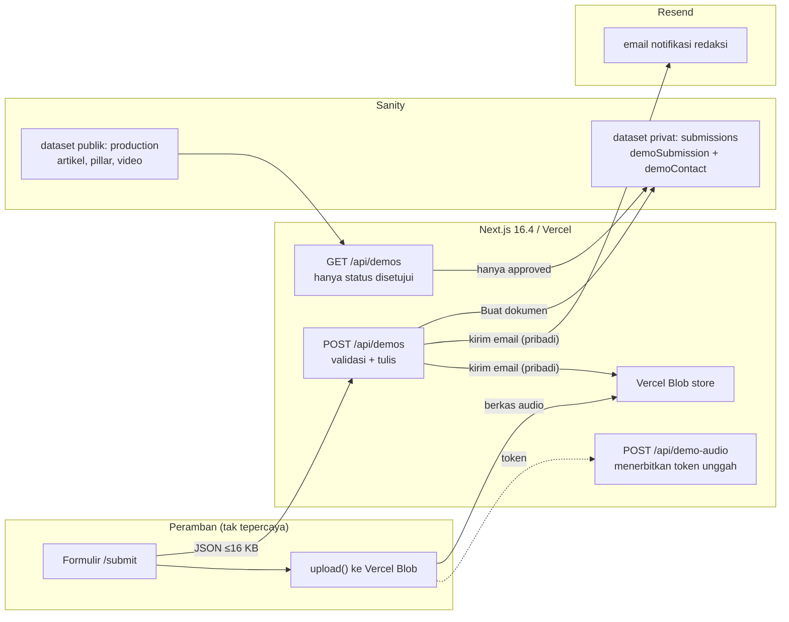

# SECURITY-PRIVACY — Melodi Alam Web Platform

> **Status dokumen: 21 Oktober 2026.** Ditulis ulang agar cocok dengan kode yang
> ada sekarang (Next.js 16.4 + Sanity Studio). Versi sebelumnya dokumen ini
> ditulis saat backend direncanakan memakai **Payload CMS 3 + Supabase**; kode
> Payload sudah dihapus dan seluruh bagian yang menyangkut PostGIS/RLS/Storage di
> dokumen lama tidak lagi berlaku. Riwayat keputusan ada di
> [`adr/0008-sanity-studio-menggantikan-payload.md`](adr/0008-sanity-studio-menggantikan-payload.md).
>
> **Audit 21 Okt 2026.** Laporan audit lengkap (keamanan + codebase + integrasi
> Sanity/Vercel + SEO) ada di [`audit-2026-10-21.md`](audit-2026-10-21.md).
> Dokumen ini mengikutinya dan meringkas; salinan artefak audit lengkap ada di
> `D:\DOCS Project Samsara - Melodi Alam\Melodi Alam Website\Audit Keamanan 2026-10-21\`.

Dokumen ini adalah **tinjauan defensif** atas platform web **Melodi Alam**
sebagaimana adanya hari ini: penanganan input, data pribadi (PII), kontrol
penyalahgunaan, dan status temuan audit yang masih terbuka.

Label status yang dipakai:

| Label | Arti |
|---|---|
| `TERVERIFIKASI` | Dibaca langsung di kode, atau dijalankan dan hasilnya diamati |
| `RENCANA` | Belum ada; target yang akan dibangun |
| `ASUMSI` | Diperkirakan, belum dikonfirmasi |
| `[PERLU VERIFIKASI]` | Secara eksplisit belum diperiksa dan butuh konfirmasi |

---

## 0. Ringkasan eksekutif

Hari ini situs **menyimpan data pribadi sungguhan**. Form demo `/submit` menulis
nama band, kota, judul, genre, program, tautan streaming/EPK, dan cerita
singkat ke dokumen `demoSubmission` di dataset Sanity **privat** `submissions`;
kontak manajer (WhatsApp/email) ditulis ke dokumen terpisah `demoContact`; dan
berkas audio — bila dilampirkan — benar-benar diunggah ke **Vercel Blob** dan
alamatnya disimpan di field `audioUrl`.

Dokumen versi lama menyatakan sebaliknya ("`contact` tidak pernah dipersistensi",
"audio tidak diunggah"). **Pernyataan itu sudah tidak benar.** Yang benar sekarang
adalah: datanya disimpan, dan justru karena itu kontrol yang kita butuhkan.

Empat hal yang paling penting:

1. **Satu temuan sudah tertutup; sisanya masih terbuka.** Pada laporan audit
   21 Okt 2026, kesepuluh temuan F01–F10 tercatat terbuka. **F01 ditutup** lewat
   allow-list host Blob (lihat §4.1). F02 ditutup sebagian: rate limit per IP, `Idempotency-Key`, dan honeypot (22 Okt 2026); F03–F10 belum disentuh.
2. **Audit berjalan tanpa sandbox OS**, jadi tidak ada satu pun kode target yang
   dieksekusi. Semua temuan berstatus `needs_validation` — **belum terkonfirmasi**,
   bukan "terbukti ada". Nilai severity di bawah adalah *severity bila
   terkonfirmasi*.
3. **`SANITY_REVALIDATE_SECRET` pernah terekspos di log percakapan** di luar repo.
   Nilai itu **sudah dirotasi dan nilai lamanya sudah mati** (22 Okt 2026): webhook
   Sanity memakai secret baru, dan secret lama menjawab **401**. Pratinjau draf
   sekarang memakai secret sendiri, `SANITY_PREVIEW_SECRET` (F03 ditutup).
4. **PII dan audio tidak pernah keluar ke jalur baca publik.** Kueri antrean
   hanya membaca status yang disetujui dan hanya memproyeksikan field tertentu
   (`app/api/demos/route.ts:122-133`). Yang bocor ke pihak ketiga adalah **email
   notifikasi redaksi** — isinya memuat kontak manajer dan `audioUrl` (F01).

### Data yang disimpan, dan di mana

| Data | Klasifikasi | Disimpan di | Terakhir dikirim ke |
|---|---|---|---|
| nama band/solois, kota, judul, genre, program, tautan, cerita | karya, quasi-publik | dokumen `demoSubmission` (dataset privat `submissions`) | antrean publik **hanya** untuk status `SHORTLISTED (SAMSARA)` / `APPROVED (ARTICLE)` |
| **kontak manajer** (WhatsApp/email) | **PII** | dokumen `demoContact` (dataset privat `submissions`, field `contact`) | email notifikasi redaksi (bila `RESEND_API_KEY` diset) |
| **berkas audio demo** | data pribadi/karya | **Vercel Blob**, `access: "public"`, key `demo-audio/<timestamp>-<nama-asli>` | URL-nya disimpan di `demoSubmission.audioUrl` dan ikut ke email redaksi |
| IP pengirim, User-Agent | PII | tidak ditangani kode | `[PERLU VERIFIKASI]` — mungkin dicatat platform |

---

## 1. Ruang lingkup dan metode

### 1.1 Yang ditinjau

| Artefak | Isi yang dibaca |
|---|---|
| `app/api/demos/route.ts` | Validasi, batas body, penyimpanan ke Sanity, notifikasi email, jalur fallback |
| `app/api/demo-audio/route.ts` | Penerbitan token unggah Blob (`handleUpload`) |
| `app/api/revalidate/route.ts` | Autentikasi webhook, pembuangan tag cache |
| `app/(site)/preview/[type]/[slug]/page.tsx` | Secret pratinjau, perspektif `drafts`, `noindex` |
| `lib/sanity.ts` · `lib/sanity-server.ts` · `lib/sanity-preview.ts` | Klien(token), dataset, perspektif, fallback secret |
| `lib/taxonomy.ts` · `lib/content-fallback.ts` | Enum demo, batas audio, artikel statis |
| `components/DemoPortal.tsx` | Form, unggah audio, object URL |
| `components/VideoModal.tsx` | Embed YouTube |
| `next.config.ts` | Header keamanan, `images.remotePatterns`, `poweredByHeader` |
| `app/(site)/layout.tsx` · `app/robots.ts` | Metadata, JSON-LD, aturan robots |
| `melodialam-sanity/sanity/schemaTypes/*` | Skema `demoSubmission`, `demoContact`, `article`, `siteSettings`, dan pemisahan dataset |

### 1.2 Metode

- **Pembacaan statis** dari sumber di kedua repo. Tidak ada server yang
  dijalankan, tidak ada endpoint produksi yang dipanggil, tidak ada exploit yang
  dicoba.
- **Audit terpisah** (skill `security-audit`, mode audit penuh) juga berjalan
  source-level dan tidak mengeksekusi kode target — lihat
  [`audit-2026-10-21.md`](audit-2026-10-21.md) §1.
- **Severity** mengikuti skala Critical / High / Medium / Low / Informational,
  dinilai dari *exploitability realistis × dampak* untuk data yang ada.

### 1.3 Yang **tidak** ditinjau

- **Sistem yang berjalan.** Tidak ada bukti runtime. Klaim yang butuh sistem
  hidup ditandai `[PERLU VERIFIKASI]`.
- **Dashboard Vercel & Sanity.** Status Blob store, Resend, anggota project,
  Firewall/WAF, dan daftar env per scope tidak bisa dikonfirmasi dari repo.
- **Kepatuhan hukum.** UU PDP dan lain-lain bukan penilaian dokumen ini.
- **Supply chain.** `npm audit` tidak dijalankan dalam tinjauan ini.

---

## 2. Gambaran sistem dan batas kepercayaan

**Batas kepercayaan:**

| # | Batas | Arah | Catatan |
|---|---|---|---|
| B1 | Peramban → `POST /api/demos` | tak tepercaya masuk | Input tak tepercaya utama; sudah divalidasi field per field |
| B2 | Peramban → `POST /api/demo-audio` | tak tepercaya masuk | **Kapabilitas unggah tidak dikunci** ke server (F04/F05) |
| B3 | Route → dataset `submissions` | internal | PII; hanya terjangkau lewat token server |
| B4 | Route → Vercel Blob | keluar | Objek **publik**; nama file asli ikut ke key |
| B5 | Route → Resend | keluar | **PII + `audioUrl`** keluar dari sistem ke penyedia email |
| B6 | Halaman → `youtube.com/embed` | keluar | `id` dari katalog/CMS, bukan input pengguna |
| B7 | Halaman → `i.ytimg.com` · `cdn.sanity.io` | keluar | Allow-list persis di `next.config.ts:86-97` |

**Aktor:** pengunjung anonim (satu-satunya aktor yang ada hari ini), kurator
redaksi (peran Sanity, bukan fitur aplikasi), pihak ketiga YouTube / Vercel Blob /
Resend / Sanity.

---

## 3. Ringkasan threat model

| # | Ancaman | Mitigasi hari ini | Residual |
|---|---|---|---|
| T1 | Spam submission membanjiri penyimpanan & biaya | Validasi field + enum + batas body 16 KB (`413`) | **Tinggi** — tanpa rate limit, tiap POST = 2 tulis Sanity + 1 email berbayar (F02) |
| T2 | Konten tak termoderasi tampil publik | Kueri antrean hanya membaca status disetujui | **Rendah** saat token terpasang; **Sedang** pada jalur fallback tanpa token (F06) |
| T3 | XSS tersimpan dari `artist`/`title`/`story`/`city` | React auto-escape; 1 `dangerouslySetInnerHTML` yang disengaja (JSON-LD, nilainya dibangun server) | **Rendah** |
| T4 | Injeksi skema URL via `link` | Regex `/^https?:\/\/.+/i` → `422` | **Rendah** |
| T5 | Clickjacking / framing | `X-Frame-Options: SAMEORIGIN` + `frame-ancestors 'self'` (CSP enforced) | **Rendah** |
| T6 | MIME sniffing / kebocoran Referer | `X-Content-Type-Options: nosniff` + `Referrer-Policy: strict-origin-when-cross-origin` | **Rendah** |
| T7 | Kebocoran PII kontak ke publik | PII di dokumen terpisah `demoContact`; kueri publik tidak pernah memintanya | **Rendah** di jalur Sanity; **Sedang** lewat email notifikasi (F01) |
| T8 | Penyalahgunaan endpoint token unggah | Token tanpa kedaluwarsa/pemakai | **Tinggi** — siapa pun bisa mencetak token tanpa meter (F04/F05) |
| T9 | Kontrol iframe embed dibajak | `id` dari sumber internal; origin YouTube tetap | **Info** |
| T10 | Pembukaan cache tanpa otorisasi | `revalidateTag` butuh secret, dibandingkan constant-time | **Sedang** — secret diterima juga lewat `?secret=` dan dipakai ganda (F03) |

---

## 4. Hasil audit 21 Oktober 2026 — F01 s.d. F10

> **Cara membaca tabel ini.** Audit berjalan **tanpa sandbox OS** (tanpa
> container, tanpa isolasi jaringan), sehingga **tidak ada satu pun kode target
> yang dieksekusi**. Konsekuensinya: **tidak ada temuan yang bisa dinyatakan
> `confirmed`** — semuanya `needs_validation` dengan langkah validasi yang
> jelas. Kolom "Severity" adalah *severity bila terkonfirmasi*, bukan vonis.
> **Status pada laporan audit: seluruh temuan belum diperbaiki.**
>
> Catatan: **F01 sudah ditutup** setelah laporan audit itu dibuat — lihat §4.1.
> Status lajur "per laporan audit" tetap mengikuti laporan aslinya; perubahan
> sesudahnya ditandai terpisah.

| # | Temuan | Severity bila terkonfirmasi | Status (per laporan audit) | Perbaikan terkecil |
|---|---|---|---|---|
| F01 | `audioUrl` diterima dari host mana pun, lalu disimpan ke dokumen yang dikurasi **dan** dikirim ke email redaksi | **High** | `needs_validation` — **ditutup 21 Okt 2026** *(lihat §4.1: host kini dibatasi ke store Blob milik operator)* | bandingkan host dengan store Blob milik operator; tolak selain itu dengan `422` |
| F02 | `POST /api/demos` tanpa rate limit/quota/CAPTCHA/idempotensi; tiap permintaan = 2 tulis Sanity + 1 email berbayar | **High** | `needs_validation` — belum diperbaiki | rate limit per IP di edge + Turnstile + `Idempotency-Key` |
| F03 | ~~satu secret (`SANITY_REVALIDATE_SECRET`) dipakai untuk **dua** kapabilitas: baca draf + invalidasi 6 tag cache, dan diterima lewat `?secret=` di URL | **Medium** | `needs_validation` — belum diperbaiki | `SANITY_PREVIEW_SECRET` terpisah; header saja; **rotasi nilai lama** |
| F04 | token unggah Blob diterbitkan untuk siapa pun; key objek tidak diikat server; `access: "public"` dipilih peramban; nama file asli ikut ke URL publik | **Medium** | `needs_validation` — belum diperbaiki | server yang menentukan key + access; bucket privat + signed URL; nama file di-sanitasi |
| F05 | token unggah bisa dicetak tanpa batas → menulis objek ke storage milik operator yang tak pernah dibersihkan | **Medium** | `needs_validation` — belum diperbaiki | grant sekali-pakai dari `/api/demos` + job pembersihan |
| F06 | tanpa token, antrean fallback dilayani **tanpa** filter status (`IN REVIEW` terbaca publik) dan submitten diberi janji "telah masuk antrean" padahal tidak tersimpan | **Low** | `needs_validation` — belum diperbaiki | filter status di kedua cabang fallback; tanpa store → `503` + log, bukan `201` |
| F07 | hapus submission di Studio meninggalkan `demoContact` (PII) dan objek audio (publik) hidup selamanya | **Low** | `needs_validation` — belum diperbaiki | aksi hapus kurator yang ikut menghapus kontak + objek; tetapkan tanggal retensi |
| F08 | `visionTool()` aktif di workspace `submissions` → GROQ bebas atas dataset privat bagi siapa pun yang punya akses workspace | **Low** | `needs_validation` — belum diperbaiki | matikan `visionTool` di workspace itu; periksa daftar anggota project |
| F09 | `DATABASE_URL` berisi password Supabase untuk layanan yang sudah tidak dipakai | **Low–Medium (operasional)** | `needs_validation` — **sebagian ditutup**: barisnya sudah dihapus dari `.env` (22 Okt 2026); rotasi password di akun Supabase belum | hapus dari `.env` (**selesai**); rotasi password di akun Supabase |
| F10 | error mentah Sanity ditulis penuh ke log operator tiap kegagalan tulis | **Informational** | `needs_validation` — belum diperbaiki | log ringkas: status, tipe error, id kiriman |

**Rekap severity:** Critical 0 · High 2 · Medium 3 · Low 3 · Informational 1 ·
operasional 1 (**total 10**).

### 4.1 Catatan per temuan

**F01 — `audioUrl` tidak terikat host.**
Pada kondisi saat laporan audit ditulis, `app/api/demos/route.ts` hanya memeriksa
dua hal: prefiks `https://` dan ekstensi yang diizinkan (`.mp3`, `.wav`, `.ogg`).
**Host-nya tidak diperiksa**, jadi siapa pun yang bisa mengirim POST bisa membuat
`audioUrl` menunjuk ke host mana saja; nilainya lalu tersimpan di
`demoSubmission.audioUrl` dan ikut di body email redaksi. Jika `RESEND_API_KEY`
diset, isi email itu keluar dari sistem. Perbaikan: allow-list host store milik
operator.

> **Perkembangan (21 Okt 2026, sudah masuk repo).** Allow-list host
> sudah ditambahkan: `isOwnBlobUrl()` (`app/api/demos/route.ts:78-87`) hanya
> menerima URL `https:` dengan host berakhiran `.blob.vercel-storage.com`, dan
> validasi `audioUrl` memanggilnya (`:287-292`). Jadi bagian *"host tidak diikat"*
> **sudah tertutup**; yang tersisa adalah mengikat store **privat**, menyanitasi
> nama file, dan membersihkan objek (masih F04/F05), serta host store yang masih
> `public`. Status F01 berubah dari *terbuka* menjadi **sebagian tertutup** —
> tetapi belum diverifikasi ulang oleh audit dan belum ada di commit.

**F02 — `POST /api/demos` tanpa rate limit.**
Tidak ada autentikasi, rate limit, CAPTCHA, honeypot, atau `Idempotency-Key`.
Batas body 16 KB (`app/api/demos/route.ts:38,226`) membatasi ukuran — bukan
jumlah. Satu permintaan yang sah = 2 dokumen Sanity (`demoSubmission` +
`demoContact`) + 1 email. Perbaikan: rate limit per IP di edge (Vercel Firewall
atau bucket di rute), Turnstile, `Idempotency-Key`.

**F03 — satu secret untuk dua kapabilitas.**
`lib/sanity-preview.ts:38-40` Reading draft used to fall back:
`process.env.SANITY_PREVIEW_SECRET ?? process.env.SANITY_REVALIDATE_SECRET ?? null`.
Selama `SANITY_PREVIEW_SECRET` **belum diset**, pratinjau draf memakai nilai yang
sama dengan secret webhook. `app/api/revalidate/route.ts:57-60` juga menerima
secret lewat `?secret=` di URL — parameter URL masuk ke log akses dan riwayat
peramban. Nilai `SANITY_REVALIDATE_SECRET` **pernah terekspos di log percakapan**
di luar repo (`git log --all -- .env` kosong, jadi bukan kebocoran repo) — tapi
eksposur di luar repo tetap berarti nilai itu harus dianggap bocor dan
**dirotasi**. Perbaikan: secret terpisah untuk pratinjau, header saja untuk
webhook, lalu rotasi nilai lama.

> **Perkembangan 22 Okt 2026 — rotasi tuntas.** `SANITY_PREVIEW_SECRET`
> dipasang sebagai secret terpisah dan **fallback-nya dihapus** dari
> `lib/sanity-preview.ts`; `SANITY_REVALIDATE_SECRET` **dirotasi**, webhook Sanity
> diarahkan ke nilai baru, dan `SANITY_REVALIDATE_SECRET_PREVIOUS` dikosongkan —
> secret lama kini menjawab **401** (dibuktikan: publish → halaman segar dalam
> 8,2 detik). Rute pratinjau menjawab **404** untuk secret yang salah, karena
> pemeriksaannya dipindah ke `proxy.ts` yang berjalan sebelum halaman dirender.
>
> **Yang tersisa:** cabut penerimaan `?secret=` di `/api/revalidate`, dan
> pertimbangkan verifikasi tanda tangan `sanity-webhook-signature` sebagai ganti
> header buatan sendiri.

**F04/F05 — kapabilitas unggah Blob tidak terikat server.**
`app/api/demo-audio/route.ts:23-35` memanggil `handleUpload` tanpa
pemeriksaan identitas. `onBeforeGenerateToken` mengunci tipe MIME dan ukuran,
tapi **pathname-nya tetap datang dari peramban** dan `access: "public"` dipilih
di sisi peramban (`components/DemoPortal.tsx:115-121`), bersama nama file asli
di dalam key. Token juga bisa dicetak tanpa batas (F05). Perbaikan: server yang
menentukan key + access, bucket privat + signed URL, grant sekali-pakai, dan job
pembersihan objek.

**F06 — jalur fallback melewati moderasi.**
Tanpa `SANITY_API_READ_TOKEN`, `submissionsClient` bernilai `null`
(`lib/sanity-server.ts:24-33`) dan route memakai array proses-lokal.
`GET` mengembalikan **seluruh** array tanpa filter status
(`app/api/demos/route.ts:137-152`), dan `POST` membalas `201`
(`:282-290`) walau tidak ada yang tersimpan permanen — antrean yang dijanjikan
hilang saat restart. Perbaikan: filter status di kedua cabang; tanpa store →
`503` + log.

**F07 — penghapusan tidak berantai.**
Tidak ada endpoint kurator dan tidak ada hook penghapusan; `demoContact`
terhubung lewat `reference` yang tidak otomatis ikut terhapus, dan objek audio
di Blob tidak pernah dibersihkan. Perbaikan: aksi hapus kurator yang menghapus
kontak + objek, plus tanggal retensi.

**F08 — `visionTool` di workspace privat.**
`melodialam-sanity/sanity.config.ts:46` mengaktifkan `visionTool()` juga pada
workspace `submissions`. Siapa pun yang punya akses workspace itu bisa
menjalankan GROQ bebas atas dataset privat. Perbaikan: matikan di workspace
privat; audit daftar anggota & peran project.

**F09 — sisa password Supabase di `.env`.**
`DATABASE_URL` **sudah dihapus** dari `.env` lokal (22 Okt 2026), dan memang **0** rujukan kode
memakainya (`grep DATABASE_URL` di `*.ts|*.tsx|mjs|js` → 0 hasil). Ini sisa
layanan yang sudah ditinggalkan, tetapi passwordnya masih hidup di file.
Perbaikan: hapus barisnya dari `.env`, lalu rotasi password di akun Supabase.

**F10 — log error mentah.**
`app/api/demos/route.ts:359` (`console.error("[api/demos] gagal menyimpan ke Sanity:", error)`)
dan `app/api/demo-audio/route.ts:39` menulis objek error apa adanya. Perbaikan:
log ringkas (status, tipe error, id kiriman) — jangan log payload.

### 4.2 Satu kandidat gugur saat verifikasi

Hipotesis stored XSS lewat `href` Portable Text **dibatalkan** oleh verifikasi
independen: React 19.3 membersihkan `javascript:` di `href` pada render server
maupun client, dan situs ini tidak punya sesi/cookie/storage yang bisa
dikompromikan. Diturunkan menjadi catatan hardening: `components/ArticleBody.tsx`
sebaiknya meng-override `marks.link` dengan allowlist skema (http/https/mailto/tel)
— aturan `Rule.uri` di Studio hanya berlaku di form, bukan di Content Lake.

### 4.3 Catatan hardening lain (bukan temuan)

- `lib/sanity-server.ts` dan `lib/sanity-preview.ts` memegang token tetapi tidak
  memakai `import "server-only"`. Graf impor sudah dijaga, jadi risikonya
  rendah — tapi penanda itu akan menjadikannya jaminan build-time, bukan
  konvensi saja.
- `xml()` di `app/rss.xml/route.ts` belum membuang karakter terlarang XML 1.0,
  jadi satu judul berisi karakter kontrol membuat seluruh feed tidak valid.
- `fromCms` tidak mem-type-check `imagePath`; satu dokumen rusak bisa menggagalkan
  seluruh `/rss.xml`.
- `components/VideoModal.tsx:33` memvalidasi `id` dari event `melodi:watch` hanya
  dengan cek non-kosong sebelum menyisipkannya ke URL embed YouTube. Hostnya
  tetap terkunci, jadi dampaknya kecil.
- ~~`JSON.parse(raw)` bisa mengembalikan `null`~~ → **Ditutup.** Body `null` atau
  array kini ditolak `400` sebelum field dibaca (`app/api/demos/route.ts:232-237`).
- Ukuran audio kini dibaca sebagai angka **atau** string angka
  (`bytes()`, `app/api/demos/route.ts:65-69`), jadi batas 25 MB tidak bisa dilewati
  dengan mengirim `"0"`.

---

## 5. Temuan dari tinjauan dokumen ini (SEC-Fxx) — status terhadap kode sekarang

Tabel ini menggantikan daftar temuan versi lama, yang ditulis saat antrean demo
masih berupa array proses-lokal. **Baris yang sudah tertutup dicoret; baris yang
masih terbuka|jadi temuan berjalan.**

| ID | Temuan (versi lama) | Status 21 Okt 2026 |
|---|---|---|
| SEC-F01 | Membran keamanan HTTP tidak ada | ~~Terbuka~~ → **Ditutup sebagian.** `next.config.ts:56-78` kini mengirim `X-Content-Type-Options`, `Referrer-Policy`, `X-Frame-Options`, `Permissions-Policy`, HSTS, CSP **enforced** + CSP **report-only**. Sisa: CSP enforced belum punya `script-src` (`next.config.ts:9-12`), jadi satu-satunya penjaga XSS masih React. `RENCANA` |
| SEC-F02 | Permukaan penyalahgunaan tanpa kontrol | **Terbuka** — secara teknis bukan lagi "tanpa batas body" (16 KB, `route.ts:38`), tapi **tanpa rate limit/CAPTCHA/idempotensi** = temuan audit **F02** |
| SEC-F03 | Batas audio 25 MB tidak ditegakkan | ~~Terbuka~~ → **Ditutup.** Tiga lapis: klien (`DemoPortal.tsx:81-84`), token server (`demo-audio/route.ts:28`), dan body's `audioSize` (`demos/route.ts:278-280`). Lapisan ketiga baru benar-benar menyala pada 21 Okt 2026: sebelumnya klien mengirim ukuran sebagai string, sehingga pemeriksaannya tidak pernah dijalankan. Diuji: 30 MB → `422` |
| SEC-F04 | `link` menampilkan tujuan eksternal arbitrer | **Terbuka (Low)** — skema `http(s)` tetap ditegakkan (`demos/route.ts:262` → `422`); tidak ada allowlist host |
| SEC-F05 | `note` memantulkan `contact` mentah | ~~Terbuka~~ → **Ditutup.** `note` kini teks statis ("Kontak manajer tersimpan terpisah dan tidak tampil di antrean publik.", `demos/route.ts:325,409`) — nilai kontak tidak lagi dipantulkan |
| SEC-F06 | Object URL pratinjau audio tidak di-revoke | ~~Terbuka~~ → **Ditutup.** `useEffect` cleanup ada (`DemoPortal.tsx:37-42`) |
| SEC-F07 | Tidak ada batas ukuran body | ~~Terbuka~~ → **Ditutup.** `MAX_BODY_BYTES = 16 * 1024` → `413` (`demos/route.ts:38,226-228`) |
| SEC-F08 | ID video YouTube tidak divalidasi bentuk | **Terbuka (Low/defense in depth)** — masih hanya cek non-kosong (`VideoModal.tsx:33`) |
| SEC-F09 | `X-Powered-By` terpapar | ~~Terbuka~~ → **Ditutup.** `poweredByHeader: false` (`next.config.ts:54`) |
| SEC-F10 | `rel="noreferrer"` tanpa `noopener` eksplisit | **Terbuka (Informational)** — `noreferrer` menyiratkan `noopener` di peramban modern; hanya `VideoModal.tsx:157` yang menulis keduanya eksplisit |

---

## 6. Penilaian privasi

### 6.1 Inventaris data

| Data | Klasifikasi | Disimpan di | Retensi hari ini |
|---|---|---|---|
| `artist`, `city`, `title`, `genre`, `program`, `link`, `story` | karya / quasi-publik | dokumen `demoSubmission` di dataset privat `submissions` | sampai dihapus manual di Studio |
| **`contact`** | **PII** | dokumen `demoContact` di dataset privat `submissions` | sampai dihapus manual; **tidak** ikut terhapus bersama submission (F07) |
| `audioName`, `audioUrl` | data karya | dokumen `demoSubmission` + objek di Vercel Blob (`access: "public"`) | tidak dihapus otomatis; retensi 90 hari masih `RENCANA` |
| IP pengirim, User-Agent | PII | tidak ditangani kode | `[PERLU VERIFIKASI]` — mungkin dicatat platform |
| `submittedAt` | internal | dokumen `demoSubmission` | sampai dihapus manual |

**Klasifikasi:** tidak ada data sensitif (kesehatan, keuangan, kredensial).
Kandidat PII ada dan **benar-benar tersimpan**: kontak manajer, nama band, dan
kota asal.

### 6.2 Yang sudah aman — dinyatakan eksplisit

| Cek | Hasil | Bukti |
|---|---|---|
| `dangerouslySetInnerHTML` di repo | **1 hasil, disengaja** | JSON-LD `WebSite`/`Organization` di `app/(site)/layout.tsx:146-149`; nilainya dibangun server, bukan input pengguna |
| XSS dari `artist`/`city`/`title`/`genre`/`story` | **Aman** — React auto-escape | seluruh render form memakai JSX text |
| XSS dari `href` Portable Text | **Aman** (React 19.3 membersihkan `javascript:`); tetap pengganti allowlist skema = `RENCANA` | `components/ArticleBody.tsx` |
| `javascript:`/`data:` via `link` | **Aman** — ditolak `422` | `demos/route.ts:262` |
| PII kontak di jalur baca publik | **Aman** — `GET` hanya memilih field non-PII dan hanya status disetujui | `demos/route.ts:122-133` |
| PII kontak di email redaksi | **Bocor ke pihak ketiga** — lihat F01 | `demos/route.ts:193-194` |
| Audio bocor lewat URL | **Bocor** — objek `access: "public"`, nama file asli di key | `DemoPortal.tsx:115-121`; lihat F04 |
| `contact` dipantulkan di respons | **Aman** — `note` sudah teks statis | `demos/route.ts:325,409` |
| Allow-list gambar remote | **Ketat** — `i.ytimg.com/vi/**` + `cdn.sanity.io/images/**` via HTTPS | `next.config.ts:86-97` |
| Origin iframe embed | **Tetap** — `www.youtube.com` / `www.youtube-nocookie.com` | `VideoModal.tsx`, CSP `frame-src` |
| Secret di dalam repo | **Tidak ada** — `.gitignore` menutup `.env*` (kecuali `.env.example`) | `.gitignore:33-36` |
| `DATABASE_URL` dipakai kode | **Tidak** — 0 rujukan | `grep` lintas `*.ts,tsx,mjs,js` |

### 6.3 Risiko privasi

1. **Data disimpan tanpa pemberitahuan privasi yang jujur.** Form `/submit`
   belum memuat pemberitahuan privasi (§8.1). Tanpa itu, pengumpul data
   pribadi tidak memberi Bases yang benar.
2. **PII keluar lewat email.** `notifyNewSubmission` menyusun teks yang memuat
   `entry.contact` **dan** `entry.audioUrl` (`demos/route.ts:186-199`). Begitu
   `RESEND_API_KEY` diset, data pribadi dikirim ke penyedia email pihak ketiga.
   Saat ini belum diset → **inert**.
3. **Blob publik.** Audio demo berada di bucket `access: "public"`; siapa pun
   yang tahu URL-nya bisa mengunduhnya, dan URL itu ikut ke email.
4. **Retensi belum ditetapkan.** Tidak ada job penghapusan, tidak ada tanggal
   retensi di kode untuk dokumen `demoSubmission`, `demoContact`, maupun objek
   Blob.
5. **Penghapusan tidak berantai.** Menghapus `demoSubmission` di Studio tidak
   menghapus `demoContact` (PII) maupun objek audio (F07).
6. **Jalur fallback.** Tanpa token, kiriman "dibuat" hanya di memori proses dan
   hilang saat restart (F06).
7. **Yurisdiksi.** Produk beroperasi di Indonesia; kewajiban UU PDP harus
   dipastikan bersama penasihat hukum, bukan diasumsikan dari dokumen ini.

---

## 7. Kontrol yang belum ada (`RENCANA`)

Semua di §7 **belum diimplementasikan**. Tidak ada satu pun yang boleh dibaca
sebagai klaim keadaan sekarang.

| Kontrol | Kenapa | Status |
|---|---|---|
| **Rotasi `SANITY_REVALIDATE_SECRET`** | nilai pernah terekspos di log percakapan | `RENCANA` — **P0** |
| **`SANITY_PREVIEW_SECRET` terpisah** | satu secret untuk dua kapabilitas (F03) | **`TERVERIFIKASI`** — dipasang, fallback dihapus, `SANITY_REVALIDATE_SECRET` dirotasi (22 Okt 2026) |
| **Blokir `?secret=`** di `/api/revalidate` | secret di URL masuk log & riwayat | `RENCANA` |
| **Allow-list host `audioUrl`** | F01 | **`TERVERIFIKASI`** — `isOwnBlobUrl()` menolak host di luar `*.blob.vercel-storage.com`; diuji: host asing → `422` |
| **Rate limit + `Idempotency-Key`** | F02 | **`TERVERIFIKASI`** 22 Okt 2026 — 5 kiriman/jam per IP di `POST /api/demos`, 20 token/jam di `POST /api/demo-audio`, `Idempotency-Key` + honeypot. Turnstile masih `RENCANA` |
| **Grant unggah sekali-pakai** dari `/api/demos` | F04/F05 | `RENCANA` |
| **Server menentukan key + access object Blob**; nama file di-sanitasi | F04 | `RENCANA` |
| **Filter status di jalur fallback**; tanpa store → `503` | F06 | `RENCANA` |
| **Aksi hapus kurator berantai** (kiriman + kontak + objek) | F07 | `RENCANA` |
| **Matikan `visionTool` di workspace `submissions`** | F08 | `RENCANA` |
| **Hapus `DATABASE_URL` + rotasi password Supabase** | F09 | **sebagian** — baris di `.env` sudah dihapus (22 Okt 2026); rotasi password di akun Supabase tetap `RENCANA` |
| **Log ringkas tanpa payload** | F10 | `RENCANA` |
| **Bucket privat + signed URL berumur pendek** untuk audio | kebocoran lewat URL | `RENCANA` |
| **Job retensi** (arsip audio 90 hari, hapus kontak bersama kiriman) | retensi | `RENCANA` |
| **Pemberitahuan privasi live di form `/submit`** | kewajiban saat mengumpulkan PII | `RENCANA` |
| **Audit log keputusan kurator** (`reviewed_by`, `reviewed_at`, `review_note`) | akuntabilitas | `RENCANA` — status diubah manual di Studio |
| **Rotasi berkala secret editorial** |Umur secret tak terbatas | `RENCANA` |
| **`script-src` pada CSP enforced** | satu-satunya penjaga XSS sekarang React | `RENCANA` |
| **Allowlist skema `marks.link`** | defense in depth | `RENCANA` |
| **`import "server-only"`** di `lib/sanity-server.ts` + `lib/sanity-preview.ts` | jaminan build-time | `RENCANA` |
| **Turnstile** pada `/submit` | gerbang manusia | `RENCANA` |

> **Catatan.**
> Controller RLS/Postgres, signed-URL bucket Supabase, dan `service_role`
> seperti yang disebut di versi dokumen ini **tidak ada lagi** — backend-nya
> Sanity + Vercel Blob, bukan Supabase. Lihat
> [`adr/0008-sanity-studio-menggantikan-payload.md`](adr/0008-sanity-studio-menggantikan-payload.md).

---

## 8. Prioritas remediasi

### 8.1 P0 — sebelum menyalakan fitur baru

1. **Rotasi `SANITY_REVALIDATE_SECRET`** dan pasang `SANITY_PREVIEW_SECRET`
   terpisah; hapus penerimaan `?secret=` di kedua rute. (F03)
2. **Pasang Blob store** di Vercel → `BLOB_READ_WRITE_TOKEN` ikut terpasang,
   lalu perbaiki `app/api/demo-audio/route.ts` (server menentukan key + access)
   dan `app/api/demos/route.ts` (tolak `audioUrl` dari host asing — allow-list
   host **sudah masuk repo**). (F01/F04/F05)
3. **Tambahkan rate limit** untuk `POST /api/demos` + `POST /api/demo-audio`,
   plus `Idempotency-Key`. (F02)
4. **Hapus `DATABASE_URL` dari `.env`** dan rotasi password Supabase-nya. (F09)

### 8.2 P1 — konsistensi & kejujuran

5. **Centang Update** di webhook Sanity; samakan filternya dengan 7 tipe yang
   punya tag cache. (lihat [`SANITY-INTEGRATION.md`](SANITY-INTEGRATION.md) §11)
6. **Matikan `visionTool`** di workspace `submissions`; audit daftar anggota. (F08)
7. **Aksi hapus kurator** yang ikut menghapus `demoContact` + objek audio;
   tetapkan tanggal retensi. (F07)
8. **Filter status di jalur fallback**; tanpa store → `503`, bukan `201`. (F06)
9. **Log ringkas** tanpa payload pada semua kegagalan tulis. (F10)
10. **Hapus export mati** (`demoStoreConfigured`, `draftPreviewConfigured`,
    `videosByIds`, `videosByVenue`); cabut `cardCurtain.featureLabel`/`featureCta`
    dari skema Studio.

### 8.3 P2 — polish

11. **Pasang `RESEND_API_KEY`** → notifikasi email hidup; set `DEMO_NOTIFY_TO`.
    Periksa dulu apa isi email sebelum menyalakannya (PII keluar, F01).
12. **Pemberitahuan privasi live di form `/submit`**.
13. **`script-src` pada CSP enforced**; allowlist skema `marks.link`; `typeof`
    check untuk `imagePath`; buang karakter terlarang XML di `xml()`.
14. **`import "server-only"`** di dua berkas Sanity server.
15. **Aktifkan Vercel Web Analytics** di dashboard.
16. **Lampirkan domain `melodialam.id`** → semua canonical ikut benar.
17. `npm audit` + kebijakan pemutakhiran dependensi.

---

## 9. Checklist Keamanan Pra-Rilis

| # | Cek | Acuan | Fase |
|---|---|---|---|
| C1 | `SANITY_REVALIDATE_SECRET` sudah dirotasi | F03 | `RENCANA` |
| C2 | `SANITY_PREVIEW_SECRET` diset & berbeda | F03 | `RENCANA` |
| C3 | `?secret=` tidak lagi diterima | F03 | `RENCANA` |
| C4 | `audioUrl` menolak host di luar store operator | F01 | `TERVERIFIKASI` — host asing → `422` |
| C5 | Rate limit + `429`/`Retry-After` di `POST /api/demos` & `/api/demo-audio` | F02 | `RENCANA` |
| C6 | `Idempotency-Key` didukung | F02 | `RENCANA` |
| C7 | Turnstile terpasang & diverifikasi server | F02 | `RENCANA` |
| C8 | Key objek & `access` ditentukan server; nama file disanitasi | F04 | `RENCANA` |
| C9 | Grant unggah sekali-pakai + limit | F05 | `RENCANA` |
| C10 | Jalur fallback memfilter status; tanpa store → `503` | F06 | `RENCANA` |
| C11 | Hapus berantai: kiriman + kontak + objek audio | F07 | `RENCANA` |
| C12 | `visionTool` mati di workspace `submissions` | F08 | `RENCANA` |
| C13 | `DATABASE_URL` dihapus dari `.env`; password Supabase dirotasi | F09 | `RENCANA` |
| C14 | Log tidak memuat payload kiriman | F10 | `RENCANA` |
| C15 | Bucket audio privat + signed URL | privasi | `RENCANA` |
| C16 | Retensi audio 90 hari berjalan | retensi | `RENCANA` |
| C17 | Pemberitahuan privasi tampil di form | privasi | `RENCANA` |
| C18 | Audit log keputusan kurator (`reviewed_by/at/note`) | akuntabilitas | `RENCANA` |
| C19 | Header keamanan lengkap | SEC-F01 | `TERVERIFIKASI` |
| C20 | `poweredByHeader: false` | SEC-F09 | `TERVERIFIKASI` |
| C21 | Batas audio 25 MB di klien + server + token | BR-001 | `TERVERIFIKASI` |
| C22 | Batas ukuran body sebelum parse | SEC-F07 | `TERVERIFIKASI` |
| C23 | `link` tetap dibatasi skema `http(s)` | SEC-F04 | `TERVERIFIKASI` |
| C24 | `contact` tidak pernah masuk log/observability | privasi | `TERVERIFIKASI` |
| C25 | Nol `dangerouslySetInnerHTML` di luar JSON-LD | XSS | `TERVERIFIKASI` |
| C26 | `npm audit` bersih atau risiko diterima tertulis | supply chain | `[PERLU VERIFIKASI]` |

**Blocker yang berdiri sendiri dan wajib lewat sebelum rilis:** C1–C5, C10,
C17 — plus C8/C15/C16 bila unggahan audio tetap aktif.

---

## 10. Keterbatasan dan item yang perlu review spesialis

- **Bukan penetration test.** Semua pemeriksaan bersifat source-level; tidak ada
  kode target yang dieksekusi (audit dan tinjauan ini). Efektivitas kontrol
  runtime belum terbukti.
- **Tidak ada temuan yang terkonfirmasi.** Semua F01–F10 `needs_validation`.
- **Bukan penilaian kepatuhan.** UU PDP (atau yurisdiksi lain) memerlukan
  penasihat hukum.
- **Supply chain belum diperiksa.** `npm audit` tidak dijalankan; status
  kerentanan `next@16.4.2`, `react@19.3.0`, `motion` `[PERLU VERIFIKASI]`.
- **Header platform.** Sebagian header mungkin disuntik Vercel; konfirmasi lewat
  respons produksi.
- **Temuan bergantung pada fakta saat ini.** Kalau layout data atau secret
  berubah, tabel severity harus dihitung ulang.
- **Rekomendasi khusus.** Sebelum mengumpulkan PII nyata: review legal atas
  pemberitahuan privasi + periode retensi, dan (bila volume tinggi) uji beban
  untuk batas rate limit.

---

## Catatan Verifikasi (Verification Notes)

**Dibaca langsung dari sumber** (repo `melodi-alam` dan `melodialam-sanity`):

- `app/api/demos/route.ts` (**413 baris, penuh**) — `MAX_BODY_BYTES = 16 * 1024`
  (`:38`); `str()` trim+slice (`:54-56`); `bytes()` menerima ukuran audio sebagai
  angka **atau** string angka (`:65-69`); `isOwnBlobUrl()` hanya menerima host
  `*.blob.vercel-storage.com` dengan skema `https:` (`:78-87`); `APPROVED_QUERY`
  hanya memilih status disetujui dan **tidak** pernah memilih
  `contact`/`audioUrl`/`audioName` (`:122-133`); `GET` jatuh ke `memoryQueue`
  **tanpa filter status** bila token absen (`:137-152`); kueri antrean memakai
  `cache: "no-store"` (`:146`); `notifyNewSubmission` memuat `entry.contact` dan
  `entry.audioUrl` ke badan email (`:186-199`); early-return `413` sebelum parse
  (`:226-228`); guard `JSON.parse` untuk `null`/array (`:232-237`); validasi
  `link` (`:262`); validasi `audioName`/`audioSize` (`:273-281`); validasi
  `audioUrl` — ekstensi **dan** host store operator (`:287-292`);
  `memoryContacts.set` + `memoryQueue.unshift` pada jalur fallback (`:317-318`);
  `note` statis (`:325`, `:409`); dua `submissionsClient.create` (`:334`, `:352`);
  `console.error` error mentah (`:359`).
- `app/api/demo-audio/route.ts` (**45 baris, penuh**) — `handleUpload` tanpa
  pemeriksaan identitas (`:23`); `allowedContentTypes` + `maximumSizeInBytes` +
  `addRandomSuffix` (`:26-30`); `onUploadCompleted` kosong (`:31-34`); `400` +
  log error mentah (`:38-43`).
- `app/api/revalidate/route.ts` (**69 baris, penuh**) — 6 tag di `CONTENT_TAGS`
  (`:30-37`); `timingSafeEqual` dengan cek panjang (`:39-45`); secret dibaca dari
  header `x-webhook-secret` **atau** `?secret=` (`:57-60`); `401` kalau tidak
  cocok (`:62-64`).
- `app/(site)/preview/[type]/[slug]/page.tsx` (**202 baris, penuh**) — `robots:
  { index: false, follow: false }` (`:22`); `instant = false` (`:31`); 404 kalau
  secret tidak cocok (`:106`); perspektif `drafts` lewat `draftClient`; tipe
  `journal` dan `kurasi`.
- `lib/sanity-preview.ts` (**51 baris, penuh**) — `SANITY_PREVIEW_SECRET ??
  SANITY_REVALIDATE_SECRET ?? null` (`:38-40`); `secretMatches` constant-time
  (`:43-50`).
- `lib/sanity-server.ts` (**34 baris, penuh**) — `submissionsClient` bernilai
  `null` tanpa token (`:24-33`); `useCdn: false`; `perspective: "published"`.
- `lib/sanity.ts` (**70 baris, penuh**) — `contentClient` **tanpa token**,
  `perspective: "published"` (`:30-41`); `SANITY_API_VERSION = "2026-05-19"`.
- `lib/taxonomy.ts` — `DEMO_INITIAL_STATUS = "IN REVIEW"` (`:63`);
  `DEMO_APPROVED_STATUSES` (`:69`); `DEMO_AUDIO_MAX_BYTES = 25 * 1024 * 1024`
  (`:76`); `DEMO_AUDIO_TYPES` (`:77`); `DEMO_AUDIO_EXTENSIONS` (`:78`).
- `components/DemoPortal.tsx` (**401 baris**) — `useEffect` revoke object URL
  (`:37-42`); cek ekstensi + tipe + ukuran 25 MB di klien (`:63-84`);
  `payload` bertipe `Record<string, string \| number>` karena ukuran audio dikirim
  sebagai angka (`:105-107`); `upload()` dengan `access: "public"`,
  `handleUploadUrl: "/api/demo-audio"`, key
  `demo-audio/${Date.now()}-${audioFile.name}` (`:115-121`).
- `components/VideoModal.tsx` — `id` dari `CustomEvent`, hanya cek non-kosong
  (`:32-33`); `rel="noopener noreferrer"` (`:157`).
- `next.config.ts` (**110 baris, penuh**) — CSP enforced 4 direktif (`:9-12`);
  CSP report-only lengkap dengan `script-src` dan host Blob di `connect-src`
  (`:29-47`); `poweredByHeader: false` (`:54`); `headers()` (`:56-78`);
  `images.remotePatterns` 2 host (`:86-97`).
- `app/(site)/layout.tsx` — metadata + `metadataBase` (`:52-82`); JSON-LD lewat
  `dangerouslySetInnerHTML` (`:146-149`); `<Analytics />` (`:181`).
- `app/robots.ts` — `allow: "/"`, `disallow: "/api/"`; `/preview` **tidak**
  ditutup (agar `noindex`-nya terbaca crawler).
- `melodialam-sanity/sanity/schemaTypes/` — `demoSubmission` (12 field,
  termasuk `audioName`/`audioUrl` `readOnly`) dan `demoContact` (`submission`
  reference + `contact`); `article.mediaType` `foto`/`reel` dengan
  `initialValue: "foto"`; `siteSettings.cardCurtain` hanya `articleLabel` +
  `articleCta`; `sanity.config.ts:37,46` — `visionTool()` aktif di **kedua**
  workspace.

**Diverifikasi dengan menjalankan:** `npm test` → 20/20 lulus (`lib/content-fallback.test.ts`,
Vitest 3.2.7); `npm run build` → lulus, **33 halaman statis** (`Next.js 16.4.2`,
Turbopack).

**Tidak diperiksa (butuh akses akun):** status Blob store & Resend di Vercel,
daftar env per scope, daftar anggota & peran Sanity, apakah Firewall/WAF aktif,
apakah `melodialam.id` sudah diarahkan, dan apakah nilai `DATABASE_URL` masih
hidup.

**Tidak dieksekusi:** seluruh kode target — audit dan tinjauan ini keduanya
source-level. Karena itu tidak ada temuan berstatus `confirmed`.

---

## Open Questions

1. **Berapa lama `demoContact` dan objek audio disimpan?** Tidak ada angka retensi
   di kode; `demoContact` juga tidak ikut terhapus bersama submission (F07).
   Perlu ditetapkan sebelum PII dikumpulkan lebih lama.
2. **Apakah email notifikasi boleh membawa `contact` dan `audioUrl`?** Saat ini
   iya (F01). Kalau dilarang, jalurnya perlu diubah — mis. tautan internal ke
   dokumen, bukan lampiran.
3. **Bucket Blob publik atau privat?** `access: "public"` dipilih di peramban.
   Kepindahannya ke privat + signed URL mengubah alur unduh di Studio.
4. **Siapa saja anggota workspace `submissions`?** Viewer sudah bisa menjalankan
   `visionTool` atas dataset privat (F08).
5. **Apakah `melodialam.id` akan jadi origin produksi?** Selama belum, canonical,
   sitemap, OG, dan `robots.host` menunjuk ke `https://melodialam-website.vercel.app`
   karena `NEXT_PUBLIC_SITE_URL` diarahkan ke situ (default di kode:
   `https://melodialam.id`, `lib/site.ts:18`).
6. **Apakah `SANITY_API_READ_TOKEN` punya akses baca ke dataset `production`?**
   Kalau tidak, pratinjau draf 404 — bukan bocor. Perlu dipastikan agar
   diagnosis 404 tidak salah arah.
7. **Apakah `DATABASE_URL`/password Supabase masih hidup?** Perlu rotasi kalau
   iya.
8. **Bagaimana rate limit diimplementasikan di Vercel multi-instance?** Penghitung
   in-memory tidak boleh dipakai; butuh Firewall, bucket, atau store terpisah.
